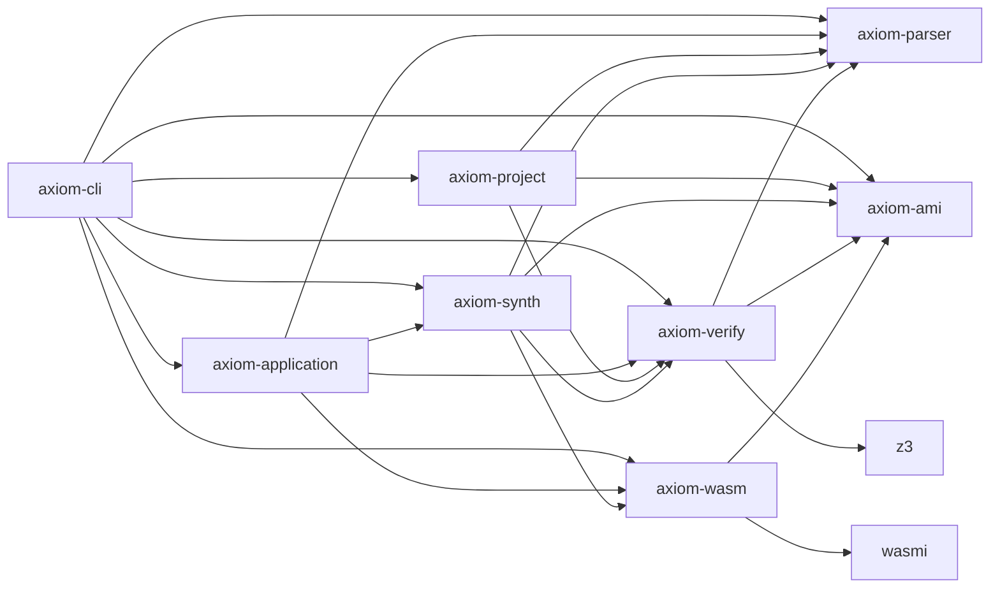

# Synthetix Target Architecture

## 1. System Overview

Synthetix is a Cargo workspace with eight decoupled crates. The first usable
vertical slice now covers parsing, bounded synthesis, Z3 verification, direct
WASM emission, embedded WASM execution, project linking, and a browser dev
loop. The v4 proof core supports pure `u32`, `i32`, and `bool` computations;
browser state, rendering, and host APIs remain outside that proof boundary.

Cargo dependency direction:



---

## v5.0 Application Boundary

The graph above shows workspace dependencies. At runtime, the v5 application
call path uses the one-way boundary below:

```text
axiom-cli app-run
       │
       ▼
axiom-application ────────┬── axiom-parser (contract signature)
  ApplicationValue        ├── axiom-synth ── axiom-ami / axiom-verify / axiom-wasm
  validation + lowering   ├── axiom-verify
  WASM call + lifting     └── axiom-wasm
       │
       └── EffectRequest → generated v5.5 host adapter boundary
```

`axiom-application` depends on the parser and verified-core crates. No verified
core crate depends on `axiom-application`, browser APIs, HTTP, or storage. The
CLI's generated browser host in `axiom-cli/src/web.rs` owns DOM, fetch,
`localStorage`, and rendering behavior; those operations are outside the proof.
Pure contract bodies continue to execute from verified WASM exports.

`axiom-application` exposes `VerifiedComputation`, `ApplicationCall`, and
`EffectRequest` as distinct representations. `app-run` is the executable
vertical slice. The existing `run` command remains the v4 command path.

Web builds carry imported `extern` signatures as host metadata. The signatures
do not become WASM exports; the host adapter validates request and response
types and keeps external results in application state until a caller explicitly
passes supported scalars to a verified export.

## v5.1 Thin Browser Runtime

The generated browser runtime validates top-level scalar input values against
their declared type, calls verified exports from `app.wasm`, stores the lifted
result in page state, and renders the updated state. It exposes a small host
adapter hook for `{ name, inputs }` effect requests; an adapter result can
update application state without entering the proof core. Runtime errors carry
the source path and remain application errors. Page/UI expression evaluation
stays in JavaScript, while verified contract bodies run only in WASM.

Page reducers stage ordered updates against a cloned application state and
commit only after every verified WASM call succeeds. A failed update leaves the
original state in place and reports an application transition failure separately
from proof results.

---

## 2. Detailed Crate Responsibilities

### `crates/axiom-ami` — implemented
- **Role**: Intermediate Representation (IR) for synthesis and verification.
- **Dependencies**: None (must stay zero-dependency).
- **Current scope**:
  - Expr: Tree representing computations (Arg, Const, arithmetic, unsigned
    comparisons, Boolean operators, and Select).
  - `eval(&self, args: &[u32]) -> u32`: High-speed concrete interpreter enforcing modulo $2^{32}$ wrap-around arithmetic.
- **Current scope**: candidate enumeration lives in `axiom-synth`; this crate
  exposes the WASM instruction cost used to order candidates.

### `crates/axiom-parser` — implemented, minimal
- **Role**: Front-end parser for the Axiom specification language (`.ax`).
- **Input**: UTF-8 source string.
- **Output**: Typed `Contract` AST containing:
  - Function signature: parameters, parameter types, return type.
  - `requires`: Pre-conditions constraining the valid input domain.
  - `ensures`: Post-conditions that must hold for `result`.
- **Current limitation**: grammar and semantic rules are intentionally limited to
  pure scalar `u32`/`i32`/`bool` values with finite conditional expressions;
  source errors now include line and column positions.

### `crates/axiom-project` — v2
- **Role**: Project manifest loading and module linking.
- **Input**: `synthetix.toml` plus the entry `.ax` file.
- **Behavior**: Follows explicit relative imports, enforces exports, detects
  cycles, and retains original contract summaries alongside the legacy
  runtime-expanded view.
- **Boundary**: Called contracts must currently have a single result equality
  and no requires clauses in the legacy runtime expansion. The verifier's
  compositional API uses the original summaries and discharges call-site
  preconditions before assuming callee postconditions.

### `crates/axiom-verify` — implemented subset
- **Role**: The oracle of correctness.
- **Key Invariant**: Must be completely independent of `axiom-synth`. It does not know *how* candidates are generated; it only validates or refutes them.
- **Mechanics**:
  - Formulates the verification condition:
    $$\Phi(x) = \text{Requires}(x) \land (\text{Candidate}(x) \neq \text{Ensures}(x))$$
  - Submits $\Phi(x)$ to Z3 SMT Solver (bit-vector theory `QF_BV`).
  - If UNSAT, the candidate satisfies the specification for all $2^{32}$ inputs.
- **Current limitation**: supports the current pure scalar expression subset and
  bundled Z3; it does not yet cover loops, memory, host effects, or external
  provenance signatures. CLI reports carry verification state and artifact
  integrity fingerprints, while correctness remains the `ProofResult` plus
  backend conformance contract.

### `crates/axiom-synth` — bounded
- **Role**: Enumerative program synthesizer with formal candidate verification.
- **Algorithm (v0.1)**:
  1. Maintain a set of concrete test cases (starts with e.g. `{0, 1, 2, u32::MAX}`).
  2. Enumerate candidate AMI expressions in increasing order of size/cost.
  3. Filter candidates against concrete test cases using `axiom-ami::eval()` (fast reject).
  4. Once a candidate passes all concrete inputs, invoke `axiom-verify`.
  5. If `axiom-verify` returns SAT with a counterexample, reject the candidate and resume search.
  6. If `axiom-verify` returns UNSAT, synthesis is complete.
- **Current limitation**: the search is bounded at depth two and a configurable
  candidate cap. A timeout is checked between candidate verifications; a
  running Z3 query is not forcibly cancelled.

### `crates/axiom-wasm` — emitter and runtime
- **Role**: Backend code generator.
- **Input**: Formally verified `axiom-ami::Expr`.
- **Output**: `Vec<u8>` containing a valid WebAssembly module.
- **Runtime**: executes the exported `run` function through `wasmi` for `u32`
  inputs and result values.
- **Design Rule**: Emits the binary directly without a WAT/text round-trip or an external WASM compiler dependency.
- **Current limitation**: emits and executes only the supported `i32` AMI subset;
  richer WASM types and host imports are not implemented.

### `crates/axiom-cli` — usable MVP
- **Role**: Validates contracts, builds WASM, and executes generated modules.
- **Usage**: `axiom check file.ax`, `axiom build file.ax`, and
  `axiom run file.ax -- 5`. Build and run can also write a JSON report
  with `--report report.json`, limit synthesis with `--timeout-ms N`, and
  cap enumeration with `--max-candidates N`.
- **v2 usage**: `axiom check`, `axiom build`, and `axiom dev` read
  `synthetix.toml`; `axiom dev` serves generated web files and watches the
  linked source files.
- Artifact reports carry the semantics version, synthesis bounds, proof state,
  and separate integrity fingerprints for the verification artifact and emitted
  WASM.

### `crates/axiom-application` — v5.0 boundary baseline
- **Role**: Validates application values, lowers supported scalar inputs to the
  verified WASM ABI, executes a verified computation, and lifts its result.
- **Effect boundary**: `EffectRequest` is separate from `ApplicationCall`; v5.0
  defines the boundary and v5.5 routes typed `extern` requests through the
  generated browser adapter. Neither HTTP nor browser API calls enter the core.
- **Failure boundary**: input validation, precondition, WASM runtime, output,
  and effect failures use application errors rather than `ProofResult` states.
