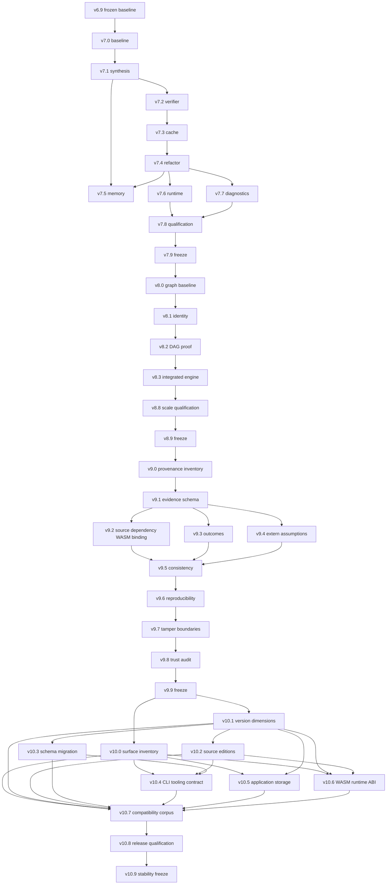

# Historical records
Archived milestone plans, measurements, and implementation records. Generated raw JSON captures are local-only; summaries and checksums remain tracked in [the capture manifest](benchmark-captures.sha256). The v6 final and v7.9 reports remain tracked because later benchmark runners consume them.
## Contents
- [roadmap v4 v7 record](#history-roadmap-v4-v7-record)
- [roadmap v7 v10 record](#history-roadmap-v7-v10-record)
- [v4 performance baseline](#history-v4-performance-baseline)
- [v6 benchmark compositional after](#history-v6-benchmark-compositional-after)
- [v6 benchmark compositional comparison](#history-v6-benchmark-compositional-comparison)
- [v6 benchmark final comparison](#history-v6-benchmark-final-comparison)
- [v6 benchmark final](#history-v6-benchmark-final)
- [v6 benchmark](#history-v6-benchmark)
- [v7 benchmark baseline](#history-v7-benchmark-baseline)
- [v7 1 benchmark](#history-v7-1-benchmark)
- [v7 2 benchmark](#history-v7-2-benchmark)
- [v7 3 benchmark](#history-v7-3-benchmark)
- [v7 4 benchmark](#history-v7-4-benchmark)
- [v7 5 benchmark](#history-v7-5-benchmark)
- [v7 6 benchmark](#history-v7-6-benchmark)
- [v7 7 benchmark](#history-v7-7-benchmark)
- [v7 8 benchmark](#history-v7-8-benchmark)
- [v7 9 benchmark](#history-v7-9-benchmark)
- [v8 0 benchmark](#history-v8-0-benchmark)
- [v8 1 identity](#history-v8-1-identity)
- [v8 2 proof](#history-v8-2-proof)
- [v8 3 benchmark](#history-v8-3-benchmark)
- [v8 8 benchmark](#history-v8-8-benchmark)

---
## history-roadmap-v4-v7-record

## 보존 기록: 기존 Synthetix 공식 로드맵

이 문서는 v4~v6 구현 기록과 v7 상태를 보존한다. 본문의 상태 문구는 기록을 옮긴 시점의 snapshot이며 현재 진행 상태는 나타내지 않는다. v7 상세 근거와 v8~v10의 최초 계획은 [계획 snapshot](history.md#history-roadmap-v7-v10-record)에 보존되어 있다. 현행 major 방향과 v8~v10 구현·PASS 계약은 [현재 로드맵](roadmap.md)과 연결된 SPEC 및 결과 문서를 따른다.

---

## Synthetix 공식 로드맵

### 한 문장 목표

Synthetix는 범용(general-purpose) programming language가 아니라,
**명세 → 합성 → 증명 → 실행**을 하나의 흐름으로 제공하는 verified
programming language다.

사용자는 `.ax` 파일에 구현 방법보다 반드시 성립해야 하는 조건을 적는다.
Synthetix는 후보 구현을 찾고, Z3로 검증한 뒤, 검증된 결과만 WASM으로
방출한다.

```text
.ax contract
  → parse / type check
  → candidate synthesis
  → Z3 proof
  → WASM lowering
  → runtime execution
```

WASM은 언어의 정체성이 아니라 검증된 순수 로직을 실행하는 기본 backend다.
웹 runtime은 범용 웹 프레임워크가 아니라 verified core와 상태·effect 세계를
연결하는 얇은 계층이다.

### 버전별 중심축

| 버전 | 중심 목표 |
| --- | --- |
| **v4** | Synthetix의 증명 결과를 신뢰할 수 있게 만든다. |
| **v5** | 검증된 코어와 웹·상태·effect·API 경계를 연결한다. |
| **v6** | 증명 가능한 프로그램의 크기와 구조를 확장한다. |
| **v7** | 같은 correctness를 더 빠르고 단순하게 만든다. |
| **v8** | 큰 프로젝트에서도 변경된 부분만 정확하게 다시 계산하고 검증한다. |
| **v9** | 어떤 source가 어떤 proof와 executable을 만들었는지 기계적으로 추적한다. |
| **v10** | 언어와 도구가 발전해도 기존 사용자가 의존할 안정성 계약과 호환성 회귀 기준을 확정한다. |

v7–v10의 당시 milestone 계획, rationale, research gate, dependency map과 freeze
기준은 [계획 snapshot](history.md#history-roadmap-v7-v10-record)에 보존되어 있다. 현행 v8~v10의
구현·PASS 계약은 [SPEC-V8-A](specs/v8/SPEC-V8-A.md),
[SPEC-V8-B](specs/v8/SPEC-V8-B.md), [SPEC-V9](specs/v9/SPEC-V9.md),
[SPEC-V10](specs/v10/SPEC-V10.md)을 따른다.
Rust API 안정성은 외부 consumer 근거가 확인될 때 R10-A — Stable Rust Library API
Research Gate에서만 평가하며, 현재 numbered milestone에는 포함하지 않는다.
v10의 마지막 단계는 v10.7 Compatibility Regression Corpus → v10.8 Release
Qualification → v10.9 Stable Language & Ecosystem Contract Freeze 순서다.

기능 수보다 soundness와 명확한 verification boundary를 우선한다. 서버,
DB, 인증 내부까지 Synthetix가 증명하는 것은 목표가 아니다.

### 현재 위치

| 영역 | 현재 상태 |
| --- | --- |
| v1 | 단일 contract의 합성·Z3 검증·WASM 실행 완료 |
| v2 | 여러 `.ax` 파일, import/export, `axiom dev`, 정적 web bundle 1차 구현 |
| v3.1 | 상태·record·list·text·reducer·persist 기반 애플리케이션 1차 구현 |
| v4.0 | property-first `max`·`min`·`clamp`·조건부 후보 합성 1차 구현 |
| v4.9 | proof semantics freeze 완료 |
| v5.9 | application boundary freeze 완료 |
| v6.0 | 규모 확장 benchmark baseline 완료 |
| v6.1 | 제한된 배열 완료 |
| v6.2 | 제한된 반복문 완료 |
| v6.3 | 구조적 재귀 완료 |
| v6.4 | 검증된 Collection: 현 workload에 별도 필요 없음 (NOT NEEDED) |
| v6.5 | 대규모 Modular Proof cache/invalidation 완료 |
| v6.6 | budget 실패 뒤 proof-checked fallback과 benchmark 계측 완료 |
| v6.7 | WASI/Node/Edge 제품 수요 없음 (NOT NEEDED) |
| v6.8 | extern effect와 unverified trust boundary 완료 |
| v6.9 | Freeze 완료: native CLI 4개 플랫폼 검증 완료 |
| v7.0 | PASS: clean performance/architecture baseline ([결과](history.md#history-v7-benchmark-baseline)) |
| v7.1 | PASS: bounded synthesis hot path ([비교](history.md#history-v7-1-benchmark)) |
| v7.2 | PASS: verifier query reuse and boundaries ([비교](history.md#history-v7-2-benchmark)) |
| v7.3 | PASS: process-local proof cache correctness; runtime optimization NOT NEEDED ([결과](history.md#history-v7-3-benchmark)) |
| v7.4 | PASS: private bounded-loop lowering extraction; runtime optimization NOT NEEDED ([결과](history.md#history-v7-4-benchmark)) |
| v7.5 | PASS: runtime memory optimization NOT NEEDED ([결과](history.md#history-v7-5-benchmark)) |
| v7.6 | PASS: WASM/browser bundle-size gate ([결과](history.md#history-v7-6-benchmark)) |
| v7.7 | PASS: CLI diagnostics and documentation gate ([결과](history.md#history-v7-7-benchmark)) |
| v7.8 | PASS: four-platform CLI and VSIX qualification ([결과](history.md#history-v7-8-benchmark)) |
| v7.9 | PASS: semantics-preserving Freeze; local and hosted regression, four-platform CLI/VSIX gate ([근거](history.md#history-v7-9-benchmark)) |

v4.9와 v5.9는 각각 proof와 application 경계를 동결했다. v6.0 benchmark는
검증된 배열 입력이 거부되는 expressiveness 경계를 재현했고, v6.1은 앱
`List`가 아닌 최대 16개 원소의 고정 증명 입력으로만 이를 확장했다. v6.3은
bounded loop와 별개로 제한된 단일 함수 self-recursion만 정적으로 펼친다.
v6.4는 현재 bounded array/loop가 sum/fold와 search를 표현함을 확인했고,
추가 dynamic collection semantics를 요구하는 실제 workload가 없어 NOT NEEDED로
판정했다.
v6.5는 `axiom dev`의 process-local proof cache에서 정확히 파싱한 source bytes,
semantics version, synthesis 설정, dependency key를 묶어 VERIFIED 후보만 재사용하고,
변경된 contract와 그 caller만 다시 검증한다. 조건부 v6.6은 benchmark에서 병목을
재확인해 `maximum_3`, `bitwise_combo`, `sum_8`의 budget 실패를 증명 가능한
source-derived 후보로 구제했다. 추가 검색 기능이나 budget 증가는 하지 않았다.
v6.7 검토에서는 delivered runtime이 browser/WASM이고 Node.js는
integration/benchmark test host임을 확인했다. WASI/Node/Edge deployment에 대한
실제 제품 요구가 없어 새 target은 NOT NEEDED로 판정했다. v6.8은 proof artifact에서
검증된 WASM contract와 host가 제공하는 미검증 extern 구현을 분리하고, typed effect와
명시적 가정 및 audit 미제공 상태를 기록한다. v6.9는 release regression을 고정하고,
commit `2e355cb91c872963048fe6a6dd167be75568e469`의 [GitHub Actions run]
(36029482437)에서 Linux x64, Windows x64, macOS arm64, macOS x64 native CLI
build/smoke와 VSIX packaging이 모두 성공했다. 각 runner의 `native-cli-*` evidence
artifact에는 대표 check/build, `mul8(5) = 40`, signed 결과 `-1`, 두 UNSAT fixture의
exit code와 WASM 미생성, v6 release fixture 결과가 기록됐다. 전체 workflow의 별도
Workspace tests job까지 완료되어 workflow가 `success`였고, hosted workspace tests와
로컬 전체 workspace tests가 각각 146개 통과했다.

[GitHub Actions run]: https://github.com/lee090626/synthetix/actions/runs/36029482437

### 공통 완료 기준

각 버전은 코드가 존재하는 것만으로 완료하지 않는다.

- **static:** parser, type checker, IR, 문서의 계약이 일치한다.
- **proof:** Z3 결과와 실패 상태가 구분된다.
- **runtime:** WASM 또는 웹 runtime에서 같은 의미가 실행된다.
- **regression:** 기존 contract와 실패 예제가 계속 같은 결과를 낸다.
- **boundary:** 검증되는 영역과 검증되지 않는 외부 effect가 문서화된다.

---

## v4 — 증명 신뢰성

v4는 synthesis 기능을 많이 추가하는 버전이 아니다. Synthetix가 생성한
결과를 사용자가 믿을 수 있도록 의미론, 결과 상태, 검색 경계, backend 보존을
고정하는 버전이다.

### v4.1 — Semantic Baseline

#### 목표

동일한 AMI 프로그램이 reference evaluator, Z3, WASM에서 같은 의미를 갖는지
확인한다.

#### 필요한 이유

Z3가 증명한 식과 WASM이 실행한 식의 의미가 다르면, 검증은 실제 프로그램을
증명한 것이 아니다. 특히 overflow, signed 연산, division, remainder, shift는
backend마다 차이가 생기기 쉬운 경계다.

#### 주요 작업

1. `u32`, `i32`, `bool`의 의미 표 작성
2. overflow, division, remainder, shift, signed/unsigned comparison 규칙 확정
3. 현재 `axiom-ami::Expr`를 canonical typed IR로 사용할 수 있는지 검토
4. reference evaluator 구현
5. AMI evaluator의 의미 확인
6. AMI ↔ Z3 ↔ WASM differential/conformance test 추가
7. `requires`의 satisfiability 검사 추가
8. 기존 `max`, `min`, `clamp` regression test 고정

새 Core IR은 무조건 만들지 않는다. 현재 AMI가 타입·의미·source 정보까지
감당하지 못한다는 근거가 있을 때만 추가한다.

#### 완료 기준

- 같은 AMI 프로그램의 reference evaluator와 WASM 실행 결과가 일치한다.
- Z3가 사용하는 bit-vector 의미와 reference evaluator가 일치한다.
- overflow와 signed/unsigned 경계값이 회귀 테스트에 포함된다.
- 모순된 `requires`가 `UNSATISFIABLE_PRECONDITION`으로 식별된다.
- 기존 property 예제가 의미론 변경 없이 계속 통과한다.

#### 의존성과 범위 밖

v4의 모든 후속 단계가 이 단계에 의존한다. 새 synthesis 기능, CEGIS,
ambiguity detection, 검색 resource limit은 v4.1 범위에 넣지 않는다.

#### v4.1 구현 기록

상태: **완료**

- reference evaluator를 추가하고 AMI evaluator와 분리했다.
- `axiom-ami::Expr`를 현재 scalar pipeline의 canonical candidate IR로 유지하되,
  self-describing typed IR은 아니라는 한계를 문서화했다.
- `requires` satisfiability를 Z3로 별도 검사하고 모순된 계약을
  `UNSATISFIABLE_PRECONDITION`으로 거부한다.
- reference evaluator, AMI, Z3, WASM의 boundary/conformance 테스트와
  `max`·`min`·`clamp` regression을 추가했다.

검증: `cargo test --workspace`, `cargo fmt --all -- --check`,
`git diff --check` 통과.

남은 위험: `Expr` 자체에는 타입 metadata가 없다. browser runtime의 JavaScript
evaluator는 page/UI expression만 계산하며 verified contract body는 WASM export로
실행한다. v4.8 conformance test가 이 호출 경로를 검증한다.

### v4.2 — Contract/Proof/Synthesis 상태 모델

#### 목표

계약 자체의 문제, synthesis 검색 결과, proof 결과를 서로 다른 상태로
표현한다.

#### 필요한 이유

현재의 “verified candidate를 찾지 못함”만으로는 모순된 명세, 검색 공간
부족, timeout을 구분할 수 없다. 사용자가 다음 행동을 결정할 수 있는 오류
모델이 필요하다.

#### 상태 모델

```text
ContractCheck:
  VALID
  INVALID
  UNSATISFIABLE_PRECONDITION
  UNSATISFIABLE_POSTCONDITION

SynthesisResult:
  FOUND
  NO_CANDIDATE
  TIMEOUT
  RESOURCE_LIMIT

ProofResult:
  VERIFIED
  COUNTEREXAMPLE
  SOLVER_UNKNOWN

Diagnostic:
  AMBIGUOUS_CANDIDATES
```

`UNSATISFIABLE_POSTCONDITION`은 검색 공간을 다 써버렸다는 뜻이 아니라,
유효한 입력 조건에서 `ensures`를 만족할 수 없는 계약 자체를 뜻한다.
`AMBIGUOUS_CANDIDATES`는 `SynthesisResult`가 아니라 현재 검색 공간에서
서로 다른 verified candidate를 여러 개 발견했다는 별도 diagnostic/warning이다.
strict mode에서는 이 diagnostic을 build failure로 승격할 수 있지만,
일반 모드의 `SynthesisResult`는 `FOUND`로 유지한다.

#### 완료 기준

CLI, VSCode Problems/Output, JSON report가 같은 상태 모델을 사용한다.
상태마다 원인·사용자 대응·재현 입력을 표시한다.

#### 의존성과 범위 밖

v4.1의 의미론과 precondition 검사 이후에 진행한다. 후보 grammar나 검색
알고리즘을 크게 늘리는 일은 v4.3 이후로 미룬다.

#### v4.2 구현 기록

상태: **완료**

- `ContractCheck`에 `VALID`, `INVALID`,
  `UNSATISFIABLE_PRECONDITION`, `UNSATISFIABLE_POSTCONDITION`을 추가했다.
- `ProofResult`를 `VERIFIED`, `COUNTEREXAMPLE`, `SOLVER_UNKNOWN`으로 고정하고
  기존 `VerificationResult` 이름은 호환 alias로 유지했다.
- `SynthesisResult`에 `FOUND`, `NO_CANDIDATE`, `TIMEOUT`, `RESOURCE_LIMIT`을
  추가하고 후보 제한·timeout을 실제 결과로 보존했다.
- CLI, project web build/check, VSCode Problems/Output, JSON report에 같은
  상태 이름과 reason/next action/reproduction input을 연결했다.
- `AMBIGUOUS_CANDIDATES`는 diagnostic 타입만 정의하고 아직 검출하지 않았다.

검증: workspace test, `cargo clippy --workspace --all-targets -- -D warnings`,
format, CLI 성공 report와 `RESOURCE_LIMIT` 실패 report를 확인했다.

남은 위험: synthesis 실패 report의 proof 상태는 실제 solver가 `UNKNOWN`을
반환한 경우에만 채워진다. ambiguity 검출과 strict mode 승격은 v4.3 범위다.

### v4.3 — Typed Synthesis Kernel

#### 목표

후보를 늘리기 전에 bounded synthesis의 검색 공간과 자원 사용을 통제한다.

#### 필요한 이유

중첩 조건과 연산을 단순 enumeration으로 계속 추가하면 후보 수가 폭발한다.
검색 결과의 재현성과 종료 보장이 먼저 필요하다.

#### 주요 작업과 완료 기준

- 타입별 candidate grammar
- canonicalization과 duplicate 제거
- 후보 비용 및 deterministic ordering
- counterexample 재사용
- 명시적인 CEGIS 구조
- 후보 수·시간·메모리 제한
- 검색 공간과 후보 수 benchmark

현재 검색 공간에서 서로 다른 verified candidate를 여러 개 발견하면
`AMBIGUOUS_CANDIDATES` diagnostic을 낸다. 이것을 의미론적
`UNDERCONSTRAINED`로 확정하지는 않는다. strict mode는 현재 검색 공간의
ambiguity diagnostic을 실패로 승격하는 수준으로 제한한다.

#### 의존성과 범위 밖

v4.2 상태 모델에 의존한다. 새로운 loop, array, recursive search, ML-guided
search는 범위 밖이다.

#### v4.3 구현 기록

상태: **완료**

- \`Expr\`에 구조적 ordering을 추가하고 contract context에서 후보 타입을
  추론·필터링하는 typed candidate kernel을 구현했다.
- 교환법칙이 있는 연산을 canonicalize하고 중복 후보를 제거했다. 비용순
  deterministic ordering으로 같은 입력이 같은 후보를 선택하도록 고정했다.
- \`CegisState\`에 sample과 마지막 counterexample을 모아 후보 검증마다
  재사용하도록 했다.
- 후보 수·timeout·보수적 후보 메모리 추정치를 각각 \`RESOURCE_LIMIT\`와
  \`TIMEOUT\`으로 보존했다.
- 첫 검증 후보 이후 다른 verified candidate가 발견되면
  \`SynthesisResult::FOUND\`와 별도로 \`AMBIGUOUS_CANDIDATES\` diagnostic을
  반환한다. 이는 의미론적 \`UNDERCONSTRAINED\` 판정이 아니다.
- WASM lowering과 CLI JSON report가 위 diagnostic을 전달한다.

검증: \`cargo test --workspace\`, \`cargo fmt --all -- --check\`,
\`cargo clippy --workspace --all-targets -- -D warnings\`, \`git diff --check\`,
CLI ambiguity report 수동 확인.

남은 위험: 메모리 제한은 allocator 실사용량이 아니라 후보 트리의
보수적 추정치다. strict mode의 정책 승격과 더 큰 검색 최적화는 후속 단계로
남긴다.

### v4.4 — Property Synthesis 확장

#### 목표

구현 코드 없이 작성한 property에서 유용한 순수 scalar 구현을 찾는다.

#### 주요 작업

- `max`, `min`, `clamp`의 일반화
- range 제한과 validation
- default branch와 constant branch
- bit mask
- wrapping subtraction
- semantics와 backend conformance가 확보된 뒤 division, remainder, right shift

#### 완료 기준

각 property 예제에 대해 후보 생성, Z3 검증, WASM 실행, 경계값 회귀 테스트가
모두 존재한다. 검색 공간 밖의 실패는 `NO_CANDIDATE`로 보고하며 계약 모순과
섞지 않는다.

#### 의존성과 범위 밖

v4.1의 의미론과 v4.3의 typed search kernel에 의존한다. 배열·반복문·대규모
자료구조 synthesis는 v6 연구 범위다.

나눗셈, 나머지, right shift는 현재 의미 표가 미정인 연산이므로 v4.4에서
추가하지 않는다. 별도 semantics 결정과 AMI·Z3·WASM conformance가 끝난 뒤에만
추가 후보가 된다.

#### v4.4 구현 기록

상태: **완료**

- `max`, `min`, `clamp`, constant branch, default branch property를
  기존 typed kernel 위에서 회귀 고정했다.
- `property_at_least_ten`으로 range 조건과 constant branch를 검증했다.
- bit mask와 wrapping subtraction property를 AMI·Z3·WASM 실행으로 확인했다.
- `requires` 범위 검사를 synthesis 전에 수행하는 경계를 테스트했다.

검증: property별 unit test와 WASM 실행, workspace test, format, clippy,
`git diff --check`, CLI property 실행 통과.

남은 위험: division, remainder, right shift는 의미론과 backend 계약이 아직
없다. 임의의 후보 문법을 먼저 늘리지 않고 v4.5 이후 별도 semantics 작업으로
미룬다.

### v4.5 — `contract` / `fn` / `extern`

#### 목표

명세를 합성하는 선언, 사용자가 작성한 구현, 외부 effect의 경계를 언어에
고정한다.

#### 의미

```text
contract
  구현 없음
  synthesis 대상

fn
  사용자가 구현
  verifier가 검증

extern
  구현이 외부에 있음
  검증 경계 밖
```

`adapter`는 언어의 순수 함수 종류가 아니라 runtime/project 연결 설정으로
둔다. `program`은 별도 실행 모델이 아니라 `contract`의 쉬운 문법 alias로
취급한다.

#### 완료 기준

세 종류가 parser, type checker, verifier, project linker, 문서에서 같은
의미를 갖는다. `contract`와 `fn`이 단순히 이름만 다른 함수가 아니다.

```text
fn increment(value: u32) -> u32 {
  return value +% 1;
  ensures result == value +% 1;
}

extern fn read_count(key: u32) -> u32;
```

`fn`은 하나의 명시적 `return` 표현식을 가져야 하며, 그 표현식은 같은 AMI로
내려가 Z3 검증을 통과해야 한다. `extern fn`은 서명만 기록하고 `check`는
허용하지만, runtime adapter 없이는 `build`/WASM 방출 대상이 아니다.

#### 의존성과 범위 밖

v4.1 의미론과 v4.2 결과 모델에 의존한다. 외부 HTTP·DB·브라우저 API의
실제 구현은 v5 범위다.

#### v4.5 구현 기록

상태: **완료**

- AST에 `Contract`·`Function`·`Extern` declaration kind와 `fn`
  implementation을 추가했다.
- parser와 type checker가 `fn return`과 `extern fn` 경계를 검사한다.
- 명시적 `fn` 구현을 AMI로 낮추고 기존 Z3 verifier와 WASM backend를
  재사용한다. 구현이 계약을 깨면 `INVALID`와 반례를 반환한다.
- `extern`은 `check`에서 유효한 경계 선언으로 남기고 synthesis/build에서는
  `EXTERN_OUTSIDE_VERIFICATION_BOUNDARY`로 방출을 거부한다.
- project linker와 VSCode syntax/completion이 세 선언 종류를 보존한다.

검증: parser·project linker·verifier·synth unit test, explicit `fn` CLI
check/run, extern CLI check 및 build 거부, workspace test/clippy/format 통과.

남은 위험: 함수 호출은 아직 contract를 inline하는 기존 project 경로에
머물러 있다. `requires` 증명과 `ensures` 가정으로 바꾸는 작업은 v4.6이다.

### v4.6 — Compositional Verification

#### 목표

계약 호출 시 callee 구현을 계속 펼치지 않고 계약 요약으로 검증한다.

#### 주요 작업

```text
caller가 callee.requires를 증명
callee.ensures를 caller 안에서 가정
```

- imported contract signature
- precondition discharge
- postcondition assumption
- contract summary
- 모듈 간 타입 검사
- 순환 호출 오류와 source 위치

#### 완료 기준

callee의 구현을 inline하지 않아도 `requires`와 `ensures`만으로 caller를
검증할 수 있다. call-site의 precondition을 증명하지 못하면 상위 contract
diagnostic으로 노출한다. 내부 증명 과정에서 반례가 발견된 경우에만
`ProofResult.COUNTEREXAMPLE`을 근거로 첨부하며, call-site 진단을
`ProofResult` 자체로 대체하지 않는다.

#### 의존성과 범위 밖

v4.5에서 contract의 의미와 외부 경계를 먼저 고정해야 한다. 일반 재귀,
loop invariant, 무제한 함수 호출은 v6 범위다.

#### v4.6 구현 기록

상태: **완료**

- axiom-verify에 compositional verification API를 추가했다. caller는 callee
  requires를 call-site마다 증명하고, callee ensures를 summary constraint로
  가정한다.
- call-site precondition 실패는 ProofResult와 분리된
  CALL_PRECONDITION_VIOLATION diagnostic으로 보고하고 source line/column을
  보존한다. 실제 postcondition 모델만 ProofResult::COUNTEREXAMPLE이다.
- Project는 기존 web/runtime 호환용 expanded view와 원본
  verification_summaries를 함께 보존한다.
- project API가 원본 summary로 검증하며 web check/build의 실제 compile 경로가
  이 검증을 통과해야 WASM을 생성한다. expanded view는 candidate search에만 쓴다.
- callee 구현을 펼치지 않는 add_one 호출 검증과 precondition 실패 테스트를
  추가하고 caller/callee의 requires/ensures 조합을 project 및 web compile
  경로에서 검증한다.

검증: compositional verifier unit test, project summary 보존 test, workspace
test/clippy/format 통과.

남은 위험: summary resolution은 module import scope의 contract 이름을 사용하며,
재귀/loop는 지원하지 않는다.

### v4.7 — Verification Artifact

#### 목표

검증 결과와 생성 산출물을 재현하고 추적할 수 있게 한다.

#### 주요 작업

report에 다음을 기록한다.

- contract 이름과 source 위치
- candidate
- semantics version
- synthesis bound와 사용 자원
- counterexample
- solver 결과
- `verification_artifact_hash`
- `wasm_hash`

hash는 correctness proof가 아니다. `verification_artifact_hash`는 artifact
무결성, `wasm_hash`는 생성 파일 무결성을 나타낸다. correctness는
`ProofResult.VERIFIED`와 backend conformance가 담당한다.

#### 완료 기준

같은 source·semantics version·bound로 실행하면 같은 report와 candidate를
재현할 수 있다. 검증되지 않은 candidate는 WASM으로 방출하지 않는다.

#### v4.7 구현 기록

상태: **완료**

- CLI 성공/실패 report가 같은 v4 artifact schema를 사용한다. contract,
  candidate, semantics version, synthesis bounds, candidate_count, timeout/resource
  상태, counterexample, solver/proof result, 두 integrity hash를 기록하고,
  적용되지 않는 값은 null로 둔다.
- verification artifact 입력과 생성 WASM에 각각
  verification_artifact_hash와 wasm_hash를 기록한다.
- 두 hash는 artifact/file integrity fingerprint일 뿐 correctness proof가
  아니며, correctness는 ProofResult와 backend conformance가 담당한다.
- 동일한 source, bound, candidate로 다시 실행하면 report의 핵심 필드와
  candidate가 재현된다.

검증: CLI report 수동 확인, hash 필드 확인, workspace test/clippy/format 통과.

남은 위험: 현재 fingerprint는 외부 서명이나 provenance 체인을 제공하지
않는다. 배포 서명과 장기 artifact 저장은 v5 이후 release 작업이다.

#### 의존성과 범위 밖

v4.2의 상태 모델과 v4.3의 resource 정보에 의존한다. proof explorer UI는
v6.8 이전에는 필수가 아니다.

### v4.8 — Backend Conformance Suite

#### 목표

v4.1의 개별 differential test를 전체 backend 보존성 검증 체계로 확장한다.

#### v4.1과의 차이

- **v4.1:** 의미론이 맞는지 확인하는 최소 기준선
- **v4.8:** 전체 candidate·ABI·runtime·browser 경로의 보존성 검증

#### 주요 작업과 완료 기준

- AMI evaluator ↔ Z3 모델 ↔ WASM 실행 결과 비교
- random 및 boundary differential test
- zero/one/multi-argument ABI 검증
- signed/unsigned와 overflow 회귀
- generated WASM의 export·입력·출력 검증
- 순수 계산은 JS가 재구현하지 않고 WASM 호출
- web runtime에서 source contract와 실행 artifact 추적

#### v4.8 구현 기록

상태: **완료**

- `axiom-synth`에 zero/one/multi-argument ABI, deterministic input matrix,
  unsigned wrapping, signed boundary, bool 결과를 함께 비교하는 conformance
  test를 추가했다.
- reference evaluator, AMI evaluator, Z3, WASM 실행 결과가 같은 candidate와
  입력에서 일치하는지 고정했다.
- WASM backend에 zero-argument export 실행 회귀를 추가했다.
- Node.js JS runtime에서 생성 `app.js`와 실제 generated WASM을 instantiate하고,
  generated button 경로로 export를 호출한다. overflow, signed/unsigned boundary,
  bool ABI 결과를 reference/AMI/Z3/WASM과 비교한다.

검증: workspace 테스트 및 Node.js browser-runtime integration test 통과.

남은 위험: 실제 브라우저별 최종 화면과 WASM 실행은 이 자동 conformance가
대체하지 않는다. v4.9에서는 release fixture와 수동 브라우저 smoke test를
동결된 검증 기준에 포함한다.

#### 의존성과 범위 밖

v4.1의 기준선과 v4.7의 artifact 정보에 의존한다. 새로운 언어 기능,
WASI·Node·Edge backend 추가는 이 단계의 목표가 아니다.

### v4.9 — Freeze

#### 목표

v4의 의미론과 검증 경계를 안정된 공개 계약으로 동결한다.

#### 완료 기준

- semantics 문서 동결
- contract/result 상태 동결
- supported grammar 동결
- negative fixture와 regression corpus 확보
- CLI·VSCode·WASM release 검증
- 성능 기준과 검색 한계 공개
- migration 문서 작성

#### v4.9 구현 기록

상태: **완료**

- `docs/semantics.md`에 `v4.1-scalar-baseline`의 frozen surface와 변경 시
  새 semantics version이 필요하다는 규칙을 기록했다.
- `ContractCheck`, `SynthesisResult`, `ProofResult`의 공개 상태와
  `AMBIGUOUS_CANDIDATES`·`CALL_PRECONDITION_VIOLATION` diagnostic 경계를
  동결했다.
- `examples/errors/unsat_precondition.ax`와
  `examples/errors/unsat_postcondition.ax`를 negative regression fixture로
  고정했다.
- CLI release build, 기본·signed WASM 실행, generated browser runtime의 실제
  WASM instantiate/export 호출, VSCode VSIX/source hash 및 activation smoke,
  전체 workspace test/clippy/format/diff 검증을 완료했다.
- `docs/v4-performance-baseline.json`에 benchmark별 candidate 수, 시간, search
  bounds를 기록하고 release 명령으로 재생성할 수 있게 했다.

검증 기준은 `docs/setup.md`의 fresh-checkout smoke test와 이 문서의 v4.8
backend conformance suite다. 상세한 호환성 규칙은
[`docs/v4-migration.md`](v4-migration.md)에 기록했다. v4.9 이후 기능 추가는
v4 semantics version과 freeze 기준을 깨지 않는 별도 버전 작업으로만 진행한다.

#### 범위 밖

v4.9 이후에야 대규모 자료구조, loop, recursion, 새로운 runtime target을
검토한다. freeze 전에 기능을 추가해 의미론을 다시 흔들지 않는다.

---

## v5 — 검증 코어와 웹·effect·API 경계

v5는 이미 구현된 v3.1 기능을 단순히 다시 추가하는 버전이 아니다. 기존
`record`, `list`, `text`, `reducer`, `persist`를 verified core,
application runtime, effect boundary로 재분류하고 안정화한다.

### v5.0 — Application Boundary Baseline

| 항목 | 내용 |
| --- | --- |
| 목표·필요성 | 기존 기능이 무엇을 검증하고 무엇을 검증하지 않는지 고정한다. |
| 주요 작업·완료 | scalar contract, UI data, browser effect를 문서·타입·runtime에서 같은 경계로 분리한다. |
| 의존성 | v4.9의 의미론과 `contract/fn/extern` 정의 이후 진행한다. |
| 범위 밖 | 새 collection 알고리즘, 서버 구현, DB·인증 검증. |

#### v5.0 구현 기록

상태: **완료**

- `axiom-application`에서 `ApplicationValue`, `VerifiedComputation`,
  `ApplicationCall`, `EffectRequest`를 분리해 pure computation, application
  call, 외부 effect 경계를 타입으로 표현한다.
- `app-run`이 application 입력을 검증·lowering하고 verified WASM을 실행한
  뒤 결과를 application value로 lifting한다. `mul8(5)`와 signed `-1` 실행을
  실제 release CLI에서 확인했다.
- 정수/boolean 간 암묵 변환과 범위 밖 입력을 거부하고, `extern` 실행,
  precondition, WASM runtime, effect, 결과 lifting 실패를 proof result와
  분리한다.
- [Application Boundary 문서](application-boundary.md)와 architecture에
  trust/dependency/value/failure 경계를 기록했다. v4 core/semantics 파일은
  수정하지 않았다.

검증:

- `cargo test --workspace`: 105개 통과
- `cargo clippy --workspace --all-targets -- -D warnings` 통과
- `cargo fmt --all -- --check`, `git diff --check` 통과
- `cargo build --release -p axiom-cli` 통과

추가로 Cargo metadata에서 app → core 방향과 core의 application/browser/
HTTP/storage dependency 부재를 확인했다.

경계 테스트: 잘못된 scalar 범위, text/list/record, integer-to-bool coercion,
잘못된 boolean output, extern declaration, precondition, WASM runtime, effect
실패를 확인하고 CLI integration test로 positive/negative 흐름을 실행했다.

### v5.1 — Thin Web Runtime

| 항목 | 내용 |
| --- | --- |
| 목표·필요성 | verified core와 브라우저를 연결하되 범용 웹 프레임워크가 되지 않는다. |
| 주요 작업·완료 | WASM 호출, 상태 연결, 화면 갱신, effect 실행, source 오류 전달을 얇은 runtime으로 고정한다. |
| 의존성 | v5.0 경계 분류 이후 진행한다. |
| 범위 밖 | React 대체, 자체 component ecosystem, DOM 전체 증명. |

#### v5.1 구현 기록

상태: **완료**

- Generated runtime이 verified WASM export만 호출하고, `u32`/`i32`/`bool`
  입력과 결과를 선언 타입에 맞춰 lowering/lifting한다.
- top-level `text`, `number`, `i32`, `bool` 입력을 state에 반영하고,
  scalar state input과 WASM 결과를 화면에 렌더링한다. collection과 nested
  field input은 거부한다.
- 계약의 `requires` 조건도 같은 AMI predicate를 별도 WASM export로 실행해
  입력을 거부하며 JavaScript에서 proof 의미를 재구현하지 않는다.
- host effect adapter 등록 및 `{ name, inputs }` 요청 경로를 제공한다.
  응답 state 반영과 render를 확인했고 adapter 오류는 application runtime
  오류로 전달한다.
- runtime 오류에 source 경로를 담고 `APPLICATION_RUNTIME_ERROR`로 표시한다.
  proof result 및 counterexample로 분류하지 않는다.
- 검증된 contract body는 JavaScript에 복제하지 않고 WASM export에서 실행한다.

검증:

- `built_web_app_runs_input_state_verified_wasm_and_effect_runtime`: 실제
  `.ax` 프로젝트 build, generated WASM instantiate, scalar/boolean input,
  state update, 결과 render, WASM precondition rejection, effect
  success/failure 실행.
- `generated_browser_runtime_instantiates_wasm_and_matches_scalar_backends`:
  reference/AMI/Z3/WASM 결과와 JS runtime 결과 비교 및 runtime 오류 분류.
- `cargo test --workspace`: 107개 통과
- `cargo clippy --workspace --all-targets -- -D warnings` 통과
- `cargo fmt --all -- --check`, `git diff --check` 통과
- `cargo build --release -p axiom-cli` 통과

검증 환경은 Node.js JS runtime과 테스트용 DOM shim이며, 별도 headless
browser 검증은 v5.7 integration 범위에 남긴다.

### v5.2 — State Transition

| 항목 | 내용 |
| --- | --- |
| 목표·필요성 | 상태 변경이 어떤 순서와 결과를 갖는지 예측 가능하게 만든다. |
| 주요 작업·완료 | event, reducer, 초기 상태, 실패한 전이, 검증된 scalar contract 호출을 테스트한다. |
| 의존성 | v5.1 runtime bridge가 필요하다. |
| 범위 밖 | 분산 상태, 서버 동시성, 무제한 actor model. |

#### v5.2 구현 기록

상태: **완료**

- page state 초기값, click event, reducer update를 generated runtime에서
  transition으로 실행한다. 각 update는 앞선 staged 결과를 읽는다.
- 모든 update가 성공했을 때만 state를 commit한다. 중간 contract/precondition
  실패 시 기존 state를 유지하고 `FAILED`, 실패 update index, 원래 state를
  transition result에 기록한다.
- 같은 초기 state와 event는 동일한 결과를 내고, event 순서가 바뀌면
  sequence 결과가 달라지는 예제를 실행했다.
- reducer 내부 contract는 build 단계에서 proof와 WASM 생성이 완료된 함수만
  사용한다. 실패는 `APPLICATION_TRANSITION_FAILURE`와 별도 application
  cause로 전달하고 proof counterexample 상태로 만들지 않는다.

검증:

- `reducer_transitions_are_ordered_deterministic_and_atomic`: 실제 project
  build와 generated WASM runtime에서 update 순서, deterministic replay,
  event 순서, 두 번째 update precondition failure rollback을 확인.
- `cargo test --workspace`: 108개 통과
- `cargo clippy --workspace --all-targets -- -D warnings` 통과
- `cargo fmt --all -- --check`, `git diff --check` 통과
- `cargo build --release -p axiom-cli` 통과

### v5.3 — Data Boundary

| 항목 | 내용 |
| --- | --- |
| 목표·필요성 | `record`, `list`, `text`가 화면 데이터인지 proof 데이터인지 혼동되지 않게 한다. |
| 주요 작업·완료 | serialization, record/list 상태, scalar contract로 넘길 수 있는 값의 경계를 문서화한다. |
| 의존성 | v5.0의 boundary 분류와 v5.2 상태 모델에 의존한다. |
| 범위 밖 | 임의의 list/map 알고리즘에 대한 완전한 Z3 검증. |

#### v5.3 구현 기록

상태: **완료**

- `ApplicationValue`에 tagged JSON 직렬화/역직렬화를 추가했다. 잘못된 JSON,
  variant, scalar payload는 `ApplicationDataError::Serialization`으로 거부한다.
- list item과 record field를 명시적으로 추출하고 integer/boolean만
  `verified_scalar()`를 통과시킨다. `ApplicationCall`은 이후에도 contract
  타입과 범위를 검사하며 list, record, text는 core 입력으로 직접 받지 않는다.
- `examples/v3-todo-v31`의 실제 web build/runtime에서 text draft와
  list-of-record state를 사용하고, `done: bool`만 verified `toggle` WASM에
  전달했다. 결과로 record state와 Todo 렌더링이 바뀌고 persisted record도
  갱신됨을 확인했다.

검증:

- `application_data_round_trips_and_rejects_malformed_json`: nested list/record/text
  round-trip 및 malformed JSON 거부.
- `only_explicit_scalar_extraction_crosses_into_verified_wasm`: text/list/record
  implicit lowering 거부, 추출된 bool만 verified contract에 전달.
- `todo_example_keeps_application_data_outside_verified_scalars`: fixture의 실제
  generated WASM 호출, record/list/text state, rendered result 및 storage 반영.
- `cargo test --workspace`: 111개 통과
- `cargo clippy --workspace --all-targets -- -D warnings` 통과
- `cargo fmt --all -- --check`, `git diff --check` 통과
- `cargo build --release -p axiom-cli` 통과

### v5.4 — Browser Effect와 Persistence

| 항목 | 내용 |
| --- | --- |
| 목표·필요성 | 브라우저 외부 상태가 숨겨진 부작용으로 들어오지 않게 한다. |
| 주요 작업·완료 | `persist`, localStorage 오류, 복원 실패, schema migration, 비 persist 상태를 명시한다. |
| 의존성 | v5.1 runtime과 v5.3 data boundary가 필요하다. |
| 범위 밖 | DB transaction과 서버 storage의 증명. |

#### v5.4 구현 기록

상태: **완료**

- `persist` 선언된 상태만 하나의 versioned storage envelope에 저장한다.
  비 persist 상태는 선언된 초기값으로 시작한다.
- `storage_schema_version`을 `[project]` 설정에 추가했다. 생략하면 `1`이며,
  0은 거부한다. 저장 envelope와 generated runtime에 버전을 함께 기록한다.
- 기본 localStorage adapter 외에 host get/set adapter를 허용한다. 저장 값을
  envelope와 top-level state 타입에 맞춰 검사한다.
- 구형 v3.1 per-state storage key를 versioned envelope로 변환한다.
  버전이 달라지면 migration adapter를 요구하고, 성공 결과를 검증한 뒤
  새 envelope로 저장한다. `registerStorageMigration`과 `restore()`로 런타임
  복구 경로도 제공한다.
- 손상 JSON, 잘못된 state shape, incompatible version, migration 실패, storage
  read/write 오류는 application runtime 오류로 보고하며 proof 결과에 섞지 않는다.

검증:

- `persisted_state_is_versioned_validated_and_migratable`: generated web bundle에서
  저장/복원, persist/non-persist 구분, 기존 키 변환, schema mismatch,
  migration 성공/실패, corrupted data, storage read/write 오류를 실행.
- `cargo test --workspace`: 112개 통과
- `cargo clippy --workspace --all-targets -- -D warnings` 통과
- `cargo fmt --all -- --check`, `git diff --check` 통과
- `cargo build --release -p axiom-cli` 통과

### v5.5 — External Adapter

| 항목 | 내용 |
| --- | --- |
| 목표·필요성 | HTTP와 browser API를 verified core와 안전하게 연결한다. |
| 주요 작업·완료 | `extern`, request/response 타입, loading/success/error, API client adapter를 정의한다. |
| 의존성 | v4.5의 `extern` 의미와 v5.4 effect 모델에 의존한다. |
| 범위 밖 | 외부 서버 내부 구현의 correctness 증명. |

#### v5.5 구현 기록

상태: **완료**

- project의 `extern` signature를 browser runtime metadata로 전달하고,
  `app.wasm`과 verified contract export에는 포함하지 않는다.
- `EffectRequest::from_extern`은 선언 입력을 확인하고 response `Type`을
  기록한다. `window.synthetix.requestExtern`도 입력·응답·target state를
  선언 타입으로 검증한다.
- effect adapter 호출은 `LOADING`, `SUCCEEDED`, `ERROR` 상태를 노출한다.
  generic effect payload는 지원되는 application JSON 값으로 제한한다.
- 외부 결과는 application state 값이다. 필요하면 별도 verified export에
  명시적으로 전달하며, API의 사실성은 증명된 것으로 취급하지 않는다.
- API 오류는 extern source location과 함께 application runtime error로
  전달하고 proof result에 넣지 않는다.

검증:

- `extern_signature_builds_a_typed_application_effect_request`: extern 입력
  서명 및 response type, 잘못된 입력/선언 거부.
- `extern_requests_use_typed_adapters_outside_verified_wasm`: generated project에서
  u32/i32/bool 응답, 실제 verified WASM export 분리, UI state/render,
  loading/success/error, invalid response, network failure, unsupported payload.
- `cargo test --workspace`: 114개 통과
- `cargo clippy --workspace --all-targets -- -D warnings` 통과
- `cargo fmt --all -- --check`, `git diff --check` 통과
- `cargo build --release -p axiom-cli` 통과

### v5.6 — Async와 실패 흐름

| 항목 | 내용 |
| --- | --- |
| 목표·필요성 | 실제 API 지연·재시도·취소·부분 실패를 명확히 처리한다. |
| 주요 작업·완료 | stale response, retry, cancel, effect 결과의 상태 반영을 테스트한다. |
| 의존성 | v5.2 state transition과 v5.5 adapter가 필요하다. |
| 범위 밖 | 분산 시스템 전체의 formal verification. |

#### v5.6 구현 기록

상태: **완료**

- 같은 target state의 새 요청은 이전 요청을 취소하고, 늦게 도착한 결과가
  state, error, 최신 effect status를 덮어쓰지 못하게 한다.
- adapter에 `AbortSignal`과 request id를 전달한다. `cancelEffect`는 요청
  하나 또는 진행 중인 요청을 취소하고, `retryEffect`는 마지막 실패 입력을
  다시 실행한다.
- target이 다른 effect는 독립적으로 완료된다. 하나의 API 실패가 다른
  target의 성공한 state 갱신을 되돌리지 않는다.
- generated project 테스트가 실제 WASM을 instantiate해 늦은 stale 응답,
  명시적 취소, 일시 실패 후 재시도, 부분 성공/실패를 검사한다.

검증:

- `cargo test --workspace`: 114개 통과 (16 suites)
- `cargo clippy --workspace --all-targets -- -D warnings` 통과
- `cargo fmt --all -- --check`, `git diff --check` 통과
- `cargo build --release -p axiom-cli` 통과

### v5.7 — Web Integration Test

| 항목 | 내용 |
| --- | --- |
| 목표·필요성 | generated bundle이 proof 결과와 화면 동작을 함께 보존하는지 확인한다. |
| 주요 작업·완료 | WASM/UI 비교, 입력 오류, API/storage 실패, Live Reload, source mapping을 테스트한다. |
| 의존성 | v5.1~v5.6 runtime과 effect 흐름 이후 진행한다. |
| 범위 밖 | DOM/CSS 시각 결과의 수학적 증명. |

#### v5.7 구현 기록

상태: **완료**

- generated `app.js`가 실제 `app.wasm`을 instantiate하고 WASM 결과를
  reference evaluator, Z3 point proof, rendered UI state와 대조한다.
- generated runtime 통합 테스트가 invalid input, extern/API 실패, storage
  실패, contract/API source location 및 proof 상태와 application error의
  분리를 검사한다.
- dev rebuild 테스트가 실제 project source를 수정해 성공 → 실패 → 복구
  경로를 실행한다. HTTP version/error/bundle routes의 출력과 generated
  runtime polling의 reload 및 오류 배너 해제를 확인한다.
- HTTP에서 제공한 `app.proof.json`이 contract source를 project-relative
  경로로 매핑하는지 검사한다. canonical path가 symlink 경로와 달라도
  기존 `source_label` 규칙을 재사용한다.

검증:

- `cargo test --workspace`: 115개 통과 (16 suites)
- `cargo clippy --workspace --all-targets -- -D warnings` 통과
- `cargo fmt --all -- --check`, `git diff --check` 통과
- `cargo build --release -p axiom-cli` 통과

### v5.8 — Packaging과 Deployment

| 항목 | 내용 |
| --- | --- |
| 목표·필요성 | 검증된 웹앱을 재현 가능하게 빌드하고 배포한다. |
| 주요 작업·완료 | 정적 bundle, 환경 설정, template, CLI/VSCode package, reproducible build를 제공한다. |
| 의존성 | v5.7의 runtime test 통과가 선행 조건이다. |
| 범위 밖 | Synthetix 자체 cloud, managed DB, 인증 서비스. |

#### v5.8 구현 기록

상태: **완료**

- static bundle에 `app.config.js`를 추가했다. deployment는 공개 설정을
  교체하고 effect adapter는 `window.synthetix.config`에서 읽는다.
- Node integration test가 독립된 두 build의 모든 산출물을 byte 단위로
  대조하고, staging 설정을 실제 generated runtime에서 확인한다.
- `examples/web-counter`를 starter project로 문서화했다. release CLI로
  해당 프로젝트의 check/build가 성공하고 `app.config.js`를 포함한 정적
  산출물이 생성되는 것을 확인했다.
- 현재 release CLI를 포함해 VSIX를 다시 package했다. checker가 packaged
  `extension.js`와 CLI의 SHA-256을 source와 대조하고 activation smoke를
  실행했다.

검증:

- `cargo test --workspace`: 116개 통과 (16 suites)
- `cargo clippy --workspace --all-targets -- -D warnings` 통과
- `cargo fmt --all -- --check`, `git diff --check` 통과
- `cargo build --release -p axiom-cli` 통과
- web-counter release CLI `check` 및 `build` 통과
- VSIX package, `check-vsix.js` hash 확인 및 activation smoke 통과

### v5.9 — Freeze

| 항목 | 내용 |
| --- | --- |
| 목표·필요성 | 검증된 scalar core를 실제 웹앱 제작 흐름으로 안정화한다. |
| 주요 작업·완료 | contract → proof → WASM → state/effect/API → static deployment 전체 흐름을 release test로 고정한다. |
| 의존성 | v5.0~v5.8 전체 완료 이후 진행한다. |
| 범위 밖 | Python급 범용 언어, 자체 backend framework. |

#### v5.9 구현 기록

상태: **완료**

- `v5_release_path_keeps_proof_wasm_state_effect_and_static_config_together`
  가 실제 CLI `check`와 `build`를 실행하고 proof manifest, static asset,
  WASM export 경계를 검사한다.
- 같은 test가 generated browser runtime에서 verified page action과 contract
  call, typed extern adapter, deployment config, rendered state를 end-to-end로
  확인한다. typed extern으로 갱신된 state의 versioned storage 저장과 복원도
  검사한다. extern은 WASM export나 proof manifest에 들어가지 않는다.
- 이 test는 `cargo test --workspace`에 포함돼 release workflow의 workspace
  test job에서 실행된다.

검증:

- `cargo test --workspace`: 117개 통과 (16 suites)
- `cargo clippy --workspace --all-targets -- -D warnings` 통과
- `cargo fmt --all -- --check`, `git diff --check` 통과
- `cargo build --release -p axiom-cli` 통과

---

## v6 — 증명 가능한 프로그램 규모 확장

v6의 loop, recursion, array, map, set은 단순한 문법 추가가 아니다. 각각
검색 공간, 종료 증명, 메모리 모델, solver 비용을 크게 바꾸는 연구 과제다.
따라서 v6.0에서 benchmark로 필요성을 확인하고, 한 번에 하나의 확장만
진행한다.

### v6.0 — 규모 확장 Benchmark

| 항목 | 내용 |
| --- | --- |
| 목표·필요성 | 어떤 프로그램 규모에서 현재 모델이 실제로 막히는지 측정한다. |
| 주요 작업·완료 | 후보 수, Z3 시간, 호출 깊이, 데이터 크기, loop/collection 필요 사례를 benchmark로 고정한다. |
| 의존성 | v5.9의 안정된 runtime과 v4.9의 proof 기준이 필요하다. |
| 범위 밖 | benchmark 없이 e-graph, ML, loop를 바로 도입하는 것. |

### v6.1 — 제한된 배열

| 항목 | 내용 |
| --- | --- |
| 목표·필요성 | 메모리와 collection 증명의 가장 작은 형태를 검증한다. |
| 주요 작업·완료 | 고정 크기 배열, index 범위, length, 읽기·쓰기, out-of-bounds를 지원한다. |
| 의존성 | v6.0에서 배열이 실제 병목으로 확인되어야 한다. |
| 범위 밖 | 임의 크기 동적 메모리와 포인터 산술. |

#### v6.1 구현 기록

상태: **완료**

- v6.0의 `verified_array_parameter_boundary`는 배열 집계를 표현하는
  계약 입력이 parser/type checker 단계에서 거부됨을 재현했다. 이는 앱
  `List`의 속도 문제가 아니라 proof input expressiveness의 한계다. v6.0의
  compositional depth 및 synthesis scaling 우선순위는 그대로 유지한다.
- `[u32; N]` (`1 <= N <= 16`) 입력, 평탄화된 verified ABI, `.length`, 읽기,
  immutable `array_update`, elementwise equality를 parser/type checker,
  reference evaluator, AMI/Z3, WASM lowering에 연결했다.
- `requires`는 전체 입력에서 정의되어야 하고 candidate/`ensures` 배열
  접근은 `requires` 하에서 범위가 증명되어야 한다. `&&`, `||`, 조건식의
  단락 경계도 reference, definedness proof, AMI, WASM에 맞췄다. 불가능한
  bounds obligation은 `INVALID`이며 실행 시 out-of-bounds는 error/trap이다.
- fixed array는 application `List`, page expression/state, extern ABI와
  분리했다. 함수 반환은 기존대로 scalar로 제한한다.

검증: `cargo test --workspace` 131개 통과,
`cargo clippy --workspace --all-targets -- -D warnings`,
`cargo fmt --all -- --check`, `git diff --check`,
`cargo build --release -p axiom-cli` 통과.

### v6.2 — 제한된 반복문

| 항목 | 내용 |
| --- | --- |
| 목표·필요성 | 반복 계산을 증명 가능한 형태로 확장한다. |
| 주요 작업·완료 | bounded loop, 종료 조건, loop invariant, 반복 횟수 제한을 지원한다. |
| 의존성 | v6.0 benchmark와 v6.1의 제한된 memory 모델이 필요하다. |
| 범위 밖 | 종료가 보장되지 않는 일반 loop. |

#### v6.2 구현 기록

상태: **완료**

- v6.0의 unrolled `sum_8`/bounded-search 사례는 수동 확장이 샘플 자원
  한도에 닿는 경계를 기록했다. v6.1의 fixed-array memory 모델 위에
  `for i in START..END with acc = INIT invariant P { NEXT_ACC }` 형식을
  추가했다.
- start/end는 정적 `u32`이며 half-open 범위의 최대 반복 횟수는 16이다.
  인덱스는 `u32`, body는 accumulator와 같은 타입이어야 한다. invariant는
  entry, 각 반복 진입, exit에서 검사하며, 실패는 `fn`의 `ContractCheck`
  `INVALID`가 된다.
- finite body를 AMI로 unroll해 기존 Z3 proof와 WASM lowering을 사용한다.
  동적 bound와 nested loop는 거부한다. loop synthesis grammar와 증명 비용
  개선은 구현하지 않았으므로 v6.6 scaling 근거로 간주하지 않는다.
- sum, max/min, bounded validation, 반복 array update, zero/one/16회,
  invariant failure/trap, 동적·초과 bound rejection을 parser, proof,
  reference, AMI, WASM 테스트에서 확인한다.

검증: `cargo test --workspace` 137개 통과,
`cargo clippy --workspace --all-targets -- -D warnings`,
`cargo fmt --all -- --check`, `git diff --check`,
`cargo build --release -p axiom-cli` 통과.

### v6.3 — 구조적 재귀

| 항목 | 내용 |
| --- | --- |
| 목표·필요성 | recursion을 허용하되 종료와 자원 사용을 증명한다. |
| 주요 작업·완료 | 입력 크기가 줄어드는 재귀, termination proof, stack/resource bound를 지원한다. |
| 의존성 | v6.2의 invariant·resource 모델 이후 진행한다. |
| 범위 밖 | 일반 재귀와 임의의 self-modifying control flow. |

#### v6.3 구현 기록

상태: **완료**

- 단일 `u32 -> u32` `fn`의 self-call 하나만 허용한다. 호출은
  `if n == 0 { base } else { ... f(n -% 1) ... }`의 nonzero branch 안에
  있어야 한다. u32의 하한과 zero base가 wrapping decrement의 underflow를
  막고, 그 분기에서 measure가 1 감소함을 구문 형태로 고정한다.
- 최대 16개의 recursive edge(초기 호출 포함 최대 17개 frame)까지만 AMI로
  정적 unroll한다. 한도를 넘는 경로는 undefined guard가 되고, verifier가
  `requires` 아래에서 그 경로가 도달 불가능함을 증명하지 못하면 함수는
  `INVALID`다. WASM stack overflow는 한도나 termination 증거로 쓰지 않는다.
- bounded loop와 재귀의 조합, 비감소 호출, 여러 self-call, shadow된 measure,
  mutual/다른 함수 호출은 지원하지 않는다. 기존 project contract cycle
  rejection은 유지한다.
- `sum_to`의 base/decreasing cases, 깊이 한도 경계와 초과 trap, 한도 증명이
  없는 함수의 거부를 parser, proof, AMI reference evaluator, WASM 테스트로
  확인한다.

검증: `cargo test --workspace` 140개 통과,
`cargo clippy --workspace --all-targets -- -D warnings`,
`cargo fmt --all -- --check`, `git diff --check`,
`cargo build --release -p axiom-cli` 통과.

### v6.4 — 검증된 Collection

| 항목 | 내용 |
| --- | --- |
| 목표·필요성 | 화면용 collection을 넘어 순수 collection 계산을 증명한다. |
| 주요 작업·완료 | list 계산, search, fold, filter를 먼저 검토하고 map/set은 별도 benchmark 후 결정한다. |
| 의존성 | v6.1 배열과 v6.2 loop 또는 v6.3 recursion 중 필요한 모델이 선행되어야 한다. |
| 범위 밖 | 모든 자료구조를 한 번에 지원하는 범용 collection library. |

#### v6.4 구현 기록

상태: **NOT NEEDED — 현재 workload에 별도 verified collection이 필요하지 않음**

- v6.0 benchmark의 verified-list aggregation 사례는 입력 type boundary에서
  거부됐다. v6.1의 고정 배열과 v6.2의 bounded loop 뒤에는 sum/fold가
  `bounded_array_sum_proves_the_loop_and_matches_reference_and_wasm`에서
  검증된다. search found/not-found도 기존 배열·loop 조합을 사용하는
  `bounded_array_loop_search_covers_found_and_not_found`에서 reference,
  AMI, Z3, WASM 결과가 일치한다.
- 현재 증명 모델은 빈 배열이나 가변 길이 결과(filter)를 표현하지 않는다.
  저장소의 `List` 사용은 application UI/runtime 경로에 있고, 기존 v6.0
  benchmark는 이를 verified proof input의 수요로 분류하지 않는다.
- 따라서 dynamic collection type, filter output representation, arbitrary
  length support는 추가하지 않는다. 실제 contract가 빈/가변 길이 결과를
  요구하거나 16-element bound가 workload를 막는 사례가 생기면 재평가한다.

검증: `cargo test --workspace` 141개 통과,
`cargo clippy --workspace --all-targets -- -D warnings`,
`cargo fmt --all -- --check`, `git diff --check`,
`cargo build --release -p axiom-cli` 통과.

### v6.5 — 대규모 Modular Proof

| 항목 | 내용 |
| --- | --- |
| 목표·필요성 | 큰 import graph를 매번 처음부터 증명하지 않는다. |
| 주요 작업·완료 | contract summary, proof cache, dependency invalidation, 변경 모듈만 재검증한다. |
| 의존성 | v4.6 compositional verification과 v4.7 artifact가 필요하다. |
| 범위 밖 | 검증되지 않은 module을 verified graph에 자동 포함하는 것. |

완료: `axiom dev` watcher의 반복 build 경로가 process-local cache를 재사용한다.
cache key는 parser가 실제 사용한 정확한 module bytes, `VERIFIED_SEMANTICS_VERSION`,
synthesis timeout/candidate/memory 설정, 그리고 dependency key를 포함한다.
cache에는 compositional proof가 `VERIFIED`된 candidate만 저장한다. 실패한
precondition/proof는 저장하지 않으며 다음 build에서 다시 검증한다. 파일 변경은
mtime/size 추정 대신 현재 source bytes로 탐지한다. one-shot `check`/`build`는
실행 간 cache를 보존하지 않는다.

검증 사례: A→B→C caller graph의 cold/warm, C 변경, root만 변경, unrelated module
변경, semantics version 변경, synthesis setting 변경, failed proof 미저장과
32-module cold/warm graph를 `axiom-cli` 테스트가 직접 확인한다. 상세 단일 실행
측정은 [v6 benchmark archive](#history-v6-benchmark)의 v6.5 절에 기록한다. 시간은 로컬 debug test
측정이며 성능 보장이 아니다. milestone gate: `cargo test --workspace` 144개,
`cargo clippy --workspace --all-targets -- -D warnings`,
`cargo fmt --all -- --check`, `git diff --check`,
`cargo build --release -p axiom-cli`가 모두 통과했다.

### v6.6 — Synthesis Scaling

| 항목 | 내용 |
| --- | --- |
| 목표·필요성 | benchmark에서 synthesis가 병목일 때 검색 규모를 확장한다. |
| 주요 작업·완료 | 병렬 CEGIS, solver-guided search, 더 큰 typed grammar, 필요 시 e-graph를 도입한다. |
| 의존성 | v4.3 kernel과 v6.0 benchmark가 필수다. |
| 범위 밖 | benchmark 없는 ML-guided synthesis. |

상태: **완료**. v6.0 benchmark를 동일한 50,000-candidate/64-MiB 기본 bound로
다시 실행해 `maximum_3`, `bitwise_combo`, `sum_8`가 각각 후보 생성 또는 초기
sample Cartesian product에서 `RESOURCE_LIMIT`되는 것을 확인했다. 검색 bound와
semantics는 그대로 두고, 해당 bound에 도달했을 때만 제한된 source-derived
fallback을 시도한다: exact `result == expression`, 또는 모든 u32 입력에 대한
result lower/upper bound에서 만든 max/min fold. fallback도 Z3에서 VERIFIED된
후에만 `FOUND`가 된다. 실패하면 기존 `RESOURCE_LIMIT`을 유지한다.

benchmark 계측은 proof attempt, 생성 후보, type/sample/solver 거절 후보를
분리해 반복 실행 간 결정성도 비교한다. 같은 release benchmark의 before/after
결과와 추가 WASM boundary test는 [v6 benchmark archive](#history-v6-benchmark)에 기록했다. 세 fixture는
모두 같은 search bound에서 `FOUND`로 바뀌고 실제 생성 WASM 결과가 맞았다.
총 wall time은 추가 Z3 proof 때문에 늘었으며 성능 향상으로 주장하지 않는다.
milestone gate: `cargo test --workspace` 145개,
`cargo clippy --workspace --all-targets -- -D warnings`,
`cargo fmt --all -- --check`, `git diff --check`,
`cargo build --release -p axiom-cli`가 모두 통과했다.

### v6.7 — 추가 Runtime Target

| 항목 | 내용 |
| --- | --- |
| 목표·필요성 | WASM 외 실행 환경이 실제 제품 요구가 될 때 연결한다. |
| 주요 작업·완료 | WASI, Node, Edge adapter 중 필요한 target만 추가하고 의미 보존을 검증한다. |
| 의존성 | v4.8 backend conformance와 실제 배포 수요가 필요하다. |
| 범위 밖 | WASM을 버리고 JS/TypeScript 생성으로 방향을 바꾸는 것. |

상태: **NOT NEEDED**. Product-facing runtime은 browser의 generated WASM 경로다.
현재 Node.js 사용은 integration/benchmark에서 browser bundle을 실행하는 test
host이며, WASI나 별도 Node/Edge target의 배포 요구를 증명하지 않는다. 실제
deployment consumer가 생길 때 필요한 target 하나를 선택하고 conformance를
다시 조사한다.

### v6.8 — FFI와 Unsafe Boundary

| 항목 | 내용 |
| --- | --- |
| 목표·필요성 | 외부 함수와 검증되지 않은 영역을 명시적으로 격리한다. |
| 주요 작업·완료 | FFI 선언, effect 표시, 입력·출력 타입, 가정과 audit 경계를 제공한다. |
| 의존성 | v4.5 `extern`과 v5.5 adapter 모델이 필요하다. |
| 범위 밖 | 외부 함수 내부까지 자동으로 verified라고 표시하는 것. |

완료: 기존 `extern fn` 선언을 host effect 경계로 유지한다. web proof artifact
schema v4는 `external_boundaries`에 extern source, input/output type, effect,
`UNVERIFIED` 구현 상태, declared-type-only 응답 검증, runtime adapter 가정,
`NOT_PROVIDED` audit metadata를 기록한다. `verification` 상태는
`WASM_CONTRACTS_ONLY`로 범위가 한정되고 `verification_scope`는 미검증 extern
구현을 분리한다. generated runtime은 같은 effect 및
trust-boundary marker를 host adapter request에 전달한다.

실제 `axiom build` release-path test는 manifest 구조와 source/type/audit 값을
확인하고, Node가 generated WASM/runtime을 실행해 valid input/output, 잘못된 input,
잘못된 output, adapter 미등록, adapter 예외, 그리고 effect marker 전달을 확인한다.
application runtime 오류는 proof counterexample가 아니다. 외부 구현의 동작과
사실성은 여전히 검증하지 않는다. v6.8 gate: `cargo test --workspace` 145개,
`cargo clippy --workspace --all-targets -- -D warnings`,
`cargo fmt --all -- --check`, `git diff --check`,
`cargo build --release -p axiom-cli`가 모두 통과했다.

### v6.9 — Freeze

| 항목 | 내용 |
| --- | --- |
| 목표·필요성 | 더 큰 프로그램에서도 증명 가능성과 경계 명확성을 유지한다. |
| 주요 작업·완료 | 배열·제한된 loop·필요한 collection·incremental proof·외부 경계를 안정화한다. |
| 의존성 | 선택된 v6 연구 트랙의 실제 완료 결과에 의존한다. |
| 범위 밖 | Python 수준의 모든 기능, 무제한 recursion, 자동 ML 최적화. |
| 검증 결과 | PASS: release E2E, 로컬 회귀 146개, native CLI matrix 4/4, VSIX packaging. |
| hosted evidence | [Actions run 36029482437] 전체 `success`; 네 native matrix와 VSIX package 성공, Workspace tests 146개 통과. SHA `2e355cb91c872963048fe6a6dd167be75568e469`. |

[Actions run 36029482437]: https://github.com/lee090626/synthetix/actions/runs/36029482437

Hosted artifact SHA-256 from run 36029482437 (source commit `2e355cb91c872963048fe6a6dd167be75568e469`):

| Artifact | CLI binary SHA-256 | Uploaded package SHA-256 |
| --- | --- | --- |
| macOS arm64 | `e9c323c5cf348874e186a07ce1d0b4dc15aee92f7749198a99d3b1c570511bda` | `6a89d14626d401b6b4188ccb98e541cd750db9142171b2531a13d78fe3be5394` |
| macOS x64 | `bc2281018db61c3fba5c1abb30a4b01a01c23d462f761849e3fdee5e1f897e15` | `9ae9d365e8dbf2fc3e05606ae10a4e5dce3429dd5efb6302d783eb367f621154` |
| Linux x64 | `30c6da3b6816b4ec13d563390a98bf03c610b2c497fb6a00a63a17f563c6f52d` | `7642e066a2470e6093838e0b5c49e200fb9cbfa6c9834b89d982181a2eb178f7` |
| Windows x64 | `5eeda7e4875872b24f3bf26309612740a9f56ec20ac65aa8a050ee4917a86729` | `cc1d726b620f84c2dfda7f3695fdb3e8034ade01114a21717c0f4096e52c78df` |
| VSIX `synthetix-vscode-0.14.1.vsix` | — | `8480f4847db0f60b873b5127e321b76768d0abe9857f954264e24d09ed1d5261` |

---

## 기존 문서와의 정리

기존 `docs/roadmap.md`는 v0.1부터 v4 1차 기능까지를 phase와 체크박스로
정리한 문서였다. 이 문서가 다음 부분에서 새 로드맵과 충돌한다.

1. 기존 Phase 9는 v4를 scalar 연산과 property synthesis 확장으로 설명했다.
   새 로드맵에서는 그 내용을 **v4.0 실험적 slice**로 낮추고, v4.1에서
   의미론과 backend 일치성을 먼저 검증한다.
2. 기존 문서는 division, e-graph, array, loop, Web Studio, ML을 한 묶음의
   이후 작업으로 나열했다. 새 로드맵에서는 division은 v4 의미론·property
   범위에서 먼저 다루고, array·loop·recursion·collection은 v6 연구 트랙으로
   분리한다.
3. 기존 문서는 `contract`, 일반 구현 함수, 외부 effect의 의미를 별도
   단계로 나누지 않았다. 새 로드맵은 v4.5에서 이 경계를 먼저 고정한 뒤
   v4.6에서 compositional verification을 진행한다.
4. 기존 synthesis 실패 메시지는 모순, under-constrained, 검색 경계 밖을
   하나의 실패로 설명했다. 새 로드맵은 v4.2에서 ContractCheck,
   SynthesisResult, ProofResult를 분리한다.
5. `docs/v2.md`와 `docs/v3.md`는 웹과 상태 기능의 현재 경계를 설명하는
   사양 문서로 유지한다. 다만 v3의 `record`, `list`, `text`는 문서에 적힌
   것처럼 Z3/WASM proof type이 아니라 application runtime data이며, 새
   v5.0에서 이 경계를 공식적으로 재확인한다.

이 문서는 v4~v6의 결정과 구현 기록, 작성 당시의 v7 상태를 보존한다.
v7~v10의 당시 계획은 [계획 snapshot](history.md#history-roadmap-v7-v10-record)으로 보존하며,
현행 방향과 v8~v10 milestone PASS 기준은 [현재 로드맵](roadmap.md)과 해당 SPEC을 따른다.
`docs/v2.md`, `docs/v3.md`, `docs/semantics.md`, `docs/architecture.md`는
각 버전의 사양과 구현 경계를 설명하는 문서로 유지한다.

### 현재 상태

v4.1 Semantic Baseline부터 v4.9 Freeze까지와 v5.0 Application Boundary
Baseline, v5.1 Thin Web Runtime, v5.2 State Transition, v5.3 Data Boundary,
v5.4 Browser Effect와 Persistence, v5.5 External Adapter, v5.6 Async와 실패
흐름, v5.7 Web Integration Test, v5.8 Packaging과 Deployment, v5.9 Freeze,
v6.0 Scale Benchmark, v6.1 제한된 배열, v6.2 제한된 반복문, v6.3 구조적
재귀, v6.5 대규모 Modular Proof, v6.8 FFI trust boundary가 완료되었고 v6.4 검증된 Collection은
현재 workload에 필요하지 않아 NOT NEEDED로 판정됐다. v6.6은 같은 bounded search에서
세 measured resource limit 사례를 proof-checked fallback으로 구제했다. v6.7 추가
runtime target은 현재 제품 수요가 없어 NOT NEEDED로 판정됐다. v6.9 Freeze는 native
CLI matrix와 release regression 검증을 마쳤다. v7.0 clean performance/architecture
baseline, v7.1 bounded synthesis hot path, v7.2 verifier query reuse, v7.3 process-local
proof cache, v7.4 core lowering refactor, v7.5 memory gate, v7.6 WASM/browser bundle,
v7.7 CLI/docs, v7.8 four-platform qualification과 v7.9 Freeze는 결과 문서에 따라 PASS다.
v8–v10 구현은 시작하지 않았다.

```text
v4.1 완료
  → v4.2 완료
  → v4.3 완료
  → v4.4 완료
  → v4.5 완료
  → v4.6 완료
  → v4.7 완료
  → v4.8 완료
  → v4.9 완료
  → v5.0 완료
  → v5.1 완료
  → v5.2 완료
  → v5.3 완료
  → v5.4 완료
  → v5.5 완료
  → v5.6 완료
  → v5.7 완료
  → v5.8 완료
  → v5.9 완료
  → v6.0 완료
  → v6.1 완료
  → v6.2 완료
  → v6.3 완료
  → v6.4 NOT NEEDED
  → v6.5 완료
  → v6.6 완료
  → v6.7 NOT NEEDED
  → v6.8 완료
  → v6.9 완료
  → v7.0 PASS
  → v7.1 PASS
  → v7.2 PASS
  → v7.3 PASS
  → v7.4 PASS
  → v7.5 PASS
  → v7.6 PASS
  → v7.7 PASS
  → v7.8 PASS
  → v7.9 Freeze PASS
```

v4.9에서 의미론, 결과 상태, supported grammar, negative fixture, release
검증 기준을 동결했고 v5.0~v5.9에서 core와 application/effect 실행,
state transition, data/persistence boundary, typed external adapter를
분리했다. v6.3은 제한된 self-recursion만 추가했으며 일반 재귀,
종료 증명 없는 loop, 무제한 호출은 지원하지 않는다.

---
## history-roadmap-v7-v10-record

> **보존된 계획 기록:** 이 문서는 v7 실행 근거와 v8~v10 최초 상세 계획 및 작성 당시 상태를 그대로 보존한다. 본문의 상태 문구는 snapshot이며 현재 진행 상태를 나타내지 않는다. 현재 방향은 [로드맵](roadmap.md), 향후 구현·PASS 계약은 [SPEC-V8-A](specs/v8/SPEC-V8-A.md), [SPEC-V8-B](specs/v8/SPEC-V8-B.md), [SPEC-V9](specs/v9/SPEC-V9.md), [SPEC-V10](specs/v10/SPEC-V10.md)을 따른다. 아래의 과거 상태 모델과 중단 문구는 현재 workflow의 PASS/CONDITIONAL/FAIL/PENDING/BLOCKED 판정을 대체하지 않는다.

## Synthetix v7.0–v10.9 기술 로드맵

이 문서는 v7–v10 구현 계획이다. 기준 checkout은 `main`의 `4f13d08`이며 분석 시작
시점의 작업 트리는 깨끗했다. 로드맵 작성 중에는 코드 변경이나 새 성능 측정을 하지
않았다. 이후 milestone 실행은 그 시점의 clean commit과 실제 consumer를 확인하고,
결과는 각 benchmark report에 기록한다.

현재 상태: v7.0 clean baseline, v7.1 bounded synthesis optimization, v7.2 verifier query reuse,
v7.3 process-local proof cache, v7.4 core lowering refactor, v7.5 measured memory gate,
v7.6 WASM/browser bundle, v7.7 CLI/docs, v7.8 four-platform qualification은 PASS다. v7.5
runtime memory optimization은 NOT NEEDED이며 v7.9 Freeze는 PASS다. v8–v10 구현은
시작하지 않았다. 결과는 [v7.0 baseline](history.md#history-v7-benchmark-baseline), [v7.1 comparison](history.md#history-v7-1-benchmark),
[v7.2 comparison](history.md#history-v7-2-benchmark), [v7.3 proof-cache report](history.md#history-v7-3-benchmark),
[v7.4 core-lowering report](history.md#history-v7-4-benchmark), [v7.5 memory report](history.md#history-v7-5-benchmark),
[v7.6 bundle report](history.md#history-v7-6-benchmark), [v7.7 CLI/docs report](history.md#history-v7-7-benchmark),
[v7.8 platform/package report](history.md#history-v7-8-benchmark),
[v7.9 freeze evidence](history.md#history-v7-9-benchmark)에서 확인한다.

### 핵심 근거

| 판단 | 근거 |
| --- | --- |
| v6 benchmark와 측정 한계 | [최종 결과](history.md#history-v6-benchmark-final), [비교](history.md#history-v6-benchmark-final-comparison), [JSON](v6-benchmark-final.json), [compositional 결과](history.md#history-v6-benchmark-compositional-after) |
| synthesis·verification·project 구조 | [`axiom-synth`](../crates/axiom-synth/src/lib.rs#L128), [`axiom-verify`](../crates/axiom-verify/src/lib.rs#L158), [`axiom-project`](../crates/axiom-project/src/lib.rs) |
| cache·web proof artifact·CLI report·semantics id | [cache key](../crates/axiom-cli/src/web.rs#L418), [web manifest](../crates/axiom-cli/src/web.rs#L1554), [CLI report hash](../crates/axiom-cli/src/main.rs#L471), [semantics id](../crates/axiom-parser/src/ast.rs#L20) |
| runtime/trust 경계와 release proof | [application boundary](application-boundary.md), [semantics](semantics.md), [release workflow](../.github/workflows/release.yml), [VSIX check](../editors/vscode/check-vsix.js), [VSCode package](../editors/vscode/package.json) |

### 기준선과 실제 근거

#### 저장소와 제품 경계

- Cargo workspace는 `axiom-ami`, `axiom-parser`, `axiom-verify`,
  `axiom-synth`, `axiom-wasm`, `axiom-project`, `axiom-application`,
  `axiom-cli`의 8개 crate로 구성된다. CLI crate는 library가 아니라 binary다.
- 현재 흐름은 `.ax` 파싱·검사 → bounded synthesis → Z3 proof → AMI → 직접
  WASM emission → browser/application boundary다. Browser DOM, state, storage,
  effect adapter와 `extern` 구현은 proof core 밖에 있다.
- proof 영역은 scalar `u32`/`i32`/`bool`, 제한된 fixed array, bounded loop,
  한 종류의 bounded structural recursion이다. Array/loop/recursion은 기존 앱
  `List`나 무제한 memory/recursion을 뜻하지 않는다.
- `axiom-project`는 import/export, dependency cycle 검사, dependency-first
  summary proof, expanded legacy view를 함께 제공한다. `axiom dev`의 verified
  candidate cache는 source bytes, semantics id, synthesis options, dependency
  keys를 비교하며 process-local이다. 실패한 proof는 저장하지 않는다.
- `axiom-synth`는 bounded enumerative search와 CEGIS를 사용한다. timeout은
  현재 candidate verification 사이에서 확인되며 이미 실행 중인 Z3 query를
  취소하지 않는다. resource limit에 도달한 뒤에도 일부 exact-result 및
  max/min 패턴만 proof-checked fallback을 시도한다.
- WASM은 `axiom-wasm`에서 직접 인코딩되고 로컬 실행에는 `wasmi`를 쓴다.
  Browser runtime은 `axiom-cli/src/web.rs`가 생성한다. v6.9 release workflow는
  네 OS/architecture의 native CLI smoke와 VSIX package check를 수행한다.

#### Benchmark에서 관찰한 문제와 한계

v6 final report는 macOS arm64, rustc 1.98.1, Node 24.19.0, release benchmark의
세 번 반복 median이다. 다만 그 보고서는 commit `103e073`과 dirty working tree에서
생성됐다. cache timing은 debug test profile이고 일부 generated runtime 측정은
단일 실행이다. 따라서 아래 수치는 v7 비교 기준이 아니라 재측정 대상을 고르는
역사적 근거다. v7.0은 현재 clean v6.9 checkout에서 같은 workload를 다시 잰다.

| 관찰 | 측정 결과 | 로드맵에서의 사용 |
| --- | --- | --- |
| `property_clamp` search | 273.554 ms; 88,136 generated, 59,386 rejected | enumeration과 candidate 비용을 v7.1에서 측정 |
| `maximum_3` search | 238.523 ms; 138,137 generated, 138,136 rejected, 1 proof attempt | fallback은 해결책의 일부이지 일반 search 확장으로 취급하지 않음 |
| `sum_3` search | 141.764 ms; 138,136 rejected | CEGIS/search 후보 생성 비용의 대표 case |
| `bitwise_combo` search | 76.516 ms; 96,370 rejected, 1 proof attempt | 검증 비용보다 후보 생성 비용이 큰지 분리 측정 |
| `sum_8` | fallback 포함 1.482 ms, 1 generated candidate | 이전 sample Cartesian-product resource failure의 한정된 해결 |
| `cegis_hidden_nine` | `RESOURCE_LIMIT` | fallback이 모든 search failure를 해결하지 않음을 유지 |
| 5-contract cache | cold 1,401.386 ms; warm 0.625 ms | cache가 유용하지만 debug profile의 단일-host 측정임을 표시 |
| 32-module chain cache | cold 486.586 ms; warm 3.772 ms | fan-in/fan-out DAG와 실제 변경 전파를 추가 측정 |
| compositional chain depth 8 | summary 5.521 ms; release project build 28.685 ms | 깊이 외 graph 형태와 parse/link 비용을 분리 |

v6 corpus는 `NO_CANDIDATE`를 관찰하지 못했다. Peak-memory 값은 candidate AST와
sample vector의 추정치로, allocator, Z3, process, browser engine memory를
포함하지 않는다. 현 benchmark에는 실제 RSS/allocations, build/test/CI duration의
기준선이 없다. 이는 측정 공백이지 이미 확인된 memory 병목은 아니다.

#### 기술 부채와 중요도

| 영역 / 심각도 | 실제 근거와 영향 | 예정 위치 |
| --- | --- | --- |
| Performance / 높음 | v6 synthesis에서 대량 후보 생성·거절이 관찰됐고 `cegis_hidden_nine`은 여전히 resource-limited다. solver와 enumeration 시간을 따로 측정해야 한다. | v7.0–v7.2 |
| Incremental / 중간 | cache는 `axiom dev` process 안에서만 살며, benchmark는 주로 chain graph다. project parse/link 비용과 shared dependency 영향은 분리 측정되지 않았다. | v7.3, v8.0–v8.3, v8.8 |
| Architecture / 중간 | 전체 파일 줄 수(테스트 포함)는 `web.rs` 3,551줄로 proof/cache, artifact, JS 생성, dev server/watch를 함께 가진다. `project/lib.rs`는 2,077줄이며 linker와 page validation을 함께 가진다. `verify/lib.rs`는 2,614줄이고 lowering, definedness, compositional proof, SMT 경로가 모여 있다. 줄 수는 병목 증거가 아니므로 기존 seam과 변경 위험을 보고 제한적으로 분해한다. | v7.4, v7.6 |
| Memory evidence / 중간 | synthesis memory는 추정치뿐이며 실제 process peak나 allocation count가 없다. 전역 allocator를 추가할 근거는 없다. | v7.0, v7.5; R7-A |
| Test evidence / 중간 | v6 freeze는 workspace 146 tests, native CLI matrix 4/4, VSIX activation smoke를 보유한다. Workspace tests는 release workflow에서 Linux만 수행하며 static browser 검사는 별도의 수동 Chromium smoke였다. | v7.8–v7.9 |
| Documentation / 중간 | `docs/architecture.md`의 verifier limitation은 loop/array를 아직 다루지 않는다고 설명하는 반면 현재 AST, verifier, v6 semantics는 fixed array/loop/recursion을 구현으로 기록한다. `docs/semantics.md` 첫 단락도 broader semantics가 target이라고 적어 뒤의 v6 절과 어긋난다. | v7.7 |
| Tooling / 낮음 | static browser smoke에서 개발용 `/__synthetix/version` 요청이 500ms마다 404를 받았고 runtime은 이를 무시했다. VSCode 문서는 full LSP와 project-wide semantic completion이 의도적으로 deferred라고 명시한다. | v7.6; LSP는 R8-B |
| Compatibility / 높음 | CLI report에는 `v4.1-scalar-baseline`, parser/cache에는 `v6.3-bounded-program-model`, CLI report와 web proof manifest는 각각 format `4`, storage는 별도 schema version을 쓴다. 모든 Cargo crate는 `0.1.0`, VSIX는 `0.14.1`, 저장소의 마지막 tag는 `v0.14.0`이다. 이 값들이 각자 다른 역할일 수 있으나 관계를 설명하는 정책은 없다. | v9.0–v10.8 |
| Trust / 중간 | CLI report의 `stable_hash`는 FNV-1a 64-bit다. Web proof manifest는 schema `4`와 proof/effect 구분을 기록하지만 semantics id, source digest, WASM digest, tool build identity는 포함하지 않는다. Extern 구현은 타입만 확인되며 audit metadata는 `NOT_PROVIDED`다. | v9.0–v9.8 |
| Dependency / 낮음 | workspace manifest의 직접 의존성은 crate 역할과 연결돼 있고, 명백한 미사용 direct dependency는 발견하지 못했다. Z3는 bundled, wasmi는 필요한 기능만 켠다. 삭제 목적의 dependency milestone은 만들지 않는다. | 필요 시 v7.0 재측정 |

`TODO`/`FIXME`/`XXX` 표식이 실제 source TODO로 남아 있는 것은 확인하지 못했다.
`unsafe` 문자열 검색 결과는 verifier 테스트 이름이었다. 현재 `extern`은 DSL의
host-effect 경계이며 Rust `unsafe` FFI 구현이 아니다.

#### 주요 방향 선택과 제외

| 후보 | 결정 | 근거 |
| --- | --- | --- |
| Optimization & Refactoring | **v7 선택** | v6 benchmark가 측정된 후보 생성 비용, cache 효과와 증거 공백을 남겼다. Proof classification과 observable behavior를 유지한다. |
| Incremental Project Engine | **v8 선택** | dependency graph, compositional proof, change-local work, process-local cache가 이미 제품 경로다. 기존 benchmark는 chain만 다뤄 DAG shape와 incremental edit를 추가로 qualification해야 한다. |
| Proof Provenance & Trust | **v9 선택** | `app.proof.json`, CLI report, WASM과 extern boundary가 이미 제품 산출물이다. Evidence를 exact source/semantics/candidate/executable에 연결하고 claim 범위를 드러내야 한다. |
| Stable Language & Ecosystem Contract | **v10 선택** | frozen semantics와 서로 다른 artifact/storage/release version이 공존한다. Surface별 support tier, compatibility window와 breaking-change migration을 확정한다. |
| Dynamic verified collection | 정식 milestone 제외 | v6.4 분석에서 fixed array+bounded loop가 현재 sum/search workload를 표현했고 가변 길이 verified output 소비자가 없었다. 새 workload가 오면 R8-C로 재평가한다. |
| WASI/Node/Edge backend | 정식 milestone 제외 | v6.7 분석에서 product-facing runtime은 browser/WASM이고 Node는 test host였다. 추가 target 소비자가 확인되지 않았다. |
| Full LSP, ML/LLM synthesis, distributed solver, cloud/DB, JIT, GPU | 정식 milestone 제외 | 저장소에 현재 수요·측정치·consumer가 없다. 관련 요청과 재현 사례가 확보될 때만 research gate를 연다. |
| Proof certificate / independently checkable SMT proof | Research Gate | 신뢰를 줄일 가능성은 있으나 현재 Z3 binding, consumer 요구, certificate 비용이 조사되지 않았다. v9에서 기본 구현으로 가정하지 않는다. |

### 상태 모델과 공통 완료 규칙

계획 단계 상태는 `PLANNED`이며 실행 때 아래 판정을 적용한다.

- **PASS**: milestone의 완료 기준과 저장된 evidence가 모두 통과했다.
- **PARTIAL**: 일부 산출물은 있지만 완료 증거가 부족하다. 의존 milestone은
  진행하지 않는다.
- **FAIL**: acceptance 또는 invariant가 깨졌다. 원인을 수정하고 해당 gate를
  다시 통과하기 전까지 downstream 작업을 멈춘다.
- **NOT NEEDED**: 사전에 적은 필요성 평가를 실행했고, 현재 workload/consumer로
  필요하지 않다는 대체 근거를 남겼다. 실패한 구현이나 일정 미달을 숨기는 데 쓰지
  않는다.

`same source → same semantics → same proof classification → same observable result`
는 v7 전체 invariant다. `VERIFIED`, `COUNTEREXAMPLE`, `SOLVER_UNKNOWN`,
`NO_CANDIDATE`, `TIMEOUT`, `RESOURCE_LIMIT`, `INVALID` 사이의 분류를 성능 최적화로
바꾸지 않는다. Synthesis의 동률 candidate가 달라지는 경우도 결과와 WASM이 의미상
동일하고 현재 artifact contract에 맞는지 별도로 증명한다.

각 milestone의 작업 규모는 S/M/L/Research로만 추정한다. 시간 단위 예측은 하지
않는다. Benchmark “필요”는 해당 단계가 performance claim을 하려는 경우의
재현 가능한 before/after 자료를 뜻한다. 기준선에서 차이가 보이지 않으면 최적화를
되돌리고 `NOT NEEDED` 또는 `PARTIAL`을 evidence에 따라 판정한다.

## v7 — Optimization & Refactoring

**Theme:** 의미를 바꾸지 않고 검색 비용, 중복 작업, 구조와 developer feedback을
개선한다. v7에서는 새 language semantics, backend, application behavior를 추가하지
않는다.

**Identity:** 같은 correctness를 더 빠르고 단순하게 만든다.

#### v7.0 — Clean Performance and Architecture Baseline

- **목표·근거·작업:** dirty `103e073` benchmark를 고정 기준으로 삼지 않는다.
  clean v6.9 HEAD에서 기존 54-scenario corpus와 release path를 재생하고, toolchain,
  host, profile, repeats, `git status`, artifact sizes를 함께 남긴다. v6 corpus의
  `NO_CANDIDATE` 미관찰, RSS/CI duration 부재도 명시한다.
- **PASS / 검증·측정:** synthesis generation/rejection/Z3 시간을 구분하고,
  cache cold/warm/change, project parse/link/build, WASM bytes, Node runtime,
  CLI startup, workspace test/build duration을 기록한다. 동일 환경에서 결과를 다시
  생성해 count와 status가 같고 JSON/Markdown의 field가 일치한다.
- **의존·범위 밖·중단:** v6.9 clean tree와 기존 harness에 의존한다. 새 optimizer,
  숫자 성능 목표, 다른 host 결과의 직접 비교는 범위 밖이다. scenario result나
  benchmark environment를 재현할 수 없으면 v7.1 진입을 멈춘다.
- **계획:** 규모 M · 위험 낮음 · 구조 영향 낮음 · 회귀 위험 낮음 · benchmark 필수.

#### v7.1 — Bounded Synthesis Hot Path

- **목표·근거·작업:** `property_clamp`, `maximum_3`, `sum_3`, `bitwise_combo`,
  `cegis_hidden_nine`에서 generation, sorting, structural deduplication, sample
  evaluation 중 실제 비용이 큰 한 경로만 개선한다. v6 fallback을 일반 search로
  오인하지 않고, sound한 pruning/cost reuse만 검토한다.
- **PASS / 검증·측정:** 선택한 workload의 동일 source·bounds에서 repeatable
  candidate-generation/rejection 또는 elapsed cost 감소를 보이고, 전체 결과
  classification, deterministic counters, AMI/reference/Z3/WASM 결과가 동일하다.
- **의존·범위 밖·중단:** v7.0 의존. 새 grammar, ML/e-graph, 더 큰 기본 budget은
  범위 밖이다. 후보 누락, 의미 변경, 다른 baseline case의 반복 regression이
  발견되면 해당 optimization을 revert하고 다음 synthesis 작업을 멈춘다.
- **계획:** 규모 M · 위험 중간 · 구조 영향 중간 · 회귀 위험 높음 · benchmark 필수.

#### v7.2 — Verifier Query Reuse and Boundaries

- **목표·근거·작업:** 현재 `synthesize_result_inner`의 `check_contract` 다음에
  `search_with_options`가 같은 contract의 precondition satisfiability를 다시
  확인한다. 이를 확인 결과 재사용으로 줄이고, property-heavy case에서 Z3 query
  count와 translation cost를 따로 측정한다. Z3 cancellation/timeout은 binding이
  안전하게 지원하는 경우에만 별도 검토한다.
- **PASS / 검증·측정:** 동일 source에서 precondition/query 결과와 failure
  classification이 동일하고, 중복 query가 제거됐음이 counter로 증명된다.
  `property_max`, `property_clamp`, invalid/unsatisfiable fixtures 및 compositional
  call-precondition regression을 비교한다.
- **의존·범위 밖·중단:** v7.0–v7.1 의존. SMT theory 변경, proof obligation 축소,
  verifier와 synthesizer 결합은 범위 밖이다. `SolverUnknown`/counterexample의
  차이나 obligation 누락이 나오면 즉시 중단한다.
- **계획:** 규모 M · 위험 높음 · 구조 영향 중간 · 회귀 위험 높음 · benchmark 필수.

#### v7.3 — Process-local Proof Cache

**상태: PASS — optimization NOT NEEDED.** Cache runtime 구현은 변경하지 않았다.
회귀 검증과 관찰된 lifecycle correctness를 통과했으며, 측정 구간이 겹치고 key 생성·lookup
비용이 분리되지 않아 runtime 최적화 근거는 없다. 세부 원자료는 [v7.3 benchmark](history.md#history-v7-3-benchmark)에 있다.

- **목표·근거·작업:** v6.5의 cache는 큰 cold/warm 차이를 보였지만 debug profile의
  제한된 graph 자료뿐이다. exact source bytes, semantics id, synthesis options,
  dependency key 계산과 불필요한 key comparison/clone을 profile하고 현재 cache
  lifecycle 안에서만 개선한다.
- **PASS / 검증·측정:** cold, warm, leaf/root/unrelated change, changed options,
  changed semantics, failed proof, deleted module cases에서 hit/miss/invalidation이
  정확하다. 저장 가능한 것은 proof-checked candidate뿐이며 미검증/부분 결과는
  cache에 남지 않는다.
- **의존·범위 밖·중단:** v7.0, v7.2 의존. disk/network cache와 proof 결과를
  재검증 없이 신뢰하는 일은 범위 밖이다. invalidation이 과소/과다하거나 실패 결과가
  재사용되면 downstream cache 작업을 멈춘다.
- **계획:** 규모 M · 위험 높음 · 구조 영향 중간 · 회귀 위험 높음 · benchmark 필수.

#### v7.4 — Core Lowering and Project Code Boundaries

**상태: PASS — runtime optimization NOT NEEDED.** `SpecExpr::For` 구현 lowering은 private `lower_bounded_loop`로 분리됐다. 다섯 쌍의 benchmark에서 직접 lowering 관련 timing ranges가 모두 겹쳤으며, 속도 향상은 주장하지 않는다. CLI report와 WASM 출력, scalar 경계 runtime 결과는 before/after 동일하다. 세부 결과와 원자료는 [v7.4 benchmark](history.md#history-v7-4-benchmark), `v7.4-benchmark.json` (raw capture omitted from GitHub)에 있다. `axiom-project`의 graph/order 및 expansion seam은 이미 있으므로 추가 분리는 NOT NEEDED였다.

- **목표·근거·작업:** parser AST에서 AMI/definedness/SMT와 project linking으로
  가는 현재 경계를 정리한다. `verify/lib.rs`의 implementation lowering 및
  `project/lib.rs`의 graph/link/expand 경로에서 이미 드러난 책임 경계만 작은
  private function/module로 나눈다. 새 visitor framework나 crate는 추가하지 않는다.
- **PASS / 검증·측정:** public Rust API, diagnostics, proof classification, graph
  order, emitted candidates가 기존 fixture와 동일하다. 동일 benchmark에서 build/test
  시간이나 allocation regression이 없어야 하며, 실제 변경 가능한 단위가 명확해진다.
- **의존·범위 밖·중단:** v7.0–v7.3 의존. 파일 줄 수만 줄이는 변경, 새 IR, public API
  재설계는 범위 밖이다. module 분리가 call-site semantics나 source spans를 바꾸면
  revert한다.
- **계획:** 규모 M · 위험 중간 · 구조 영향 높음 · 회귀 위험 중간 · benchmark 필요.

#### v7.5 — Measured Memory and Allocation Work

**상태: PASS — runtime memory optimization NOT NEEDED.** 동일 host/toolchain/profile/source snapshot/executable/fixtures의 두 process-RSS batch에서 네 workload를 각각 5회 측정했다. 결과는 RSS 감소 전후 비교가 아니며 runtime 개선을 주장하지 않는다. 기존 estimated-memory limit와 실행 결과를 보존했다. 상세 수치와 40개 raw run은 [v7.5 benchmark](history.md#history-v7-5-benchmark), `v7.5-benchmark.json` (raw capture omitted from GitHub)에 있다. v7.6–v7.9는 PASS다. v8–v10은 시작하지 않았다.

- **목표·근거·작업:** 현재 추정치가 실제 peak RSS와 다를 수 있으므로 우선 v7.0의
  candidate-heavy, array/loop/recursion workload에 대한 process peak 측정을 만든다.
  측정된 hotspot만 대상으로 clone, temporary vector, candidate lifetime을 줄인다.
- **PASS / 검증·측정:** peak memory가 반복 측정에서 감소하거나, 비교 가능한
  workload에서 실제 memory pressure가 없다는 evidence로 `NOT NEEDED`를 선언한다.
  이번 측정은 후자를 뒷받침한다. CEGIS의 268,435,456-byte 값은 synthesizer의
  estimated-memory limit이며 process RSS cap이 아니다. 기존 limits와 실행 결과는 그대로다.
- **의존·범위 밖·중단:** v7.0, v7.1 의존. 근거 없는 global allocator, custom arena,
  새로운 dependency는 범위 밖이다. host/profile이 다른 RSS를 직접 비교하면
  milestone을 보류한다.
- **계획:** 규모 M · 위험 중간 · 구조 영향 낮음 · 회귀 위험 중간 · benchmark 필수.

#### v7.6 — WASM and Generated Browser Runtime

- **목표·근거·작업:** v6 final은 `fixed_array_sum4` 272-byte, bounded loop
  1,650-byte, recursion 1,457-byte WASM을 기록했고 static browser smoke에서는
  개발용 `/__synthetix/version` polling이 매 500ms 404를 받았다. emitter의 code
  size와 runtime 경계를 측정하고, static output에 개발용 polling이 불필요하면
  development mode에만 제한한다. Rust 안의 대형 JS template는 현재 generation
  seam을 유지한 채 분리할 수 있는지 함께 정리한다.
- **PASS / 검증·측정:** release fixture의 WASM/static bundle 크기와 boot/transition
  timings를 비교한다. Static page는 dev poll 없이 load, WASM call, persist/restore가
  되고 dev page는 source change reload가 유지된다. Browser console/network evidence와
  Node integration 결과를 각각 기록한다.
- **의존·범위 밖·중단:** v7.0, v7.4 의존. 새 runtime target, generated JS로 verified
  logic을 옮기는 일, WAT compiler 도입은 범위 밖이다. runtime 경계가 proof core를
  바꾸거나 static/dev behavior를 혼합하면 중단한다.
- **계획:** 규모 M · 위험 높음 · 구조 영향 중간 · 회귀 위험 높음 · benchmark 필수.

#### v7.7 — CLI, Diagnostics, and Current Documentation

- **목표·근거·작업:** `axiom-cli/src/main.rs`의 command/report path와 VSCode의 CLI
  handoff를 조사해 중복 argument/report formatting을 최소 분해한다. Parser line/column,
  CLI report, Problems panel이 같은 source location/failure class를 보존하는지 고정한다.
  `docs/architecture.md`와 `docs/semantics.md`의 v6 구현 범위도 실제 code에 맞춘다.
- **PASS / 검증·측정:** legacy `check/build/run/app-run/dev`, output/report schema,
  exit states와 VSCode diagnostics의 회귀 fixture가 통과하고 기존 error의 분류·위치가
  같아야 한다. CLI startup/help와 workspace feedback 시간을 v7.0과 비교한다.
- **의존·범위 밖·중단:** v7.0, v7.4 의존. Full LSP, project-wide semantic completion,
  새 command framework는 R8-B 이전에는 범위 밖이다. machine-readable report 호환성이나
  source location이 바뀌면 중단한다.
- **계획:** 규모 M · 위험 중간 · 구조 영향 중간 · 회귀 위험 중간 · benchmark 필요.

#### v7.8 — Build, CI, and Packaging Cost

- **목표·근거·작업:** current release workflow가 Linux workspace tests, 네 플랫폼의
  native CLI smoke, VSIX source/activation check를 각각 어떻게 수행하는지 기록한다.
  v7 build/test/CI 시간을 재고 불필요한 rebuild/cache miss와 package contents만 손본다.
- **PASS / 검증·측정:** clean checkout의 locked build, workspace regression, four-target
  CLI smoke, generated static release smoke, VSIX activation/hash check가 같은 결과를
  낸다. CI duration이나 package size 개선은 반복 측정으로만 주장한다.
- **의존·범위 밖·중단:** v7.0, v7.6, v7.7 의존. release tag 생성/배포와 dependency
  변경은 범위 밖이다. 하나라도 artifact 누락/해시 불일치가 나면 release gate를 멈춘다.
- **계획:** 규모 M · 위험 중간 · 구조 영향 낮음 · 회귀 위험 높음 · benchmark 필수.

#### v7.9 — Semantics-preserving Freeze

- **목표·근거·작업:** v7 optimization/refactor 결과를 v6.9 frozen behavior와 대조하고
  모든 필수 milestone의 status/evidence를 닫는다.
- **PASS / 검증·측정:** source fixtures, parser/type diagnostics, reference/Z3/AMI/WASM
  differential regression, project cache invalidation, application/effect/runtime,
  benchmark before/after, clean build, four-target CLI smoke, VSIX와 browser/static
  smoke가 통과한다. 필수 `PARTIAL`/`FAIL`이 없고 각 `NOT NEEDED`에는 필요성 근거가 있다.
- **의존·범위 밖·중단:** v7.0–v7.8 결과에 의존한다. 미완료 required work를 `NOT NEEDED`
  로 바꾸는 일은 범위 밖이다. 어떤 semantics/runtime mismatch라도 있으면 freeze와 v8을
  멈춘다.
- **계획:** 규모 M · 위험 높음 · 구조 영향 중간 · 회귀 위험 높음 · benchmark 필수.

## v8 — Incremental Project Engine

**Identity:** 큰 프로젝트에서도 변경된 부분만 정확하게 다시 계산하고 검증한다.

**Theme:** 큰 프로젝트에서도 변경된 부분만 정확하게 다시 계산하고 검증한다. Existing graph/cache code and the v6 depth-8 call-chain plus 32-module caller-chain results justify qualification work, but no DAG-scale or parallel-verification benchmark currently exists. DAG shape coverage is a measurement gap, not a claimed performance bottleneck.

#### v8.0 — Project Graph and Change Baseline

- **목표·근거·작업:** clean v7.9 checkout에서 project load/link/proof/build와 `axiom dev` edit loop를 baseline화한다. v6 chain evidence를 재현하고 fan-out/fan-in, shared callee, multiple roots, unrelated/leaf/root/import/manifest edits를 대표 graph fixtures로 추가한다.
- **PASS / 검증·측정:** cold/warm 및 edit class별 timing, graph shape, result class, invalidation set을 반복 생성하고 clean 상태와 함께 기록한다. 현재 call-chain 결과와 새 DAG coverage를 구분한다.
- **의존·범위 밖·중단:** v7.9 의존. 성능 목표치 약속, parallel scheduling, persistent cache는 범위 밖이다. 어떤 edit가 영향을 주는지 재현할 수 없으면 v8.1을 멈춘다.
- **계획:** 규모 M · 위험 낮음 · 구조 영향 낮음 · 회귀 위험 낮음 · benchmark 필수.

#### v8.1 — Stable Module and Dependency Identity

- **목표·근거·작업:** project path/contract identity와 dependency order를 rename, same-name modules, shared dependencies, duplicate/cyclic edges에서 검증하고 deterministic identity/invalidation inputs를 고정한다.
- **PASS / 검증·측정:** 반복된 동일 graph가 같은 order, source mapping, diagnostics를 내고 잘못된/모호한 edge는 fail-closed한다. Graph mutations가 identity를 우연히 충돌시키지 않는다.
- **의존·범위 밖·중단:** v8.0 의존. 공개 import syntax 변경은 범위 밖이다. 다른 contract가 같은 identity가 되거나 valid edge가 사라지면 중단한다.
- **계획:** 규모 M · 위험 높음 · 구조 영향 중간 · 회귀 위험 높음 · benchmark 필요.

#### v8.2 — DAG Compositional Proof

- **목표·근거·작업:** 현재 callee `requires`/`ensures` compositional proof를 chain에서 shared-callee DAG, multiple call sites, nested requires와 sibling modules로 확장 검증한다.
- **PASS / 검증·측정:** 각 call-site obligation을 증명한 경우에만 callee postcondition이 caller proof에 들어가며 reference/Z3 결과와 source-aware diagnostics가 일치한다. Graph shape별 solver invocation을 기록한다.
- **의존·범위 밖·중단:** v8.1 의존. Module recursion이나 proof rule widening은 범위 밖이다. 잘못된 precondition으로 VERIFIED가 나오면 v8을 중단한다.
- **계획:** 규모 L · 위험 높음 · 구조 영향 높음 · 회귀 위험 매우 높음 · benchmark 필수.

#### v8.3 — Integrated Incremental Project Engine

- **목표·근거·작업:** 기존에 따로 제안했던 change-local parse/link, proof invalidation/recovery, cache lifetime, dev-loop failure isolation 및 precise project diagnostics를 한 end-to-end engine milestone으로 통합한다. 현재 watcher/load 경로와 process-local proof cache를 기반으로 변경 node와 영향 closure만 재계산하고 long-running process의 stale state를 회수한다.
- **PASS / 검증·측정:** clean full build와 incremental build가 linked graph, proof classification, diagnostics, static outputs에서 동일하다. no-op, leaf/root/import/manifest changes, delete/rename, valid→invalid→recovered edit cycle에서 정확한 affected closure, cache hit/miss, error location, bounded process state를 확인한다. Invalid input은 last good output을 덮지 않는다.
- **의존·범위 밖·중단:** v8.0–v8.2 및 v7.3 의존. Remote/disk cache, multi-user daemon, unbounded graph claims는 범위 밖이다. Under-invalidation, stale verified output, clean/incremental mismatch, unrecovered diagnostics가 있으면 engine qualification을 중단한다.
- **계획:** 규모 L · 위험 매우 높음 · 구조 영향 높음 · 회귀 위험 매우 높음 · benchmark 필수.

#### v8.8 — DAG Scale Qualification

- **목표·근거·작업:** DAG fixtures, graph sizes and edit classes를 대상으로 scaling behavior와 pathological cases를 측정한다. 기존 chain 결과는 DAG performance claim에 쓰지 않는다.
- **PASS / 검증·측정:** clean/incremental outputs와 graph order가 결정적이고, resource bound가 지켜진다. 성능 개선은 baseline 대비 재현된 graph shape에만 주장한다.
- **의존·범위 밖·중단:** v8.0–v8.3 의존. 무제한 크기 보장과 parallel proof implementation은 R8-D가 채택되지 않는 한 범위 밖이다. pathological graph에서 correctness 또는 resource bound가 무너지면 freeze를 중단한다.
- **계획:** 규모 M · 위험 높음 · 구조 영향 중간 · 회귀 위험 높음 · benchmark 필수.

#### v8.9 — Incremental Project Engine Freeze

- **목표·근거·작업:** graph identity, compositional proof, incremental parse/link/proof, invalidation/recovery, diagnostics와 measured scale envelope를 하나의 frozen engine contract로 확정한다.
- **PASS / 검증·측정:** DAG mutation corpus, clean-vs-incremental differential, repeated scale benchmark, workspace regression, four-platform CLI, VSIX/browser static qualification이 통과하고 필수 항목에 `PARTIAL`/`FAIL`이 없다.
- **의존·범위 밖·중단:** v8.0–v8.3 및 v8.8 의존. Persistent cache는 별도 research gate다. Stale result나 unsupported scale claim이 있으면 v9를 시작하지 않는다.
- **계획:** 규모 M · 위험 매우 높음 · 구조 영향 중간 · 회귀 위험 매우 높음 · benchmark 필수.

## v9 — Proof Provenance & Trust

**Identity:** 어떤 source가 어떤 proof와 executable을 만들었는지 기계적으로 추적한다.

**Theme:** canonical evidence로 source, dependencies, semantics profile, candidate, outcome, WASM과 external assumptions를 묶는다. 이는 proof engine이 참이라는 독립 수학 증명이 아니다. v9는 provenance와 trust claim만 다루며 reader compatibility와 schema migration은 v10 책임이다.

#### v9.0 — Provenance and Trust Claim Inventory

- **목표·근거·작업:** CLI report, web proof manifest, WASM, semantics ids의 producer·field·proof scope와 현재 claim의 생성 경로를 inventory한다. 장기 reader support와 external consumer compatibility는 v10에서 결정한다.
- **PASS / 검증·측정:** 모든 field가 source of truth, cache-only, UI/runtime hint,
  integrity fingerprint 중 하나로 분류되고, trust claim과 current evidence를 나눈다.
- **의존·범위 밖·중단:** v8.9 의존. 서명, supply-chain attestation, solver proof certificate는
  R9-A 채택 전 범위 밖이다. 어떤 field가 어떤 proof claim을 뒷받침하는지 확인할 수 없으면
  canonical record를 설계하지 않는다.
- **계획:** 규모 S · 위험 낮음 · 구조 영향 낮음 · 회귀 위험 낮음 · benchmark 불필요.

#### v9.1 — Canonical Proof Evidence

- **목표·근거·작업:** CLI report와 web proof manifest의 format version, semantics/model
  version, verified scope, synthesis bounds를 서로 다른 필드로 정의한다. Success와 failure
  result vocabulary를 고정하고, 현재 external boundary 구분을 보존한다.
- **PASS / 검증·측정:** 새 canonical evidence record가 required proof fields와 outcome vocabulary를 round-trip하며 보존한다. Legacy version-4 reader/migration 지원은 v10의 결정과 완료 기준이다.
- **의존·범위 밖·중단:** v9.0 의존. Source semantics 변경은 범위 밖이다. `VERIFIED`가
  `UNVERIFIED` extern implementation까지 확장되거나 canonical record의 required evidence가
  조용히 잘리면 중단한다.
- **계획:** 규모 M · 위험 높음 · 구조 영향 중간 · 회귀 위험 높음 · benchmark 불필요.

#### v9.2 — Source, Semantics, Candidate, and WASM Identity

- **목표·근거·작업:** Web manifest에 project-relative source, exact source/dependency
  digests, candidate identity, generated WASM digest, semantics id와 build identity를 연결한다.
  현재 CLI FNV-1a 64-bit hash는 cryptographic authenticity가 아님을 표현한다.
- **PASS / 검증·측정:** Static fixture의 source/dependency/WASM bytes를 manifest field와
  다시 비교해 match/mismatch를 판정한다. Digest 알고리즘은 consumer threat model에 따라
  결정하고, cryptographic claim을 하면 표준 SHA-256 implementation을 사용한다.
- **의존·범위 밖·중단:** v9.1 의존. Signed provenance는 R9-A 연구 gate의 채택 기준을
  통과하기 전에는 범위 밖이다. Digest mismatch가 build success로 표시되면 중단한다.
- **계획:** 규모 M · 위험 높음 · 구조 영향 중간 · 회귀 위험 높음 · artifact-size benchmark 필요.

#### v9.3 — Complete Proof Outcome Records

- **목표·근거·작업:** CLI already reports `INVALID`, `TIMEOUT`, `RESOURCE_LIMIT`, counterexample
  및 verified result를 나눠 기록한다. Project artifact에서도 source별 outcome, synthesis
  bounds, diagnostic, candidate/proof status가 실패 때도 혼동 없이 나타나는지 통일한다.
- **PASS / 검증·측정:** 각 state fixture에서 machine parser가 같은 classification을 읽고,
  실패 case는 verified/WASM output을 주장하지 않는다. Manifest size와 serialization time을
  기존 결과와 비교한다.
- **의존·범위 밖·중단:** v9.1–v9.2 의존. Speculation 기반 “불가능” 판정은 범위 밖이다.
  `NO_CANDIDATE`/`RESOURCE_LIMIT`를 contradiction으로 표현하면 중단한다.
- **계획:** 규모 M · 위험 중간 · 구조 영향 낮음 · 회귀 위험 중간 · benchmark 필요.

#### v9.4 — External Effect Assumption Records

- **목표·근거·작업:** `extern` implementation은 현재 UNVERIFIED이고 response는 declared
  type만 검사하며 audit status는 `NOT_PROVIDED`다. Manifest는 declaration, source,
  effect class, response type validation, host-supplied optional evidence를 각각 표시한다.
- **PASS / 검증·측정:** Adapter 미등록/오류/잘못된 응답과 정상 응답 모두 proof result와
  application runtime error를 분리한다. Optional host evidence가 빠지면 `NOT_PROVIDED`를
  유지하며 이를 VERIFIED로 승격하지 않는다.
- **의존·범위 밖·중단:** v9.1 의존. Network/DB/external facts의 correctness를 증명하는 일은
  범위 밖이다. Host data를 proof fact로 조용히 승격하면 중단한다.
- **계획:** 규모 M · 위험 높음 · 구조 영향 중간 · 회귀 위험 높음 · benchmark 불필요.

#### v9.5 — Artifact Consistency Check

- **목표·근거·작업:** Build integration가 emitted static files, proof manifest, source snapshots,
  WASM exports and hashes가 한 build에 속하는지 cross-check한다. 기존 `axiom build`의
  output contract를 유지한다.
- **PASS / 검증·측정:** Clean build와 deliberate tamper fixtures가 각각 consistent/invalid로
  분류된다. 검사는 Z3를 다시 실행하지 않으며 `proof verified`의 독립 재증명이라 부르지 않는다.
- **의존·범위 밖·중단:** v9.1–v9.4 의존. New cloud/signing service는 범위 밖이다. Hash,
  contract name, source path 간 하나라도 불일치하면 release output을 거부한다.
- **계획:** 규모 M · 위험 높음 · 구조 영향 중간 · 회귀 위험 높음 · benchmark 필요.

#### v9.6 — Reproducible Manifest and Bundle

- **목표·근거·작업:** v6.9가 동일 host의 두 project directory에서 static files를 비교한 근거를
  반복하고, 새 manifest fields가 output determinism을 깨지 않는지 확인한다.
- **PASS / 검증·측정:** 동일 clean source, locked dependencies, toolchain, config에서 두 번
  생성한 static files와 manifest가 byte-identical하다. Timestamp/build path 같은 의도적
  nondeterministic fields는 명시하거나 산출물에서 제외한다.
- **의존·범위 밖·중단:** v9.2–v9.5 의존. 서로 다른 compiler/OS 간 byte identity를
  약속하지 않는다. Same-environment output mismatch가 설명되지 않으면 freeze를 멈춘다.
- **계획:** 규모 M · 위험 중간 · 구조 영향 낮음 · 회귀 위험 중간 · benchmark 필수.

#### v9.7 — Tamper and Integrity Boundaries

- **목표·근거·작업:** source/dependency/candidate/WASM evidence를 변조하는 fixture로 integrity verifier의 감지 범위와 한계를 고정한다.
- **PASS / 검증·측정:** source, dependency, semantics, candidate, outcome, WASM의 각 field 단위 변조가 검출되고, digest 검사는 source identity proof나 solver 재검증을 대신하지 않는다.
- **의존·범위 밖·중단:** v9.2–v9.6 의존. Consumer migration policy는 v10 범위다. 검증 가능한 bytes의 tamper를 통과시키면 중단한다.
- **계획:** 규모 M · 위험 높음 · 구조 영향 낮음 · 회귀 위험 높음 · benchmark 불필요.

#### v9.8 — Provenance and Trust Claim Audit

- **목표·근거·작업:** manifest, CLI output, release notes가 `VERIFIED`의 정확한 범위, solver
  assumption, WASM conformance, source hash, external boundary를 과장하지 않는지 검토한다.
- **PASS / 검증·측정:** 각 claim이 machine-readable evidence 또는 documented assumption에
  연결된다. `FNV1a64`는 digest only, Z3 proof result는 solver와 translation TCB에 의존,
  external adapter는 type-checked only라고 분명하다.
- **의존·범위 밖·중단:** v9.0–v9.7 의존. Marketing-only claim은 범위 밖이다. Claim에
  반례가 있으면 v9.9 freeze를 막는다.
- **계획:** 규모 S · 위험 중간 · 구조 영향 낮음 · 회귀 위험 낮음 · benchmark 불필요.

#### v9.9 — Provenance and Trust Freeze

- **목표·근거·작업:** canonical evidence, identities, outcomes, external assumptions, tamper checks, reproducibility와 trust claims를 freeze한다. Consumer compatibility is explicitly deferred to v10.
- **PASS / 검증·측정:** evidence fixtures, tamper cases, clean/reproducible build, workspace regression, four-target CLI, VSIX and browser/static qualification pass; required items have no `PARTIAL`/`FAIL`.
- **의존·범위 밖·중단:** v9.0–v9.8 의존. Reader migration과 long-term schema support는 범위 밖이며 v10. Unimplemented proof certificate를 claim하지 않는다. Integrity gap이 있으면 v10을 멈춘다.
- **계획:** 규모 M · 위험 높음 · 구조 영향 중간 · 회귀 위험 높음 · benchmark 필수.

## v10 — Stable Language & Ecosystem Contract

**Identity:** 언어와 도구가 발전해도 기존 사용자가 의존할 수 있는 안정성 계약을 확정한다.

**Theme:** 각 ecosystem surface를 stable·experimental·internal로 분류하고, supported version, reader/migration, deprecation 및 breaking-change 경로를 정한다. v10.9는 이 stability promise의 범위를 freeze하며 Synthetix 1.0 release를 선언하지 않는다.

| Stability surface | v10 계약 범위 |
| --- | --- |
| Source Language / Edition | Edition 선택과 기존 source 해석 유지 (v10.2) |
| Semantics Profile | Capability/version 조합과 cache invalidation (v10.1) |
| Proof Artifact | Schema reader, migration, fail-closed 규칙 (v10.3) |
| CLI / Release Mapping | 명령·출력 계약과 binary/tag/package 버전 관계 (v10.4) |
| VSCode / Tooling | Extension activation과 bundled CLI 지원 관계 (v10.4) |
| Application / Storage | Application 오류 경계와 storage migration 소유권 (v10.5) |
| WASM Runtime ABI | Export/import/calling convention 호환성 (v10.6) |
| Rust API | 실제 downstream consumer가 확인될 때만 R10-A Research Gate로 평가 |

#### v10.0 — Stable Surface and Consumer Decision

- **목표·근거·작업:** `.ax` grammar, `synthetix.toml`, CLI commands/options/output,
  `window.synthetix` runtime ABI, `app.proof.json`, semantics profile, application storage,
  VSCode/tooling, release/version mapping, Rust crate exports를 surface별로 inventory하고,
  consumer evidence, stability tier, support/deprecation policy 초안을 정한다.
- **PASS / 검증·측정:** 각 surface가 stable, experimental, internal 중 하나로 승인되고
  consumer evidence가 기록된다. Cargo crate `0.1.0`을 외부 Rust API 안정성으로 오해하지
  않도록 policy를 둔다.
- **의존·범위 밖·중단:** v9.9 의존. Evidence 없는 crates.io/support promise는 범위 밖이다.
  실제 consumer가 누락된 public breaking change가 나오면 version plan을 멈춘다.
- **계획:** 규모 M · 위험 중간 · 구조 영향 중간 · 회귀 위험 중간 · benchmark 불필요.

#### v10.1 — Semantics and Capability Version Matrix

- **목표·근거·작업:** scalar frozen model, bounded arrays/loops/recursion, verifier lowering,
  WASM ABI, report schema와 proof cache의 version identifiers가 서로 무엇을 무효화하는지
  선언한다. `v4.1-scalar-baseline`과 `v6.3-bounded-program-model`의 역할을 설명한다.
- **PASS / 검증·측정:** Cache keys, CLI report, web proof manifest, benchmark metadata가
  올바른 version dimension을 기록하고, version bump tests가 필요한 cache/schema invalidation만
  일으킨다.
- **의존·범위 밖·중단:** v9.1, v9.2 의존. 구현 semantics를 바꾸는 일은 범위 밖이다.
  같은 semantic profile의 stale cache가 hit하면 중단한다.
- **계획:** 규모 M · 위험 높음 · 구조 영향 중간 · 회귀 위험 높음 · benchmark 필요.

#### v10.2 — Source Edition Selection

- **목표·근거·작업:** 미래에 source grammar/meaning이 바뀌는 경우 기존 files를 조용히
  재해석하지 않도록 project-level language edition 규칙을 정의한다. 필요하다면 기존 manifest
  default를 legacy edition으로 유지하고 unknown edition을 거부한다.
- **PASS / 검증·측정:** Legacy `.ax` files의 parse/type/proof result가 이전 edition과 같고,
  new syntax는 명시한 edition에서만 허용된다. Missing/unknown edition behavior가 fixtures로
  고정된다.
- **의존·범위 밖·중단:** v10.1 의존. New operators, collections, unrestricted recursion은
  범위 밖이다. Existing source가 edition migration 없이 다른 meaning을 얻으면 중단한다.
- **계획:** 규모 M · 위험 높음 · 구조 영향 중간 · 회귀 위험 높음 · benchmark 불필요.

#### v10.3 — Proof Artifact Schema Migration Policy

- **목표·근거·작업:** v4 report/proof manifests와 v9 canonical evidence schema 사이의
  reader, migration, rejection rules를 고정한다. Application의 `storage_schema_version`은
  별도 surface로 두고 migration 책임은 v10.5에서 정한다.
- **PASS / 검증·측정:** Supported legacy schema는 deterministic migration/reading을 하고,
  unknown major/corrupt/incomplete fields는 fail-closed한다. Migration은 proof semantics를
  재해석하지 않는다.
- **의존·범위 밖·중단:** v9.9, v10.1 의존. Browser storage migration은 범위 밖이다.
  Corrupt input이 verified status로 올라가면 중단한다.
- **계획:** 규모 M · 위험 높음 · 구조 영향 중간 · 회귀 위험 높음 · benchmark 불필요.

#### v10.4 — CLI, VSCode, and Tooling Contract

- **목표·근거·작업:** CLI binary version/report versions, Cargo crate versions, Git tags,
  VSIX version 및 bundled target CLIs의 mapping을 정의한다. `axiom --version`과 machine-readable
  report version이 없다면 approved command/field로 제공하고 error/exit behavior를 고정한다.
- **PASS / 검증·측정:** Release CI가 manifest의 approved mapping과 모든 bundled platform CLI를
  확인하고, VSIX activation smoke를 실행한다. Legacy `check/build/run/app-run/dev` 및 flags는
  별도 migration notice 없이 깨지지 않는다.
- **의존·범위 밖·중단:** v10.0–v10.3 의존. Release/publish는 이 계획 문서의 범위 밖이다.
  Cargo package, tag, VSIX가 의도치 않게 서로 다른 CLI를 지시하면 release gate를 중단한다.
- **계획:** 규모 M · 위험 높음 · 구조 영향 낮음 · 회귀 위험 높음 · benchmark 불필요.

#### v10.5 — Application and Storage Compatibility

- **목표·근거·작업:** Host effects, application JSON values, persisted
  `storage_schema_version`의 support와 migration contract를 proof evidence/schema reader와
  분리한다. Verified core change가 browser storage나 external response를 자동으로 trust하지
  않게 한다.
- **PASS / 검증·측정:** v5.9 state/effect path와 current restore/migration fixtures가 유지되고,
  storage migration failure가 application error로 남으며 ProofResult로 변하지 않는다.
- **의존·범위 밖·중단:** v10.0–v10.1 의존. Database/auth persistence와 extern
  implementation verification은 범위 밖이다. Storage failure가 proof classification으로 바뀌면
  중단한다.
- **계획:** 규모 M · 위험 높음 · 구조 영향 중간 · 회귀 위험 높음 · benchmark 불필요.

#### v10.6 — WASM Runtime ABI Compatibility

- **목표·근거·작업:** Verified scalar calling convention, WASM export names/signatures,
  host imports와 ABI version identity를 surface matrix에 연결한다. ABI change가 semantics profile,
  artifact identity, host adapter에 미치는 breaking boundary를 명시한다.
- **PASS / 검증·측정:** 각 supported ABI profile에 reference/AMI/WASM/runtime conformance fixture가
  있고 ABI mismatch가 명시적으로 reject되거나 migration된다. Host/runtime failure는 proof outcome으로
  바뀌지 않는다.
- **의존·범위 밖·중단:** v10.0–v10.2 의존. WASI/Node/Edge deployment 추가는 범위 밖이다. ABI
  mismatch가 verified candidate의 meaning을 바꾸면 중단한다.
- **계획:** 규모 M · 위험 높음 · 구조 영향 중간 · 회귀 위험 매우 높음 · benchmark 필요.

#### v10.7 — Compatibility Regression Corpus

- **목표·근거·작업:** v10.1–v10.6에서 선언한 source edition, semantics profile, proof artifact
  schema/reader, CLI, VSCode, storage migration, WASM ABI의 전체 compatibility matrix를 회귀
  corpus로 고정한다. Rust API stability는 현 v10 numbered milestone과 이 matrix에서 제외하고
  R10-A Research Gate로만 유지한다. Gate가 채택 기준을 통과해도 promotion policy에 따라 다음
  roadmap revision 또는 major에서 정식 milestone로 제안하며, 현재 v10 번호를 재정의하지 않는다.
- **PASS / 검증·측정:** 선언한 모든 supported 조합에서 기존 source/result, artifact read/migration,
  CLI·VSCode 계약, storage migration, WASM ABI conformance가 유지된다. 모든 unsupported 조합은
  명시적으로 거부되며 각 matrix entry에 재현 가능한 fixture와 기대 결과가 있다.
- **의존·범위 밖·중단:** v10.0–v10.6 의존. Release candidate/platform qualification은 v10.8이다.
  누락된 supported entry, silent migration/data loss, stale verified artifact 또는 ABI mismatch가
  통과하면 중단한다.
- **계획:** 규모 L · 위험 높음 · 구조 영향 중간 · 회귀 위험 매우 높음 · benchmark 불필요.

#### v10.8 — Release Qualification

- **목표·근거·작업:** v10.7 compatibility corpus가 통과한 clean release candidate를 전체
  supported platform/tooling matrix에서 qualification한다.
- **PASS / 검증·측정:** Clean checkout에서 workspace tests, Linux x64/Windows x64/macOS arm64/macOS x64
  CLI smoke, VSIX package/activation, static browser load/call/persistence, artifact consistency,
  same-toolchain reproducibility evidence가 모두 통과한다.
- **의존·범위 밖·중단:** v10.0–v10.7 의존. v10.9 판정 전 publish/release creation은 하지 않는다.
  Trust/compatibility mismatch가 있으면 candidate를 중단한다.
- **계획:** 규모 L · 위험 높음 · 구조 영향 중간 · 회귀 위험 매우 높음 · benchmark 필수.

#### v10.9 — Stable Language & Ecosystem Contract Freeze

- **목표·근거·작업:** source edition, semantics profiles, artifact schema/readers, CLI,
  VSCode/tooling, application/storage, runtime ABI, release/version mapping과 Rust API의
  stable/experimental/internal 범위 및 breaking-change migration 절차를 freeze한다. Rust API는
  향후 roadmap revision에서 별도 채택되지 않으면 internal로 남긴다. 이 계약은 1.0 release
  선언이 아니다.
- **PASS / 검증·측정:** v10.0–v10.8 evidence가 닫히고 required milestones 모두 PASS이며,
  `NOT NEEDED`는 사용자/consumer/benchmark evidence를 포함한다. Migration guide와 supported
  surface matrix가 clean checkout에서 검증된다.
- **의존·범위 밖·중단:** 모든 v10 milestone 의존. Unreleased proof-certificate, dynamic
  collection, extra runtime target을 freeze claim에 넣지 않는다. 남은 `PARTIAL`/`FAIL`이
  있으면 major freeze를 선언하지 않는다.
- **계획:** 규모 M · 위험 매우 높음 · 구조 영향 높음 · 회귀 위험 매우 높음 · benchmark 필수.

### Research Gates

연구 gate는 기본 milestone이 아니다. Gate 통과만으로 implementation milestone이 생성되지는 않는다.

#### Promotion Policy

1. Gate 질문에 맞는 named consumer, reproducible benchmark 또는 concrete blocker를 확인한다.
2. Isolated experiment로 correctness/semantics, 실측 benefit, maintenance cost를 검증한다.
3. 채택되면 다음 roadmap revision 또는 다음 major에 정식 milestone로 제안한다. 현재 major의
   기존 scope/acceptance는 중간에 재정의하지 않는다.
4. 현재 major의 필수 acceptance를 막는 blocker만 예외로 prerequisite milestone에 삽입할 수
   있다. 이유, dependency, 독립 PASS/verification criteria, roadmap change 기록을 함께 남긴다.
5. 채택하지 않은 gate는 결과와 함께 닫는다. 번호가 있는 milestone을 `DEFERRED`로 남기지
   않는다.

| Gate | 질문과 채택 기준 | 채택하지 않을 조건 |
| --- | --- | --- |
| R7-A 실제 memory/allocation profiler | Current v7 workloads에서 RSS/allocations가 throughput, default limit 또는 developer host를 실제로 제한하는가? Cross-platform 측정이 repeatable해야 한다. | Estimated-memory limit만 달라지고 actual peak pressure가 없으면 custom allocator/arena는 `NOT NEEDED`. |
| R7-B Z3 in-flight cancellation | Pinned Z3 binding이 query cancel/timeout 결과를 `UNKNOWN/TIMEOUT`과 구분해 안전하게 노출하는가? Interrupted proof가 verified로 캐시되지 않아야 한다. | Safe cancel API나 counterevidence가 없으면 between-query timeout을 유지하고 제한을 문서화한다. |
| R8-A Cross-process proof cache | Restart 간 candidate 재사용이 실제 consumer 시간을 줄이는가? Cache read가 source/semantics/dependency identity를 검증하고, proof result를 재검증 없이 신뢰하지 않는가? | Warm process cache로 충분하거나 disk cache가 correctness/maintenance cost를 넘으면 `NOT NEEDED`. |
| R8-B Full LSP/project semantic completion | 사용자 요청이나 repeated workflow evidence가 hover/completion/signature help의 현재 정적 구현 한계를 보여주는가? | 단지 일반적인 IDE parity만으로는 도입하지 않는다. |
| R8-C Dynamic verified collection | Real contract fixture가 fixed arrays/loops로 표현되지 않는 variable-length verified behavior를 요구하는가? Empty/out-of-bounds/termination/resource semantics와 WASM ABI를 먼저 정의해야 한다. | Application `List` 사용만으로는 proof collection 수요가 아니다. |
| R8-D Parallel independent-module verification | named consumer or measured DAG bottleneck and an isolated experiment showing deterministic resource scheduling and net benefit are required. No such evidence is currently present. | Serial verification meets measured needs or parallelism complicates solver/resource determinism without repeatable gain. |
| R9-A Proof certificate, signature, supply-chain attestation | External consumer가 Z3 solver를 신뢰하지 않고 manifest/artifact를 independently validate해야 하는가? Producer, checker, key ownership, update/revocation, build provenance까지 설계돼야 한다. | Hash/manifest consumer만 있고 proof certificate checker가 없으면 signatures를 추가하지 않는다. |
| R10-A Stable Rust library API | Repository 외부 downstream crate가 특정 public Rust APIs에 의존하는 증거가 있는가? | 소비자가 없으면 API stability를 약속하지 않고 internal implementation surface로 둔다. |
| R10-B New runtime/backend | Named deployment consumer와 measured blocker가 있는가? | Node test host 사용만으로 Node deployment target을 추가하지 않는다. |

### 최종 v7.0–v10.9 목록

- **v7.0** — clean performance·architecture baseline.
- **v7.1** — measured bounded-synthesis hot path.
- **v7.2** — verifier query reuse and boundaries.
- **v7.3** — process-local proof cache correctness/cost.
- **v7.4** — core lowering/project boundary refactor.
- **v7.5** — evidence-based memory/allocation work.
- **v7.6** — WASM and generated browser runtime.
- **v7.7** — CLI, diagnostics, and current documentation.
- **v7.8** — build, CI, and packaging qualification.
- **v7.9** — semantics-preserving freeze.
- **v8.0** — graph/change workload baseline.
- **v8.1** — stable module/dependency identity.
- **v8.2** — DAG compositional-proof conformance.
- **v8.3** — integrated incremental project engine.
- **v8.4–v8.7** — intentionally unused; concerns are integrated in v8.3.
- **v8.8** — DAG scale and pathological-graph qualification.
- **v8.9** — incremental project engine freeze.
- **v9.0** — provenance/trust inventory.
- **v9.1** — canonical proof evidence.
- **v9.2** — source, dependency, semantics, candidate, and WASM identity.
- **v9.3** — complete proof outcome records.
- **v9.4** — external-effect assumptions.
- **v9.5** — artifact consistency checks.
- **v9.6** — reproducible manifest and bundle.
- **v9.7** — tamper and integrity boundaries.
- **v9.8** — provenance/trust-claim audit.
- **v9.9** — provenance and trust freeze.
- **v10.0** — stable surface and consumer decision.
- **v10.1** — semantics/capability version matrix.
- **v10.2** — source-edition selection.
- **v10.3** — proof-artifact schema and reader migration policy.
- **v10.4** — CLI, VSCode, and tooling contract.
- **v10.5** — application and storage compatibility.
- **v10.6** — WASM runtime ABI compatibility.
- **v10.7** — source edition, semantics profile, proof artifact, CLI/VSCode, storage migration,
  and WASM ABI compatibility regression corpus.
- **v10.8** — clean release-candidate qualification.
- **v10.9** — stable language/ecosystem contract freeze; no version 1.0 release is implied.

### Dependency Map



중요한 교차 의존은 v7.0→모든 v7 benchmark, v7.3→v8 cache correctness, v8.9→v9
stable project/source identity, v9.1–v9.2→v10 proof artifact schema/version policy,
v10.1→v10.2 source/semantics mapping, v10.1→v10.5–v10.6 versioned runtime/storage boundaries,
v10.0–v10.6→v10.7 compatibility corpus, v10.7→v10.8 release qualification이다. 각 `.9`는 바로 앞 milestone만이 아니라 해당 major의
필수 evidence를 모두 요구한다.

### v7–v10 공통 Verification Strategy

1. **Unit/integration:** parser/type, AMI, reference evaluator, definedness, Z3,
   compositional caller/callee, WASM emitter/runtime, application values, effects,
   persistence, project linker/cache, CLI/report, VSIX package/activation을 각각 검증한다.
2. **Property/regression:** 새 property-testing dependency 없이 지원 grammar로 bounded
   deterministic input corpus를 생성하고 boundary values를 포함한다. Reference evaluator,
   Z3 classification, AMI result, generated WASM result를 교차 비교한다. 실패는 최소
   fixture로 저장하고 `NO_CANDIDATE`/timeout/resource limit을 contradiction으로 바꾸지 않는다.
3. **Benchmarks:** 동일 clean checkout, toolchain, host, build profile, search bounds,
   graph shape와 repeats를 기록한다. Median 외 분산도 함께 남기며 성능 수치 주장은 같은
   환경의 before/after에서만 한다. Estimated bytes와 RSS/allocation은 다른 지표로 표시한다.
4. **Build/reproducibility:** `Cargo.lock`을 사용한 clean checkout, workspace build/test,
   동일 source/config/toolchain의 double static build를 확인한다. 서로 다른 OS/toolchain 간
   byte identity를 증거 없이 요구하지 않는다.
5. **Platforms/release:** Linux x64, Windows x64, macOS arm64, macOS x64에서 native CLI
   build/smoke를 유지한다. Workspace tests, v6 release E2E, VSIX source/package/activation,
   bundled CLI matrix를 major freeze 때 확인한다. 어떤 smoke가 수동인지 자동인지 기록한다.
6. **Browser/static:** Local static server에서 generated HTML/JS/WASM load, verified call,
   state transition, persistence restore, effect adapter failure path를 실제 browser에서
   확인한다. Node DOM shim 결과를 browser result라고 부르지 않는다. 추가 backend/runtime이
   R10-B 기준을 충족하지 않으면 그 conformance suite는 만들지 않는다.
7. **Freeze:** 모든 required milestone은 PASS여야 한다. NOT NEEDED는 사전에 정의된 demand
   check 또는 measurement가 있어야 하며, `PARTIAL`/`FAIL`을 freeze 전에 해결한다.

### Compatibility and Freeze Policy

| Change kind | Policy |
| --- | --- |
| Backward compatible | Internal refactor, deterministic optimization, additive optional diagnostics/manifest fields. Existing output and source meaning remain stable. |
| Migration required | Proof manifest major schema, persisted storage schema, source edition default, or public CLI output contract change. Reader/migration fixture와 rollback behavior를 함께 제공한다. |
| Semantics change | Operator meaning, definedness, signedness, array bounds, loop/recursion proof rule. New semantics profile/edition, reference-Z3-WASM conformance, cache invalidation이 선행돼야 한다. |
| Artifact format change | CLI report, `app.proof.json`, benchmark JSON. Format schema와 semantics id를 별도로 version하고 unsupported major를 fail-closed한다. |
| CLI breaking change | Command, flag, exit code, machine-readable output removal. Deprecation + migration path 없이는 major release에서도 silent break를 하지 않는다. |
| Source-language breaking change | Grammar/type rule change. Existing syntax를 다른 meaning으로 재사용하지 않고 explicit edition이 필요하다. |
| Rust crate API | 현재 모든 crate는 `0.1.0`이며 external stability promise는 확인되지 않았다. v10.0에서는 기본 internal로 분류하고, R10-A가 승격된 경우에만 별도 roadmap revision에서 consumer-backed API surface를 안정화한다. |

`app.proof.json`/CLI report format, proof semantics version, proof cache key, application
storage version, CLI/VSIX release number는 별도 축이다. 하나의 숫자로 합치지 않는다.
v7 optimizations는 v4.9 scalar meaning, v5.9 application/effect boundary, v6.1–v6.8
bounded behavior와 trust boundary를 유지한다. v8은 project graph/cache behavior를 유지한다.
v9는 proof evidence의 identity와 provenance integrity를 다룬다. v10은 source edition,
semantics/version mapping, artifact reader migration, CLI/VSCode, application/storage, runtime ABI와
release support 기간을 surface별로 고정한다.

각 major freeze에는 clean checkout, workspace regression, reference/Z3/WASM conformance,
CLI report/artifact schema, four-platform native CLI, VSIX, browser/static smoke, reproducible
same-toolchain static build, benchmark evidence, compatibility note가 들어간다. v7은 기존
semantics 비교가 최우선이며 v8은 clean-vs-incremental equality, v9는 artifact tamper/integrity
boundary, v10은 supported version matrix와 explicit stability promise가 추가 조건이다.

### v10 Architecture Vision

```text
.ax source + synthetix.toml
  → version-selected lexer/parser and typed AST
  → source-level contract and explicit application/project declarations
  → bounded synthesizer proposes an AMI candidate (untrusted search)
  → verifier lowers obligations and asks Z3
  → verified status + versioned evidence manifest
  → AMI/WASM lowering and conformance checks
  → browser/application runtime calls verified WASM exports
  → host state/storage/effect adapters validate application data
  → static deployment and external systems
```

- **Parsing/type boundary:** `axiom-parser` owns source grammar, spans, types and edition-aware
  validation. Parsing correctness and contract-to-obligation lowering remain in the trusted path.
- **Specification/synthesis:** Contract constraints define obligations. `axiom-synth` is a bounded,
  replaceable candidate proposer; an accepted result still requires a verifier result.
- **Proof:** `axiom-verify` owns precondition satisfiability, definedness, call-site obligations,
  proof classification and counterexamples. A `VERIFIED` manifest states exactly which semantics
  profile and source/dependency identities were checked.
- **Verified IR/backend:** AMI is the canonical verified expression representation for the supported
  model. `axiom-wasm` lowers that representation; backend equivalence remains supported by
  differential conformance, not by the manifest digest alone.
- **Project/artifact:** `axiom-project` owns deterministic module identities and dependency graph.
  CLI and web artifact writers own versioned, self-describing outputs; cache is an optimization and
  can never upgrade an unverified result.
- **Application/effect:** Application values, browser UI, persistence and host adapters stay outside
  proof. `extern` declarations are assumptions about interface/type only. The host validates each
  response before a scalar crosses into a verified call.
- **Deployment/external:** Generated static assets can be hashed and reproduced under a recorded
  toolchain. Browser APIs, host adapter implementation, remote service truth, machine and compiler
  runtime remain external assumptions.

#### Trust Boundaries

| Category | v10 responsibility |
| --- | --- |
| Trusted Computing Base (TCB) | Source parser/type validation, obligation/AMI lowering, Z3 solver and binding, semantics/version dispatch, artifact validation, WASM emitter, WASM engine, host machine/toolchain. Conformance tests reduce risk but are not a formal proof of each implementation. |
| Verified relation | For a selected semantics profile, the accepted AMI candidate satisfies declared preconditions/postconditions and call-site obligations when the verifier reports VERIFIED. The generated WASM agrees on the tested supported profile according to backend conformance. |
| Assumed | Solver and compiler/runtime correctness beyond available checks, application intent, OS/browser behavior, user configuration, resource availability. |
| Extern/effect boundary | External implementation is UNVERIFIED. Synthetix validates declared signature/types and records host-supplied evidence; it does not claim behavior or factual correctness. |
| Application | DOM/rendering, reducers/state, JSON values, storage, networking, asynchronous effect scheduling and UI behavior. Failures remain application failures, not proof counterexamples. |
| External systems | APIs, databases, authentication, clocks, remote persistence and service responses. They remain outside the proof unless a later consumer-driven contract explicitly changes the boundary. |

The target is a smaller and clearer proof claim with reproducible artifacts, not a claim that
Synthetix formally verifies Z3, the browser, host adapters or external services.

---
## history-v4-performance-baseline

## v4 Synthesis Performance Baseline

Run `cargo run --release -p axiom-synth --example search_baseline` from the
repository root to reproduce the JSON measurements in
`v4-performance-baseline.json` (raw capture omitted from GitHub). Parsing time and
release compilation are excluded; each `elapsed_ms` measures one synthesis run.

The recorded run uses release defaults: 50,000 candidates, 64 MiB, and no
timeout. Candidate counts and elapsed times are a baseline for comparison, not a
performance guarantee. Re-record the JSON on the target host when comparing a
change.

---
## history-v6-benchmark-compositional-after

## v6.0 Scale Benchmark Baseline

Non-guarantee measurements for the current scalar core and application boundary. Generated by `scripts/run-v6-benchmarks.sh`.

### Environment

- HEAD: `00969e005abf37d6aa28a44fc6416742e9b13b36`
- Working tree dirty: `true` (benchmark harness/instrumentation are included in this run)
- OS/architecture: `macos / aarch64`
- Rust: `rustc 1.98.1 (48a229cea 2026-09-01)`
- Node: `v24.19.0`
- Build mode: `release`
- Repeats: 3 (median timings)
- Default search bounds: timeout=none ms, candidates=50000, memory=67108864 bytes
- Timing note: Wall-clock and solver durations are host-dependent. Synthesis, verifier timings, application JSON costs, and compositional release CLI builds are medians of three runs; generated static bundle/runtime rows are single runs, so their first row may include cold-start overhead. Generated timestamp is intentionally variable; bounds and counts are recorded per case.
- Resource estimate: Peak estimate sums the synthesizer's candidate AST estimate and CEGIS sample-vector estimate; it excludes allocator, Z3, process, and browser-engine overhead.

### Results

| Case | Category | Size (nodes / params / depth / data) | Candidates | Synthesis non-Z3 ms | Z3 ms (checks) | Total ms | Result |
| --- | --- | ---: | ---: | ---: | ---: | ---: | --- |
| `mul8` | synthesis | 5 / 1 / — / — | 2 | 3.649 | 1.088 (7) | 4.737 | FOUND |
| `property_max` | synthesis | 13 / 2 / — / — | 2 | 2.281 | 13.460 (7) | 15.741 | FOUND |
| `property_clamp` | synthesis | 28 / 3 / — / — | 2 | 121.748 | 15.712 (7) | 137.459 | FOUND |
| `minimum` | synthesis | 13 / 2 / — / — | 2 | 1.811 | 13.565 (7) | 15.376 | FOUND |
| `maximum_3` | synthesis | 20 / 3 / — / — | 0 | 145.758 | 1.659 (3) | 147.417 | RESOURCE_LIMIT |
| `bitwise_combo` | synthesis | 9 / 1 / — / — | 0 | 66.864 | 0.195 (3) | 67.059 | RESOURCE_LIMIT |
| `sum_3` | synthesis | 7 / 3 / — / — | 2 | 109.013 | 0.202 (7) | 109.215 | FOUND |
| `sum_8` | synthesis | 17 / 8 / — / — | 0 | 0.817 | 0.140 (3) | 0.957 | RESOURCE_LIMIT |
| `cegis_hidden_nine` | synthesis | 11 / 1 / — / — | 1 | 42.782 | 0.450 (5) | 43.232 | RESOURCE_LIMIT |
| `power_5_bounded` | synthesis | 11 / 1 / — / — | 0 | 2.101 | 0.142 (3) | 2.243 | RESOURCE_LIMIT |
| `explicit_timeout` | synthesis | 5 / 1 / — / — | 0 | 0.288 | 0.128 (3) | 0.417 | TIMEOUT |
| `explicit_candidate_resource_limit` | synthesis | 5 / 1 / — / — | 0 | 0.286 | 0.126 (3) | 0.413 | RESOURCE_LIMIT |
| `z3_sum_params_1` | z3_verification | 3 / 1 / 0 / — | — | — | 0.014 (2) | 0.195 | VERIFIED |
| `z3_sum_params_2` | z3_verification | 5 / 2 / 0 / — | — | — | 0.014 (2) | 0.195 | VERIFIED |
| `z3_sum_params_4` | z3_verification | 9 / 4 / 0 / — | — | — | 0.014 (2) | 0.197 | VERIFIED |
| `z3_sum_params_8` | z3_verification | 17 / 8 / 0 / — | — | — | 0.014 (2) | 0.201 | VERIFIED |
| `z3_sum_params_16` | z3_verification | 33 / 16 / 0 / — | — | — | 0.015 (2) | 0.206 | VERIFIED |
| `z3_branch_count_1` | z3_verification | 8 / 1 / 0 / — | — | — | 0.015 (2) | 0.198 | VERIFIED |
| `z3_branch_count_2` | z3_verification | 13 / 2 / 0 / — | — | — | 0.015 (2) | 0.201 | VERIFIED |
| `z3_branch_count_4` | z3_verification | 23 / 4 / 0 / — | — | — | 0.017 (2) | 0.205 | VERIFIED |
| `z3_branch_count_8` | z3_verification | 43 / 8 / 0 / — | — | — | 0.020 (2) | 0.217 | VERIFIED |
| `counterexample_property_max_arg0` | z3_verification | 13 / 2 / 0 / — | — | — | 0.256 (2) | 0.468 | COUNTEREXAMPLE |
| `compositional_call_depth_1` | project_compositional | 6 / — / 1 / — | 2 | — | 0.257 (5) | 16.973 | VERIFIED |
| `compositional_call_depth_2` | project_compositional | 9 / — / 2 / — | 3 | — | 0.342 (8) | 13.111 | VERIFIED |
| `compositional_call_depth_4` | project_compositional | 15 / — / 4 / — | 5 | — | 0.583 (14) | 17.412 | VERIFIED |
| `compositional_call_depth_8` | project_compositional | 27 / — / 8 / — | 9 | — | 1.103 (26) | 27.215 | VERIFIED |
| `call_site_precondition_source_diagnostic` | compositional_diagnostic | 3 / 1 / 1 / — | — | — | 0.160 (2) | — | EXPECTED_CALL_PRECONDITION_DIAGNOSTIC |
| `circular_call_rejection` | compositional_diagnostic | — / — / 2 / — | — | — | — | 0.075 | EXPECTED_CIRCULAR_CALL_REJECTION |
| `structural_recursion_boundary` | language_expressiveness | 16 / 1 / 1 / — | — | — | — | 0.041 | EXPECTED_RECURSION_REJECTION |
| `application_value_boundary_size_0` | application_data_serialization | — / — / — / list=0 | — | — | — | 0.001 | APPLICATION_DATA_ONLY |
| `application_value_boundary_size_10` | application_data_serialization | — / — / — / list=10 | — | — | — | 0.005 | APPLICATION_DATA_ONLY |
| `application_value_boundary_size_100` | application_data_serialization | — / — / — / list=100 | — | — | — | 0.031 | APPLICATION_DATA_ONLY |
| `application_value_boundary_size_1000` | application_data_serialization | — / — / — / list=1000 | — | — | — | 0.309 | APPLICATION_DATA_ONLY |
| `application_value_boundary_size_10000` | application_data_serialization | — / — / — / list=10000 | — | — | — | 3.141 | APPLICATION_DATA_ONLY |
| `static_runtime_list_0_text_0` | static_bundle_runtime_and_persistence | — / — / 1 / list=0 | — | — | — | 76.537 | VERIFIED_WASM_RUNTIME_AND_PERSISTENCE |
| `static_runtime_list_10_text_0` | static_bundle_runtime_and_persistence | — / — / 1 / list=10 | — | — | — | 76.251 | VERIFIED_WASM_RUNTIME_AND_PERSISTENCE |
| `static_runtime_list_100_text_0` | static_bundle_runtime_and_persistence | — / — / 1 / list=100 | — | — | — | 81.799 | VERIFIED_WASM_RUNTIME_AND_PERSISTENCE |
| `static_runtime_list_1000_text_0` | static_bundle_runtime_and_persistence | — / — / 1 / list=1000 | — | — | — | 81.838 | VERIFIED_WASM_RUNTIME_AND_PERSISTENCE |
| `static_runtime_list_10_text_0` | static_bundle_runtime_and_persistence | — / — / 1 / list=10 | — | — | — | 86.998 | VERIFIED_WASM_RUNTIME_AND_PERSISTENCE |
| `static_runtime_list_10_text_1024` | static_bundle_runtime_and_persistence | — / — / 1 / list=10 | — | — | — | 76.728 | VERIFIED_WASM_RUNTIME_AND_PERSISTENCE |
| `static_runtime_list_10_text_16384` | static_bundle_runtime_and_persistence | — / — / 1 / list=10 | — | — | — | 79.534 | VERIFIED_WASM_RUNTIME_AND_PERSISTENCE |
| `static_runtime_list_10_text_65536` | static_bundle_runtime_and_persistence | — / — / 1 / list=10 | — | — | — | 79.977 | VERIFIED_WASM_RUNTIME_AND_PERSISTENCE |
| `verified_array_parameter_boundary` | language_expressiveness | 3 / 1 / — / — | — | — | — | — | EXPECTED_INVALID |
| `unrolled_validation_4` | synthesis | 17 / 4 / — / — | 1 | 75.073 | 0.395 (5) | 75.468 | FOUND |
| `unrolled_bounded_search_4` | synthesis | 23 / 5 / — / — | 0 | 0.852 | 0.150 (3) | 1.002 | RESOURCE_LIMIT |

### Outcome coverage

- `APPLICATION_DATA_ONLY`: 5
- `COUNTEREXAMPLE`: 1
- `EXPECTED_CALL_PRECONDITION_DIAGNOSTIC`: 1
- `EXPECTED_CIRCULAR_CALL_REJECTION`: 1
- `EXPECTED_INVALID`: 1
- `EXPECTED_RECURSION_REJECTION`: 1
- `FOUND`: 6
- `RESOURCE_LIMIT`: 7
- `TIMEOUT`: 1
- `VERIFIED`: 13
- `VERIFIED_WASM_RUNTIME_AND_PERSISTENCE`: 8
- Not observed in this bounded corpus: NO_CANDIDATE

### Expressiveness evidence

| Use case | Measured result | Boundary shown |
| --- | --- | --- |
| N-value sum | `sum_3=FOUND`; `sum_8=RESOURCE_LIMIT` | Three scalar inputs synthesize; eight inputs exceed the sample Cartesian-product limit before allocation. |
| max/min | `property_max=FOUND`, `minimum=FOUND`, `maximum_3=RESOURCE_LIMIT` | Two-input max/min synthesize; three-input max reaches the candidate-generation bound. |
| Repeated validation | `unrolled_validation_4=FOUND` | Four checks are expressible as a 17-node scalar predicate and synthesize without a loop. |
| Bounded search | `unrolled_bounded_search_4=RESOURCE_LIMIT` | Five scalar parameters exceed the default sample limit; a loop bound/invariant would avoid hand-unrolling but needs an explicit memory model. |
| List transform / aggregation | `verified_array_parameter_boundary=EXPECTED_INVALID` | The representative `sum_list` signature is rejected at the list parameter before verified body synthesis. Application list display/add is measured separately and does not establish verified transform semantics. |
| Structural recursion | `structural_recursion_boundary=EXPECTED_RECURSION_REJECTION` | A decreasing `sum_to` call parses, then the project linker rejects the recursive cycle before termination proof. |

Indexed array reads/writes, fixed-array bounds checks, and element-wise collection validation are not separate executable cases: the current proof boundary rejects list parameters before those operations can be expressed. That is a type-boundary observation, not evidence that every such operation would be costly after arrays exist.

### Bottleneck and feature assessment

- **Synthesis:** `candidate_count` is the number of candidates sent through verification, including the source-shaped seed; generated candidates and search-batch iterations are separate. `NO_CANDIDATE` and `RESOURCE_LIMIT` describe only the configured grammar/budget, never proof of implementation impossibility. A generation-bound row may stop before any candidate reaches Z3. `synthesis_non_solver_time_ms` subtracts instrumented solver time from synthesis wall time.
- **Z3:** direct verifier rows report exact `Solver::check()` invocation count and summed time. Search rows include contract satisfiability, CEGIS precondition checks, and candidate proof calls.
- **Compositional depth:** each generated chain is verified dependency-first with a fixed identity candidate through the verified-summary API at every contract, then built by the release CLI in a fresh temporary `dist` directory. Rows record contract count, summary count, solver time, and end-to-end CLI build time. Direct API timing isolates summary verification; the CLI build also performs production synthesis and artifact emission. Depths 1/2/4/8 are measured after the nested-summary fix. Circular-call rejection and a source-located failed call precondition are separate cases.
- **Data boundary:** `application_data_serialization` measures tagged JSON plus explicit scalar extraction while scaling record fields, list items, and text together. `static_bundle_runtime_and_persistence` builds with the release CLI and executes generated JS/WASM in Node with a small DOM/storage shim; transition cost includes verified WASM calls, persistence serialization, and list rendering. It is not a real-browser timing claim.
- **Loop cases:** sum3/sum8, min/max/clamp, validation4, and bounded-search4 measure current source/unrolled encodings. Sum8 and bounded-search4 exceed the 50,000-sample limit before allocating the Cartesian product. A verified list transform is inferred to hit the same tested list-parameter boundary; generated application lists are not verified collections.
- **Array/collection:** `verified_array_parameter_boundary` records the actual typecheck rejection for a list aggregation parameter. A separate transform body is not benchmarked because its list parameter would be rejected before verified body synthesis. Static application list serialization/rendering costs are reported separately.
- **Recursion:** the `sum_to(n -% 1)` source-shaped case parses but project loading rejects its recursive contract cycle before any termination analysis. The cross-module cycle case is also rejected. No tree-walk or divide-and-conquer workload was observed, so recursion is not the selected priority.

### Priority recommendation

The former nested-summary blocker is exercised at depths 1/2/4/8 with both dependency-first verification and the release CLI build. The next measured pressure remains bounded search: three-parameter max and bitwise synthesis reach the 50,000 candidate-generation bound, while eight-parameter sum exceeds the 50,000 sample bound. Fixed arrays remain a separate language boundary: list parameters are rejected by verified contracts, while static runtime data handling is measured independently. These timings are local evidence, not guarantees.

### Case details

- `mul8`: repeat_deterministic=true; candidate=Shl(Arg(0), Const(3))
- `property_max`: repeat_deterministic=true; candidate=Select { condition: Gt(Arg(0), Arg(1)), then_branch: Arg(0), else_branch: Arg(1) }
- `property_clamp`: repeat_deterministic=true; candidate=Select { condition: Lt(Arg(0), Arg(1)), then_branch: Arg(1), else_branch: Select { condition: Gt(Arg(0), Arg(2)), then_branch: Arg(2), else_branch: Arg(0) } }
- `minimum`: repeat_deterministic=true; candidate=Select { condition: Gt(Arg(0), Arg(1)), then_branch: Arg(1), else_branch: Arg(0) }
- `maximum_3`: repeat_deterministic=true; candidate=; classification=candidate_generation_bound_reached_before_verification
- `bitwise_combo`: repeat_deterministic=true; candidate=; classification=candidate_generation_bound_reached_before_verification
- `sum_3`: repeat_deterministic=true; candidate=Add(Arg(2), Add(Arg(0), Arg(1)))
- `sum_8`: repeat_deterministic=true; candidate=; classification=sample_cartesian_product_or_zero_budget_limit
- `cegis_hidden_nine`: repeat_deterministic=true; candidate=; counterexample_sample_added=true; later_candidate_verification=false; classification=explicit_search_resource_limit
- `power_5_bounded`: repeat_deterministic=true; candidate=; classification=candidate_generation_bound_reached_before_verification
- `explicit_timeout`: repeat_deterministic=true; candidate=; classification=explicit_search_timeout
- `explicit_candidate_resource_limit`: repeat_deterministic=true; candidate=; classification=sample_cartesian_product_or_zero_budget_limit
- `z3_sum_params_1`: candidate=Arg(0); repeat_deterministic=true
- `z3_sum_params_2`: candidate=Add(Arg(0), Arg(1)); repeat_deterministic=true
- `z3_sum_params_4`: candidate=Add(Add(Add(Arg(0), Arg(1)), Arg(2)), Arg(3)); repeat_deterministic=true
- `z3_sum_params_8`: candidate=Add(Add(Add(Add(Add(Add(Add(Arg(0), Arg(1)), Arg(2)), Arg(3)), Arg(4)), Arg(5)), Arg(6)), Arg(7)); repeat_deterministic=true
- `z3_sum_params_16`: candidate=Add(Add(Add(Add(Add(Add(Add(Add(Add(Add(Add(Add(Add(Add(Add(Arg(0), Arg(1)), Arg(2)), Arg(3)), Arg(4)), Arg(5)), Arg(6)), Arg(7)), Arg(8)), Arg(9)), Arg(10)), Arg(11)), Arg(12)), Arg(13)), Arg(14)), Arg(15)); repeat_deterministic=true
- `z3_branch_count_1`: candidate=Select { condition: Gt(Arg(0), Const(0)), then_branch: Arg(0), else_branch: Const(0) }; repeat_deterministic=true
- `z3_branch_count_2`: candidate=Select { condition: Gt(Arg(0), Const(0)), then_branch: Arg(0), else_branch: Select { condition: Gt(Arg(1), Const(0)), then_branch: Arg(1), else_branch: Const(0) } }; repeat_deterministic=true
- `z3_branch_count_4`: candidate=Select { condition: Gt(Arg(0), Const(0)), then_branch: Arg(0), else_branch: Select { condition: Gt(Arg(1), Const(0)), then_branch: Arg(1), else_branch: Select { condition: Gt(Arg(2), Const(0)), then_branch: Arg(2), else_branch: Select { condition: Gt(Arg(3), Const(0)), then_branch: Arg(3), else_branch: Const(0) } } } }; repeat_deterministic=true
- `z3_branch_count_8`: candidate=Select { condition: Gt(Arg(0), Const(0)), then_branch: Arg(0), else_branch: Select { condition: Gt(Arg(1), Const(0)), then_branch: Arg(1), else_branch: Select { condition: Gt(Arg(2), Const(0)), then_branch: Arg(2), else_branch: Select { condition: Gt(Arg(3), Const(0)), then_branch: Arg(3), else_branch: Select { condition: Gt(Arg(4), Const(0)), then_branch: Arg(4), else_branch: Select { condition: Gt(Arg(5), Const(0)), then_branch: Arg(5), else_branch: Select { condition: Gt(Arg(6), Const(0)), then_branch: Arg(6), else_branch: Select { condition: Gt(Arg(7), Const(0)), then_branch: Arg(7), else_branch: Const(0) } } } } } } } }; repeat_deterministic=true
- `counterexample_property_max_arg0`: candidate=Arg(0); repeat_deterministic=true; classification=solver_found_counterexample
- `compositional_call_depth_1`: project load -> dependency-first verified-summary API with fixed identity candidates -> release axiom build in a fresh output directory; direct candidate search excluded, production build includes synthesis; contract_count=2; summary_count=2; failure=none
- `compositional_call_depth_2`: project load -> dependency-first verified-summary API with fixed identity candidates -> release axiom build in a fresh output directory; direct candidate search excluded, production build includes synthesis; contract_count=3; summary_count=3; failure=none
- `compositional_call_depth_4`: project load -> dependency-first verified-summary API with fixed identity candidates -> release axiom build in a fresh output directory; direct candidate search excluded, production build includes synthesis; contract_count=5; summary_count=5; failure=none
- `compositional_call_depth_8`: project load -> dependency-first verified-summary API with fixed identity candidates -> release axiom build in a fresh output directory; direct candidate search excluded, production build includes synthesis; contract_count=9; summary_count=9; failure=none
- `call_site_precondition_source_diagnostic`: callee=positive; source_location=entry.ax:3:2; proof_result=none
- `circular_call_rejection`: expected project cycle rejection; error_kind=circular import
- `structural_recursion_boundary`: structurally decreasing sum_to(n -% 1) parses, but project linking rejects all recursive contract cycles before termination analysis; classification=recursion_not_supported
- `application_value_boundary_size_0`: record/list/text remain application values; this row measures JSON and explicit scalar extraction only, not verified collection semantics
- `application_value_boundary_size_10`: record/list/text remain application values; this row measures JSON and explicit scalar extraction only, not verified collection semantics
- `application_value_boundary_size_100`: record/list/text remain application values; this row measures JSON and explicit scalar extraction only, not verified collection semantics
- `application_value_boundary_size_1000`: record/list/text remain application values; this row measures JSON and explicit scalar extraction only, not verified collection semantics
- `application_value_boundary_size_10000`: record/list/text remain application values; this row measures JSON and explicit scalar extraction only, not verified collection semantics
- `static_runtime_list_0_text_0`: release_build=true; transitions=50; rendered_items=0; persisted state restored; build/search uses CLI default limits; runtime_boot includes generated JS/WASM initialization
- `static_runtime_list_10_text_0`: release_build=true; transitions=50; rendered_items=10; persisted state restored; build/search uses CLI default limits; runtime_boot includes generated JS/WASM initialization
- `static_runtime_list_100_text_0`: release_build=true; transitions=50; rendered_items=100; persisted state restored; build/search uses CLI default limits; runtime_boot includes generated JS/WASM initialization
- `static_runtime_list_1000_text_0`: release_build=true; transitions=5; rendered_items=1000; persisted state restored; build/search uses CLI default limits; runtime_boot includes generated JS/WASM initialization
- `static_runtime_list_10_text_0`: release_build=true; transitions=50; rendered_items=10; persisted state restored; build/search uses CLI default limits; runtime_boot includes generated JS/WASM initialization
- `static_runtime_list_10_text_1024`: release_build=true; transitions=50; rendered_items=10; persisted state restored; build/search uses CLI default limits; runtime_boot includes generated JS/WASM initialization
- `static_runtime_list_10_text_16384`: release_build=true; transitions=50; rendered_items=10; persisted state restored; build/search uses CLI default limits; runtime_boot includes generated JS/WASM initialization
- `static_runtime_list_10_text_65536`: release_build=true; transitions=50; rendered_items=10; persisted state restored; build/search uses CLI default limits; runtime_boot includes generated JS/WASM initialization
- `verified_array_parameter_boundary`: parser/typecheck boundary rejects list parameter: type error: contract parameter values must be number or bool
- `unrolled_validation_4`: repeat_deterministic=true; candidate=And(And(And(Le(Arg(0), Const(10)), Le(Arg(1), Const(10))), Le(Arg(2), Const(10))), Le(Arg(3), Const(10)))
- `unrolled_bounded_search_4`: repeat_deterministic=true; candidate=; classification=sample_cartesian_product_or_zero_budget_limit

---
## history-v6-benchmark-compositional-comparison

## Nested compositional benchmark comparison

- Before: `docs/v6-benchmark-baseline.json`; commit `00969e005abf37d6aa28a44fc6416742e9b13b36`, generated `1790188583142`.
- After: `docs/v6-benchmark-compositional-after.json`; commit `00969e005abf37d6aa28a44fc6416742e9b13b36`, generated `1790230600422`.
- After environment: macos/aarch64, rustc 1.98.1 (48a229cea 2026-09-01), repeats=3.
- Both runs use the same generated identity-chain shape without `requires`; the after production regression separately covers nested requires.
- Before timing verifies one root summary and emits one WASM module. After timing verifies every dependency-first summary and includes a release CLI build into a cleared temporary `dist`; total and artifact timings therefore have different scope.

| Depth | Before | Before summary ms | After | Summary count | After all-summary ms | Release CLI build ms | After total ms | WASM bytes |
| ---: | --- | ---: | --- | ---: | ---: | ---: | ---: | ---: |
| 1 | VERIFIED | 0.42975 | VERIFIED | 2 | 1.107083 | 14.702458 | 16.973208 | 58 |
| 2 | FAILED | 0.10475 | VERIFIED | 3 | 1.363334 | 11.401834 | 13.110583 | 78 |
| 4 | FAILED | 0.1045 | VERIFIED | 5 | 2.182292 | 14.987208 | 17.411792 | 118 |
| 8 | FAILED | 0.096708 | VERIFIED | 9 | 3.828625 | 22.906208 | 27.214833 | 198 |

### Failure details

- Before depth 1: project load -> production summary verifier with fixed identity candidate -> WASM emission on proof success; candidate search excluded; contract_count=2; failure=none
- After depth 1: project load -> dependency-first verified-summary API with fixed identity candidates -> release axiom build in a fresh output directory; direct candidate search excluded, production build includes synthesis; contract_count=2; summary_count=2; failure=none
- Before depth 2: project load -> production summary verifier with fixed identity candidate -> WASM emission on proof success; candidate search excluded; contract_count=3; failure=unresolved contract call: level0; link the project before verification
- After depth 2: project load -> dependency-first verified-summary API with fixed identity candidates -> release axiom build in a fresh output directory; direct candidate search excluded, production build includes synthesis; contract_count=3; summary_count=3; failure=none
- Before depth 4: project load -> production summary verifier with fixed identity candidate -> WASM emission on proof success; candidate search excluded; contract_count=5; failure=unresolved contract call: level2; link the project before verification
- After depth 4: project load -> dependency-first verified-summary API with fixed identity candidates -> release axiom build in a fresh output directory; direct candidate search excluded, production build includes synthesis; contract_count=5; summary_count=5; failure=none
- Before depth 8: project load -> production summary verifier with fixed identity candidate -> WASM emission on proof success; candidate search excluded; contract_count=9; failure=unresolved contract call: level6; link the project before verification
- After depth 8: project load -> dependency-first verified-summary API with fixed identity candidates -> release axiom build in a fresh output directory; direct candidate search excluded, production build includes synthesis; contract_count=9; summary_count=9; failure=none

---
## history-v6-benchmark-final-comparison

## v6 Final Performance Comparison

This comparison keeps the original v6.0 baseline intact and links it to the
nested-summary follow-up and the final working-tree run:

- `v6-benchmark-baseline.json` (raw capture omitted from GitHub)
- `v6-benchmark-compositional-after.json` (raw capture omitted from GitHub)
- [Final measurements JSON](v6-benchmark-final.json)
- [Final measurements Markdown](history.md#history-v6-benchmark-final)

Reproduce the final run with `bash scripts/run-v6-final-benchmarks.sh`. The final
run used HEAD `103e073a816535d2dbfd614c8705edf093aca4d9` plus the dirty v6 working
tree, macOS arm64, `rustc 1.98.1`, Node `v24.19.0`, and three repeats with median
timings. Default synthesis bounds were no timeout, 50,000 candidates, and 64 MiB
estimated memory. Incremental-cache measurements invoke the existing proof-cache
tests in the debug test profile; all other harness measurements use release.

### Nested compositional verification

The v6.0 baseline measured the direct project path only and failed beyond depth 1.
The follow-up and final runs include dependency-first summaries and a release CLI
build. The v6.0 column therefore has no comparable release-build timing.

| Depth | v6.0 result / direct total ms | Nested-summary result / total ms | Final result / total ms | Final summary ms | Final release build ms |
| ---: | --- | --- | --- | ---: | ---: |
| 1 | VERIFIED / 0.486 | VERIFIED / 16.973 | VERIFIED / 18.029 | 1.804 | 15.180 |
| 2 | FAILED / 0.151 | VERIFIED / 13.111 | VERIFIED / 16.141 | 1.919 | 13.965 |
| 4 | FAILED / 0.174 | VERIFIED / 17.412 | VERIFIED / 21.933 | 3.198 | 18.303 |
| 8 | FAILED / 0.161 | VERIFIED / 27.215 | VERIFIED / 34.935 | 5.521 | 28.685 |

These timings are local observations; the final source adds summary accounting and
release artifact work, so elapsed-time differences do not establish a regression
or speedup by themselves. Depths 2/4/8 changed from unresolved-call failures to
verified release builds.

### Synthesis scaling cases

All three snapshots use the same default candidate and memory bounds. The final
run includes the proof-checked fallback recorded for v6.6.

| Case | v6.0 | Nested-summary follow-up | Final |
| --- | --- | --- | --- |
| `maximum_3` | RESOURCE_LIMIT; 0 checked, 138,136 generated; 142.747 ms | RESOURCE_LIMIT; 0 checked, 138,136 generated; 147.417 ms | FOUND; 1 checked, 138,137 generated, 138,136 rejected; 238.523 ms |
| `bitwise_combo` | RESOURCE_LIMIT; 0 checked, 96,370 generated; 65.004 ms | RESOURCE_LIMIT; 0 checked, 96,370 generated; 67.059 ms | FOUND; 1 checked, 96,371 generated, 96,370 rejected; 76.516 ms |
| `sum_8` | RESOURCE_LIMIT; 0 checked, 0 generated; 0.947 ms | RESOURCE_LIMIT; 0 checked, 0 generated; 0.957 ms | FOUND; 1 checked, 1 generated, 0 rejected; 1.482 ms |

The final synthesis cases complete with verified candidates, but take longer in
these samples because they prove the fallback after the original bounded search
reaches its resource limit. This is added bounded coverage, not a speed claim.

### Arrays, loops, recursion, and release path

| Case | Proof result | Z3 time / calls | WASM bytes | Bounds or inputs |
| --- | --- | ---: | ---: | --- |
| `fixed_array_sum4` | VERIFIED | 0.036 ms / 4 | 272 | Fixed array length 4; one reference/WASM input |
| `bounded_loop_sum4` | VERIFIED | 0.041 ms / 4 | 1,650 | Loop bound 4; one reference/WASM input |
| `bounded_recursion_sum_to` | VERIFIED | 3.466 ms / 5 | 1,457 | Maximum depth 16; inputs 0, 1, and 16 |

These rows verify fixed source implementations and compare generated WASM with the
reference evaluator; they are not synthesis-search timings.

The release fixture ran project check/build and served its generated static files
over local HTTP to the Node DOM-shim runtime for three measured builds:

| Release measurement | Median |
| --- | ---: |
| CLI build | 167.789 ms |
| Runtime boot | 2.894 ms |
| State transition | 0.116 ms |
| External effect adapter | 0.235 ms |
| Persistence restore | 0.040 ms |
| Static artifacts | 44,029 bytes |
| WASM | 3,181 bytes |

The release fixture reports four proof-artifact contracts and checks arrays,
bounded loops, bounded recursion, modular calls, an unverified extern adapter,
state transition, persistence, and rendered state. Its measured effect adapter
run uses Node through local HTTP.

A separate manual browser smoke loaded the generated static bundle from local
HTTP in the Codex in-app Chromium browser. The page loaded its JS and WASM with
HTTP 200 responses; clicking `increment` changed the visible value from 0 to 1,
and reloading restored 1 from persisted state. The static server returned 404
for the development-only `/__synthetix/version` poll every 500 ms; the runtime
ignores non-OK responses and the app remained usable. This is browser execution
evidence, but it is not an automated browser regression test, and the timed
effect adapter measurement above remains a Node DOM-shim run.

### Static bundle reproducibility

The release CLI was built from the clean snapshot's empty Cargo target. The
same `axiom build` command and fixture were run from two separately copied,
clean temporary project directories on macOS arm64; all six generated files
matched byte-for-byte. These are artifact hashes from that run, not a claim that
the native CLI binary or VSIX is bit-for-bit reproducible across toolchains.

| Artifact | SHA-256 |
| --- | --- |
| `index.html` | `491d6ac4428d4bb9ca1fdaf09feca66f27fafb272f466dee2d48e3acf435adc2` |
| `app.config.js` | `a4ddef50d58e7c9a86bce785d8579c573d6eb84464513c0063d695162f31561e` |
| `app.js` | `24df3c4118c1e6c998d1d86c125f686939f6db8858064b9b49280bc624e432d9` |
| `app.css` | `b7f634dd0f4ff14dae26fc91160096a845a67397a23870d15de9f7662483e23a` |
| `app.wasm` | `30db9c09a7a6b82b7d7e81240226adf66a2d1468d057f50890cdc2ed1f669f93` |
| `app.proof.json` | `e42009757311fdfd5089f4f77797eea30c17d9830a0a9b41402f2e06a3163f48` |

### Incremental proof-cache measurements

Each value is the median of three runs of
`cargo test -p axiom-cli proof_cache_ -- --nocapture`. These debug-profile timers
include project loading and verification/cache lookup, and exclude fixture
creation and source edits.

| Scenario | Contracts/modules | Median | Hits / misses / invalidations |
| --- | ---: | ---: | ---: |
| Five-contract cold | 5 | 1,401.386 ms | 0 / 5 / 0 |
| Five-contract warm | 5 | 0.625 ms | 5 / 0 / 0 |
| Change leaf `C` | 5 | 1,362.314 ms | 1 / 4 / 4 |
| Change root | 5 | 341.026 ms | 4 / 1 / 1 |
| 32-module cold | 32 | 486.586 ms | 0 / 32 / 0 |
| 32-module warm | 32 | 3.772 ms | 32 / 0 / 0 |

The same tests assert that changing an unrelated module keeps the chain cached,
semantics-version and synthesis-option changes invalidate affected keys, and a
failed proof is never stored as VERIFIED. The unrelated-change scenario is not
timed. These single-host observations are not performance guarantees.

### Scope limits

Verified dynamic collections remain deferred: current arrays and bounded loops
cover the measured fixed-bound aggregation and search cases, while no workload
requires variable-length verified output. Application `List` stays outside the
verified array model. A non-browser WASI/Node/Edge deployment target also remains
deferred because no product requirement was established.

---
## history-v6-benchmark-final

## v6 Final Freeze Performance Baseline

Non-guarantee performance measurements for this Synthetix v6 source and release path.

### Environment

- HEAD: `103e073a816535d2dbfd614c8705edf093aca4d9`
- Working tree dirty: `true`
- OS/architecture: `macos / aarch64`
- Rust: `rustc 1.98.1 (48a229cea 2026-09-01)`
- Node: `v24.19.0`
- Build mode: `release`
- Repeats: 3 (median timings)
- Default search bounds: timeout=none ms, candidates=50000, memory=67108864 bytes
- Timing note: Wall-clock and solver durations are host-dependent. Synthesis, verifier timings, application JSON costs, compositional/release CLI builds, and proof-cache cases are medians of three runs; proof-cache timings come from the debug cargo test profile. Other generated static bundle/runtime rows are single runs and may include cold-start overhead. Generated timestamp is intentionally variable; bounds and counts are recorded per case.
- Resource estimate: Peak estimate sums the synthesizer's candidate AST estimate and CEGIS sample-vector estimate; it excludes allocator, Z3, process, and browser-engine overhead.

### Results

| Case | Category | Nodes / params / depth / data | Search bounds | Tested / rejected / generated | Synthesis non-Z3 ms | Link / summary ms | Z3 ms (calls) | Build / boot ms | Transition / effect / restore ms | Total ms | Artifact / WASM bytes | Cache hits / misses / invalidations | Result |
| --- | --- | ---: | --- | ---: | ---: | ---: | ---: | ---: | ---: | ---: | ---: | ---: | --- |
| `mul8` | synthesis | 5 / 1 / — / — | timeout=none, candidates=50000, memory=67108864 | 2 / 846 / 2286 | 4.007 | — / — | 0.948 (12) | — / — | — / — / — | 4.955 | — / — | — | FOUND |
| `property_max` | synthesis | 13 / 2 / — / — | timeout=none, candidates=50000, memory=67108864 | 2 / 2566 / 2610 | 3.105 | — / — | 13.888 (12) | — / — | — / — / — | 16.993 | — / — | — | FOUND |
| `property_clamp` | synthesis | 28 / 3 / — / — | timeout=none, candidates=50000, memory=67108864 | 2 / 59386 / 88136 | 258.565 | — / — | 14.990 (16) | — / — | — / — / — | 273.554 | — / — | — | FOUND |
| `minimum` | synthesis | 13 / 2 / — / — | timeout=none, candidates=50000, memory=67108864 | 2 / 2567 / 2610 | 2.720 | — / — | 12.600 (12) | — / — | — / — / — | 15.320 | — / — | — | FOUND |
| `maximum_3` | synthesis | 20 / 3 / — / — | timeout=none, candidates=50000, memory=67108864 | 1 / 138136 / 138137 | 225.103 | — / — | 13.421 (8) | — / — | — / — / — | 238.523 | — / — | — | FOUND |
| `bitwise_combo` | synthesis | 9 / 1 / — / — | timeout=none, candidates=50000, memory=67108864 | 1 / 96370 / 96371 | 76.282 | — / — | 0.233 (8) | — / — | — / — / — | 76.516 | — / — | — | FOUND |
| `sum_3` | synthesis | 7 / 3 / — / — | timeout=none, candidates=50000, memory=67108864 | 2 / 90384 / 138136 | 141.530 | — / — | 0.234 (12) | — / — | — / — / — | 141.764 | — / — | — | FOUND |
| `sum_8` | synthesis | 17 / 8 / — / — | timeout=none, candidates=50000, memory=67108864 | 1 / 0 / 1 | 1.304 | — / — | 0.178 (8) | — / — | — / — / — | 1.482 | — / — | — | FOUND |
| `cegis_hidden_nine` | synthesis | 11 / 1 / — / — | timeout=none, candidates=50000, memory=268435456 | 2 / 96372 / 96372 | 45.571 | — / — | 0.590 (12) | — / — | — / — / — | 46.160 | — / — | — | RESOURCE_LIMIT |
| `power_5_bounded` | synthesis | 11 / 1 / — / — | timeout=2000, candidates=1000, memory=67108864 | 1 / 3038 / 3039 | 3.071 | — / — | 0.173 (8) | — / — | — / — / — | 3.244 | — / — | — | FOUND |
| `explicit_timeout` | synthesis | 5 / 1 / — / — | timeout=0, candidates=100, memory=67108864 | 0 / 0 / 0 | 0.377 | — / — | 0.138 (4) | — / — | — / — / — | 0.515 | — / — | — | TIMEOUT |
| `explicit_candidate_resource_limit` | synthesis | 5 / 1 / — / — | timeout=none, candidates=0, memory=67108864 | 0 / 0 / 1 | 0.377 | — / — | 0.135 (4) | — / — | — / — / — | 0.511 | — / — | — | RESOURCE_LIMIT |
| `z3_sum_params_1` | z3_verification | 3 / 1 / 0 / — | timeout=none, candidates=—, memory=— | — | — | — / — | 0.026 (4) | — / — | — / — / — | 0.380 | — / — | — | VERIFIED |
| `z3_sum_params_2` | z3_verification | 5 / 2 / 0 / — | timeout=none, candidates=—, memory=— | — | — | — / — | 0.026 (4) | — / — | — / — / — | 0.377 | — / — | — | VERIFIED |
| `z3_sum_params_4` | z3_verification | 9 / 4 / 0 / — | timeout=none, candidates=—, memory=— | — | — | — / — | 0.027 (4) | — / — | — / — / — | 0.389 | — / — | — | VERIFIED |
| `z3_sum_params_8` | z3_verification | 17 / 8 / 0 / — | timeout=none, candidates=—, memory=— | — | — | — / — | 0.029 (4) | — / — | — / — / — | 0.415 | — / — | — | VERIFIED |
| `z3_sum_params_16` | z3_verification | 33 / 16 / 0 / — | timeout=none, candidates=—, memory=— | — | — | — / — | 0.030 (4) | — / — | — / — / — | 0.409 | — / — | — | VERIFIED |
| `z3_branch_count_1` | z3_verification | 8 / 1 / 0 / — | timeout=none, candidates=—, memory=— | — | — | — / — | 0.031 (4) | — / — | — / — / — | 0.408 | — / — | — | VERIFIED |
| `z3_branch_count_2` | z3_verification | 13 / 2 / 0 / — | timeout=none, candidates=—, memory=— | — | — | — / — | 0.032 (4) | — / — | — / — / — | 0.405 | — / — | — | VERIFIED |
| `z3_branch_count_4` | z3_verification | 23 / 4 / 0 / — | timeout=none, candidates=—, memory=— | — | — | — / — | 0.036 (4) | — / — | — / — / — | 0.416 | — / — | — | VERIFIED |
| `z3_branch_count_8` | z3_verification | 43 / 8 / 0 / — | timeout=none, candidates=—, memory=— | — | — | — / — | 0.044 (4) | — / — | — / — / — | 0.440 | — / — | — | VERIFIED |
| `counterexample_property_max_arg0` | z3_verification | 13 / 2 / 0 / — | timeout=none, candidates=—, memory=— | — | — | — / — | 0.251 (4) | — / — | — / — / — | 0.658 | — / — | — | COUNTEREXAMPLE |
| `compositional_call_depth_1` | project_compositional | 6 / — / 1 / — | timeout=none, candidates=50000, memory=67108864 | 2 / — / — | — | 0.128 / 1.804 | 0.291 (9) | 15.180 / — | — / — / — | 18.029 | 58 / — | — | VERIFIED |
| `compositional_call_depth_2` | project_compositional | 9 / — / 2 / — | timeout=none, candidates=50000, memory=67108864 | 3 / — / — | — | 0.084 / 1.919 | 0.372 (14) | 13.965 / — | — / — / — | 16.141 | 78 / — | — | VERIFIED |
| `compositional_call_depth_4` | project_compositional | 15 / — / 4 / — | timeout=none, candidates=50000, memory=67108864 | 5 / — / — | — | 0.088 / 3.197 | 0.685 (24) | 18.303 / — | — / — / — | 21.933 | 118 / — | — | VERIFIED |
| `compositional_call_depth_8` | project_compositional | 27 / — / 8 / — | timeout=none, candidates=50000, memory=67108864 | 9 / — / — | — | 0.110 / 5.521 | 1.221 (44) | 28.685 / — | — / — / — | 34.935 | 198 / — | — | VERIFIED |
| `proof_cache_five_contract_cold` | incremental_proof_cache | — / — / — / — | timeout=none, candidates=50000, memory=67108864 | — | — | — / — | — | — / — | — / — / — | 1401.386 | — / — | 0 / 5 / 0 | CACHE_COLD_VERIFIED |
| `proof_cache_five_contract_warm` | incremental_proof_cache | — / — / — / — | timeout=none, candidates=50000, memory=67108864 | — | — | — / — | — | — / — | — / — / — | 0.625 | — / — | 5 / 0 / 0 | CACHE_WARM_HIT |
| `proof_cache_leaf_change` | incremental_proof_cache | — / — / — / — | timeout=none, candidates=50000, memory=67108864 | — | — | — / — | — | — / — | — / — / — | 1362.314 | — / — | 1 / 4 / 4 | DEPENDENTS_REVERIFIED |
| `proof_cache_root_change` | incremental_proof_cache | — / — / — / — | timeout=none, candidates=50000, memory=67108864 | — | — | — / — | — | — / — | — / — / — | 341.026 | — / — | 4 / 1 / 1 | ROOT_REVERIFIED |
| `proof_cache_32_module_cold` | incremental_proof_cache | — / — / — / — | timeout=none, candidates=50000, memory=67108864 | — | — | — / — | — | — / — | — / — / — | 486.586 | — / — | 0 / 32 / 0 | CACHE_COLD_VERIFIED |
| `proof_cache_32_module_warm` | incremental_proof_cache | — / — / — / — | timeout=none, candidates=50000, memory=67108864 | — | — | — / — | — | — / — | — / — / — | 3.772 | — / — | 32 / 0 / 0 | CACHE_WARM_HIT |
| `call_site_precondition_source_diagnostic` | compositional_diagnostic | 3 / 1 / 1 / — | timeout=none, candidates=—, memory=— | — | — | — / — | 0.205 (4) | — / — | — / — / — | — | — / — | — | EXPECTED_CALL_PRECONDITION_DIAGNOSTIC |
| `circular_call_rejection` | compositional_diagnostic | — / — / 2 / — | timeout=none, candidates=—, memory=— | — | — | — / — | — | — / — | — / — / — | 0.087 | — / — | — | EXPECTED_CIRCULAR_CALL_REJECTION |
| `application_value_boundary_size_0` | application_data_serialization | — / — / — / list=0 | timeout=none, candidates=—, memory=— | — | — | — / — | — | — / — | — / — / — | 0.001 | — / — | — | APPLICATION_DATA_ONLY |
| `application_value_boundary_size_10` | application_data_serialization | — / — / — / list=10 | timeout=none, candidates=—, memory=— | — | — | — / — | — | — / — | — / — / — | 0.003 | — / — | — | APPLICATION_DATA_ONLY |
| `application_value_boundary_size_100` | application_data_serialization | — / — / — / list=100 | timeout=none, candidates=—, memory=— | — | — | — / — | — | — / — | — / — / — | 0.025 | — / — | — | APPLICATION_DATA_ONLY |
| `application_value_boundary_size_1000` | application_data_serialization | — / — / — / list=1000 | timeout=none, candidates=—, memory=— | — | — | — / — | — | — / — | — / — / — | 0.308 | — / — | — | APPLICATION_DATA_ONLY |
| `application_value_boundary_size_10000` | application_data_serialization | — / — / — / list=10000 | timeout=none, candidates=—, memory=— | — | — | — / — | — | — / — | — / — / — | 3.138 | — / — | — | APPLICATION_DATA_ONLY |
| `static_runtime_list_0_text_0` | static_bundle_runtime_and_persistence | — / — / 1 / list=0 | timeout=none, candidates=50000, memory=67108864 | — | — | — / — | — | 79.763 / 2.193 | 0.454 / — / 0.057 | 82.467 | 28884 / — | — | VERIFIED_WASM_RUNTIME_AND_PERSISTENCE |
| `static_runtime_list_10_text_0` | static_bundle_runtime_and_persistence | — / — / 1 / list=10 | timeout=none, candidates=50000, memory=67108864 | — | — | — / — | — | 80.677 / 2.379 | 0.743 / — / 0.075 | 83.874 | 29163 / — | — | VERIFIED_WASM_RUNTIME_AND_PERSISTENCE |
| `static_runtime_list_100_text_0` | static_bundle_runtime_and_persistence | — / — / 1 / list=100 | timeout=none, candidates=50000, memory=67108864 | — | — | — / — | — | 79.730 / 1.117 | 2.296 / — / 0.108 | 83.251 | 31773 / — | — | VERIFIED_WASM_RUNTIME_AND_PERSISTENCE |
| `static_runtime_list_1000_text_0` | static_bundle_runtime_and_persistence | — / — / 1 / list=1000 | timeout=none, candidates=50000, memory=67108864 | — | — | — / — | — | 81.509 / 2.166 | 2.449 / — / 0.728 | 86.852 | 58773 / — | — | VERIFIED_WASM_RUNTIME_AND_PERSISTENCE |
| `static_runtime_list_10_text_0` | static_bundle_runtime_and_persistence | — / — / 1 / list=10 | timeout=none, candidates=50000, memory=67108864 | — | — | — / — | — | 81.231 / 1.016 | 0.716 / — / 0.058 | 83.019 | 29163 / — | — | VERIFIED_WASM_RUNTIME_AND_PERSISTENCE |
| `static_runtime_list_10_text_1024` | static_bundle_runtime_and_persistence | — / — / 1 / list=10 | timeout=none, candidates=50000, memory=67108864 | — | — | — / — | — | 81.067 / 1.059 | 0.754 / — / 0.185 | 83.065 | 30187 / — | — | VERIFIED_WASM_RUNTIME_AND_PERSISTENCE |
| `static_runtime_list_10_text_16384` | static_bundle_runtime_and_persistence | — / — / 1 / list=10 | timeout=none, candidates=50000, memory=67108864 | — | — | — / — | — | 79.996 / 2.324 | 1.357 / — / 0.071 | 83.747 | 45547 / — | — | VERIFIED_WASM_RUNTIME_AND_PERSISTENCE |
| `static_runtime_list_10_text_65536` | static_bundle_runtime_and_persistence | — / — / 1 / list=10 | timeout=none, candidates=50000, memory=67108864 | — | — | — / — | — | 83.817 / 1.419 | 2.766 / — / 0.100 | 88.102 | 94699 / — | — | VERIFIED_WASM_RUNTIME_AND_PERSISTENCE |
| `v6_release_array_loop_recursion_application` | static_release_runtime_and_effect | — / — / 16 / — | timeout=none, candidates=50000, memory=67108864 | — | — | — / — | — | 167.789 / 2.894 | 0.116 / 0.235 / 0.040 | 170.873 | 44029 / 3181 | — | VERIFIED_RELEASE_PATH |
| `verified_array_parameter_boundary` | language_expressiveness | 3 / 1 / — / — | timeout=none, candidates=—, memory=— | — | — | — / — | — | — / — | — / — / — | — | — / — | — | EXPECTED_INVALID |
| `unrolled_validation_4` | synthesis | 17 / 4 / — / — | timeout=none, candidates=50000, memory=67108864 | 1 / 154132 / 154133 | 86.513 | — / — | 0.442 (8) | — / — | — / — / — | 86.955 | — / — | — | FOUND |
| `unrolled_bounded_search_4` | synthesis | 23 / 5 / — / — | timeout=none, candidates=50000, memory=67108864 | 1 / 0 / 1 | 1.294 | — / — | 0.182 (8) | — / — | — / — / — | 1.476 | — / — | — | FOUND |
| `fixed_array_sum4` | verified_feature_proof | 32 / 1 / 0 / — | timeout=none, candidates=—, memory=— | — | — | — / — | 0.036 (4) | — / — | — / — / — | 0.438 | 272 / 272 | — | VERIFIED |
| `bounded_loop_sum4` | verified_feature_proof | 27 / 1 / 0 / — | timeout=none, candidates=—, memory=— | — | — | — / — | 0.041 (4) | — / — | — / — / — | 0.719 | 1650 / 1650 | — | VERIFIED |
| `bounded_recursion_sum_to` | verified_feature_proof | 17 / 1 / 0 / — | timeout=none, candidates=—, memory=— | — | — | — / — | 3.466 (5) | — / — | — / — / — | 4.359 | 1457 / 1457 | — | VERIFIED |

### Outcome coverage

- `APPLICATION_DATA_ONLY`: 5
- `CACHE_COLD_VERIFIED`: 2
- `CACHE_WARM_HIT`: 2
- `COUNTEREXAMPLE`: 1
- `DEPENDENTS_REVERIFIED`: 1
- `EXPECTED_CALL_PRECONDITION_DIAGNOSTIC`: 1
- `EXPECTED_CIRCULAR_CALL_REJECTION`: 1
- `EXPECTED_INVALID`: 1
- `FOUND`: 11
- `RESOURCE_LIMIT`: 2
- `ROOT_REVERIFIED`: 1
- `TIMEOUT`: 1
- `VERIFIED`: 16
- `VERIFIED_RELEASE_PATH`: 1
- `VERIFIED_WASM_RUNTIME_AND_PERSISTENCE`: 8
- Not observed in this bounded corpus: NO_CANDIDATE

Candidate metrics: `candidate_count` is proof attempts; `generated_candidate_count` counts post-canonicalization candidates per batch; `rejected_candidate_count` counts type/sample rejects and counterexamples. An expression emitted in separate batches can be counted more than once.


### v6 Feature and Release Evidence

| Case | Result | Scope |
| --- | --- | --- |
| `v6_release_array_loop_recursion_application` | VERIFIED_RELEASE_PATH | repeats=3; bounds=timeout:none,max_candidates:50000,estimated_memory:67108864; fixed array length=4; loop bound=4; recursion max=16; external result type-checked only; static HTTP assets and persisted state passed |
| `fixed_array_sum4` | VERIFIED | candidate=Guard { condition: And(And(And(Lt(Const(0), Const(4)), Lt(Const(1), Const(4))), Lt(Const(2), Const(4))), Lt(Const(3), Const(4))), value: Add(Add(Add(ArrayGet { elements: [Arg(0), Arg(1), Arg(2), Arg(3)], index: Const(0) }, ArrayGet { elements: [Arg(0), Arg(1), Arg(2), Arg(3)], index: Const(1) }), ArrayGet { elements: [Arg(0), Arg(1), Arg(2), Arg(3)], index: Const(2) }), ArrayGet { elements: [Arg(0), Arg(1), Arg(2), Arg(3)], index: Const(3) }) }; repeat_deterministic=true; fixed implementation candidate; WASM ABI arity=4; reference/WASM inputs=1 |
| `bounded_loop_sum4` | VERIFIED | candidate=Guard { condition: And(And(And(And(And(And(And(And(And(Eq(Const(0), Const(0)), Lt(Const(0), Const(4))), And(And(Lt(Const(0), Const(4)), Lt(Const(0), Const(4))), Eq(Add(Const(0), ArrayGet { elements: [Arg(0), Arg(1), Arg(2), Arg(3)], index: Const(0) }), Add(Const(0), ArrayGet { elements: [Arg(0), Arg(1), Arg(2), Arg(3)], index: Const(0) })))), And(Lt(Const(0), Const(4)), Lt(Const(1), Const(4)))), And(And(And(Lt(Const(0), Const(4)), Lt(Const(1), Const(4))), And(Lt(Const(0), Const(4)), Lt(Const(1), Const(4)))), Eq(Add(Add(Const(0), ArrayGet { elements: [Arg(0), Arg(1), Arg(2), Arg(3)], index: Const(0) }), ArrayGet { elements: [Arg(0), Arg(1), Arg(2), Arg(3)], index: Const(1) }), Add(Add(Const(0), ArrayGet { elements: [Arg(0), Arg(1), Arg(2), Arg(3)], index: Const(0) }), ArrayGet { elements: [Arg(0), Arg(1), Arg(2), Arg(3)], index: Const(1) })))), And(And(Lt(Const(0), Const(4)), Lt(Const(1), Const(4))), Lt(Const(2), Const(4)))), And(And(And(And(Lt(Const(0), Const(4)), Lt(Const(1), Const(4))), Lt(Const(2), Const(4))), And(And(Lt(Const(0), Const(4)), Lt(Const(1), Const(4))), Lt(Const(2), Const(4)))), Eq(Add(Add(Add(Const(0), ArrayGet { elements: [Arg(0), Arg(1), Arg(2), Arg(3)], index: Const(0) }), ArrayGet { elements: [Arg(0), Arg(1), Arg(2), Arg(3)], index: Const(1) }), ArrayGet { elements: [Arg(0), Arg(1), Arg(2), Arg(3)], index: Const(2) }), Add(Add(Add(Const(0), ArrayGet { elements: [Arg(0), Arg(1), Arg(2), Arg(3)], index: Const(0) }), ArrayGet { elements: [Arg(0), Arg(1), Arg(2), Arg(3)], index: Const(1) }), ArrayGet { elements: [Arg(0), Arg(1), Arg(2), Arg(3)], index: Const(2) })))), And(And(And(Lt(Const(0), Const(4)), Lt(Const(1), Const(4))), Lt(Const(2), Const(4))), Lt(Const(3), Const(4)))), And(And(And(And(And(Lt(Const(0), Const(4)), Lt(Const(1), Const(4))), Lt(Const(2), Const(4))), Lt(Const(3), Const(4))), And(And(And(Lt(Const(0), Const(4)), Lt(Const(1), Const(4))), Lt(Const(2), Const(4))), Lt(Const(3), Const(4)))), Eq(Add(Add(Add(Add(Const(0), ArrayGet { elements: [Arg(0), Arg(1), Arg(2), Arg(3)], index: Const(0) }), ArrayGet { elements: [Arg(0), Arg(1), Arg(2), Arg(3)], index: Const(1) }), ArrayGet { elements: [Arg(0), Arg(1), Arg(2), Arg(3)], index: Const(2) }), ArrayGet { elements: [Arg(0), Arg(1), Arg(2), Arg(3)], index: Const(3) }), Add(Add(Add(Add(Const(0), ArrayGet { elements: [Arg(0), Arg(1), Arg(2), Arg(3)], index: Const(0) }), ArrayGet { elements: [Arg(0), Arg(1), Arg(2), Arg(3)], index: Const(1) }), ArrayGet { elements: [Arg(0), Arg(1), Arg(2), Arg(3)], index: Const(2) }), ArrayGet { elements: [Arg(0), Arg(1), Arg(2), Arg(3)], index: Const(3) })))), And(And(And(Lt(Const(0), Const(4)), Lt(Const(1), Const(4))), Lt(Const(2), Const(4))), Lt(Const(3), Const(4)))), value: Add(Add(Add(Add(Const(0), ArrayGet { elements: [Arg(0), Arg(1), Arg(2), Arg(3)], index: Const(0) }), ArrayGet { elements: [Arg(0), Arg(1), Arg(2), Arg(3)], index: Const(1) }), ArrayGet { elements: [Arg(0), Arg(1), Arg(2), Arg(3)], index: Const(2) }), ArrayGet { elements: [Arg(0), Arg(1), Arg(2), Arg(3)], index: Const(3) }) }; repeat_deterministic=true; fixed implementation candidate; WASM ABI arity=4; reference/WASM inputs=1 |
| `bounded_recursion_sum_to` | VERIFIED | candidate=Guard { condition: And(Const(1), Select { condition: Eq(Arg(0), Const(0)), then_branch: Const(1), else_branch: And(Const(1), Select { condition: Eq(Sub(Arg(0), Const(1)), Const(0)), then_branch: Const(1), else_branch: And(Const(1), Select { condition: Eq(Sub(Sub(Arg(0), Const(1)), Const(1)), Const(0)), then_branch: Const(1), else_branch: And(Const(1), Select { condition: Eq(Sub(Sub(Sub(Arg(0), Const(1)), Const(1)), Const(1)), Const(0)), then_branch: Const(1), else_branch: And(Const(1), Select { condition: Eq(Sub(Sub(Sub(Sub(Arg(0), Const(1)), Const(1)), Const(1)), Const(1)), Const(0)), then_branch: Const(1), else_branch: And(Const(1), Select { condition: Eq(Sub(Sub(Sub(Sub(Sub(Arg(0), Const(1)), Const(1)), Const(1)), Const(1)), Const(1)), Const(0)), then_branch: Const(1), else_branch: And(Const(1), Select { condition: Eq(Sub(Sub(Sub(Sub(Sub(Sub(Arg(0), Const(1)), Const(1)), Const(1)), Const(1)), Const(1)), Const(1)), Const(0)), then_branch: Const(1), else_branch: And(Const(1), Select { condition: Eq(Sub(Sub(Sub(Sub(Sub(Sub(Sub(Arg(0), Const(1)), Const(1)), Const(1)), Const(1)), Const(1)), Const(1)), Const(1)), Const(0)), then_branch: Const(1), else_branch: And(Const(1), Select { condition: Eq(Sub(Sub(Sub(Sub(Sub(Sub(Sub(Sub(Arg(0), Const(1)), Const(1)), Const(1)), Const(1)), Const(1)), Const(1)), Const(1)), Const(1)), Const(0)), then_branch: Const(1), else_branch: And(Const(1), Select { condition: Eq(Sub(Sub(Sub(Sub(Sub(Sub(Sub(Sub(Sub(Arg(0), Const(1)), Const(1)), Const(1)), Const(1)), Const(1)), Const(1)), Const(1)), Const(1)), Const(1)), Const(0)), then_branch: Const(1), else_branch: And(Const(1), Select { condition: Eq(Sub(Sub(Sub(Sub(Sub(Sub(Sub(Sub(Sub(Sub(Arg(0), Const(1)), Const(1)), Const(1)), Const(1)), Const(1)), Const(1)), Const(1)), Const(1)), Const(1)), Const(1)), Const(0)), then_branch: Const(1), else_branch: And(Const(1), Select { condition: Eq(Sub(Sub(Sub(Sub(Sub(Sub(Sub(Sub(Sub(Sub(Sub(Arg(0), Const(1)), Const(1)), Const(1)), Const(1)), Const(1)), Const(1)), Const(1)), Const(1)), Const(1)), Const(1)), Const(1)), Const(0)), then_branch: Const(1), else_branch: And(Const(1), Select { condition: Eq(Sub(Sub(Sub(Sub(Sub(Sub(Sub(Sub(Sub(Sub(Sub(Sub(Arg(0), Const(1)), Const(1)), Const(1)), Const(1)), Const(1)), Const(1)), Const(1)), Const(1)), Const(1)), Const(1)), Const(1)), Const(1)), Const(0)), then_branch: Const(1), else_branch: And(Const(1), Select { condition: Eq(Sub(Sub(Sub(Sub(Sub(Sub(Sub(Sub(Sub(Sub(Sub(Sub(Sub(Arg(0), Const(1)), Const(1)), Const(1)), Const(1)), Const(1)), Const(1)), Const(1)), Const(1)), Const(1)), Const(1)), Const(1)), Const(1)), Const(1)), Const(0)), then_branch: Const(1), else_branch: And(Const(1), Select { condition: Eq(Sub(Sub(Sub(Sub(Sub(Sub(Sub(Sub(Sub(Sub(Sub(Sub(Sub(Sub(Arg(0), Const(1)), Const(1)), Const(1)), Const(1)), Const(1)), Const(1)), Const(1)), Const(1)), Const(1)), Const(1)), Const(1)), Const(1)), Const(1)), Const(1)), Const(0)), then_branch: Const(1), else_branch: And(Const(1), Select { condition: Eq(Sub(Sub(Sub(Sub(Sub(Sub(Sub(Sub(Sub(Sub(Sub(Sub(Sub(Sub(Sub(Arg(0), Const(1)), Const(1)), Const(1)), Const(1)), Const(1)), Const(1)), Const(1)), Const(1)), Const(1)), Const(1)), Const(1)), Const(1)), Const(1)), Const(1)), Const(1)), Const(0)), then_branch: Const(1), else_branch: And(Const(1), Select { condition: Eq(Sub(Sub(Sub(Sub(Sub(Sub(Sub(Sub(Sub(Sub(Sub(Sub(Sub(Sub(Sub(Sub(Arg(0), Const(1)), Const(1)), Const(1)), Const(1)), Const(1)), Const(1)), Const(1)), Const(1)), Const(1)), Const(1)), Const(1)), Const(1)), Const(1)), Const(1)), Const(1)), Const(1)), Const(0)), then_branch: Const(1), else_branch: Const(0) }) }) }) }) }) }) }) }) }) }) }) }) }) }) }) }) }), value: Select { condition: Eq(Arg(0), Const(0)), then_branch: Const(0), else_branch: Add(Const(1), Select { condition: Eq(Sub(Arg(0), Const(1)), Const(0)), then_branch: Const(0), else_branch: Add(Const(1), Select { condition: Eq(Sub(Sub(Arg(0), Const(1)), Const(1)), Const(0)), then_branch: Const(0), else_branch: Add(Const(1), Select { condition: Eq(Sub(Sub(Sub(Arg(0), Const(1)), Const(1)), Const(1)), Const(0)), then_branch: Const(0), else_branch: Add(Const(1), Select { condition: Eq(Sub(Sub(Sub(Sub(Arg(0), Const(1)), Const(1)), Const(1)), Const(1)), Const(0)), then_branch: Const(0), else_branch: Add(Const(1), Select { condition: Eq(Sub(Sub(Sub(Sub(Sub(Arg(0), Const(1)), Const(1)), Const(1)), Const(1)), Const(1)), Const(0)), then_branch: Const(0), else_branch: Add(Const(1), Select { condition: Eq(Sub(Sub(Sub(Sub(Sub(Sub(Arg(0), Const(1)), Const(1)), Const(1)), Const(1)), Const(1)), Const(1)), Const(0)), then_branch: Const(0), else_branch: Add(Const(1), Select { condition: Eq(Sub(Sub(Sub(Sub(Sub(Sub(Sub(Arg(0), Const(1)), Const(1)), Const(1)), Const(1)), Const(1)), Const(1)), Const(1)), Const(0)), then_branch: Const(0), else_branch: Add(Const(1), Select { condition: Eq(Sub(Sub(Sub(Sub(Sub(Sub(Sub(Sub(Arg(0), Const(1)), Const(1)), Const(1)), Const(1)), Const(1)), Const(1)), Const(1)), Const(1)), Const(0)), then_branch: Const(0), else_branch: Add(Const(1), Select { condition: Eq(Sub(Sub(Sub(Sub(Sub(Sub(Sub(Sub(Sub(Arg(0), Const(1)), Const(1)), Const(1)), Const(1)), Const(1)), Const(1)), Const(1)), Const(1)), Const(1)), Const(0)), then_branch: Const(0), else_branch: Add(Const(1), Select { condition: Eq(Sub(Sub(Sub(Sub(Sub(Sub(Sub(Sub(Sub(Sub(Arg(0), Const(1)), Const(1)), Const(1)), Const(1)), Const(1)), Const(1)), Const(1)), Const(1)), Const(1)), Const(1)), Const(0)), then_branch: Const(0), else_branch: Add(Const(1), Select { condition: Eq(Sub(Sub(Sub(Sub(Sub(Sub(Sub(Sub(Sub(Sub(Sub(Arg(0), Const(1)), Const(1)), Const(1)), Const(1)), Const(1)), Const(1)), Const(1)), Const(1)), Const(1)), Const(1)), Const(1)), Const(0)), then_branch: Const(0), else_branch: Add(Const(1), Select { condition: Eq(Sub(Sub(Sub(Sub(Sub(Sub(Sub(Sub(Sub(Sub(Sub(Sub(Arg(0), Const(1)), Const(1)), Const(1)), Const(1)), Const(1)), Const(1)), Const(1)), Const(1)), Const(1)), Const(1)), Const(1)), Const(1)), Const(0)), then_branch: Const(0), else_branch: Add(Const(1), Select { condition: Eq(Sub(Sub(Sub(Sub(Sub(Sub(Sub(Sub(Sub(Sub(Sub(Sub(Sub(Arg(0), Const(1)), Const(1)), Const(1)), Const(1)), Const(1)), Const(1)), Const(1)), Const(1)), Const(1)), Const(1)), Const(1)), Const(1)), Const(1)), Const(0)), then_branch: Const(0), else_branch: Add(Const(1), Select { condition: Eq(Sub(Sub(Sub(Sub(Sub(Sub(Sub(Sub(Sub(Sub(Sub(Sub(Sub(Sub(Arg(0), Const(1)), Const(1)), Const(1)), Const(1)), Const(1)), Const(1)), Const(1)), Const(1)), Const(1)), Const(1)), Const(1)), Const(1)), Const(1)), Const(1)), Const(0)), then_branch: Const(0), else_branch: Add(Const(1), Select { condition: Eq(Sub(Sub(Sub(Sub(Sub(Sub(Sub(Sub(Sub(Sub(Sub(Sub(Sub(Sub(Sub(Arg(0), Const(1)), Const(1)), Const(1)), Const(1)), Const(1)), Const(1)), Const(1)), Const(1)), Const(1)), Const(1)), Const(1)), Const(1)), Const(1)), Const(1)), Const(1)), Const(0)), then_branch: Const(0), else_branch: Add(Const(1), Select { condition: Eq(Sub(Sub(Sub(Sub(Sub(Sub(Sub(Sub(Sub(Sub(Sub(Sub(Sub(Sub(Sub(Sub(Arg(0), Const(1)), Const(1)), Const(1)), Const(1)), Const(1)), Const(1)), Const(1)), Const(1)), Const(1)), Const(1)), Const(1)), Const(1)), Const(1)), Const(1)), Const(1)), Const(1)), Const(0)), then_branch: Const(0), else_branch: Add(Const(1), Const(0)) }) }) }) }) }) }) }) }) }) }) }) }) }) }) }) }) } }; repeat_deterministic=true; fixed implementation candidate; WASM ABI arity=1; reference/WASM inputs=3 |

### Interpretation

`NO_CANDIDATE` and `RESOURCE_LIMIT` apply only to each recorded grammar and search bound; they do not establish that a program is impossible. Solver and wall-clock timings are local observations, not performance guarantees. The release-path row measures generated static assets served over local HTTP in the Node DOM shim; it is not a real-browser timing claim.

### Case details

- `mul8`: repeat_deterministic=true; candidate=Shl(Arg(0), Const(3))
- `property_max`: repeat_deterministic=true; candidate=Select { condition: Gt(Arg(0), Arg(1)), then_branch: Arg(0), else_branch: Arg(1) }
- `property_clamp`: repeat_deterministic=true; candidate=Select { condition: Lt(Arg(0), Arg(1)), then_branch: Arg(1), else_branch: Select { condition: Gt(Arg(0), Arg(2)), then_branch: Arg(2), else_branch: Arg(0) } }
- `minimum`: repeat_deterministic=true; candidate=Select { condition: Gt(Arg(0), Arg(1)), then_branch: Arg(1), else_branch: Arg(0) }
- `maximum_3`: repeat_deterministic=true; candidate=Select { condition: Gt(Select { condition: Gt(Arg(0), Arg(1)), then_branch: Arg(0), else_branch: Arg(1) }, Arg(2)), then_branch: Select { condition: Gt(Arg(0), Arg(1)), then_branch: Arg(0), else_branch: Arg(1) }, else_branch: Arg(2) }
- `bitwise_combo`: repeat_deterministic=true; candidate=BitXor(BitAnd(Arg(0), Const(15)), Add(Arg(0), Const(1)))
- `sum_3`: repeat_deterministic=true; candidate=Add(Arg(2), Add(Arg(0), Arg(1)))
- `sum_8`: repeat_deterministic=true; candidate=Add(Add(Add(Add(Add(Add(Add(Arg(0), Arg(1)), Arg(2)), Arg(3)), Arg(4)), Arg(5)), Arg(6)), Arg(7))
- `cegis_hidden_nine`: repeat_deterministic=true; candidate=; counterexample_reused_by_later_candidate=true; classification=explicit_search_resource_limit
- `power_5_bounded`: repeat_deterministic=true; candidate=Mul(Mul(Mul(Mul(Arg(0), Arg(0)), Arg(0)), Arg(0)), Arg(0))
- `explicit_timeout`: repeat_deterministic=true; candidate=; classification=explicit_search_timeout
- `explicit_candidate_resource_limit`: repeat_deterministic=true; candidate=; classification=sample_cartesian_product_or_zero_budget_limit
- `z3_sum_params_1`: candidate=Arg(0); repeat_deterministic=true
- `z3_sum_params_2`: candidate=Add(Arg(0), Arg(1)); repeat_deterministic=true
- `z3_sum_params_4`: candidate=Add(Add(Add(Arg(0), Arg(1)), Arg(2)), Arg(3)); repeat_deterministic=true
- `z3_sum_params_8`: candidate=Add(Add(Add(Add(Add(Add(Add(Arg(0), Arg(1)), Arg(2)), Arg(3)), Arg(4)), Arg(5)), Arg(6)), Arg(7)); repeat_deterministic=true
- `z3_sum_params_16`: candidate=Add(Add(Add(Add(Add(Add(Add(Add(Add(Add(Add(Add(Add(Add(Add(Arg(0), Arg(1)), Arg(2)), Arg(3)), Arg(4)), Arg(5)), Arg(6)), Arg(7)), Arg(8)), Arg(9)), Arg(10)), Arg(11)), Arg(12)), Arg(13)), Arg(14)), Arg(15)); repeat_deterministic=true
- `z3_branch_count_1`: candidate=Select { condition: Gt(Arg(0), Const(0)), then_branch: Arg(0), else_branch: Const(0) }; repeat_deterministic=true
- `z3_branch_count_2`: candidate=Select { condition: Gt(Arg(0), Const(0)), then_branch: Arg(0), else_branch: Select { condition: Gt(Arg(1), Const(0)), then_branch: Arg(1), else_branch: Const(0) } }; repeat_deterministic=true
- `z3_branch_count_4`: candidate=Select { condition: Gt(Arg(0), Const(0)), then_branch: Arg(0), else_branch: Select { condition: Gt(Arg(1), Const(0)), then_branch: Arg(1), else_branch: Select { condition: Gt(Arg(2), Const(0)), then_branch: Arg(2), else_branch: Select { condition: Gt(Arg(3), Const(0)), then_branch: Arg(3), else_branch: Const(0) } } } }; repeat_deterministic=true
- `z3_branch_count_8`: candidate=Select { condition: Gt(Arg(0), Const(0)), then_branch: Arg(0), else_branch: Select { condition: Gt(Arg(1), Const(0)), then_branch: Arg(1), else_branch: Select { condition: Gt(Arg(2), Const(0)), then_branch: Arg(2), else_branch: Select { condition: Gt(Arg(3), Const(0)), then_branch: Arg(3), else_branch: Select { condition: Gt(Arg(4), Const(0)), then_branch: Arg(4), else_branch: Select { condition: Gt(Arg(5), Const(0)), then_branch: Arg(5), else_branch: Select { condition: Gt(Arg(6), Const(0)), then_branch: Arg(6), else_branch: Select { condition: Gt(Arg(7), Const(0)), then_branch: Arg(7), else_branch: Const(0) } } } } } } } }; repeat_deterministic=true
- `counterexample_property_max_arg0`: candidate=Arg(0); repeat_deterministic=true; classification=solver_found_counterexample
- `compositional_call_depth_1`: project load -> dependency-first verified-summary API with fixed identity candidates -> release axiom build in a fresh output directory; direct candidate search excluded, production build includes synthesis; contract_count=2; summary_count=2; failure=none
- `compositional_call_depth_2`: project load -> dependency-first verified-summary API with fixed identity candidates -> release axiom build in a fresh output directory; direct candidate search excluded, production build includes synthesis; contract_count=3; summary_count=3; failure=none
- `compositional_call_depth_4`: project load -> dependency-first verified-summary API with fixed identity candidates -> release axiom build in a fresh output directory; direct candidate search excluded, production build includes synthesis; contract_count=5; summary_count=5; failure=none
- `compositional_call_depth_8`: project load -> dependency-first verified-summary API with fixed identity candidates -> release axiom build in a fresh output directory; direct candidate search excluded, production build includes synthesis; contract_count=9; summary_count=9; failure=none
- `proof_cache_five_contract_cold`: debug cargo test profile; median of 3 test runs; elapsed includes project load and verification/cache lookup, excludes fixture creation and edits; hits=0, misses=5, invalidations=0
- `proof_cache_five_contract_warm`: debug cargo test profile; median of 3 test runs; elapsed includes project load and verification/cache lookup, excludes fixture creation and edits; hits=5, misses=0, invalidations=0
- `proof_cache_leaf_change`: debug cargo test profile; median of 3 test runs; elapsed includes project load and verification/cache lookup, excludes fixture creation and edits; hits=1, misses=4, invalidations=4
- `proof_cache_root_change`: debug cargo test profile; median of 3 test runs; elapsed includes project load and verification/cache lookup, excludes fixture creation and edits; hits=4, misses=1, invalidations=1
- `proof_cache_32_module_cold`: debug cargo test profile; median of 3 test runs; elapsed includes project load and verification/cache lookup, excludes fixture creation and edits; hits=0, misses=32, invalidations=0
- `proof_cache_32_module_warm`: debug cargo test profile; median of 3 test runs; elapsed includes project load and verification/cache lookup, excludes fixture creation and edits; hits=32, misses=0, invalidations=0
- `call_site_precondition_source_diagnostic`: callee=positive; source_location=entry.ax:3:2; proof_result=none
- `circular_call_rejection`: expected project cycle rejection; error_kind=circular import
- `application_value_boundary_size_0`: record/list/text remain application values; this row measures JSON and explicit scalar extraction only, not verified collection semantics
- `application_value_boundary_size_10`: record/list/text remain application values; this row measures JSON and explicit scalar extraction only, not verified collection semantics
- `application_value_boundary_size_100`: record/list/text remain application values; this row measures JSON and explicit scalar extraction only, not verified collection semantics
- `application_value_boundary_size_1000`: record/list/text remain application values; this row measures JSON and explicit scalar extraction only, not verified collection semantics
- `application_value_boundary_size_10000`: record/list/text remain application values; this row measures JSON and explicit scalar extraction only, not verified collection semantics
- `static_runtime_list_0_text_0`: release_build=true; transitions=50; rendered_items=0; persisted state restored; build/search uses CLI default limits; runtime_boot includes generated JS/WASM initialization
- `static_runtime_list_10_text_0`: release_build=true; transitions=50; rendered_items=10; persisted state restored; build/search uses CLI default limits; runtime_boot includes generated JS/WASM initialization
- `static_runtime_list_100_text_0`: release_build=true; transitions=50; rendered_items=100; persisted state restored; build/search uses CLI default limits; runtime_boot includes generated JS/WASM initialization
- `static_runtime_list_1000_text_0`: release_build=true; transitions=5; rendered_items=1000; persisted state restored; build/search uses CLI default limits; runtime_boot includes generated JS/WASM initialization
- `static_runtime_list_10_text_0`: release_build=true; transitions=50; rendered_items=10; persisted state restored; build/search uses CLI default limits; runtime_boot includes generated JS/WASM initialization
- `static_runtime_list_10_text_1024`: release_build=true; transitions=50; rendered_items=10; persisted state restored; build/search uses CLI default limits; runtime_boot includes generated JS/WASM initialization
- `static_runtime_list_10_text_16384`: release_build=true; transitions=50; rendered_items=10; persisted state restored; build/search uses CLI default limits; runtime_boot includes generated JS/WASM initialization
- `static_runtime_list_10_text_65536`: release_build=true; transitions=50; rendered_items=10; persisted state restored; build/search uses CLI default limits; runtime_boot includes generated JS/WASM initialization
- `v6_release_array_loop_recursion_application`: repeats=3; bounds=timeout:none,max_candidates:50000,estimated_memory:67108864; fixed array length=4; loop bound=4; recursion max=16; external result type-checked only; static HTTP assets and persisted state passed
- `verified_array_parameter_boundary`: parser/typecheck boundary rejects list parameter: type error: contract parameter values must be number, bool, or a supported fixed array
- `unrolled_validation_4`: repeat_deterministic=true; candidate=And(And(And(Le(Arg(0), Const(10)), Le(Arg(1), Const(10))), Le(Arg(2), Const(10))), Le(Arg(3), Const(10)))
- `unrolled_bounded_search_4`: repeat_deterministic=true; candidate=Select { condition: Eq(Arg(0), Arg(4)), then_branch: Const(0), else_branch: Select { condition: Eq(Arg(1), Arg(4)), then_branch: Const(1), else_branch: Select { condition: Eq(Arg(2), Arg(4)), then_branch: Const(2), else_branch: Select { condition: Eq(Arg(3), Arg(4)), then_branch: Const(3), else_branch: Const(4) } } } }
- `fixed_array_sum4`: candidate=Guard { condition: And(And(And(Lt(Const(0), Const(4)), Lt(Const(1), Const(4))), Lt(Const(2), Const(4))), Lt(Const(3), Const(4))), value: Add(Add(Add(ArrayGet { elements: [Arg(0), Arg(1), Arg(2), Arg(3)], index: Const(0) }, ArrayGet { elements: [Arg(0), Arg(1), Arg(2), Arg(3)], index: Const(1) }), ArrayGet { elements: [Arg(0), Arg(1), Arg(2), Arg(3)], index: Const(2) }), ArrayGet { elements: [Arg(0), Arg(1), Arg(2), Arg(3)], index: Const(3) }) }; repeat_deterministic=true; fixed implementation candidate; WASM ABI arity=4; reference/WASM inputs=1
- `bounded_loop_sum4`: candidate=Guard { condition: And(And(And(And(And(And(And(And(And(Eq(Const(0), Const(0)), Lt(Const(0), Const(4))), And(And(Lt(Const(0), Const(4)), Lt(Const(0), Const(4))), Eq(Add(Const(0), ArrayGet { elements: [Arg(0), Arg(1), Arg(2), Arg(3)], index: Const(0) }), Add(Const(0), ArrayGet { elements: [Arg(0), Arg(1), Arg(2), Arg(3)], index: Const(0) })))), And(Lt(Const(0), Const(4)), Lt(Const(1), Const(4)))), And(And(And(Lt(Const(0), Const(4)), Lt(Const(1), Const(4))), And(Lt(Const(0), Const(4)), Lt(Const(1), Const(4)))), Eq(Add(Add(Const(0), ArrayGet { elements: [Arg(0), Arg(1), Arg(2), Arg(3)], index: Const(0) }), ArrayGet { elements: [Arg(0), Arg(1), Arg(2), Arg(3)], index: Const(1) }), Add(Add(Const(0), ArrayGet { elements: [Arg(0), Arg(1), Arg(2), Arg(3)], index: Const(0) }), ArrayGet { elements: [Arg(0), Arg(1), Arg(2), Arg(3)], index: Const(1) })))), And(And(Lt(Const(0), Const(4)), Lt(Const(1), Const(4))), Lt(Const(2), Const(4)))), And(And(And(And(Lt(Const(0), Const(4)), Lt(Const(1), Const(4))), Lt(Const(2), Const(4))), And(And(Lt(Const(0), Const(4)), Lt(Const(1), Const(4))), Lt(Const(2), Const(4)))), Eq(Add(Add(Add(Const(0), ArrayGet { elements: [Arg(0), Arg(1), Arg(2), Arg(3)], index: Const(0) }), ArrayGet { elements: [Arg(0), Arg(1), Arg(2), Arg(3)], index: Const(1) }), ArrayGet { elements: [Arg(0), Arg(1), Arg(2), Arg(3)], index: Const(2) }), Add(Add(Add(Const(0), ArrayGet { elements: [Arg(0), Arg(1), Arg(2), Arg(3)], index: Const(0) }), ArrayGet { elements: [Arg(0), Arg(1), Arg(2), Arg(3)], index: Const(1) }), ArrayGet { elements: [Arg(0), Arg(1), Arg(2), Arg(3)], index: Const(2) })))), And(And(And(Lt(Const(0), Const(4)), Lt(Const(1), Const(4))), Lt(Const(2), Const(4))), Lt(Const(3), Const(4)))), And(And(And(And(And(Lt(Const(0), Const(4)), Lt(Const(1), Const(4))), Lt(Const(2), Const(4))), Lt(Const(3), Const(4))), And(And(And(Lt(Const(0), Const(4)), Lt(Const(1), Const(4))), Lt(Const(2), Const(4))), Lt(Const(3), Const(4)))), Eq(Add(Add(Add(Add(Const(0), ArrayGet { elements: [Arg(0), Arg(1), Arg(2), Arg(3)], index: Const(0) }), ArrayGet { elements: [Arg(0), Arg(1), Arg(2), Arg(3)], index: Const(1) }), ArrayGet { elements: [Arg(0), Arg(1), Arg(2), Arg(3)], index: Const(2) }), ArrayGet { elements: [Arg(0), Arg(1), Arg(2), Arg(3)], index: Const(3) }), Add(Add(Add(Add(Const(0), ArrayGet { elements: [Arg(0), Arg(1), Arg(2), Arg(3)], index: Const(0) }), ArrayGet { elements: [Arg(0), Arg(1), Arg(2), Arg(3)], index: Const(1) }), ArrayGet { elements: [Arg(0), Arg(1), Arg(2), Arg(3)], index: Const(2) }), ArrayGet { elements: [Arg(0), Arg(1), Arg(2), Arg(3)], index: Const(3) })))), And(And(And(Lt(Const(0), Const(4)), Lt(Const(1), Const(4))), Lt(Const(2), Const(4))), Lt(Const(3), Const(4)))), value: Add(Add(Add(Add(Const(0), ArrayGet { elements: [Arg(0), Arg(1), Arg(2), Arg(3)], index: Const(0) }), ArrayGet { elements: [Arg(0), Arg(1), Arg(2), Arg(3)], index: Const(1) }), ArrayGet { elements: [Arg(0), Arg(1), Arg(2), Arg(3)], index: Const(2) }), ArrayGet { elements: [Arg(0), Arg(1), Arg(2), Arg(3)], index: Const(3) }) }; repeat_deterministic=true; fixed implementation candidate; WASM ABI arity=4; reference/WASM inputs=1
- `bounded_recursion_sum_to`: candidate=Guard { condition: And(Const(1), Select { condition: Eq(Arg(0), Const(0)), then_branch: Const(1), else_branch: And(Const(1), Select { condition: Eq(Sub(Arg(0), Const(1)), Const(0)), then_branch: Const(1), else_branch: And(Const(1), Select { condition: Eq(Sub(Sub(Arg(0), Const(1)), Const(1)), Const(0)), then_branch: Const(1), else_branch: And(Const(1), Select { condition: Eq(Sub(Sub(Sub(Arg(0), Const(1)), Const(1)), Const(1)), Const(0)), then_branch: Const(1), else_branch: And(Const(1), Select { condition: Eq(Sub(Sub(Sub(Sub(Arg(0), Const(1)), Const(1)), Const(1)), Const(1)), Const(0)), then_branch: Const(1), else_branch: And(Const(1), Select { condition: Eq(Sub(Sub(Sub(Sub(Sub(Arg(0), Const(1)), Const(1)), Const(1)), Const(1)), Const(1)), Const(0)), then_branch: Const(1), else_branch: And(Const(1), Select { condition: Eq(Sub(Sub(Sub(Sub(Sub(Sub(Arg(0), Const(1)), Const(1)), Const(1)), Const(1)), Const(1)), Const(1)), Const(0)), then_branch: Const(1), else_branch: And(Const(1), Select { condition: Eq(Sub(Sub(Sub(Sub(Sub(Sub(Sub(Arg(0), Const(1)), Const(1)), Const(1)), Const(1)), Const(1)), Const(1)), Const(1)), Const(0)), then_branch: Const(1), else_branch: And(Const(1), Select { condition: Eq(Sub(Sub(Sub(Sub(Sub(Sub(Sub(Sub(Arg(0), Const(1)), Const(1)), Const(1)), Const(1)), Const(1)), Const(1)), Const(1)), Const(1)), Const(0)), then_branch: Const(1), else_branch: And(Const(1), Select { condition: Eq(Sub(Sub(Sub(Sub(Sub(Sub(Sub(Sub(Sub(Arg(0), Const(1)), Const(1)), Const(1)), Const(1)), Const(1)), Const(1)), Const(1)), Const(1)), Const(1)), Const(0)), then_branch: Const(1), else_branch: And(Const(1), Select { condition: Eq(Sub(Sub(Sub(Sub(Sub(Sub(Sub(Sub(Sub(Sub(Arg(0), Const(1)), Const(1)), Const(1)), Const(1)), Const(1)), Const(1)), Const(1)), Const(1)), Const(1)), Const(1)), Const(0)), then_branch: Const(1), else_branch: And(Const(1), Select { condition: Eq(Sub(Sub(Sub(Sub(Sub(Sub(Sub(Sub(Sub(Sub(Sub(Arg(0), Const(1)), Const(1)), Const(1)), Const(1)), Const(1)), Const(1)), Const(1)), Const(1)), Const(1)), Const(1)), Const(1)), Const(0)), then_branch: Const(1), else_branch: And(Const(1), Select { condition: Eq(Sub(Sub(Sub(Sub(Sub(Sub(Sub(Sub(Sub(Sub(Sub(Sub(Arg(0), Const(1)), Const(1)), Const(1)), Const(1)), Const(1)), Const(1)), Const(1)), Const(1)), Const(1)), Const(1)), Const(1)), Const(1)), Const(0)), then_branch: Const(1), else_branch: And(Const(1), Select { condition: Eq(Sub(Sub(Sub(Sub(Sub(Sub(Sub(Sub(Sub(Sub(Sub(Sub(Sub(Arg(0), Const(1)), Const(1)), Const(1)), Const(1)), Const(1)), Const(1)), Const(1)), Const(1)), Const(1)), Const(1)), Const(1)), Const(1)), Const(1)), Const(0)), then_branch: Const(1), else_branch: And(Const(1), Select { condition: Eq(Sub(Sub(Sub(Sub(Sub(Sub(Sub(Sub(Sub(Sub(Sub(Sub(Sub(Sub(Arg(0), Const(1)), Const(1)), Const(1)), Const(1)), Const(1)), Const(1)), Const(1)), Const(1)), Const(1)), Const(1)), Const(1)), Const(1)), Const(1)), Const(1)), Const(0)), then_branch: Const(1), else_branch: And(Const(1), Select { condition: Eq(Sub(Sub(Sub(Sub(Sub(Sub(Sub(Sub(Sub(Sub(Sub(Sub(Sub(Sub(Sub(Arg(0), Const(1)), Const(1)), Const(1)), Const(1)), Const(1)), Const(1)), Const(1)), Const(1)), Const(1)), Const(1)), Const(1)), Const(1)), Const(1)), Const(1)), Const(1)), Const(0)), then_branch: Const(1), else_branch: And(Const(1), Select { condition: Eq(Sub(Sub(Sub(Sub(Sub(Sub(Sub(Sub(Sub(Sub(Sub(Sub(Sub(Sub(Sub(Sub(Arg(0), Const(1)), Const(1)), Const(1)), Const(1)), Const(1)), Const(1)), Const(1)), Const(1)), Const(1)), Const(1)), Const(1)), Const(1)), Const(1)), Const(1)), Const(1)), Const(1)), Const(0)), then_branch: Const(1), else_branch: Const(0) }) }) }) }) }) }) }) }) }) }) }) }) }) }) }) }) }), value: Select { condition: Eq(Arg(0), Const(0)), then_branch: Const(0), else_branch: Add(Const(1), Select { condition: Eq(Sub(Arg(0), Const(1)), Const(0)), then_branch: Const(0), else_branch: Add(Const(1), Select { condition: Eq(Sub(Sub(Arg(0), Const(1)), Const(1)), Const(0)), then_branch: Const(0), else_branch: Add(Const(1), Select { condition: Eq(Sub(Sub(Sub(Arg(0), Const(1)), Const(1)), Const(1)), Const(0)), then_branch: Const(0), else_branch: Add(Const(1), Select { condition: Eq(Sub(Sub(Sub(Sub(Arg(0), Const(1)), Const(1)), Const(1)), Const(1)), Const(0)), then_branch: Const(0), else_branch: Add(Const(1), Select { condition: Eq(Sub(Sub(Sub(Sub(Sub(Arg(0), Const(1)), Const(1)), Const(1)), Const(1)), Const(1)), Const(0)), then_branch: Const(0), else_branch: Add(Const(1), Select { condition: Eq(Sub(Sub(Sub(Sub(Sub(Sub(Arg(0), Const(1)), Const(1)), Const(1)), Const(1)), Const(1)), Const(1)), Const(0)), then_branch: Const(0), else_branch: Add(Const(1), Select { condition: Eq(Sub(Sub(Sub(Sub(Sub(Sub(Sub(Arg(0), Const(1)), Const(1)), Const(1)), Const(1)), Const(1)), Const(1)), Const(1)), Const(0)), then_branch: Const(0), else_branch: Add(Const(1), Select { condition: Eq(Sub(Sub(Sub(Sub(Sub(Sub(Sub(Sub(Arg(0), Const(1)), Const(1)), Const(1)), Const(1)), Const(1)), Const(1)), Const(1)), Const(1)), Const(0)), then_branch: Const(0), else_branch: Add(Const(1), Select { condition: Eq(Sub(Sub(Sub(Sub(Sub(Sub(Sub(Sub(Sub(Arg(0), Const(1)), Const(1)), Const(1)), Const(1)), Const(1)), Const(1)), Const(1)), Const(1)), Const(1)), Const(0)), then_branch: Const(0), else_branch: Add(Const(1), Select { condition: Eq(Sub(Sub(Sub(Sub(Sub(Sub(Sub(Sub(Sub(Sub(Arg(0), Const(1)), Const(1)), Const(1)), Const(1)), Const(1)), Const(1)), Const(1)), Const(1)), Const(1)), Const(1)), Const(0)), then_branch: Const(0), else_branch: Add(Const(1), Select { condition: Eq(Sub(Sub(Sub(Sub(Sub(Sub(Sub(Sub(Sub(Sub(Sub(Arg(0), Const(1)), Const(1)), Const(1)), Const(1)), Const(1)), Const(1)), Const(1)), Const(1)), Const(1)), Const(1)), Const(1)), Const(0)), then_branch: Const(0), else_branch: Add(Const(1), Select { condition: Eq(Sub(Sub(Sub(Sub(Sub(Sub(Sub(Sub(Sub(Sub(Sub(Sub(Arg(0), Const(1)), Const(1)), Const(1)), Const(1)), Const(1)), Const(1)), Const(1)), Const(1)), Const(1)), Const(1)), Const(1)), Const(1)), Const(0)), then_branch: Const(0), else_branch: Add(Const(1), Select { condition: Eq(Sub(Sub(Sub(Sub(Sub(Sub(Sub(Sub(Sub(Sub(Sub(Sub(Sub(Arg(0), Const(1)), Const(1)), Const(1)), Const(1)), Const(1)), Const(1)), Const(1)), Const(1)), Const(1)), Const(1)), Const(1)), Const(1)), Const(1)), Const(0)), then_branch: Const(0), else_branch: Add(Const(1), Select { condition: Eq(Sub(Sub(Sub(Sub(Sub(Sub(Sub(Sub(Sub(Sub(Sub(Sub(Sub(Sub(Arg(0), Const(1)), Const(1)), Const(1)), Const(1)), Const(1)), Const(1)), Const(1)), Const(1)), Const(1)), Const(1)), Const(1)), Const(1)), Const(1)), Const(1)), Const(0)), then_branch: Const(0), else_branch: Add(Const(1), Select { condition: Eq(Sub(Sub(Sub(Sub(Sub(Sub(Sub(Sub(Sub(Sub(Sub(Sub(Sub(Sub(Sub(Arg(0), Const(1)), Const(1)), Const(1)), Const(1)), Const(1)), Const(1)), Const(1)), Const(1)), Const(1)), Const(1)), Const(1)), Const(1)), Const(1)), Const(1)), Const(1)), Const(0)), then_branch: Const(0), else_branch: Add(Const(1), Select { condition: Eq(Sub(Sub(Sub(Sub(Sub(Sub(Sub(Sub(Sub(Sub(Sub(Sub(Sub(Sub(Sub(Sub(Arg(0), Const(1)), Const(1)), Const(1)), Const(1)), Const(1)), Const(1)), Const(1)), Const(1)), Const(1)), Const(1)), Const(1)), Const(1)), Const(1)), Const(1)), Const(1)), Const(1)), Const(0)), then_branch: Const(0), else_branch: Add(Const(1), Const(0)) }) }) }) }) }) }) }) }) }) }) }) }) }) }) }) }) } }; repeat_deterministic=true; fixed implementation candidate; WASM ABI arity=1; reference/WASM inputs=3

---
## history-v6-benchmark

## v6.0 Scale Benchmark Baseline

Non-guarantee measurements for the current scalar core and application boundary. Generated by `scripts/run-v6-benchmarks.sh`.

### Environment

- HEAD: `00969e005abf37d6aa28a44fc6416742e9b13b36`
- Working tree dirty: `true` (benchmark harness/instrumentation are included in this run)
- OS/architecture: `macos / aarch64`
- Rust: `rustc 1.98.1 (48a229cea 2026-09-01)`
- Node: `v24.19.0`
- Build mode: `release`
- Repeats: 3 (median timings)
- Default search bounds: timeout=none ms, candidates=50000, memory=67108864 bytes
- Timing note: Wall-clock and solver durations are host-dependent. Synthesis and verifier timings and application JSON costs are medians of three runs; each generated static build/runtime row is a single run, so the first row may include cold-start overhead. Generated timestamp is intentionally variable; bounds and counts are recorded per case.
- Resource estimate: Peak estimate sums the synthesizer's candidate AST estimate and CEGIS sample-vector estimate; it excludes allocator, Z3, process, and browser-engine overhead.

### Results

| Case | Category | Size (nodes / params / depth / data) | Candidates | Synthesis non-Z3 ms | Z3 ms (checks) | Total ms | Result |
| --- | --- | ---: | ---: | ---: | ---: | ---: | --- |
| `mul8` | synthesis | 5 / 1 / — / — | 2 | 3.311 | 0.991 (7) | 4.302 | FOUND |
| `property_max` | synthesis | 13 / 2 / — / — | 2 | 2.221 | 13.118 (7) | 15.339 | FOUND |
| `property_clamp` | synthesis | 28 / 3 / — / — | 2 | 119.325 | 14.948 (7) | 134.273 | FOUND |
| `minimum` | synthesis | 13 / 2 / — / — | 2 | 1.730 | 12.831 (7) | 14.561 | FOUND |
| `maximum_3` | synthesis | 20 / 3 / — / — | 0 | 141.238 | 1.509 (3) | 142.747 | RESOURCE_LIMIT |
| `bitwise_combo` | synthesis | 9 / 1 / — / — | 0 | 64.828 | 0.176 (3) | 65.004 | RESOURCE_LIMIT |
| `sum_3` | synthesis | 7 / 3 / — / — | 2 | 106.249 | 0.197 (7) | 106.445 | FOUND |
| `sum_8` | synthesis | 17 / 8 / — / — | 0 | 0.811 | 0.136 (3) | 0.947 | RESOURCE_LIMIT |
| `cegis_hidden_nine` | synthesis | 11 / 1 / — / — | 1 | 41.024 | 0.428 (5) | 41.453 | RESOURCE_LIMIT |
| `power_5_bounded` | synthesis | 11 / 1 / — / — | 0 | 2.056 | 0.163 (3) | 2.219 | RESOURCE_LIMIT |
| `explicit_timeout` | synthesis | 5 / 1 / — / — | 0 | 0.295 | 0.130 (3) | 0.425 | TIMEOUT |
| `explicit_candidate_resource_limit` | synthesis | 5 / 1 / — / — | 0 | 0.291 | 0.129 (3) | 0.420 | RESOURCE_LIMIT |
| `z3_sum_params_1` | z3_verification | 3 / 1 / 0 / — | — | — | 0.014 (2) | 0.199 | VERIFIED |
| `z3_sum_params_2` | z3_verification | 5 / 2 / 0 / — | — | — | 0.014 (2) | 0.198 | VERIFIED |
| `z3_sum_params_4` | z3_verification | 9 / 4 / 0 / — | — | — | 0.015 (2) | 0.203 | VERIFIED |
| `z3_sum_params_8` | z3_verification | 17 / 8 / 0 / — | — | — | 0.015 (2) | 0.192 | VERIFIED |
| `z3_sum_params_16` | z3_verification | 33 / 16 / 0 / — | — | — | 0.015 (2) | 0.193 | VERIFIED |
| `z3_branch_count_1` | z3_verification | 8 / 1 / 0 / — | — | — | 0.014 (2) | 0.189 | VERIFIED |
| `z3_branch_count_2` | z3_verification | 13 / 2 / 0 / — | — | — | 0.016 (2) | 0.203 | VERIFIED |
| `z3_branch_count_4` | z3_verification | 23 / 4 / 0 / — | — | — | 0.017 (2) | 0.207 | VERIFIED |
| `z3_branch_count_8` | z3_verification | 43 / 8 / 0 / — | — | — | 0.020 (2) | 0.218 | VERIFIED |
| `counterexample_property_max_arg0` | z3_verification | 13 / 2 / 0 / — | — | — | 0.228 (2) | 0.433 | COUNTEREXAMPLE |
| `compositional_call_depth_1` | project_compositional | 3 / — / 1 / — | 1 | — | 0.133 (3) | 0.486 | VERIFIED |
| `compositional_call_depth_2` | project_compositional | 3 / — / 2 / — | 1 | — | 0.000 (0) | 0.151 | FAILED |
| `compositional_call_depth_4` | project_compositional | 3 / — / 4 / — | 1 | — | 0.000 (0) | 0.174 | FAILED |
| `compositional_call_depth_8` | project_compositional | 3 / — / 8 / — | 1 | — | 0.000 (0) | 0.161 | FAILED |
| `call_site_precondition_source_diagnostic` | compositional_diagnostic | 3 / 1 / 1 / — | — | — | 0.123 (2) | — | EXPECTED_CALL_PRECONDITION_DIAGNOSTIC |
| `circular_call_rejection` | compositional_diagnostic | — / — / 2 / — | — | — | — | 0.075 | EXPECTED_CIRCULAR_CALL_REJECTION |
| `structural_recursion_boundary` | language_expressiveness | 16 / 1 / 1 / — | — | — | — | 0.047 | EXPECTED_RECURSION_REJECTION |
| `application_value_boundary_size_0` | application_data_serialization | — / — / — / list=0 | — | — | — | 0.001 | APPLICATION_DATA_ONLY |
| `application_value_boundary_size_10` | application_data_serialization | — / — / — / list=10 | — | — | — | 0.004 | APPLICATION_DATA_ONLY |
| `application_value_boundary_size_100` | application_data_serialization | — / — / — / list=100 | — | — | — | 0.031 | APPLICATION_DATA_ONLY |
| `application_value_boundary_size_1000` | application_data_serialization | — / — / — / list=1000 | — | — | — | 0.292 | APPLICATION_DATA_ONLY |
| `application_value_boundary_size_10000` | application_data_serialization | — / — / — / list=10000 | — | — | — | 3.185 | APPLICATION_DATA_ONLY |
| `static_runtime_list_0_text_0` | static_bundle_runtime_and_persistence | — / — / 1 / list=0 | — | — | — | 586.070 | VERIFIED_WASM_RUNTIME_AND_PERSISTENCE |
| `static_runtime_list_10_text_0` | static_bundle_runtime_and_persistence | — / — / 1 / list=10 | — | — | — | 75.442 | VERIFIED_WASM_RUNTIME_AND_PERSISTENCE |
| `static_runtime_list_100_text_0` | static_bundle_runtime_and_persistence | — / — / 1 / list=100 | — | — | — | 75.494 | VERIFIED_WASM_RUNTIME_AND_PERSISTENCE |
| `static_runtime_list_1000_text_0` | static_bundle_runtime_and_persistence | — / — / 1 / list=1000 | — | — | — | 78.370 | VERIFIED_WASM_RUNTIME_AND_PERSISTENCE |
| `static_runtime_list_10_text_0` | static_bundle_runtime_and_persistence | — / — / 1 / list=10 | — | — | — | 75.247 | VERIFIED_WASM_RUNTIME_AND_PERSISTENCE |
| `static_runtime_list_10_text_1024` | static_bundle_runtime_and_persistence | — / — / 1 / list=10 | — | — | — | 76.170 | VERIFIED_WASM_RUNTIME_AND_PERSISTENCE |
| `static_runtime_list_10_text_16384` | static_bundle_runtime_and_persistence | — / — / 1 / list=10 | — | — | — | 85.813 | VERIFIED_WASM_RUNTIME_AND_PERSISTENCE |
| `static_runtime_list_10_text_65536` | static_bundle_runtime_and_persistence | — / — / 1 / list=10 | — | — | — | 84.766 | VERIFIED_WASM_RUNTIME_AND_PERSISTENCE |
| `verified_array_parameter_boundary` | language_expressiveness | 3 / 1 / — / — | — | — | — | — | EXPECTED_INVALID |
| `unrolled_validation_4` | synthesis | 17 / 4 / — / — | 1 | 71.156 | 0.378 (5) | 71.534 | FOUND |
| `unrolled_bounded_search_4` | synthesis | 23 / 5 / — / — | 0 | 0.846 | 0.151 (3) | 0.997 | RESOURCE_LIMIT |

### Outcome coverage

- `APPLICATION_DATA_ONLY`: 5
- `COUNTEREXAMPLE`: 1
- `EXPECTED_CALL_PRECONDITION_DIAGNOSTIC`: 1
- `EXPECTED_CIRCULAR_CALL_REJECTION`: 1
- `EXPECTED_INVALID`: 1
- `EXPECTED_RECURSION_REJECTION`: 1
- `FAILED`: 3
- `FOUND`: 6
- `RESOURCE_LIMIT`: 7
- `TIMEOUT`: 1
- `VERIFIED`: 10
- `VERIFIED_WASM_RUNTIME_AND_PERSISTENCE`: 8
- Not observed in this bounded corpus: NO_CANDIDATE

### Expressiveness evidence

| Use case | Measured result | Boundary shown |
| --- | --- | --- |
| N-value sum | `sum_3=FOUND`; `sum_8=RESOURCE_LIMIT` | Three scalar inputs synthesize; eight inputs exceed the sample Cartesian-product limit before allocation. |
| max/min | `property_max=FOUND`, `minimum=FOUND`, `maximum_3=RESOURCE_LIMIT` | Two-input max/min synthesize; three-input max reaches the candidate-generation bound. |
| Repeated validation | `unrolled_validation_4=FOUND` | Four checks are expressible as a 17-node scalar predicate and synthesize without a loop. |
| Bounded search | `unrolled_bounded_search_4=RESOURCE_LIMIT` | Five scalar parameters exceed the default sample limit; a loop bound/invariant would avoid hand-unrolling but needs an explicit memory model. |
| List transform / aggregation | `verified_array_parameter_boundary=EXPECTED_INVALID` | The representative `sum_list` signature is rejected at the list parameter before verified body synthesis. Application list display/add is measured separately and does not establish verified transform semantics. |
| Structural recursion | `structural_recursion_boundary=EXPECTED_RECURSION_REJECTION` | A decreasing `sum_to` call parses, then the project linker rejects the recursive cycle before termination proof. |

Indexed array reads/writes, fixed-array bounds checks, and element-wise collection validation are not separate executable cases: the current proof boundary rejects list parameters before those operations can be expressed. That is a type-boundary observation, not evidence that every such operation would be costly after arrays exist.

### v6.4 Collection Scope Decision

This follow-up uses the baseline above plus the v6.1 fixed-array and v6.2 loop
implementations. It makes no new timing or performance guarantee; the v6.0
measurements remain historical.

- `bounded_array_sum_proves_the_loop_and_matches_reference_and_wasm` proves and
  executes sum/fold over a bounded array with the existing loop model.
- `bounded_array_loop_search_covers_found_and_not_found` verifies both search
  outcomes and compares the specification reference, AMI, and WASM results.
- The proof model still has no empty array or variable-length output, so dynamic
  filter results are outside its expressiveness. The repository examples use
  `List` as application data; the baseline measures application list rendering
  and serialization separately and does not identify a verified collection
  workload or a list performance blocker.

Decision: **DEFERRED**. Keep application `List` separate from verified arrays.
Revisit a verified collection only when a real contract requires an empty or
variable-length result, or a measured workload exceeds the current 16-element
bound.

### v6.5 Incremental Proof Cache Baseline

This is a reproducible scenario with one local timing run, not a performance
guarantee. It does not replace the v6.0 baseline above or the v6.9 final
release baseline.

- Commit base: `103e073a816535d2dbfd614c8705edf093aca4d9`; v6.5 changes were in
  the working tree during measurement.
- Environment: macOS arm64 (`Darwin arm64`), `rustc 1.98.1
  (48a229cea 2026-09-01)`.
- Build/run: debug `cargo test` profile, one run of
  `cargo test -p axiom-cli proof_cache_ -- --nocapture`.
- Default synthesis bounds: no timeout, 50,000 candidates, 64 MiB estimated
  memory. Timers include project loading and verification/cache lookup, but not
  fixture creation or source edits.
- The five-contract fixture is a `C → B → A → root` chain plus one unrelated
  contract. The large fixture is a 32-module caller chain. Each contract yields
  one accepted candidate; the tests do not expose total rejected search
  candidates.

| Scenario | Contracts/modules | Elapsed | Cache evidence |
| --- | ---: | ---: | --- |
| Five-contract cold | 5 | 1,429.186 ms | 5 misses, 0 hits |
| Five-contract warm | 5 | 0.638 ms | 5 hits, 0 misses |
| Change leaf `C` | 5 | 1,343.803 ms | `C/B/A/root` invalidated; unrelated contract hit |
| Change root only | 5 | 340.981 ms | root invalidated; other 4 contracts hit |
| Change unrelated contract | 5 | Not timed | only unrelated contract invalidated; chain hit |
| Large graph cold | 32 | 507.421 ms | 32 misses, 0 hits |
| Large graph warm | 32 | 4.156 ms | 32 hits, 0 misses |

Separate assertions verify that a semantics-version change and a synthesis-setting
change invalidate all five keys, while a failed call-site precondition is not
stored and fails again on the next attempt. Wall-clock values are single-run,
host-dependent debug measurements; use the same tests and bounds for a later
comparison, and do not infer a general speedup from these numbers.

### v6.6 Synthesis Scaling Re-measurement

The v6.0 baseline above remains unchanged. This before/after run uses the same
release benchmark harness and the same default bounds: no timeout, 50,000
candidates, and 64 MiB estimated memory. Both runs were on macOS arm64 with
`rustc 1.98.1`, commit base `103e073a816535d2dbfd614c8705edf093aca4d9`, a dirty
worktree, and three measured repeats with median timings.

The pre-change `candidate_count` is the number of proof attempts (also reported
by `synthesis_iterations`); rejected candidates were not yet instrumented.
Generated counts are post-canonicalization and count each batch independently.

| Case | Before result; proof attempts / generated | Before time | After result; proof attempts / rejected / generated | After time | Solver calls after |
| --- | --- | ---: | --- | ---: | ---: |
| `maximum_3` | RESOURCE_LIMIT; 0 / 138,136 | 233.101 ms | FOUND; 1 / 138,136 / 138,137 | 267.605 ms | 8 |
| `bitwise_combo` | RESOURCE_LIMIT; 0 / 96,370 | 79.772 ms | FOUND; 1 / 96,370 / 96,371 | 93.543 ms | 8 |
| `sum_8` | RESOURCE_LIMIT; 0 / 0 | 1.080 ms | FOUND; 1 / 0 / 1 | 1.667 ms | 8 |

The resource-limit path now tries a small deterministic fallback set: an exact
`result == expression` candidate, or a fixed `u32` min/max fold when the contract
states the corresponding result bounds. Each candidate still has to pass full
Z3 verification. The fallback runs only after sample or candidate-generation
resource exhaustion; it does not enlarge the search bounds or change integer,
array, or loop semantics. `sum_8` is proved before constructing its oversized
sample product. The existing grammar still reaches its generation bound for
`maximum_3` and `bitwise_combo`; those cases now finish with a verified fallback.

The proof attempts add time in these three cases, so these measurements show
improved bounded coverage, not a wall-clock speedup. Repeated benchmark results
were deterministic for all three cases, and the added test executes representative
boundary inputs through generated WASM.

### Bottleneck and feature assessment

- **Synthesis:** `candidate_count` is the number of candidates sent through verification, including the source-shaped seed; generated candidates and search-batch iterations are separate. `NO_CANDIDATE` and `RESOURCE_LIMIT` describe only the configured grammar/budget, never proof of implementation impossibility. A generation-bound row may stop before any candidate reaches Z3. `synthesis_non_solver_time_ms` subtracts instrumented solver time from synthesis wall time.
- **Z3:** direct verifier rows report exact `Solver::check()` invocation count and summed time. Search rows include contract satisfiability, CEGIS precondition checks, and candidate proof calls.
- **Compositional depth:** each generated chain is loaded as a project and the root summary is checked with a fixed identity candidate through the production `Project::verify_compositional_with_metrics` API; WASM is emitted only after proof success. This isolates summary depth from synthesis. Depth 1 verifies; depth 2 fails because the verifier cannot resolve the nested `level0` summary call. Circular-call rejection and a source-located failed call precondition are separate cases.
- **Data boundary:** `application_data_serialization` measures tagged JSON plus explicit scalar extraction while scaling record fields, list items, and text together. `static_bundle_runtime_and_persistence` builds with the release CLI and executes generated JS/WASM in Node with a small DOM/storage shim; transition cost includes verified WASM calls, persistence serialization, and list rendering. It is not a real-browser timing claim.
- **Loop cases:** sum3/sum8, min/max/clamp, validation4, and bounded-search4 measure current source/unrolled encodings. Sum8 and bounded-search4 exceed the 50,000-sample limit before allocating the Cartesian product. A verified list transform is inferred to hit the same tested list-parameter boundary; generated application lists are not verified collections.
- **Array/collection:** `verified_array_parameter_boundary` records the actual typecheck rejection for a list aggregation parameter. A separate transform body is not benchmarked because its list parameter would be rejected before verified body synthesis. Static application list serialization/rendering costs are reported separately.
- **Recursion:** the `sum_to(n -% 1)` source-shaped case parses but project loading rejects its recursive contract cycle before any termination analysis. The cross-module cycle case is also rejected. No tree-walk or divide-and-conquer workload was observed, so recursion is not the selected priority.

### Priority recommendation

Prioritize **compositional summary depth as the prerequisite to v6.5 Large Modular Proof**. The project path verifies depth 1, then fails at depth 2 in under 0.1 ms of summary-verifier time with `unresolved contract call: level0`; proof caching or dependency invalidation would not help until nested summaries can be resolved. Search scaling is the next measured concern: three-parameter max and bitwise synthesis reach the 50,000 candidate-generation bound, while eight-parameter sum exceeds the 50,000 sample bound. Fixed arrays are not yet the first blocker: the verified parameter boundary rejects lists, but generated static runtime cases complete with lists up to 1,000 items and text up to 65,536 bytes. These timings are local evidence, not guarantees.

### Case details

- `mul8`: repeat_deterministic=true; candidate=Shl(Arg(0), Const(3))
- `property_max`: repeat_deterministic=true; candidate=Select { condition: Gt(Arg(0), Arg(1)), then_branch: Arg(0), else_branch: Arg(1) }
- `property_clamp`: repeat_deterministic=true; candidate=Select { condition: Lt(Arg(0), Arg(1)), then_branch: Arg(1), else_branch: Select { condition: Gt(Arg(0), Arg(2)), then_branch: Arg(2), else_branch: Arg(0) } }
- `minimum`: repeat_deterministic=true; candidate=Select { condition: Gt(Arg(0), Arg(1)), then_branch: Arg(1), else_branch: Arg(0) }
- `maximum_3`: repeat_deterministic=true; candidate=; classification=candidate_generation_bound_reached_before_verification
- `bitwise_combo`: repeat_deterministic=true; candidate=; classification=candidate_generation_bound_reached_before_verification
- `sum_3`: repeat_deterministic=true; candidate=Add(Arg(2), Add(Arg(0), Arg(1)))
- `sum_8`: repeat_deterministic=true; candidate=; classification=sample_cartesian_product_or_zero_budget_limit
- `cegis_hidden_nine`: repeat_deterministic=true; candidate=; counterexample_sample_added=true; later_candidate_verification=false; classification=explicit_search_resource_limit
- `power_5_bounded`: repeat_deterministic=true; candidate=; classification=candidate_generation_bound_reached_before_verification
- `explicit_timeout`: repeat_deterministic=true; candidate=; classification=explicit_search_timeout
- `explicit_candidate_resource_limit`: repeat_deterministic=true; candidate=; classification=sample_cartesian_product_or_zero_budget_limit
- `z3_sum_params_1`: candidate=Arg(0); repeat_deterministic=true
- `z3_sum_params_2`: candidate=Add(Arg(0), Arg(1)); repeat_deterministic=true
- `z3_sum_params_4`: candidate=Add(Add(Add(Arg(0), Arg(1)), Arg(2)), Arg(3)); repeat_deterministic=true
- `z3_sum_params_8`: candidate=Add(Add(Add(Add(Add(Add(Add(Arg(0), Arg(1)), Arg(2)), Arg(3)), Arg(4)), Arg(5)), Arg(6)), Arg(7)); repeat_deterministic=true
- `z3_sum_params_16`: candidate=Add(Add(Add(Add(Add(Add(Add(Add(Add(Add(Add(Add(Add(Add(Add(Arg(0), Arg(1)), Arg(2)), Arg(3)), Arg(4)), Arg(5)), Arg(6)), Arg(7)), Arg(8)), Arg(9)), Arg(10)), Arg(11)), Arg(12)), Arg(13)), Arg(14)), Arg(15)); repeat_deterministic=true
- `z3_branch_count_1`: candidate=Select { condition: Gt(Arg(0), Const(0)), then_branch: Arg(0), else_branch: Const(0) }; repeat_deterministic=true
- `z3_branch_count_2`: candidate=Select { condition: Gt(Arg(0), Const(0)), then_branch: Arg(0), else_branch: Select { condition: Gt(Arg(1), Const(0)), then_branch: Arg(1), else_branch: Const(0) } }; repeat_deterministic=true
- `z3_branch_count_4`: candidate=Select { condition: Gt(Arg(0), Const(0)), then_branch: Arg(0), else_branch: Select { condition: Gt(Arg(1), Const(0)), then_branch: Arg(1), else_branch: Select { condition: Gt(Arg(2), Const(0)), then_branch: Arg(2), else_branch: Select { condition: Gt(Arg(3), Const(0)), then_branch: Arg(3), else_branch: Const(0) } } } }; repeat_deterministic=true
- `z3_branch_count_8`: candidate=Select { condition: Gt(Arg(0), Const(0)), then_branch: Arg(0), else_branch: Select { condition: Gt(Arg(1), Const(0)), then_branch: Arg(1), else_branch: Select { condition: Gt(Arg(2), Const(0)), then_branch: Arg(2), else_branch: Select { condition: Gt(Arg(3), Const(0)), then_branch: Arg(3), else_branch: Select { condition: Gt(Arg(4), Const(0)), then_branch: Arg(4), else_branch: Select { condition: Gt(Arg(5), Const(0)), then_branch: Arg(5), else_branch: Select { condition: Gt(Arg(6), Const(0)), then_branch: Arg(6), else_branch: Select { condition: Gt(Arg(7), Const(0)), then_branch: Arg(7), else_branch: Const(0) } } } } } } } }; repeat_deterministic=true
- `counterexample_property_max_arg0`: candidate=Arg(0); repeat_deterministic=true; classification=solver_found_counterexample
- `compositional_call_depth_1`: project load -> production summary verifier with fixed identity candidate -> WASM emission on proof success; candidate search excluded; contract_count=2; failure=none
- `compositional_call_depth_2`: project load -> production summary verifier with fixed identity candidate -> WASM emission on proof success; candidate search excluded; contract_count=3; failure=unresolved contract call: level0; link the project before verification; classification=compositional_nested_summary_call_limit
- `compositional_call_depth_4`: project load -> production summary verifier with fixed identity candidate -> WASM emission on proof success; candidate search excluded; contract_count=5; failure=unresolved contract call: level2; link the project before verification; classification=compositional_nested_summary_call_limit
- `compositional_call_depth_8`: project load -> production summary verifier with fixed identity candidate -> WASM emission on proof success; candidate search excluded; contract_count=9; failure=unresolved contract call: level6; link the project before verification; classification=compositional_nested_summary_call_limit
- `call_site_precondition_source_diagnostic`: callee=positive; source_location=entry.ax:3:2; proof_result=none
- `circular_call_rejection`: expected project cycle rejection; error_kind=circular import
- `structural_recursion_boundary`: structurally decreasing sum_to(n -% 1) parses, but project linking rejects all recursive contract cycles before termination analysis; classification=recursion_not_supported
- `application_value_boundary_size_0`: record/list/text remain application values; this row measures JSON and explicit scalar extraction only, not verified collection semantics
- `application_value_boundary_size_10`: record/list/text remain application values; this row measures JSON and explicit scalar extraction only, not verified collection semantics
- `application_value_boundary_size_100`: record/list/text remain application values; this row measures JSON and explicit scalar extraction only, not verified collection semantics
- `application_value_boundary_size_1000`: record/list/text remain application values; this row measures JSON and explicit scalar extraction only, not verified collection semantics
- `application_value_boundary_size_10000`: record/list/text remain application values; this row measures JSON and explicit scalar extraction only, not verified collection semantics
- `static_runtime_list_0_text_0`: release_build=true; transitions=50; rendered_items=0; persisted state restored; build/search uses CLI default limits; runtime_boot includes generated JS/WASM initialization
- `static_runtime_list_10_text_0`: release_build=true; transitions=50; rendered_items=10; persisted state restored; build/search uses CLI default limits; runtime_boot includes generated JS/WASM initialization
- `static_runtime_list_100_text_0`: release_build=true; transitions=50; rendered_items=100; persisted state restored; build/search uses CLI default limits; runtime_boot includes generated JS/WASM initialization
- `static_runtime_list_1000_text_0`: release_build=true; transitions=5; rendered_items=1000; persisted state restored; build/search uses CLI default limits; runtime_boot includes generated JS/WASM initialization
- `static_runtime_list_10_text_0`: release_build=true; transitions=50; rendered_items=10; persisted state restored; build/search uses CLI default limits; runtime_boot includes generated JS/WASM initialization
- `static_runtime_list_10_text_1024`: release_build=true; transitions=50; rendered_items=10; persisted state restored; build/search uses CLI default limits; runtime_boot includes generated JS/WASM initialization
- `static_runtime_list_10_text_16384`: release_build=true; transitions=50; rendered_items=10; persisted state restored; build/search uses CLI default limits; runtime_boot includes generated JS/WASM initialization
- `static_runtime_list_10_text_65536`: release_build=true; transitions=50; rendered_items=10; persisted state restored; build/search uses CLI default limits; runtime_boot includes generated JS/WASM initialization
- `verified_array_parameter_boundary`: parser/typecheck boundary rejects list parameter: type error: contract parameter values must be number or bool
- `unrolled_validation_4`: repeat_deterministic=true; candidate=And(And(And(Le(Arg(0), Const(10)), Le(Arg(1), Const(10))), Le(Arg(2), Const(10))), Le(Arg(3), Const(10)))
- `unrolled_bounded_search_4`: repeat_deterministic=true; candidate=; classification=sample_cartesian_product_or_zero_budget_limit

---
## history-v7-benchmark-baseline

## v7.0 Clean Performance and Architecture Baseline

Measurements are observations, not performance guarantees.

### Environment

- Source: `2e355cb91c872963048fe6a6dd167be75568e469` (clean before and after trials)
- Platform: `macOS-26.5.1-arm64-arm-64bit-Mach-O` / `arm64`
- Rust: `rustc 1.98.1 (48a229cea 2026-09-01)`; Cargo: `cargo 1.98.1 (797e8a9bc 2026-08-05)`; Node: `v24.19.0`
- Historical v6 timing values were not reused: the v6 report was generated from a dirty tree.
- `NO_CANDIDATE` was not observed among the 54 scenarios.
- Hosted CI wall-clock duration, actual RSS, and allocator-level allocations are not measured.
- Runtime/WASM rows use the existing Node DOM shim; this is not browser QA.

### Harness profiles

- Scenario harness: release profile, 3 repeats per scenario.
- Proof-cache cases: `debug cargo test profile`.
- Generated static/runtime rows: single run per trial.
- Baseline: 2 trials (fresh target, then warm target).

### Trial command timings

#### Trial 1 (fresh target)

| Command | Exit | Duration (ms) |
|---|---:|---:|
| `cargo build --workspace` | 0 | 173019.268 |
| `cargo test --workspace` | 0 | 37818.095 |
| `cargo build --release -p axiom-cli` | 0 | 173682.159 |
| `/private/tmp/synthetix-v7-baseline-source-20260925/target/v7-baseline-0kpp4teb/release/axiom check examples/basics/mul8.ax` × 10 (process start + contract check) | all 0 | median 5.422; range 5.090–5.596 |

#### Trial 2 (warm target)

| Command | Exit | Duration (ms) |
|---|---:|---:|
| `cargo build --workspace` | 0 | 44.176 |
| `cargo test --workspace` | 0 | 29031.139 |
| `cargo build --release -p axiom-cli` | 0 | 91.521 |
| `/private/tmp/synthetix-v7-baseline-source-20260925/target/v7-baseline-0kpp4teb/release/axiom check examples/basics/mul8.ax` × 10 (process start + contract check) | all 0 | median 5.205; range 4.973–5.796 |

### Scenario comparison

All 54 scenario names, bounds, results, failure classifications, and resource statuses matched the manifest and both trials.

### Scenario measurements

Per-case timing and counts are recorded in the JSON. This table shows stable identity, bounds, and outcome.

| Name | Category | Source | Bounds | Result | Failure | Resource |
|---|---|---|---|---|---|---|
| mul8 | synthesis | `examples/basics/mul8.ax` | `{"timeout_ms":null,"max_candidates":50000,"max_memory_bytes":67108864}` | FOUND | — | — |
| property_max | synthesis | `examples/properties/property_max.ax` | `{"timeout_ms":null,"max_candidates":50000,"max_memory_bytes":67108864}` | FOUND | — | — |
| property_clamp | synthesis | `examples/properties/property_clamp.ax` | `{"timeout_ms":null,"max_candidates":50000,"max_memory_bytes":67108864}` | FOUND | — | — |
| minimum | synthesis | `benchmarks/v6/synthesis/minimum.ax` | `{"timeout_ms":null,"max_candidates":50000,"max_memory_bytes":67108864}` | FOUND | — | — |
| maximum_3 | synthesis | `benchmarks/v6/synthesis/maximum_3.ax` | `{"timeout_ms":null,"max_candidates":50000,"max_memory_bytes":67108864}` | FOUND | — | — |
| bitwise_combo | synthesis | `benchmarks/v6/synthesis/bitwise_combo.ax` | `{"timeout_ms":null,"max_candidates":50000,"max_memory_bytes":67108864}` | FOUND | — | — |
| sum_3 | synthesis | `benchmarks/v6/synthesis/sum_3.ax` | `{"timeout_ms":null,"max_candidates":50000,"max_memory_bytes":67108864}` | FOUND | — | — |
| sum_8 | synthesis | `benchmarks/v6/synthesis/sum_8.ax` | `{"timeout_ms":null,"max_candidates":50000,"max_memory_bytes":67108864}` | FOUND | — | — |
| cegis_hidden_nine | synthesis | `benchmarks/v6/synthesis/cegis_hidden_nine.ax` | `{"timeout_ms":null,"max_candidates":50000,"max_memory_bytes":268435456}` | RESOURCE_LIMIT | explicit_search_resource_limit | RESOURCE_LIMIT |
| power_5_bounded | synthesis | `benchmarks/v6/synthesis/power_5.ax` | `{"timeout_ms":2000,"max_candidates":1000,"max_memory_bytes":67108864}` | FOUND | — | — |
| explicit_timeout | synthesis | `examples/basics/mul8.ax` | `{"timeout_ms":0,"max_candidates":100,"max_memory_bytes":67108864}` | TIMEOUT | explicit_search_timeout | — |
| explicit_candidate_resource_limit | synthesis | `examples/basics/mul8.ax` | `{"timeout_ms":null,"max_candidates":0,"max_memory_bytes":67108864}` | RESOURCE_LIMIT | sample_cartesian_product_or_zero_budget_limit | RESOURCE_LIMIT |
| z3_sum_params_1 | z3_verification | `generated:u32 sum with 1 scalar parameters` | `{"timeout_ms":null,"max_candidates":null,"max_memory_bytes":null}` | VERIFIED | — | — |
| z3_sum_params_2 | z3_verification | `generated:u32 sum with 2 scalar parameters` | `{"timeout_ms":null,"max_candidates":null,"max_memory_bytes":null}` | VERIFIED | — | — |
| z3_sum_params_4 | z3_verification | `generated:u32 sum with 4 scalar parameters` | `{"timeout_ms":null,"max_candidates":null,"max_memory_bytes":null}` | VERIFIED | — | — |
| z3_sum_params_8 | z3_verification | `generated:u32 sum with 8 scalar parameters` | `{"timeout_ms":null,"max_candidates":null,"max_memory_bytes":null}` | VERIFIED | — | — |
| z3_sum_params_16 | z3_verification | `generated:u32 sum with 16 scalar parameters` | `{"timeout_ms":null,"max_candidates":null,"max_memory_bytes":null}` | VERIFIED | — | — |
| z3_branch_count_1 | z3_verification | `generated nested conditional with 1 branches` | `{"timeout_ms":null,"max_candidates":null,"max_memory_bytes":null}` | VERIFIED | — | — |
| z3_branch_count_2 | z3_verification | `generated nested conditional with 2 branches` | `{"timeout_ms":null,"max_candidates":null,"max_memory_bytes":null}` | VERIFIED | — | — |
| z3_branch_count_4 | z3_verification | `generated nested conditional with 4 branches` | `{"timeout_ms":null,"max_candidates":null,"max_memory_bytes":null}` | VERIFIED | — | — |
| z3_branch_count_8 | z3_verification | `generated nested conditional with 8 branches` | `{"timeout_ms":null,"max_candidates":null,"max_memory_bytes":null}` | VERIFIED | — | — |
| counterexample_property_max_arg0 | z3_verification | `examples/properties/property_max.ax` | `{"timeout_ms":null,"max_candidates":null,"max_memory_bytes":null}` | COUNTEREXAMPLE | solver_found_counterexample | — |
| compositional_call_depth_1 | project_compositional | `generated single-module summary chain depth=1; identity contracts` | `{"timeout_ms":null,"max_candidates":50000,"max_memory_bytes":67108864}` | VERIFIED | — | — |
| compositional_call_depth_2 | project_compositional | `generated single-module summary chain depth=2; identity contracts` | `{"timeout_ms":null,"max_candidates":50000,"max_memory_bytes":67108864}` | VERIFIED | — | — |
| compositional_call_depth_4 | project_compositional | `generated single-module summary chain depth=4; identity contracts` | `{"timeout_ms":null,"max_candidates":50000,"max_memory_bytes":67108864}` | VERIFIED | — | — |
| compositional_call_depth_8 | project_compositional | `generated single-module summary chain depth=8; identity contracts` | `{"timeout_ms":null,"max_candidates":50000,"max_memory_bytes":67108864}` | VERIFIED | — | — |
| proof_cache_five_contract_cold | incremental_proof_cache | `cargo test -p axiom-cli proof_cache_ -- --nocapture` | `{"timeout_ms":null,"max_candidates":50000,"max_memory_bytes":67108864}` | CACHE_COLD_VERIFIED | — | — |
| proof_cache_five_contract_warm | incremental_proof_cache | `cargo test -p axiom-cli proof_cache_ -- --nocapture` | `{"timeout_ms":null,"max_candidates":50000,"max_memory_bytes":67108864}` | CACHE_WARM_HIT | — | — |
| proof_cache_leaf_change | incremental_proof_cache | `cargo test -p axiom-cli proof_cache_ -- --nocapture` | `{"timeout_ms":null,"max_candidates":50000,"max_memory_bytes":67108864}` | DEPENDENTS_REVERIFIED | — | — |
| proof_cache_root_change | incremental_proof_cache | `cargo test -p axiom-cli proof_cache_ -- --nocapture` | `{"timeout_ms":null,"max_candidates":50000,"max_memory_bytes":67108864}` | ROOT_REVERIFIED | — | — |
| proof_cache_32_module_cold | incremental_proof_cache | `cargo test -p axiom-cli proof_cache_ -- --nocapture` | `{"timeout_ms":null,"max_candidates":50000,"max_memory_bytes":67108864}` | CACHE_COLD_VERIFIED | — | — |
| proof_cache_32_module_warm | incremental_proof_cache | `cargo test -p axiom-cli proof_cache_ -- --nocapture` | `{"timeout_ms":null,"max_candidates":50000,"max_memory_bytes":67108864}` | CACHE_WARM_HIT | — | — |
| call_site_precondition_source_diagnostic | compositional_diagnostic | `generated imported positive(value) call without caller requires` | `{"timeout_ms":null,"max_candidates":null,"max_memory_bytes":null}` | EXPECTED_CALL_PRECONDITION_DIAGNOSTIC | — | — |
| circular_call_rejection | compositional_diagnostic | `generated two-module first <-> second import/call cycle` | `{"timeout_ms":null,"max_candidates":null,"max_memory_bytes":null}` | EXPECTED_CIRCULAR_CALL_REJECTION | — | — |
| application_value_boundary_size_0 | application_data_serialization | `ApplicationValue tagged JSON list + record + text, measured without WASM lowering` | `{"timeout_ms":null,"max_candidates":null,"max_memory_bytes":null}` | APPLICATION_DATA_ONLY | — | — |
| application_value_boundary_size_10 | application_data_serialization | `ApplicationValue tagged JSON list + record + text, measured without WASM lowering` | `{"timeout_ms":null,"max_candidates":null,"max_memory_bytes":null}` | APPLICATION_DATA_ONLY | — | — |
| application_value_boundary_size_100 | application_data_serialization | `ApplicationValue tagged JSON list + record + text, measured without WASM lowering` | `{"timeout_ms":null,"max_candidates":null,"max_memory_bytes":null}` | APPLICATION_DATA_ONLY | — | — |
| application_value_boundary_size_1000 | application_data_serialization | `ApplicationValue tagged JSON list + record + text, measured without WASM lowering` | `{"timeout_ms":null,"max_candidates":null,"max_memory_bytes":null}` | APPLICATION_DATA_ONLY | — | — |
| application_value_boundary_size_10000 | application_data_serialization | `ApplicationValue tagged JSON list + record + text, measured without WASM lowering` | `{"timeout_ms":null,"max_candidates":null,"max_memory_bytes":null}` | APPLICATION_DATA_ONLY | — | — |
| static_runtime_list_0_text_0 | static_bundle_runtime_and_persistence | `benchmarks/v6/application-template built by release axiom CLI; generated app.js and app.wasm executed in Node DOM shim` | `{"timeout_ms":null,"max_candidates":50000,"max_memory_bytes":67108864}` | VERIFIED_WASM_RUNTIME_AND_PERSISTENCE | — | — |
| static_runtime_list_10_text_0 | static_bundle_runtime_and_persistence | `benchmarks/v6/application-template built by release axiom CLI; generated app.js and app.wasm executed in Node DOM shim` | `{"timeout_ms":null,"max_candidates":50000,"max_memory_bytes":67108864}` | VERIFIED_WASM_RUNTIME_AND_PERSISTENCE | — | — |
| static_runtime_list_100_text_0 | static_bundle_runtime_and_persistence | `benchmarks/v6/application-template built by release axiom CLI; generated app.js and app.wasm executed in Node DOM shim` | `{"timeout_ms":null,"max_candidates":50000,"max_memory_bytes":67108864}` | VERIFIED_WASM_RUNTIME_AND_PERSISTENCE | — | — |
| static_runtime_list_1000_text_0 | static_bundle_runtime_and_persistence | `benchmarks/v6/application-template built by release axiom CLI; generated app.js and app.wasm executed in Node DOM shim` | `{"timeout_ms":null,"max_candidates":50000,"max_memory_bytes":67108864}` | VERIFIED_WASM_RUNTIME_AND_PERSISTENCE | — | — |
| static_runtime_list_10_text_0 | static_bundle_runtime_and_persistence | `benchmarks/v6/application-template built by release axiom CLI; generated app.js and app.wasm executed in Node DOM shim` | `{"timeout_ms":null,"max_candidates":50000,"max_memory_bytes":67108864}` | VERIFIED_WASM_RUNTIME_AND_PERSISTENCE | — | — |
| static_runtime_list_10_text_1024 | static_bundle_runtime_and_persistence | `benchmarks/v6/application-template built by release axiom CLI; generated app.js and app.wasm executed in Node DOM shim` | `{"timeout_ms":null,"max_candidates":50000,"max_memory_bytes":67108864}` | VERIFIED_WASM_RUNTIME_AND_PERSISTENCE | — | — |
| static_runtime_list_10_text_16384 | static_bundle_runtime_and_persistence | `benchmarks/v6/application-template built by release axiom CLI; generated app.js and app.wasm executed in Node DOM shim` | `{"timeout_ms":null,"max_candidates":50000,"max_memory_bytes":67108864}` | VERIFIED_WASM_RUNTIME_AND_PERSISTENCE | — | — |
| static_runtime_list_10_text_65536 | static_bundle_runtime_and_persistence | `benchmarks/v6/application-template built by release axiom CLI; generated app.js and app.wasm executed in Node DOM shim` | `{"timeout_ms":null,"max_candidates":50000,"max_memory_bytes":67108864}` | VERIFIED_WASM_RUNTIME_AND_PERSISTENCE | — | — |
| v6_release_array_loop_recursion_application | static_release_runtime_and_effect | `examples/v6-release built by release CLI; generated bundle served over local HTTP and executed in Node DOM shim` | `{"timeout_ms":null,"max_candidates":50000,"max_memory_bytes":67108864}` | VERIFIED_RELEASE_PATH | — | — |
| verified_array_parameter_boundary | language_expressiveness | `benchmarks/v6/expressiveness/array_boundary.ax` | `{"timeout_ms":null,"max_candidates":null,"max_memory_bytes":null}` | EXPECTED_INVALID | — | — |
| unrolled_validation_4 | synthesis | `benchmarks/v6/expressiveness/validate_4.ax` | `{"timeout_ms":null,"max_candidates":50000,"max_memory_bytes":67108864}` | FOUND | — | — |
| unrolled_bounded_search_4 | synthesis | `benchmarks/v6/expressiveness/bounded_search_4.ax` | `{"timeout_ms":null,"max_candidates":50000,"max_memory_bytes":67108864}` | FOUND | — | — |
| fixed_array_sum4 | verified_feature_proof | `benchmarks/v6/final/array_sum4.ax` | `{"timeout_ms":null,"max_candidates":null,"max_memory_bytes":null}` | VERIFIED | — | — |
| bounded_loop_sum4 | verified_feature_proof | `benchmarks/v6/final/bounded_loop_sum4.ax` | `{"timeout_ms":null,"max_candidates":null,"max_memory_bytes":null}` | VERIFIED | — | — |
| bounded_recursion_sum_to | verified_feature_proof | `benchmarks/v6/final/recursive_sum_to.ax` | `{"timeout_ms":null,"max_candidates":null,"max_memory_bytes":null}` | VERIFIED | — | — |

### Required milestone checks (clean v6.9 worktree)

All five required commands passed at source commit `2e355cb91c872963048fe6a6dd167be75568e469`, with the working tree clean. A target directory isolated inside the baseline worktree prevented artifact reuse from the v7.1 checkout.

| Command | Result | Evidence |
|---|---|---|
| `cargo test --workspace` | PASS | 146 passed, 0 failed |
| `cargo clippy --workspace --all-targets -- -D warnings` | PASS | Completed without warnings |
| `cargo fmt --all -- --check` | PASS | Clean |
| `git diff --check` | PASS | Clean |
| `cargo build --release -p axiom-cli` | PASS | Completed successfully |

---
## history-v7-1-benchmark

## v7.1 Bounded Synthesis Hot Path — Profile and Comparison

**Status: PASS.** The measured `property_clamp` sample-evaluation phase and instrumented synthesis time improved in all five paired captures, with non-overlapping before/after ranges. Across 270 paired corpus rows, candidate identity, outcomes, counters, classifications, bounds, and recorded artifact/resource fields stayed equal. Independent review returned PASS with no findings.

### Measurement setup

- HEAD: `4f13d088ed0ab2c4c4249ef217b380a51de2a650` for both source states.
- Host: macOS 26.5.1, Darwin 25.5.0, arm64 Apple Silicon; Rust/Cargo 1.98.1; Node v24.19.0.
- Release benchmark harness; five independent captures per source state, 54 measurement rows per capture, three internal repeats for repeated cases. Duplicate `static_runtime_list_10_text_0` is retained as a separate row occurrence.
- Per-case search bounds, outcomes, counters, phase times, environment data, fixture hashes, raw rows, and capture-file hashes are embedded in `v7.1-benchmark.json` (raw capture omitted from GitHub).
- Before/after two-file source diff SHA-256: `9a067ab90c6c5dbf43ef71dc038de903cd3e69319a039f900a4932345dbb8eef` / `808a030a3665225144b80af9836950b625f62454b9c1258d0430958294a29635`.
- Before/after release CLI SHA-256: `545229665d8ed88a4a7845a9ca5282b333d2fb20edc843c1c308a71cb82a7f58` / `864f6b560bbb2a6deee0d625d0758c270a23956c036a3bdbecb93b2dd4fb8e91`. The benchmark executable hashes are recorded in the JSON evidence and differ as well.
- An earlier recheck set is excluded because its before/after CLI binary hashes were identical. Only the five `paired-before-*` and five `paired-after-*` captures are used here.

### Selected phase and result

Profiling identified repeated evaluation of candidate-independent `requires` expressions as the dominant measured `property_clamp` synthesis phase. The change caches each sample's `requires` result once as it enters CEGIS, bypasses the cache for empty or `result`-dependent requirements, and retains the uncached path for those cases.

| Scenario / metric | Before median (range), ms | After median (range), ms | Change |
|---|---:|---:|---:|
| `property_clamp` sample evaluation | 183.878 (182.070–186.537) | 144.684 (141.144–145.790) | −21.3%; 5/5 paired runs lower |
| `property_clamp` instrumented synthesis | 269.608 (267.638–274.234) | 231.994 (225.053–236.446) | −14.0%; 5/5 paired runs lower |
| `maximum_3` sample evaluation | 110.748 (109.824–115.524) | 110.358 (108.768–112.675) | ranges overlap |
| `sum_3` sample evaluation | 30.273 (30.167–30.484) | 29.996 (29.778–30.703) | ranges overlap |

The selected `property_clamp` phase and synthesis-time ranges do not overlap. Search bounds, semantics, and search work were not reduced to obtain the improvement.

### Correctness and compatibility comparison

The five capture pairs contain **270 paired rows**. All 36 non-timing measurement fields matched: source and bounds, candidate/result identity, diagnostics and classifications, deterministic counters, solver calls, resource estimates, and recorded artifact/WASM sizes. There were **zero stable mismatches**, and outcome counts matched for all captures.

Separate CLI spot checks used both before and after binaries on `property_clamp.ax` and `power_5.ax`. `axiom check` and `axiom build` exited successfully in every run with the same bounds (`timeout=null`, `max_candidates=50000`, `max_memory_bytes=67108864`). Reports and classifications matched, and each fixture produced the same WASM bytes before and after:

| Fixture | Before/after WASM SHA-256 |
|---|---|
| `property_clamp.ax` | `5dd55a8e75224721f387375f37e335b00ac2e61fbd3377dfa9638640f6226f95` |
| `power_5.ax` | `287cfd2cf3f6d2bee2d5bee2aa6dc7d12c5cdaf083c6386656dce1482f3dfbb5` |

These are two CLI fixture spot checks; the workspace suite and full benchmark corpus provide separate coverage.

### Timing spread and large-project follow-up

A descriptive screen found two rows whose after median exceeded the maximum of the five before captures. Both full distributions overlap, so this screen does not show a disjoint adverse shift:

| Scenario | Before median (range), ms | After median (range), ms |
|---|---:|---:|
| `power_5_bounded` | 3.257 (3.189–3.276) | 3.285 (3.211–3.699) |
| `proof_cache_32_module_cold` | 487.030 (485.363–493.498) | 524.175 (485.756–542.979) |

`power_5_bounded` was higher in four of five pairs, but its median paired delta was +0.021125 ms (+0.65% of the before median); its full ranges overlap. The `proof_cache_32_module_cold` median shift was larger in the corpus captures, and is addressed by the isolated follow-up below.

The 32-module result received an isolated follow-up using ten alternating before/after invocations of `proof_cache_handles_large_import_graph_cold_and_warm`; all 20 commands passed and each reported 32 warm hits. The timed cold `compile_cached` distributions were 487.228 ms (466.553–556.606) before and 497.937 ms (469.241–560.461) after. Five of ten paired cold timings increased; the median paired delta was +1.448 ms and the ranges overlap. Warm medians were 3.895 ms before and 3.870 ms after, with five of ten paired values higher after.

The earlier `after median > before maximum` screen is retained as descriptive data, not treated as a separate acceptance threshold. It has no repeatable adverse result in the isolated follow-up; independent implementation review accepted the follow-up and returned **PASS** with no findings. Static runtime rows are single-run measurements and are not used to claim an improvement.

### Memory measurement limit

The cache adds a compact `Vec<bool>` scratch allocation that is not represented in the existing coarse `peak_resource_estimate_bytes` model. Resource estimates and counters remained equal, but process RSS and allocation count were not measured; absolute memory use is therefore not claimed unchanged.

### Required milestone checks

| Command | Result |
|---|---|
| `cargo test --workspace` | PASS (150 tests, 0 failures) |
| `cargo clippy --workspace --all-targets -- -D warnings` | PASS |
| `cargo fmt --all -- --check` | PASS |
| `git diff --check` | PASS |
| `cargo build --release -p axiom-cli` | PASS |

---
## history-v7-2-benchmark

## v7.2 — Verifier Query Reuse and Boundaries

**Status: PASS.** The successful contract preflight is reused by bounded search. Candidate proof calls, classifications, proof obligations, diagnostics, candidate identity, and search bounds remain unchanged.

### Measurement setup

- Commit: `4f13d088ed0ab2c4c4249ef217b380a51de2a650`; macOS arm64; `rustc 1.98.1 (48a229cea 2026-09-01)`; Node `v24.19.0`.
- Five before and five after captures, 54 rows each; repeated cases use three internal runs. Default bounds: timeout unset, 50,000 candidates, 67,108,864 bytes.
- Before/after source-diff SHA-256: `e456dbbc3f08fafcd47be014a391dbd3712cc563e9665b3872d84758be2b9c09` / `cf87ccb6215ac1026cb044219a4174dddf1ea69ebd754f3d31f1e3d949a9ced6`.
- Before/after release CLI SHA-256: `3b3e561fada1d694d1309b68dd694a737d0f40b8cdfbe532f0562646bbb2ad99` / `46a42681119843b6c56f6a76767fb3bcc8237b2628a3c8559e814394eaba77cc`.
- Before/after benchmark executable SHA-256: `91a8bc96aa9edb17552fb3af677c1f70ffc3c445f4c8cea93bae49e606b4f48f` / `c7565d62ac7c6f3ef577ab1a829124b17681c276a529a7653eb7a19520b830e1`.
- All 70 benchmark fixture hashes match the manifest SHA-256 `693fc588cb06890aabbc31974be1c24b296c733555d285e628cdfb6c82b10cd2`.
- The v7.1 CEGIS sample-requirement cache is present in both states and was held constant. The only runtime change for v7.2 is reuse of a successful contract-level precondition check; the after state also contains the focused regression test.
- Full raw observations, per-capture identities, fixture hashes, and paired comparisons are embedded in `v7.2-benchmark.json` (raw capture omitted from GitHub).

### Query and behavior results

The 14 synthesis cases each perform exactly one fewer precondition check. Candidate iterations and identities remain the same. Solver invocation count falls by one in 13 cases and by two in 1 case (`property_clamp`, whose repeated precondition proof uses two solver invocations). All candidate proofs still call the verifier.

Across all **270 paired measurement rows**, outcome fields, candidates, bounds, deterministic search counters, resource estimates, artifact sizes, and WASM sizes match. Timing fields vary as measured; the expected precondition-check and solver-invocation counters decrease. Outcome counts match in every capture. The candidate-level precondition proof and its definedness/formula obligations are unchanged; the change removes only the duplicate preflight.

### Timing observations

| Measure | Rows | Median per-case change | Paired aggregate observation |
|---|---:|---:|---|
| Instrumented synthesis | 14 | -3.12%; lower median in 14/14 | median capture sum 877.713 → 860.970 ms; after lower in 4/5 pairs |
| Non-solver synthesis | 14 | -4.05% | no case slower in all five pairs |
| Z3 verification | 32 | -2.22%; lower median in 26/32 | no case slower in all five pairs |
| Precondition translation | 15 | -22.11% | median capture sum 0.111380 → 0.089873 ms |
| Release/build timings | 13 | -4.64% | after lower in 5/5 pairs |
| Full-corpus total | 52 | -1.86% | after lower in 4/5 pairs |

Selected synthesis cases: `mul8` 2.269 → 2.172 ms (-4.29%); `property_max` 13.911 → 13.747 ms (-1.17%); `property_clamp` 233.754 → 229.670 ms (-1.75%). The full ranges overlap for these three; no repeatable synthesis regression was observed. These are local measurements, not performance guarantees.

The `application_value_boundary_size_100` row is unrelated to synthesis and is higher in all five after captures (0.027250–0.028626 ms before; 0.028499–0.030584 ms after). Both ranges overlap and the values are below 0.031 ms.

### CLI spot checks

`axiom check` and `axiom build` passed for `property_max.ax` and `property_clamp.ax` using both release binaries and identical build bounds. Same-path JSON reports match byte-for-byte; candidates, diagnostics, proof classifications, and actual WASM bytes match.

| Fixture | Result | Actual WASM SHA-256 |
|---|---|---|
| `property_max.ax` | `VALID` / `FOUND` / `VERIFIED` | `6e6e4e45aec4347686f03db72a836cdaeacc8acbd40f67228ca4977c573d9d5b` |
| `property_clamp.ax` | `VALID` / `FOUND` / `VERIFIED` | `5dd55a8e75224721f387375f37e335b00ac2e61fbd3377dfa9638640f6226f95` |

### Required checks

| Command | Result |
|---|---|
| `cargo test --workspace` | PASS — 152 tests, 0 failures |
| `cargo clippy --workspace --all-targets -- -D warnings` | PASS |
| `cargo fmt --all -- --check` | PASS |
| `git diff --check` | PASS |
| `cargo build --release -p axiom-cli` | PASS |

Measurements cover this macOS arm64 host only. Peak resource estimates do not measure RSS or allocation count; no memory claim is made.

---
## history-v7-3-benchmark

## v7.3 — Process-local Proof Cache

**Status: PASS — runtime optimization NOT NEEDED.** The cache implementation did not change. The gate confirms cache identity, verified-only insertion, invalidation behavior, and equality with a clean-cache compile. Before/after timing ranges overlap; these measurements do not establish a performance improvement.

### Scope and method

The cache remains process-local. Its full key identity is ContractId, exact source bytes, semantics version, timeout, `max_candidates`, `max_memory`, and recursively keyed dependencies in sorted order. Entries are inserted only after a VERIFIED compositional proof. v7.3 added a regression test in `web.rs`; it did not change production code.

Before and after measurements are five serial runs of `cargo test -p axiom-cli proof_cache_ -- --nocapture --test-threads=1`, on the same Darwin arm64 host with rustc 1.98.1 and the debug profile. The timer includes project load and parse, key creation and lookup, synthesis, and proof. It does not isolate key cost. Before and after ranges overlap for every case. Raw repeats, medians, ranges, and measurement identities are in `v7.3-benchmark.json` (raw capture omitted from GitHub).

### Cache lifecycle and semantic evidence

The regression covers independent module removal, identical re-addition, and changed source. After removal, counters are 3 hits / 1 miss / 1 invalidation with 5 retained entries. Identical re-addition yields 4/1/1; changing the independent source remains 4/1/1. At each state, candidate vectors and emitted WASM bytes equal a fresh clean-cache compile. Existing tests cover option and semantics changes and confirm failed proofs are not cached. The exact full-key re-add may safely hit; removed entries are not traversed. Memory impact from repeated unique deletions was not measured.

The local `axiom dev` QA exercised edits on a synthetic `/tmp` fixture: removal returned to four contracts and stable rebuild, identical re-addition and source edit produced the expected invalidation, and stable rebuilds produced hits. A contradictory postcondition returned `UNSATISFIABLE_POSTCONDITION`; the last-good WASM and proof JSON hashes remained unchanged. Recovery verified the updated contract, and clean-build WASM/proof JSON were byte-identical. Initial cold build emitted no runtime counters. This QA did not vary synthesis options or semantics; unit tests cover those dimensions.

### Timing observations

| Case | Before median (range), us | After median (range), us |
|---|---:|---:|
| Five-contract cold | 1,439,089 (1,351,192–1,625,234) | 1,411,245 (1,340,635–1,444,231) |
| Five-contract warm | 613 (573–628) | 602 (597–607) |
| Five-contract leaf | 1,388,669 (1,332,764–1,431,462) | 1,422,777 (1,338,731–1,469,706) |
| Five-contract root | 334,394 (333,362–343,270) | 346,704 (338,110–355,338) |
| 32-module cold | 459,698 (427,755–564,616) | 438,034 (424,047–452,438) |
| 32-module warm | 3,553 (3,345–3,909) | 3,667 (3,292–3,750) |

All before/after ranges overlap. Unrelated edit counters are 4/1/1; the existing test does not emit per-step timing. The evidence supports retaining the current implementation and marking key/runtime optimization NOT NEEDED for this measured workload, not claiming a speedup.

### Checks and identities

- `cargo test --workspace`: 153 passed, 0 failed; focused cache regression rerun passed.
- `cargo clippy --workspace --all-targets -- -D warnings`, `cargo fmt --all -- --check`, and `git diff --check`: PASS.
- Measured source SHA-256: before `7d91f43d4bea3bf12872ffc1c3a4ee8a1dd7ce917a1472a894234a5a10c3b967`; after before rustfmt `5f061cc31a32a796eb5be09d797593a7a0aa55525eadd1da89ff49871f7bba47`; final after rustfmt `fd97ad4dedc643f81731c1a4500c44d2593078f340c87ebab5e005f1767d134a`. Rustfmt was whitespace-only.
- Local runtime QA hashes and counters are recorded in the JSON record. QA temporary fixture and process were cleaned up.

---
## history-v7-4-benchmark

## v7.4 — Core Lowering and Project Code Boundaries

**Status: PASS — runtime optimization NOT NEEDED.** The existing bounded-loop lowering arm was extracted into a private helper. The change preserves output identity and passed focused and workspace regressions. Direct lowering timing ranges overlap; this report does not claim a speedup.

### Scope

`SpecExpr::For` lowering in `crates/axiom-verify/src/lib.rs` now delegates to private `lower_bounded_loop`. This only changes the internal code boundary. v6 semantics, proof classification, and observable output were not changed. No project crate split was needed: `axiom-project` already has private graph/order and expansion seams. The pre-existing v7.2 metric edits were preserved.

### Method and equivalence

Five serial before captures and five serial after captures used the same dirty release benchmark source, host, toolchain, profile, fixtures, and three internal repeats. Each capture has 54 rows. The host was macOS arm64 with rustc/Cargo 1.98.1 and Node 24.19.0. Stable-field comparison found **0 mismatches**, and outcome counts matched in every paired capture.

Before/after release CLI runs compared canonicalized complete JSON reports and WASM byte-for-byte. The bounded loop, zero-iteration loop, and scalar boundary inputs `0`, `4294967292`, and `4294967295` matched. Scalar outputs were `4`, `0`, and `3`. The bounded-loop candidate was VERIFIED; its Debug text was 3,058 bytes with SHA-256 `c9178b3932264f968d944a76661b2c6953e6c25ef792929ca2549b4c94ac501b`. Its WASM was 1,650 bytes with SHA-256 `69205701eb9b98e183278bd7f83863aefbf6dc2ea311a3569431dae4b5c8a365`. Zero-loop WASM was 46 bytes (`2484d761bc265c997b9a4559594186e45f314b8b517967ae4ec1c2419acf15be`); scalar-loop WASM was 173 bytes (`f9391190c69aa16585557fd99e8daa2bcee8a7e4491a2be39f3af2f8cb4a1a32`). Full raw samples and identities are in `v7.4-benchmark.json` (raw capture omitted from GitHub).

### Timing observations

Values are medians in milliseconds for each independent capture. Brackets show the observed five-capture range.

| Case / metric | Before median [range] | After median [range] | Ranges overlap |
| --- | ---: | ---: |:---:|
| `fixed_array_sum4` total | 0.447792 [0.446500, 0.486084] | 0.452000 [0.438708, 0.511834] | Yes |
| `fixed_array_sum4` Z3 | 0.036500 [0.036042, 0.047416] | 0.035958 [0.035165, 0.050292] | Yes |
| `bounded_loop_sum4` total | 0.704792 [0.695709, 0.819291] | 0.715917 [0.699917, 0.746541] | Yes |
| `bounded_loop_sum4` Z3 | 0.040708 [0.039791, 0.044584] | 0.040210 [0.039752, 0.044500] | Yes |
| `bounded_recursion_sum_to` total | 4.521333 [4.001500, 4.730125] | 4.085541 [3.988250, 4.359375] | Yes |
| `bounded_recursion_sum_to` Z3 | 3.625542 [3.156627, 3.732209] | 3.171293 [3.151251, 3.484042] | Yes |

These measurements do not establish a speedup. The ranges for the direct array, loop, and recursion rows overlap, so further runtime optimization is **NOT NEEDED** for this gate.

The combined release application row is reported separately because it includes app build and runtime work beyond the extracted lowering helper:

| Metric | Before median [range] | After median [range] |
| --- | ---: | ---: |
| Total | 187.018167 [169.156500, 197.526167] | 167.182251 [166.406835, 168.672583] |
| Build | 182.486625 [164.969208, 193.988042] | 162.694292 [161.946875, 164.937083] |
| Runtime boot | 3.846792 [2.723167, 4.015667] | 4.092792 [4.056959, 4.114041] |
| Transition per action | 0.127166 [0.116208, 0.137666] | 0.117834 [0.115458, 0.119375] |

The combined build and runtime values are not attributable to the helper extraction. Runtime boot was higher after and its ranges do not overlap. This is recorded as an observation; generated benchmark source and outputs were unchanged, and the direct lowering rows show no repeatable regression.

### Checks and identities

- Focused tests: `axiom-verify` 28/28 and `axiom-project` 10/10.
- Full workspace: 153 passed, 0 failed. `cargo check -p axiom-verify`, `cargo fmt --all -- --check`, and `git diff --check` passed.
- Supplementary `cargo clippy --workspace --all-targets -- -D warnings` failed with a `too_many_arguments` lint on the extracted `lower_bounded_loop` helper and two `ptr_arg` diagnostics on its `index: &String` and `accumulator: &String` parameters; baseline Clippy was not measured. Clippy was outside the approved acceptance checks; no unrelated lint changes were made.
- Verifier source SHA-256: before `f8e47763a2d9948d165df611a60de114f17d256df6aea9896c843470d986286b`, after `a612a7a2ac5e8d38bdb9078a9f3f06c373be96468c689bd3131ac0d761f38410`.
- Release CLI SHA-256: before `46a42681119843b6c56f6a76767fb3bcc8237b2628a3c8559e814394eaba77cc`, after `888e618d2f4b03f77a9e0c5ebea91dd1601aeade948b6bd3919f898f91deef20`.
- Benchmark executable SHA-256: before `c7565d62ac7c6f3ef577ab1a829124b17681c276a529a7653eb7a19520b830e1`, after `24eff7288d9299889cc8e1dad980829e3ffd40d1ce94156268987a1ae701c5fd`.

---
## history-v7-5-benchmark

## v7.5 — Measured Memory and Allocation Work

**Status: PASS — runtime memory optimization NOT NEEDED.** Two repeated process-RSS batches found no target-workload evidence requiring a runtime memory change. The batches use the same executable and source snapshot and are repeatability evidence, not before/after optimization; no RSS reduction is claimed.

### Method and identity

Each batch ran five isolated release-example processes for each of four v7 workloads (20 runs per batch, 40 total). Peak resident set size came from macOS `/usr/bin/time -l`. Both batches had zero errors and used the same host, toolchain, release profile, executable SHA-256, source snapshot SHA-256, fixtures, and expected outcomes. The raw sanitized runs, including per-process stdout, resource report, exit code, and measured RSS, are in `v7.5-benchmark.json` (raw capture omitted from GitHub).

| Workload | Batch 1 median (range), bytes | Batch 2 median (range), bytes | Combined median (range), bytes |
| --- | ---: | ---: | ---: |
| `fixed_array_sum4` | 25,116,672 (25,083,904–25,329,664) | 25,133,056 (25,116,672–25,346,048) | 25,133,056 (25,083,904–25,346,048) |
| `bounded_loop_sum4` | 25,264,128 (25,214,976–25,493,504) | 25,280,512 (25,198,592–25,460,736) | 25,272,320 (25,198,592–25,493,504) |
| `bounded_recursion_sum_to` | 36,372,480 (36,028,416–36,454,400) | 36,421,632 (36,044,800–36,470,784) | 36,372,480 (36,028,416–36,470,784) |
| `cegis_hidden_nine` | 52,789,248 (52,379,648–54,706,176) | 56,115,200 (51,789,824–57,688,064) | 53,624,832 (51,789,824–57,688,064) |

The 268,435,456-byte CEGIS value is the synthesizer's estimated-memory limit, not an RSS cap. The CEGIS run remained `RESOURCE_LIMIT` / `explicit_search_resource_limit`, with a 50,000 candidate limit and no timeout. The other workloads retained their `VERIFIED` classification. Existing limits, v6 semantics, proof classifications, and observable results are unchanged. v7.0 is context only: it did not measure actual RSS.

### Functional and regression evidence

Runtime QA confirmed fixed-array and bounded-loop reference/WASM results of 10; the loop used `[1,2,3,4]`. WASM sizes were 272 bytes for the array and 1,650 bytes for the loop. Recursion inputs 0, 1, and 16 returned 0, 1, and 16; its WASM was 1,457 bytes. The CEGIS result retained its explicit resource-limit classification.

`cargo test --workspace` passed 153 tests across 16 suites (29.06s). `cargo fmt --all -- --check`, `cargo check -p axiom-cli --example v7_memory_case`, Python syntax, new-file whitespace, and `git diff --check` passed. Independent implementation review, technical verification, and runtime QA passed. No source or test change was made for a memory optimization.

---
## history-v7-6-benchmark

## v7.6 — WASM and Browser Runtime

**Status: PASS.** Five paired release builds show a repeatable 707-byte reduction in static `app.js` and total `dist/` size. WASM and proof artifact hashes are unchanged, and Node smoke outcomes match across all five pairs. Boot, transition, and persistence-restore timing ranges overlap; no speedup is claimed. The only accepted performance claim is the static bundle-size reduction.

### Method and identity

Five fresh copies of `examples/v6-release` were built with the same release CLI procedure before and after. Each generated `dist/` passed `node scripts/v6-release-smoke.cjs`. The sanitized per-trial outcomes and timings are in `v7.6-benchmark.json` (raw capture omitted from GitHub).

| Measurement | Before median (range) | After median (range) | Change |
| --- | ---: | ---: | ---: |
| Static `app.js`, bytes | 27,280 (27,280–27,280) | 26,573 (26,573–26,573) | −707 (−2.59%) |
| Total `dist/`, bytes | 44,029 (44,029–44,029) | 43,322 (43,322–43,322) | −707 (−1.61%) |
| `app.wasm`, bytes | 3,181 (3,181–3,181) | 3,181 (3,181–3,181) | 0 |
| Runtime boot, ms | 3.883583 (1.648000–4.264042) | 4.201083 (2.927667–4.536417) | Ranges overlap; no speedup claimed |
| Transition, ms | 0.117084 (0.109375–0.177083) | 0.120417 (0.111459–0.128167) | Ranges overlap; no speedup claimed |
| Persistence restore, ms | 0.042042 (0.038209–0.275875) | 0.041500 (0.039083–0.156000) | Ranges overlap; no speedup claimed |

Before and after used the same release toolchain, fixture SHA-256 `cb41d7b2ce060533d292f757fe2a07ab8229f5adea081987ab274f940dde5d78`, host, and release profile. The CLI SHA-256 changed from `888e618d2f4b03f77a9e0c5ebea91dd1601aeade948b6bd3919f898f91deef20` to `63a9a37d6c8a9bb3eaafa74536c71db2a0b035543dd314ef18868b65a7601f73`; measured source snapshot SHA-256 changed from `02c2a843dbcb5050e169d189524e58af2170dd5b4b3543cd96bdda91328b270f` to `0528867edffcc5cd499b260f44a5148431b7bdae80956a36a981901b4eaf8bed`. The current release executable matches the after SHA. The bounded-loop fixture SHA is recorded for identity and was not changed by this milestone.

In both before and after builds, `app.wasm` was 3,181 bytes with SHA-256 `30db9c09a7a6b82b7d7e81240226adf66a2d1468d057f50890cdc2ed1f669f93`; `app.proof.json` was 12,005 bytes with SHA-256 `e42009757311fdfd5089f4f77797eea30c17d9830a0a9b41402f2e06a3163f48`.

Sanitized per-trial rows are embedded in this repository report. Raw local browser, build, and measurement evidence remains in the private workflow run directory identified in the JSON `evidence` object.

### Runtime and compatibility evidence

The static browser rendered `Summary`, incremented its count from 0 to 1, and retained 1 after same-tab reload. No `/__synthetix/version` or `/__synthetix/error` requests occurred. Dev browser QA confirmed valid source edits reload the page, invalid syntax appears as a diagnostic without advancing the version, and source recovery clears the diagnostic and resumes reload. Independent QA repeated these static and dev scenarios successfully against the final CLI. The independent QA agent could not inspect browser console output; Main separately recorded empty console error and warning lists.

The verifier confirmed the identical baseline/final `app.wasm` and `app.proof.json` hashes above and matching Node outcomes for all five trial pairs. This documents local disposable-fixture behavior and artifacts; it makes no claim about deployed or external browser behavior.

### Checks and limits

After the one-line test repair, the WASM browser conformance test passed (1 passed, 29 filtered out), `cargo test -p axiom-cli` passed 30 tests across two suites, `cargo test -p axiom-cli --test application_boundary` passed 5 tests, and `cargo test --workspace` passed 153 tests across 16 suites. `cargo fmt --all -- --check` and `git diff --check` exited successfully. The release CLI was rebuilt after the repair, and all five final post-change Node smokes passed with that binary. Independent implementation review, technical verification, and local-browser QA passed. Full sanitized trial data, exact medians/ranges, and browser evidence identities are recorded in the JSON report.

---
## history-v7-7-benchmark

## v7.7 — CLI, Diagnostics, and Documentation

**Status: PASS.** The v7.7 changes add regression coverage for parser-report and VS Code diagnostic handoff and correct v6 scope documentation. CLI option parsing refactoring was **NOT NEEDED**. The release CLI and editor runtime are unchanged. The pre-edit/final latency ranges overlap, so no speedup is claimed.

### CLI latency

Measurements are complete subprocess command latency, not pure startup. Each workload used one excluded warm-up and ten measured invocations. The final release CLI SHA-256 is identical to the pre-edit v7.6 executable; the same disposable fixtures, host, toolchain, and measurement method were used. Output digests and exit states match the pre-edit results. Raw timings and identities are in `v7.7-benchmark.json` (raw capture omitted from GitHub).

| Workload | v7.6 pre-edit median (range), ms | Final median (range), ms | Median delta | Result |
| --- | ---: | ---: | ---: | --- |
| Existing `--help` error/usage path | 3.719375 (3.478375–4.075292) | 3.3082295 (2.564375–4.597750) | -0.4111455 | Ranges overlap; no speedup claimed |
| Scalar `check mul8.ax` | 6.0553125 (5.561333–7.581250) | 5.9832080 (5.679250–8.194084) | -0.0721045 | Ranges overlap; no speedup claimed |
| Project `check` | 223.728542 (215.483792–257.474125) | 201.0106460 (189.503250–277.996959) | -22.7178960 | Ranges overlap; no speedup claimed |

The historical v7.0 binary and pre-edit v7.6 binary also produced identical output digests and exit codes across these workloads. In the recorded ten-run historical comparison, v7.0 medians were 3.578355 ms (`--help` error path), 6.580417 ms (scalar check), and 225.512917 ms (project check); pre-edit v7.6 medians were 3.719375 ms, 6.0553125 ms, and 223.728542 ms. The earlier v7.0 fresh-target and warm-target scalar trials (5.422 ms and 5.205 ms) are separate historical runs and are preserved separately in the JSON.

### Compatibility and documentation

- The malformed `build --report` test requires report version 4, `contract_check: INVALID`, the existing `diagnostic: null`, and the exact `INVALID: 2:21:` reason prefix.
- The Node VS Code smoke harness checks the parser diagnostic class, message and existing whole-line range, plus `UNSATISFIABLE_PRECONDITION`. This is harness evidence, not live VS Code UI evidence.
- Architecture and semantics documentation describe implemented v6 fixed arrays, bounded loops and bounded structural recursion while keeping the v4.1 scalar semantics identifier unchanged. Source-location wording is limited to parser errors that carry spans.

### Verification

- `rtk cargo test --workspace`: 154 tests passed across 16 suites.
- `rtk cargo fmt --all -- --check`: PASS.
- `node editors/vscode/check-vsix.js`, `node editors/vscode/smoke-test.js`, and `node --check editors/vscode/smoke-test.js`: PASS.
- Focused parser-report regression after repair: 1 test passed.
- `git diff --check`: PASS.
- Independent implementation review: PASS.
- Runtime QA: PASS on disposable CLI fixtures and the Node smoke harness; no live VS Code UI session was run.

The full evidence lives in the private workflow directory identified in the JSON report. Independent implementation review, technical verification, runtime QA, and wiki review passed; v7.7 is PASS.

---
## history-v7-8-benchmark

## v7.8 Build, CI, and Packaging Benchmark

**Gate status: PASS.** Hosted workflow [36240302965](https://github.com/lee090626/synthetix/actions/runs/36240302965) completed successfully on `release/v7.8.0` at commit `c2c74b314df3eef1761ee47adc6641ffd312a91c`. The workspace regression, all four native CLI/static release smokes, and the fresh four-platform VSIX hash and Node activation smoke passed.

### Changes

- Added `--locked` to the existing workspace test and release CLI build commands in `.github/workflows/release.yml`.
- Updated `editors/vscode/check-vsix.js` to compare source and packaged SHA-256 for every discovered `bin/<platform>/axiom[.exe]`.
- Excluded only the root `check-vsix.js` and `smoke-test.js` developer scripts from the VSIX. The release workflow still invokes both from source.

No Rust source, Cargo manifest, lockfile, test, release matrix, cache policy, tag, or publish step changed. v6 semantics, proof classifications, and observable CLI behavior were not changed by the v7.8 edits.

### Measurements

Environment: macOS arm64; Rust rustc 1.98.1 (48a229cea 2026-09-01); Cargo cargo 1.98.1 (797e8a9bc 2026-08-05); Node v24.19.0; npm 11.17.0; `@vscode/vsce@4.0.0`.

Cargo timings are three fresh process runs against the same prewarmed checkout `target/`, without cleaning or removing caches. The commands were:

- Before: `rtk cargo test --workspace`; `rtk cargo build --release -p axiom-cli --target aarch64-apple-darwin`.
- After: `rtk cargo test --workspace --locked`; `rtk cargo build --release -p axiom-cli --target aarch64-apple-darwin --locked`.

All 12 command invocations (6 before and 6 after) exited 0. Times are seconds; each cell lists samples, then median and range.

| Workload | Before samples; median (range) | After samples; median (range) |
|---|---|---|
| Workspace tests | 37.871, 34.797, 32.292; 34.797 (32.292–37.871) | 32.934, 35.031, 32.213; 32.934 (32.213–35.031) |
| Release CLI build | 6.459, 0.107, 0.095; 0.107 (0.095–6.459) | 0.229, 0.118, 0.051; 0.118 (0.051–0.229) |

The ranges overlap, and the first before-build sample was 6.459 seconds while the next two were below 0.11 seconds. No Cargo speedup is claimed. The warm-target CLI hash was identical before and after: `63a9a37d6c8a9bb3eaafa74536c71db2a0b035543dd314ef18868b65a7601f73`.

Five fresh one-platform VSIX packages were measured before and after, using that same arm64 CLI hash. All packaging commands exited 0.

| Measure | Before | After | Change |
|---|---:|---:|---:|
| Package time, median (range) | 1.634 s (1.619–1.895) | 1.669 s (1.632–1.948) | No speedup claim; ranges overlap |
| VSIX archive bytes | 9,745,267 | 9,742,592 | -2,675 (-0.0274%) |
| Compressed member bytes | 9,743,705 | 9,741,306 | -2,399 |
| Uncompressed member bytes | 25,314,048 | 25,307,386 | -6,662 |
| Members | 11 | 9 | 2 developer scripts removed |

Archive inspection confirmed that only `extension/check-vsix.js` and `extension/smoke-test.js` were removed. The final package checker passed against the one-platform artifact and validated the extension hash, arm64 CLI hash, entry point, JavaScript syntax, and Node activation smoke. A preliminary probe with slash-anchored ignore patterns did not remove the scripts and is excluded from the five-trial comparison; the final root-relative patterns were used for the reported runs.

The separate clean-target CLI had SHA-256 `8e39eec3c62763f46d07ba57ea7c96cdeffc4ede4d051270b252fef7c6f56c8d`. It passed the same local arm64 CLI scenarios and was staged into a separate fresh VSIX; source/package hash validation and activation smoke passed. That VSIX SHA-256 is `3906fa88836378fd93bf4c51bff80294fbc8e404e74c5563abcf8ca399cb522a`.

### Regression and runtime checks

A fresh external `CARGO_TARGET_DIR` ran:

- `rtk cargo build --release -p axiom-cli --target aarch64-apple-darwin --locked` — PASS, 229.463 s.
- `rtk cargo test --workspace --locked` — PASS, 154 passed (16 suites, 33.66s); command elapsed 317.457 s.

The hosted `cargo test --locked --workspace` on the pushed v7.8 commit passed 147 tests with 0 failures across 9 non-empty suites (the remaining 7 doc-test result lines ran 0 tests). The local worktree contained 7 additional uncommitted test functions outside the approved v7.4–v7.8 commit scope; those are included in the previously recorded local 154-test result, not in the hosted run.

Free space was 28.66 GiB before and 19.55 GiB after. `cargo fmt --all -- --check`, `git diff --check`, workflow YAML parsing, and Node syntax checks passed.

On macOS arm64, native `check`/`build`/`run` cases, `mul8(5) = 40`, `signed_min(-1, 1) = -1`, both expected UNSAT classifications and reports, and the v6 release project static smoke passed. The v6 smoke is a Node/local-HTTP/DOM/WASM harness, not a live browser. Activation QA used the packaged Node harness, not a live VS Code window.

### Platform gate

| Target | Hosted evidence |
|---|---|
| Linux x64 | PASS: native check/build/run, expected UNSAT classifications, and v6 static release smoke; source/package SHA-256 `a526abc35bf66c20354126a6a9a91e5867a6d0e516d87d2512f4face94d79127` |
| Windows x64 | PASS: same native scenarios and v6 static release smoke; source/package SHA-256 `bc2be27f1f6be0c3957d9da6f147981678768d7d0286c085b00583a9fe750994` |
| macOS arm64 | PASS: same native scenarios and v6 static release smoke; source/package SHA-256 `66e09ed843fdaa43606d91f44f148e7cdd7bbcd4c0ce423b8fd2b46ba8f4df03` |
| macOS x64 | PASS: same native scenarios and v6 static release smoke; source/package SHA-256 `3023ef250a8ce43dbf4654848a4ca92549760241d0a5ef4f8ce621931f225d97` |
| Fresh four-platform VSIX | PASS: extension source/package SHA-256 `62d978abab8c182eb59ae1978553f21e649d0ff56f8c70419f73d79557e31f91`; `check-vsix.js` verified all four CLI source/package hashes above and the Node activation smoke |

The downloaded `synthetix-vscode-0.14.1.vsix` SHA-256 is `52a3a104bac6bacf5fccbf35c69656930c3d68c2bbdd602dca54c38947b01221`; `unzip -t` passed. The GitHub Actions artifact ZIP SHA-256 is `02a299d9c9be4e9076b0c9309590a8b610dfec8d872197ab1e8454a38f7df6f7`. Activation was checked with the packaged Node harness; a live VS Code window was not launched.

The run used `workflow_dispatch`; the tag-gated GitHub Release job was skipped. No tag, GitHub Release, or Marketplace/package publication was created. v7.8 is PASS, v7.9 freeze verification is proceeding, and v8 remains not started. Non-blocking run notices included missing VS Code `repository`/LICENSE metadata, GitHub Actions Node.js 20 deprecation, and the upcoming `ubuntu-latest` migration.

---
## history-v7-9-benchmark

## v7.9 Semantics-preserving Freeze — Timeout Semantics and Regression

**Gate: PASS.** The current source retains v6 timeout result classification and the v7.1 no-timeout `requires` cache. Raw 54-case measurements for each of three before/after pairs and the finite-timeout matrix are embedded in [v7.9-benchmark.json](v7.9-benchmark.json).

### Source and method

- Before: the reviewed staged v7 worktree snapshot with eager `requires` caching for finite timeouts. After: the current tracked source, including the timeout repair and behavior-preserving Clippy cleanup. The after snapshot matched all 161 then-tracked paths at measurement time. Both used the same macOS arm64 host, Rust 1.98.1, release profile, benchmark harness, search bounds, and fixture bytes.
- The synthetic [finite-timeout fixture](../benchmarks/v7/finite_cache_probe.ax) repeats candidate-independent tautological `requires` clauses to make the cache evaluation deadline visible. It is a classification probe, not a representative performance workload.
- Snapshot manifest SHA-256 before/after: `b2a50c661d592a6becd3041f707d248feaee69ceb0a443f321030bd90ea196c1` / `c086e15bd848e2b5ea370004570a14d95eed6a89b6a2c7bb6d9e31c9f445537f`. Benchmark harness SHA-256: `99d701ed6146f2cbba79c88379a1770ca77007818ac31b4c8af52cfc46b6d4e2`.
- Release CLI SHA-256 legacy/unfixed/fixed: `93d8d6936ecd9a5bb2dc5c6b8522bf65084bff447c62748c94437d7429f3453f` / `63a9a37d6c8a9bb3eaafa74536c71db2a0b035543dd314ef18868b65a7601f73` / `f3321f55bbabb541529e192a458b8221ff30e0c646d6cbcb4bb382fb7cb85012`.
- Probe fixture SHA-256: `6996ceaa9d2ca21fc047091d66876987221000b4145774a2f89b3a5d63ded288`. The exact code and fixture hashes are in the JSON report.

### Finite nonzero timeout classification

Each case ran three times with identical fixture bytes and explicit timeout and candidate bounds. `legacy` is branch HEAD before the staged cache; `unfixed` is the staged cache before this repair; `fixed` is the current source.

| Case | Bounds | Legacy | Unfixed | Fixed |
| --- | --- | --- | --- | --- |
| Verified conditional candidate | timeout 20 ms; 50,000 candidates | FOUND 3/3 | TIMEOUT 3/3 | FOUND 3/3 |
| Clamp timeout | timeout 1 ms; 50,000 candidates | TIMEOUT 3/3 | TIMEOUT 3/3 | TIMEOUT 3/3 |
| Candidate resource limit | timeout 20 ms; 0 candidates | RESOURCE_LIMIT 3/3 | RESOURCE_LIMIT 3/3 | RESOURCE_LIMIT 3/3 |

The fixed release CLI returned the same `FOUND` candidate, candidate count 0, and WASM hash in five additional 20 ms runs. The cache is skipped whenever a finite timeout is set; no-timeout requests still use it. `CegisState::observe` no longer introduces timeout checks before the earlier sample-limit decision. Candidate bounds and verifier proof obligations are unchanged.

### Related benchmark

Three paired release captures covered 54 cases each (**162 paired rows**). All non-timing measurement fields matched, as did default bounds, outcome counts, and unobserved outcomes; stable mismatches: **0**. The corpus still contains 11 `FOUND`, 2 `RESOURCE_LIMIT`, 1 `TIMEOUT`, 16 `VERIFIED`, and the other recorded v6 application/cache/runtime outcomes per capture. `NO_CANDIDATE` was not observed.

| Scenario / metric | Before median (range), ms | After median (range), ms |
| --- | ---: | ---: |
| `property_clamp` sample_evaluation_time_ms | 151.353 (150.761–172.779) | 146.556 (143.387–157.200) |
| `property_clamp` instrumented_synthesis_time_ms | 240.250 (239.842–268.707) | 233.818 (232.355–262.616) |
| `sum_3` instrumented_synthesis_time_ms | 146.501 (144.835–162.864) | 168.837 (147.450–169.189) |

Timing ranges overlap; this repair makes **no new speedup claim**. The historical v7.1 five-pair no-timeout cache measurement remains a separate result. The raw six captures and their SHA-256 values are embedded in the JSON report.

### Regression and runtime

- `cargo test --workspace --locked`: PASS, 155 tests across 16 suites. `cargo clippy --workspace --all-targets -- -D warnings`, `cargo fmt --all -- --check`, and staged/unstaged `git diff --check`: PASS.
- The v7.4 bounded-loop helper changed its string parameter types to `&str` with equivalent owned map keys; its fixed 11-argument lowering helper has a local Clippy allowance. The v7.5 benchmark-only reporter has a local 8-argument Clippy allowance. These edits do not alter synthesis bounds or proof logic.
- Two separate release Cargo targets built the final source to byte-identical CLI SHA-256 `f3321f55bbabb541529e192a458b8221ff30e0c646d6cbcb4bb382fb7cb85012`.
- The current release CLI passed v6 release project `check` and `build`; Node static smoke returned array sum 10, modular call 11, recursion 16, increment 11, host effect 22, and restored persisted state. The actual local browser rendered Summary 0 → 1 and retained 1 after reload; console warnings/errors: 0.
- A disposable macOS arm64 VSIX passed source/package CLI and extension SHA-256 checks plus Node activation smoke. VSIX SHA-256: `17f340802c354e9a90240e1d971e5988e63ca86e3c2befeed55ea2797196dbe7`; bundled CLI SHA-256: `f3321f55bbabb541529e192a458b8221ff30e0c646d6cbcb4bb382fb7cb85012`.
- Generated `app.js`, `app.wasm`, and `app.proof.json` SHA-256 values match the prior v7.6 evidence: `31fd1502a2838434a2634f8eacf49bd4fdaa4ad8e27cede38efe1318c0eee7dc`, `30db9c09a7a6b82b7d7e81240226adf66a2d1468d057f50890cdc2ed1f669f93`, `e42009757311fdfd5089f4f77797eea30c17d9830a0a9b41402f2e06a3163f48`.

### Hosted four-platform gate

[Actions run 36277856970](https://github.com/lee090626/synthetix/actions/runs/36277856970) on source commit `ca47543e1407a94df89744b014d54ece761ea09b` completed with `success`: workspace tests 155/155, native CLI smoke on Linux x64, Windows x64, macOS arm64, and macOS x64, and VSIX source/package hashes plus Node activation smoke. The four native summaries cover check/build/run, both UNSAT classifications, and v6 release smoke. The downloaded VSIX contains byte-identical extension and four CLI files compared with the source artifacts. VSIX SHA-256: `74572a93e3972e6470bd1863cdf66bb05f8a9f0f69ea019a9fd8bb46e7347ee7`. The GitHub Release job was skipped; no tag, release, publish, or v8 work was performed.

---
## history-v8-0-benchmark

## v8.0 Project Graph and Change Baseline

**Gate: PASS (v8.0 only).** The `v8.0-benchmark.json` (raw capture omitted from GitHub) contains five serial runs for each of five graph shapes and six edit classes: 25 cold builds, 25 warm rebuilds, and 30 edit trials. Every run returned its expected result class, and each observed proof recomputation set matched its fixture-derived expected set. This is a v7.9 baseline, not an incremental-engine result or a speedup claim.

### Source and method

- Frozen source: clean detached `ca47543e1407a94df89744b014d54ece761ea09b` (v7.9 source), distinct from the current dirty documentation checkout. Release CLI SHA-256: `f3321f55bbabb541529e192a458b8221ff30e0c646d6cbcb4bb382fb7cb85012`. The source commit and binary SHA both match the [v7.9 freeze report](v7.9-benchmark.json), SHA-256 `df572f9b8ac1ec4e17beed7a9b8427f608a62dfd96916f16e40371a0311122db`, which records two byte-identical clean release builds. Host: macOS arm64; Rust 1.98.1; default bounds: no timeout, 50,000 candidates, 67,108,864 bytes.
- [Graph/edit corpus](../benchmarks/v8/project-graph-fixtures.json) SHA-256: `2eaa9be4dcf1a2fb298aa897090b86bb8e31ceb1920488d10e4ab8b5a72d152e`. [Capture harness](../scripts/run_v8_project_graph_baseline.py) SHA-256: `506f4cecd9dcc2204632277a49eb972b36ea70b48e1ee8b2ab5ea03841e1f479`. The JSON includes each generated fixture hash, raw CLI output, cache line where available, observed `ContractId` set, artifact hashes, timings, and source status. Cold `axiom build` exposes no cache counters; those raw fields are marked unavailable.
- Cold runs use `axiom build`. Each warm run starts `axiom dev` with a cold build, then edits only `storage_schema_version` in the manifest. The edit interval ends when the dev version endpoint advances; it includes the 300 ms watcher poll and full reload/link/proof/build. The CLI does not expose separate parse, link, proof, and build durations, so the cold wall interval and warm edit interval are combined measurements.
- The exact recomputation set is inferred from `verified: NAME` lines without `(cache hit)`, paired with fixture paths using unique contract names. The expected set is the transitive caller closure in the graph fixture; it is not treated as an observed measurement. A failed build would leave the complete observed set unobserved.

### Graph shapes

All cold and warm runs returned `FOUND/VERIFIED`; cold recomputation covered every contract. Warm manifest-only rebuilds had zero proof misses and invalidations in all five repetitions per shape. Times are median (range), milliseconds.

| Shape | Modules / edges / contracts | Cold build | Warm process-cache rebuild |
| --- | ---: | ---: | ---: |
| Chain control | 5 / 4 / 5 | 41.066 (25.907–45.824) | 340.598 (336.360–349.605) |
| Fan-in | 4 / 3 / 4 | 39.089 (35.500–39.902) | 344.229 (339.476–356.977) |
| Fan-out | 4 / 4 / 5 | 41.530 (30.690–43.469) | 348.678 (337.826–355.864) |
| Shared callee with independent branch | 5 / 5 / 7 | 49.938 (47.918–51.308) | 340.720 (334.355–351.875) |
| Multiple roots | 4 / 4 / 5 | 41.557 (39.486–46.714) | 349.877 (328.949–356.989) |

The chain row is this corpus's control, separate from the historical v6 depth-8 chain and 32-module caller-chain evidence. The four other rows establish DAG coverage; none supports a performance comparison against that older chain workload.

### Edit classes

These use the seven-contract shared-callee graph with a separate active `independent` branch. All changed-source runs returned `FOUND/VERIFIED`; the observed recomputation set exactly matched the expected affected closure in all five repetitions per class. Cache hit/miss/invalidation counts below were stable across the five repetitions. Times include watcher polling.

| Edit | Expected and observed recomputed contracts | Cache hits / misses / invalidations | Edit loop median (range), ms |
| --- | ---: | ---: | ---: |
| No-op | 0 | no rebuild | not measured |
| Unrelated independent branch | 2 | 5 / 2 / 2 | 348.681 (337.656–351.312) |
| Shared leaf | 5 | 2 / 5 / 5 | 348.016 (335.392–349.981) |
| Entry root | 3 | 4 / 3 / 3 | 352.719 (340.068–359.692) |
| Entry import reorder | 3 | 4 / 3 / 3 | 353.271 (343.885–358.257) |
| Manifest storage version | 0 | 7 / 0 / 0 | 348.688 (333.279–351.830) |

No-op makes no file change: the dev version stayed unchanged over a median 410.022 ms observation window. This is an observation window, not a rebuild duration. A preflight harness error in the import edit code was corrected before this full capture; its failed raw capture is excluded from the table.

### Gate status

- Benchmark capture: PASS, `errors=[]`; 25 cold graph runs, 25 warm graph rebuilds, and 30 edit trials passed their recorded class/set checks.
- `cargo test --workspace --locked`: PASS, 155 tests across 16 suites. `cargo clippy --workspace --all-targets -- -D warnings`, `cargo fmt --all -- --check`, JSON parsing, `git diff --check`, and raw JSON↔Markdown numeric/SHA audit: PASS.
- Independent implementation review: PASS; the first review's three evidence gaps were repaired and re-reviewed without remaining findings.

---
## history-v8-1-identity

## v8.1 Stable Module and Dependency Identity

**Original gate: PASS (v8.1 only). B2 cumulative recheck: PASS.** The `v8.1-identity.json` (raw capture omitted from GitHub) now records the seven-case B2 recheck on the integrated v8.3 source. The original v8.1 milestone run preceded the v8.3 production changes; this current capture is not that original source snapshot. The cumulative B2 workspace regression and remaining gates are tracked in [v8.9 B2](v8.9-b2.md).

### Contract and coverage

For this Phase, module identity is the canonical path within one checkout, and contract identity is that path plus contract name. A rename removes the old identity in a fresh project graph and adds the new path identity. Long-running cache eviction belongs to v8.3. Distinct modules may contain the same contract name in the project graph, while the existing web export rejects duplicate global names.

| Case | Observed result |
| --- | --- |
| `./shared.ax` and `././shared.ax`, shared dependency, distinct bindings | One canonical module; expected contract IDs, files, and bindings match |
| Same-name contracts in two paths | Distinct project IDs; web duplicate-name diagnostic preserved |
| Module rename and import update | Old path identity absent; new path identity present |
| Duplicate local binding | Source-line diagnostic identical on repeated loads |
| Circular import | Full cycle diagnostic identical on repeated loads |
| Dependency-first verification order | Expected order, file/source mapping, and repeated-load results match |

The raw JSON keeps expected and observed IDs/order/diagnostics for every case, including canonical temporary paths. The runner requires the complete seven-case set and fails if any case or test command fails. Missing imports and contract-call cycles already have project tests; this Phase adds the untested identity combinations.

### Provenance and measurement

- B2 cumulative capture HEAD: `16eedfa0a7206bc3651f0cf308584f3ee2d8bf14` (`release/v7.9.0`); current project linker source SHA-256: `c7165057588d5b2928363f02f3a5967c092afa8fd41a584f8768d568e17f5c40`; current web source SHA-256: `8d67f1254be0322951c07409be6e77888da2ec070af810629fdfdcfa24acd97c`. The clean v7.9 comparator remains commit `ca47543e1407a94df89744b014d54ece761ea09b` and CLI SHA-256 `f3321f55bbabb541529e192a458b8221ff30e0c646d6cbcb4bb382fb7cb85012`.
- [Fixture](../benchmarks/v8/identity-fixtures.json) SHA-256: `cbc9cdcb15398794d7a3dba0a70b79751c98d7ddd46de2264717c781592a2ec9`; [Rust test harness](../crates/axiom-cli/tests/v8_identity.rs) SHA-256: `a24b319b8254e8ceec73360f1154df243e7faa5a810f462ff0de15ca794b53f5`; [evidence runner](../scripts/run_v8_identity_evidence.py) SHA-256: `1e077d01d021c560dac3b02e2b807fd17a44784aa3c87c7c8cc0fc65eed346b7`.
- Focused command: `cargo test -p axiom-cli --locked --test v8_identity -- --nocapture`, exit 0, 7/7 recorded cases PASS. No speedup is claimed: production identity/linking code is unchanged. The repeated graph-shape and edit-loop timing baseline remains [v8.0](history.md#history-v8-0-benchmark); this focused run measures identity outcomes rather than isolated load cost.

### Gate status

- Original v8.1 focused identity evidence and regression closeout: PASS, 156 tests across 17 suites. This historical count is not the cumulative B2 regression result.
- B2 cumulative identity recheck and raw provenance: PASS. Current full workspace regression and complete v8.9 gates are recorded in [v8.9 B2](v8.9-b2.md).

---
## history-v8-2-proof

## v8.2 DAG Compositional Proof

**Original gate: PASS (v8.2 only). B2 cumulative recheck: PASS.** The `v8.2-proof.json` (raw capture omitted from GitHub) records eight passing direct-verifier cases and three CLI build cases on the integrated v8.3 source. The direct tests use the existing verified-summary API with fixed `Expr::Arg(0)` candidates; proof rules and search bounds remain unchanged. The cumulative B2 workspace regression and remaining gates are tracked in [v8.9 B2](v8.9-b2.md).

### Proof boundary and results

The shared `positive` callee is verified before its sibling callers. `alpha` retains two calls inside its source `requires` clause and proves `VERIFIED`; `beta` also proves `VERIFIED`. A separate caller without the callee precondition receives `CALL_PRECONDITION_VIOLATION` at source line 3 and no proof. The false `liar` summary produces `COUNTEREXAMPLE`; its dependent is rejected because that summary was not accepted. The raw rows contain expected and observed classes and diagnostics.

| Contract or case | Result | Solver invocations |
| --- | --- | ---: |
| `positive` | `VERIFIED` | 5 |
| `alpha`, two calls in source `requires` | `VERIFIED` | 9 |
| `beta`, shared callee | `VERIFIED` | 6 |
| `unsafe_root` | call-site precondition violation, no proof | 4 |
| `liar` | `COUNTEREXAMPLE` | 4 |
| `depends_on_failed` | unverified callee summary rejected before proof | not invoked |

The test reads `Project.verification_summaries` for source clauses; `Project.contracts` contains synthesis-expanded clauses and is not used as the proof-input oracle. It passes only already accepted summaries into `verify_compositional_with_verified_summaries_and_metrics`. No callee postcondition is accepted from `liar`. This API trusts its caller-supplied `verified_summaries` map; it does not independently attest the map's proof provenance. The production CLI controls that map by forwarding only accepted summaries.

The actual CLI `axiom build` succeeds and writes a proof artifact for the verified shared branch. A caller without `positive`'s precondition fails at `unsafe.ax:3` with no verified output or proof artifact. A variant with contradictory `liar` preconditions fails in `shared.ax` as `UNSATISFIABLE_PRECONDITION`, also without verified output or proof artifact. The CLI and direct-verifier failure classes differ because synthesis rejects the contradictory contract before compositional proof; both are recorded separately in the JSON.

### Reference and provenance

- A test-only oracle reads the **same fixture's** `verification_summaries` and resolves its imported calls using fixed identity candidates. It uses the reference evaluator on each concrete callee `requires`/`ensures` and caller clause. Across 15 samples (`positive`, `alpha`, `beta`, `unsafe_root`, `liar` × inputs 0, 1, 7), the reference outcomes agree with the Z3 classes: three `VERIFIED`, one call-site precondition violation, and one `COUNTEREXAMPLE`. Unsupported AST forms fail the oracle. This finite comparison supports consistency; it is not an exhaustive proof. Calls inside a callee's own `requires` would require an additional proof rule and are outside this SPEC; the covered nested calls are in a caller's `requires` clause.
- B2 cumulative capture HEAD: `16eedfa0a7206bc3651f0cf308584f3ee2d8bf14`; current project source SHA-256: `c7165057588d5b2928363f02f3a5967c092afa8fd41a584f8768d568e17f5c40`; verifier source SHA-256: `481a965c8e4e1f64109866c58bbf99bf1949a4fdd94393c1f5af4ddcb136a908`. The verifier source remains unchanged from the v7.9 comparator; the project source is the integrated v8.3 implementation.
- [Fixture](../benchmarks/v8/proof-dag-fixtures.json) SHA-256: `ae8f70bf47194fc9d875a22d6c8b58b69a515931727385437adf26a3518e87a2`; [Rust test](../crates/axiom-cli/tests/v8_proof_dag.rs) SHA-256: `9f900a4a4132dd0fd0b504e511f2d73e427a59e60a10ec78fad99b91df4e3142`; [evidence runner](../scripts/run_v8_proof_evidence.py) SHA-256: `6c0a01d8b1dfec7cb8a2fe449a005fd0ce6c0ef08c723b189169a0443d5a495d`. Host: macOS arm64, Rust 1.98.1. Direct verifier checks fixed candidates; synthesis search bounds do not apply to this capture. No performance gain is claimed.

### Gate status

- Original v8.2 closeout: PASS, 8/8 direct cases and 3/3 CLI cases; its 158-test workspace count is historical and not the cumulative B2 regression result.
- B2 cumulative proof recheck and raw provenance: PASS. Current full workspace regression and complete v8.9 gates are recorded in [v8.9 B2](v8.9-b2.md).

---
## history-v8-3-benchmark

## v8.3 Incremental Project Engine

**Benchmark gate: PASS.** The raw `v8.3-benchmark.json` (raw capture omitted from GitHub) contains 55 cases: 25 warm manifest edits across five graph shapes and 30 edit-class cases across six edits. All 55 pairs match generated artifact SHA-256 values and exact recomputed proof contract names; the report has `errors: []`.

The final-source B2 cumulative rerun is preserved separately in [v8.9 B2](v8.9-b2.md) and its `v8.9-b2/v8.3-incremental.json` (raw capture omitted from GitHub); it does not replace this original milestone capture.

### Method and provenance

- The baseline is the clean v7.9 source commit `ca47543e1407a94df89744b014d54ece761ea09b` and its release CLI SHA-256 `f3321f55bbabb541529e192a458b8221ff30e0c646d6cbcb4bb382fb7cb85012`. Current source HEAD is `16eedfa0a7206bc3651f0cf308584f3ee2d8bf14` on `release/v7.9.0`; current CLI SHA-256 is `82610142d21ad212b33f21a2b224da9f2bf4f80f740ff2ae8af164573e2a5de9`.
- Host: macOS arm64; Rust 1.98.1; release profile. Fixture SHA-256: `2eaa9be4dcf1a2fb298aa897090b86bb8e31ceb1920488d10e4ab8b5a72d152e`; current harness SHA-256: `e45683f4c95c299fe32866cfea0fe4c27e61f22107140dbeac8dc8fe83e6964d`; frozen v7.9 report SHA-256: `df572f9b8ac1ec4e17beed7a9b8427f608a62dfd96916f16e40371a0311122db`. Raw JSON records the source-file hashes and dirty status.
- Every edit-loop timing runs a fresh `axiom dev` process and includes the 300 ms watcher poll plus load, link, proof, and build. The CLI does not expose separate durations for those steps.
- For shared-callee edit-class cases, the v7.9 rebuild reparses and relinks the full five-module/seven-contract project. Current module parse/link counters are checked against the fixture-derived affected module closure. Proof misses/invalidations and observed recomputed `ContractId` names are checked separately against the exact proof-level closure. When an affected module contains several entry wrappers, all are relinked even when fewer proofs are invalidated.

### Shared-callee edit counters

Each changed edit below was repeated five times. Values show current project work and proof-cache hits/misses/invalidations; v7.9 reparsed 5 modules and relinked 7 contracts for each rebuild.

| Edit | Modules parsed / reused | Contracts relinked / reused | Proof hits / misses / invalidations |
| --- | ---: | ---: | ---: |
| Unrelated branch | 1 / 4 | 4 / 3 | 5 / 2 / 2 |
| Shared leaf | 1 / 4 | 6 / 1 | 2 / 5 / 5 |
| Entry root | 1 / 4 | 3 / 4 | 4 / 3 / 3 |
| Import reorder | 1 / 4 | 3 / 4 | 4 / 3 / 3 |
| Manifest storage version | 0 / 5 | 0 / 7 | 7 / 0 / 0 |
| No-op | No rebuild in all five trials; version remained stable | — | No rebuild counters emitted |

The leaf edit relinks six contracts because its affected module closure includes the shared leaf, both callers, and `entry.ax`, which declares three wrapper contracts. Its exact proof closure contains five contracts. All generated artifacts and proof classes match the full-reload baseline.

### Paired edit-loop timings

Median and range are milliseconds. Percent change is incremental versus v7.9; the polling interval dominates these small projects.

| Workload | v7.9 median (range) | Incremental median (range) | Change |
| --- | ---: | ---: | ---: |
| Warm manifest — chain control | 325.611 (322.682–331.831) | 327.775 (324.781–329.592) | +0.66% |
| Warm manifest — fan-in | 324.159 (319.108–328.745) | 330.910 (317.454–333.020) | +2.08% |
| Warm manifest — fan-out | 326.560 (324.731–331.007) | 324.473 (321.772–330.797) | −0.64% |
| Warm manifest — shared callee | 326.596 (320.520–332.639) | 326.458 (323.409–331.434) | −0.04% |
| Warm manifest — multiple roots | 328.460 (321.165–333.490) | 328.137 (320.860–333.726) | −0.10% |
| Unrelated branch | 330.772 (324.270–332.519) | 326.484 (324.941–331.470) | −1.30% |
| Shared leaf | 335.097 (331.041–335.603) | 334.913 (334.572–336.158) | −0.06% |
| Entry root | 328.625 (326.271–334.782) | 327.950 (324.511–331.673) | −0.21% |
| Import reorder | 331.260 (328.120–334.914) | 328.231 (325.396–332.496) | −0.91% |
| Manifest storage version | 328.013 (322.020–332.115) | 326.155 (324.437–328.962) | −0.57% |

These paired end-to-end measurements do not demonstrate a reliable wall-clock speedup, so no timing improvement is claimed. The supported improvement is reduced parse/link work for changed modules; end-to-end timing remains dominated by watcher polling at this fixture size.

### Verification and capture history

- The retained loader matches a cold project load for no-op, manifest, leaf, root, import, rename, and recovery cases. Focused tests also cover removed/re-added contracts, stale cache pruning, malformed or missing import recovery, failed-build last-good output preservation, and bounded watcher paths. The full workspace regression recorded 160 passing tests across 18 suites; Clippy, formatting, and `git diff --check` passed after the source implementation.
- The first raw capture is preserved as `v8.3-benchmark-attempt-01.json` (raw capture omitted from GitHub). Its 20 gate errors came from comparing module-level relink counts directly to proof-level affected IDs (for example, 4 relinked contracts versus 2 affected proofs on the unrelated edit). Its artifact hashes and observed proof sets already matched. The corrected runner checks those two granularities independently; it does not modify source, fixtures, proof expectations, or timing values.
- v8.3 acceptance: PASS. Main's `cargo test --workspace --locked` run passed 160 tests across 18 suites; Clippy, formatting, JSON/provenance audit, and `git diff --check` passed. Independent review of the source diff and all benchmark/documentation claims: PASS. With v8.0–v8.2 already PASS, SPEC-V8-A is cumulatively complete; SPEC-V8-B scale work remains a separate gate.

---
## history-v8-8-benchmark

## v8.8 DAG scale qualification

**Capture status: PASS. Independent milestone review: PASS. B1 / v8.8 acceptance: PASS.** The full B1 run contains 145/145 cases and no runner errors.

The B2 final-source scale rerun is preserved separately in [v8.9 B2](v8.9-b2.md) and its `v8.9-b2/v8.8-full.json` (raw capture omitted from GitHub); B1 remains the original v8.8 milestone evidence.

Raw per-case evidence: `v8.8-benchmark.json` (raw capture omitted from GitHub) (SHA-256: `575fe74a6e519aa1c3409196c1ddccda2f03ca3510df7f0d8c18a6b6000b2f84`). It includes CLI output, normalized diagnostics, graph identities/order, counters, artifact hashes, per-process wall time and peak RSS, and source provenance.

### Qualification boundary

- SPEC: [SPEC-V8-B v0.5](specs/v8/SPEC-V8-B.md), B1 / v8.8.
- Fixture envelope: 8, 32, and 128 graph nodes; five graph shapes; five repeats per shape/size; 11 edit classes repeated five times on the 128-node layered shared-path graph; exact 4N edge-cap DAG; five cycle and five duplicate-binding repetitions.
- Limits: 30 seconds per case and 268,435,456 bytes direct Axiom CLI peak RSS on macOS arm64. Proof bounds remained `max_candidates=50,000` and `max_memory_bytes=67,108,864`.
- Capture: 2026-09-28T04:29:38.498118+00:00; `macOS-26.5.1-arm64-arm-64bit-Mach-O`; `rustc 1.98.1 (48a229cea 2026-09-01)`; release profile.
- Baseline source: v7.9 commit `ca47543e1407a94df89744b014d54ece761ea09b` and CLI SHA-256 `f3321f55bbabb541529e192a458b8221ff30e0c646d6cbcb4bb382fb7cb85012`. The baseline identity matches the frozen v8.3 comparator record in [v8.3 benchmark record](history.md#history-v8-3-benchmark).
- Current source: `release/v7.9.0` at HEAD `16eedfa0a7206bc3651f0cf308584f3ee2d8bf14` with a dirty worktree; raw JSON records the captured scope and both qualified source hashes. Current CLI SHA-256: `82610142d21ad212b33f21a2b224da9f2bf4f80f740ff2ae8af164573e2a5de9`.
- Harness SHA-256: `f5d3150f6474d1c5cf8d9ccbe60510b3472fbed39a68b1be4f61f6c8f3975a4b`. Fixture oracle SHA-256: `c064ca974fc1fa1258a41b491e91b8ed1aa914fa184c6a959a6de0133fd3c8f1`.
- Qualified source SHA-256: `web.rs` `8d67f1254be0322951c07409be6e77888da2ec070af810629fdfdcfa24acd97c`; `axiom-project/src/lib.rs` `c7165057588d5b2928363f02f3a5967c092afa8fd41a584f8768d568e17f5c40`.

### Capture results

All 145 top-level cases passed: 75 shape/size cold-and-warm pairs, 5 edge-cap pairs, 55 mutation pairs, and 10 pathology pairs. The report contains 780 direct CLI process rows: 490 cold CLI runs and 290 retained `dev` runs. All rows include direct-process RSS; the runner confirms every expected process row was recorded.

Maximum observed values were 57,769,984 bytes peak RSS, 967.902 ms cold wall time, 967.723 ms startup, 820.384 ms edit loop, and 1382.409 ms no-op process-launch-to-success. All were below the approved ceilings. The recursive resource gate checked all 30 nested recovery edit times; their maximum was 330.857 ms.

Paired cold and warm-manifest timings show median and range in milliseconds across five repetitions. Startup is excluded from warm edit-loop time; no-op timing covers process launch through the successful no-rebuild observation. These measurements qualify correctness and resource bounds; they do not establish a general speedup, and no speedup is claimed.

| Graph shape | Nodes | Cold v7.9 median (range), ms | Cold current median (range), ms | Warm edit v7.9 median (range), ms | Warm edit current median (range), ms |
| --- | ---: | ---: | ---: | ---: | ---: |
| Chain | 8 | 38.597 (36.533–44.158) | 42.214 (35.787–64.490) | 205.055 (179.565–210.382) | 208.399 (203.438–210.234) |
| Chain | 32 | 110.979 (109.446–131.571) | 111.302 (109.053–111.902) | 212.966 (210.156–215.446) | 215.615 (213.291–221.841) |
| Chain | 128 | 402.260 (400.738–437.004) | 401.526 (399.546–404.206) | 241.341 (236.433–242.715) | 248.194 (243.495–250.424) |
| Wide fan-out | 8 | 33.917 (33.060–34.998) | 34.388 (33.289–73.953) | 203.963 (198.523–206.029) | 204.287 (202.958–208.212) |
| Wide fan-out | 32 | 106.335 (103.710–112.813) | 108.855 (105.709–112.031) | 214.059 (206.900–215.856) | 215.663 (213.475–218.802) |
| Wide fan-out | 128 | 395.284 (382.876–399.203) | 392.031 (387.780–422.906) | 239.983 (224.672–244.493) | 245.914 (239.333–249.089) |
| Shared-leaf fan-in | 8 | 53.254 (52.166–54.487) | 53.446 (51.720–54.679) | 207.678 (203.723–210.287) | 208.777 (204.959–210.200) |
| Shared-leaf fan-in | 32 | 195.651 (194.379–202.947) | 196.503 (194.679–202.192) | 218.384 (217.115–220.867) | 221.578 (219.708–228.048) |
| Shared-leaf fan-in | 128 | 779.666 (763.267–783.473) | 777.390 (770.681–793.190) | 253.415 (252.189–259.943) | 262.733 (237.078–268.700) |
| Layered shared-path | 8 | 43.161 (41.764–44.359) | 42.285 (41.792–43.641) | 206.428 (203.166–207.008) | 206.842 (204.386–208.841) |
| Layered shared-path | 32 | 141.955 (140.891–144.965) | 142.673 (139.147–147.008) | 216.002 (213.736–221.727) | 222.756 (220.675–226.302) |
| Layered shared-path | 128 | 561.472 (540.569–637.917) | 546.419 (541.083–557.476) | 253.325 (247.884–254.903) | 265.005 (249.960–267.818) |
| Independent roots | 8 | 52.183 (50.553–53.818) | 52.523 (51.529–53.194) | 206.509 (204.688–207.259) | 206.721 (200.899–208.869) |
| Independent roots | 32 | 179.925 (176.184–182.102) | 181.522 (176.463–185.546) | 215.786 (212.781–216.188) | 219.198 (217.753–220.921) |
| Independent roots | 128 | 695.190 (684.208–706.729) | 700.122 (688.399–701.002) | 249.335 (246.638–252.173) | 256.231 (254.824–263.040) |
| Exact edge-cap layered DAG | 128 | 932.500 (930.317–939.302) | 933.882 (914.789–967.902) | 261.524 (246.286–280.167) | 279.035 (245.989–281.630) |

### Mutation and pathology outcomes

| Edit | Repeats | Current result | Evidence |
| --- | ---: | --- | --- |
| `no_op` | 5 | `NO_REBUILD_EXPECTED` | version and artifact hashes unchanged |
| `unrelated` | 5 | `FOUND/VERIFIED` | cold and incremental class, artifact hash, order, and fixture-derived closure matched |
| `leaf` | 5 | `FOUND/VERIFIED` | cold and incremental class, artifact hash, order, and fixture-derived closure matched |
| `root` | 5 | `FOUND/VERIFIED` | cold and incremental class, artifact hash, order, and fixture-derived closure matched |
| `import_add` | 5 | `FOUND/VERIFIED` | cold and incremental class, artifact hash, order, and fixture-derived closure matched |
| `import_remove` | 5 | `FOUND/VERIFIED` | cold and incremental class, artifact hash, order, and fixture-derived closure matched |
| `import_reorder` | 5 | `FOUND/VERIFIED` | cold and incremental class, artifact hash, order, and fixture-derived closure matched |
| `module_rename` | 5 | `FOUND/VERIFIED` | cold and incremental class, artifact hash, order, and fixture-derived closure matched |
| `module_delete` | 5 | `FOUND/VERIFIED` | cold and incremental class, artifact hash, order, and fixture-derived closure matched |
| `manifest_only` | 5 | `FOUND/VERIFIED` | cold and incremental class, artifact hash, order, and fixture-derived closure matched |
| `valid_invalid_recovered` | 5 | `LOAD_LINK_FAIL` | last-good state preserved; recovery matched cold output and order |

| Pathology | Repeats | Result class | Source location | Retained behavior |
| --- | ---: | --- | --- | --- |
| cycle | 5 per CLI | `LOAD_LINK_FAIL` | none | No proof result; last-good state preserved; recovery matched cold artifacts and order. |
| duplicate binding | 5 per CLI | `LOAD_LINK_FAIL` | entry.ax:2 | No proof result; last-good state preserved; recovery matched cold artifacts and order. |

Cycle and duplicate-binding failures emitted no proof classification. Baseline/current outcomes and normalized diagnostics matched; last-good artifacts/version remained available and recovery matched a clean run. The source-location normalizer records cycle as `null` and duplicate binding as line `2`.

### Evidence interpretation

- Timing boundaries, graph oracle, invalidation expectations, and classifications are defined by SPEC-V8-B. Baseline/current used the same host, toolchain, profile, fixtures, and proof bounds.
- The runner's self-test proves that nested recovery time at the 30-second ceiling passes and +1 ns fails. Timeout cleanup was exercised with live child processes: both missing-child lookup and group SIGKILL fallback left no active child.
- Independent Reviewer completed a full review of the B1 runner, raw capture, report, and provenance: PASS with no findings. The Reviewer did not rerun the benchmark or tests; the execution results above are Main's verification evidence.
- Local regression: `cargo test -p axiom-cli --locked web::tests::` passed 16 tests; `cargo test -p axiom-project --locked` passed 12 tests. The CLI suite includes cache pruning and bounded watcher-path coverage; the benchmark does not infer these from aggregate counters.
- This capture is limited to macOS arm64 and the approved fixture envelope. It makes no claim for other hosts or larger projects.

---
