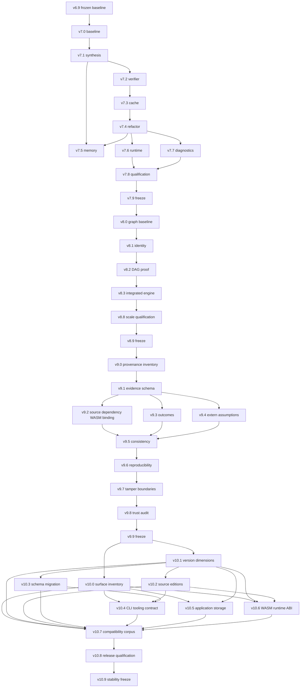

# Synthetix v7.0–v10.9 기술 로드맵

이 문서는 v7–v10 구현 계획이다. 기준 checkout은 `main`의 `4f13d08`이며 분석 시작
시점의 작업 트리는 깨끗했다. 로드맵 작성 중에는 코드 변경이나 새 성능 측정을 하지
않았다. 이후 milestone 실행은 그 시점의 clean commit과 실제 consumer를 확인하고,
결과는 각 benchmark report에 기록한다.

현재 상태: v7.0 clean baseline, v7.1 bounded synthesis optimization, v7.2 verifier query reuse,
v7.3 process-local proof cache, v7.4 core lowering refactor, v7.5 measured memory gate,
v7.6 WASM/browser bundle, v7.7 CLI/docs, v7.8 four-platform qualification은 PASS다. v7.5
runtime memory optimization은 NOT NEEDED이며 v7.9 Freeze 검증이 진행 중이다. v8–v10 구현은
시작하지 않았다. 결과는 [v7.0 baseline](v7-benchmark-baseline.md), [v7.1 comparison](v7.1-benchmark.md),
[v7.2 comparison](v7.2-benchmark.md), [v7.3 proof-cache report](v7.3-benchmark.md),
[v7.4 core-lowering report](v7.4-benchmark.md), [v7.5 memory report](v7.5-benchmark.md),
[v7.6 bundle report](v7.6-benchmark.md), [v7.7 CLI/docs report](v7.7-benchmark.md),
[v7.8 platform/package report](v7.8-benchmark.md),
[v7.9 local freeze evidence](v7.9-benchmark.md)에서 확인한다.

## 핵심 근거

| 판단 | 근거 |
| --- | --- |
| v6 benchmark와 측정 한계 | [최종 결과](v6-benchmark-final.md), [비교](v6-benchmark-final-comparison.md), [JSON](v6-benchmark-final.json), [compositional 결과](v6-benchmark-compositional-after.md) |
| synthesis·verification·project 구조 | [`axiom-synth`](../crates/axiom-synth/src/lib.rs#L128), [`axiom-verify`](../crates/axiom-verify/src/lib.rs#L158), [`axiom-project`](../crates/axiom-project/src/lib.rs) |
| cache·web proof artifact·CLI report·semantics id | [cache key](../crates/axiom-cli/src/web.rs#L418), [web manifest](../crates/axiom-cli/src/web.rs#L1554), [CLI report hash](../crates/axiom-cli/src/main.rs#L471), [semantics id](../crates/axiom-parser/src/ast.rs#L20) |
| runtime/trust 경계와 release proof | [application boundary](application-boundary.md), [semantics](semantics.md), [release workflow](../.github/workflows/release.yml), [VSIX check](../editors/vscode/check-vsix.js), [VSCode package](../editors/vscode/package.json) |

## 기준선과 실제 근거

### 저장소와 제품 경계

- Cargo workspace는 `axiom-ami`, `axiom-parser`, `axiom-verify`,
  `axiom-synth`, `axiom-wasm`, `axiom-project`, `axiom-application`,
  `axiom-cli`의 8개 crate로 구성된다. CLI crate는 library가 아니라 binary다.
- 현재 흐름은 `.ax` 파싱·검사 → bounded synthesis → Z3 proof → AMI → 직접
  WASM emission → browser/application boundary다. Browser DOM, state, storage,
  effect adapter와 `extern` 구현은 proof core 밖에 있다.
- proof 영역은 scalar `u32`/`i32`/`bool`, 제한된 fixed array, bounded loop,
  한 종류의 bounded structural recursion이다. Array/loop/recursion은 기존 앱
  `List`나 무제한 memory/recursion을 뜻하지 않는다.
- `axiom-project`는 import/export, dependency cycle 검사, dependency-first
  summary proof, expanded legacy view를 함께 제공한다. `axiom dev`의 verified
  candidate cache는 source bytes, semantics id, synthesis options, dependency
  keys를 비교하며 process-local이다. 실패한 proof는 저장하지 않는다.
- `axiom-synth`는 bounded enumerative search와 CEGIS를 사용한다. timeout은
  현재 candidate verification 사이에서 확인되며 이미 실행 중인 Z3 query를
  취소하지 않는다. resource limit에 도달한 뒤에도 일부 exact-result 및
  max/min 패턴만 proof-checked fallback을 시도한다.
- WASM은 `axiom-wasm`에서 직접 인코딩되고 로컬 실행에는 `wasmi`를 쓴다.
  Browser runtime은 `axiom-cli/src/web.rs`가 생성한다. v6.9 release workflow는
  네 OS/architecture의 native CLI smoke와 VSIX package check를 수행한다.

### Benchmark에서 관찰한 문제와 한계

v6 final report는 macOS arm64, rustc 1.98.1, Node 24.19.0, release benchmark의
세 번 반복 median이다. 다만 그 보고서는 commit `103e073`과 dirty working tree에서
생성됐다. cache timing은 debug test profile이고 일부 generated runtime 측정은
단일 실행이다. 따라서 아래 수치는 v7 비교 기준이 아니라 재측정 대상을 고르는
역사적 근거다. v7.0은 현재 clean v6.9 checkout에서 같은 workload를 다시 잰다.

| 관찰 | 측정 결과 | 로드맵에서의 사용 |
| --- | --- | --- |
| `property_clamp` search | 273.554 ms; 88,136 generated, 59,386 rejected | enumeration과 candidate 비용을 v7.1에서 측정 |
| `maximum_3` search | 238.523 ms; 138,137 generated, 138,136 rejected, 1 proof attempt | fallback은 해결책의 일부이지 일반 search 확장으로 취급하지 않음 |
| `sum_3` search | 141.764 ms; 138,136 rejected | CEGIS/search 후보 생성 비용의 대표 case |
| `bitwise_combo` search | 76.516 ms; 96,370 rejected, 1 proof attempt | 검증 비용보다 후보 생성 비용이 큰지 분리 측정 |
| `sum_8` | fallback 포함 1.482 ms, 1 generated candidate | 이전 sample Cartesian-product resource failure의 한정된 해결 |
| `cegis_hidden_nine` | `RESOURCE_LIMIT` | fallback이 모든 search failure를 해결하지 않음을 유지 |
| 5-contract cache | cold 1,401.386 ms; warm 0.625 ms | cache가 유용하지만 debug profile의 단일-host 측정임을 표시 |
| 32-module chain cache | cold 486.586 ms; warm 3.772 ms | fan-in/fan-out DAG와 실제 변경 전파를 추가 측정 |
| compositional chain depth 8 | summary 5.521 ms; release project build 28.685 ms | 깊이 외 graph 형태와 parse/link 비용을 분리 |

v6 corpus는 `NO_CANDIDATE`를 관찰하지 못했다. Peak-memory 값은 candidate AST와
sample vector의 추정치로, allocator, Z3, process, browser engine memory를
포함하지 않는다. 현 benchmark에는 실제 RSS/allocations, build/test/CI duration의
기준선이 없다. 이는 측정 공백이지 이미 확인된 memory 병목은 아니다.

### 기술 부채와 중요도

| 영역 / 심각도 | 실제 근거와 영향 | 예정 위치 |
| --- | --- | --- |
| Performance / 높음 | v6 synthesis에서 대량 후보 생성·거절이 관찰됐고 `cegis_hidden_nine`은 여전히 resource-limited다. solver와 enumeration 시간을 따로 측정해야 한다. | v7.0–v7.2 |
| Incremental / 중간 | cache는 `axiom dev` process 안에서만 살며, benchmark는 주로 chain graph다. project parse/link 비용과 shared dependency 영향은 분리 측정되지 않았다. | v7.3, v8.0–v8.3, v8.8 |
| Architecture / 중간 | 전체 파일 줄 수(테스트 포함)는 `web.rs` 3,551줄로 proof/cache, artifact, JS 생성, dev server/watch를 함께 가진다. `project/lib.rs`는 2,077줄이며 linker와 page validation을 함께 가진다. `verify/lib.rs`는 2,614줄이고 lowering, definedness, compositional proof, SMT 경로가 모여 있다. 줄 수는 병목 증거가 아니므로 기존 seam과 변경 위험을 보고 제한적으로 분해한다. | v7.4, v7.6 |
| Memory evidence / 중간 | synthesis memory는 추정치뿐이며 실제 process peak나 allocation count가 없다. 전역 allocator를 추가할 근거는 없다. | v7.0, v7.5; R7-A |
| Test evidence / 중간 | v6 freeze는 workspace 146 tests, native CLI matrix 4/4, VSIX activation smoke를 보유한다. Workspace tests는 release workflow에서 Linux만 수행하며 static browser 검사는 별도의 수동 Chromium smoke였다. | v7.8–v7.9 |
| Documentation / 중간 | `docs/architecture.md`의 verifier limitation은 loop/array를 아직 다루지 않는다고 설명하는 반면 현재 AST, verifier, v6 semantics는 fixed array/loop/recursion을 구현으로 기록한다. `docs/semantics.md` 첫 단락도 broader semantics가 target이라고 적어 뒤의 v6 절과 어긋난다. | v7.7 |
| Tooling / 낮음 | static browser smoke에서 개발용 `/__synthetix/version` 요청이 500ms마다 404를 받았고 runtime은 이를 무시했다. VSCode 문서는 full LSP와 project-wide semantic completion이 의도적으로 deferred라고 명시한다. | v7.6; LSP는 R8-B |
| Compatibility / 높음 | CLI report에는 `v4.1-scalar-baseline`, parser/cache에는 `v6.3-bounded-program-model`, CLI report와 web proof manifest는 각각 format `4`, storage는 별도 schema version을 쓴다. 모든 Cargo crate는 `0.1.0`, VSIX는 `0.14.1`, 저장소의 마지막 tag는 `v0.14.0`이다. 이 값들이 각자 다른 역할일 수 있으나 관계를 설명하는 정책은 없다. | v9.0–v10.8 |
| Trust / 중간 | CLI report의 `stable_hash`는 FNV-1a 64-bit다. Web proof manifest는 schema `4`와 proof/effect 구분을 기록하지만 semantics id, source digest, WASM digest, tool build identity는 포함하지 않는다. Extern 구현은 타입만 확인되며 audit metadata는 `NOT_PROVIDED`다. | v9.0–v9.8 |
| Dependency / 낮음 | workspace manifest의 직접 의존성은 crate 역할과 연결돼 있고, 명백한 미사용 direct dependency는 발견하지 못했다. Z3는 bundled, wasmi는 필요한 기능만 켠다. 삭제 목적의 dependency milestone은 만들지 않는다. | 필요 시 v7.0 재측정 |

`TODO`/`FIXME`/`XXX` 표식이 실제 source TODO로 남아 있는 것은 확인하지 못했다.
`unsafe` 문자열 검색 결과는 verifier 테스트 이름이었다. 현재 `extern`은 DSL의
host-effect 경계이며 Rust `unsafe` FFI 구현이 아니다.

### 주요 방향 선택과 제외

| 후보 | 결정 | 근거 |
| --- | --- | --- |
| Optimization & Refactoring | **v7 선택** | v6 benchmark가 측정된 후보 생성 비용, cache 효과와 증거 공백을 남겼다. Proof classification과 observable behavior를 유지한다. |
| Incremental Project Engine | **v8 선택** | dependency graph, compositional proof, change-local work, process-local cache가 이미 제품 경로다. 기존 benchmark는 chain만 다뤄 DAG shape와 incremental edit를 추가로 qualification해야 한다. |
| Proof Provenance & Trust | **v9 선택** | `app.proof.json`, CLI report, WASM과 extern boundary가 이미 제품 산출물이다. Evidence를 exact source/semantics/candidate/executable에 연결하고 claim 범위를 드러내야 한다. |
| Stable Language & Ecosystem Contract | **v10 선택** | frozen semantics와 서로 다른 artifact/storage/release version이 공존한다. Surface별 support tier, compatibility window와 breaking-change migration을 확정한다. |
| Dynamic verified collection | 정식 milestone 제외 | v6.4 분석에서 fixed array+bounded loop가 현재 sum/search workload를 표현했고 가변 길이 verified output 소비자가 없었다. 새 workload가 오면 R8-C로 재평가한다. |
| WASI/Node/Edge backend | 정식 milestone 제외 | v6.7 분석에서 product-facing runtime은 browser/WASM이고 Node는 test host였다. 추가 target 소비자가 확인되지 않았다. |
| Full LSP, ML/LLM synthesis, distributed solver, cloud/DB, JIT, GPU | 정식 milestone 제외 | 저장소에 현재 수요·측정치·consumer가 없다. 관련 요청과 재현 사례가 확보될 때만 research gate를 연다. |
| Proof certificate / independently checkable SMT proof | Research Gate | 신뢰를 줄일 가능성은 있으나 현재 Z3 binding, consumer 요구, certificate 비용이 조사되지 않았다. v9에서 기본 구현으로 가정하지 않는다. |

## 상태 모델과 공통 완료 규칙

계획 단계 상태는 `PLANNED`이며 실행 때 아래 판정을 적용한다.

- **PASS**: milestone의 완료 기준과 저장된 evidence가 모두 통과했다.
- **PARTIAL**: 일부 산출물은 있지만 완료 증거가 부족하다. 의존 milestone은
  진행하지 않는다.
- **FAIL**: acceptance 또는 invariant가 깨졌다. 원인을 수정하고 해당 gate를
  다시 통과하기 전까지 downstream 작업을 멈춘다.
- **NOT NEEDED**: 사전에 적은 필요성 평가를 실행했고, 현재 workload/consumer로
  필요하지 않다는 대체 근거를 남겼다. 실패한 구현이나 일정 미달을 숨기는 데 쓰지
  않는다.

`same source → same semantics → same proof classification → same observable result`
는 v7 전체 invariant다. `VERIFIED`, `COUNTEREXAMPLE`, `SOLVER_UNKNOWN`,
`NO_CANDIDATE`, `TIMEOUT`, `RESOURCE_LIMIT`, `INVALID` 사이의 분류를 성능 최적화로
바꾸지 않는다. Synthesis의 동률 candidate가 달라지는 경우도 결과와 WASM이 의미상
동일하고 현재 artifact contract에 맞는지 별도로 증명한다.

각 milestone의 작업 규모는 S/M/L/Research로만 추정한다. 시간 단위 예측은 하지
않는다. Benchmark “필요”는 해당 단계가 performance claim을 하려는 경우의
재현 가능한 before/after 자료를 뜻한다. 기준선에서 차이가 보이지 않으면 최적화를
되돌리고 `NOT NEEDED` 또는 `PARTIAL`을 evidence에 따라 판정한다.

# v7 — Optimization & Refactoring

**Theme:** 의미를 바꾸지 않고 검색 비용, 중복 작업, 구조와 developer feedback을
개선한다. v7에서는 새 language semantics, backend, application behavior를 추가하지
않는다.

**Identity:** 같은 correctness를 더 빠르고 단순하게 만든다.

### v7.0 — Clean Performance and Architecture Baseline

- **목표·근거·작업:** dirty `103e073` benchmark를 고정 기준으로 삼지 않는다.
  clean v6.9 HEAD에서 기존 54-scenario corpus와 release path를 재생하고, toolchain,
  host, profile, repeats, `git status`, artifact sizes를 함께 남긴다. v6 corpus의
  `NO_CANDIDATE` 미관찰, RSS/CI duration 부재도 명시한다.
- **PASS / 검증·측정:** synthesis generation/rejection/Z3 시간을 구분하고,
  cache cold/warm/change, project parse/link/build, WASM bytes, Node runtime,
  CLI startup, workspace test/build duration을 기록한다. 동일 환경에서 결과를 다시
  생성해 count와 status가 같고 JSON/Markdown의 field가 일치한다.
- **의존·범위 밖·중단:** v6.9 clean tree와 기존 harness에 의존한다. 새 optimizer,
  숫자 성능 목표, 다른 host 결과의 직접 비교는 범위 밖이다. scenario result나
  benchmark environment를 재현할 수 없으면 v7.1 진입을 멈춘다.
- **계획:** 규모 M · 위험 낮음 · 구조 영향 낮음 · 회귀 위험 낮음 · benchmark 필수.

### v7.1 — Bounded Synthesis Hot Path

- **목표·근거·작업:** `property_clamp`, `maximum_3`, `sum_3`, `bitwise_combo`,
  `cegis_hidden_nine`에서 generation, sorting, structural deduplication, sample
  evaluation 중 실제 비용이 큰 한 경로만 개선한다. v6 fallback을 일반 search로
  오인하지 않고, sound한 pruning/cost reuse만 검토한다.
- **PASS / 검증·측정:** 선택한 workload의 동일 source·bounds에서 repeatable
  candidate-generation/rejection 또는 elapsed cost 감소를 보이고, 전체 결과
  classification, deterministic counters, AMI/reference/Z3/WASM 결과가 동일하다.
- **의존·범위 밖·중단:** v7.0 의존. 새 grammar, ML/e-graph, 더 큰 기본 budget은
  범위 밖이다. 후보 누락, 의미 변경, 다른 baseline case의 반복 regression이
  발견되면 해당 optimization을 revert하고 다음 synthesis 작업을 멈춘다.
- **계획:** 규모 M · 위험 중간 · 구조 영향 중간 · 회귀 위험 높음 · benchmark 필수.

### v7.2 — Verifier Query Reuse and Boundaries

- **목표·근거·작업:** 현재 `synthesize_result_inner`의 `check_contract` 다음에
  `search_with_options`가 같은 contract의 precondition satisfiability를 다시
  확인한다. 이를 확인 결과 재사용으로 줄이고, property-heavy case에서 Z3 query
  count와 translation cost를 따로 측정한다. Z3 cancellation/timeout은 binding이
  안전하게 지원하는 경우에만 별도 검토한다.
- **PASS / 검증·측정:** 동일 source에서 precondition/query 결과와 failure
  classification이 동일하고, 중복 query가 제거됐음이 counter로 증명된다.
  `property_max`, `property_clamp`, invalid/unsatisfiable fixtures 및 compositional
  call-precondition regression을 비교한다.
- **의존·범위 밖·중단:** v7.0–v7.1 의존. SMT theory 변경, proof obligation 축소,
  verifier와 synthesizer 결합은 범위 밖이다. `SolverUnknown`/counterexample의
  차이나 obligation 누락이 나오면 즉시 중단한다.
- **계획:** 규모 M · 위험 높음 · 구조 영향 중간 · 회귀 위험 높음 · benchmark 필수.

### v7.3 — Process-local Proof Cache

**상태: PASS — optimization NOT NEEDED.** Cache runtime 구현은 변경하지 않았다.
회귀 검증과 관찰된 lifecycle correctness를 통과했으며, 측정 구간이 겹치고 key 생성·lookup
비용이 분리되지 않아 runtime 최적화 근거는 없다. 세부 원자료는 [v7.3 benchmark](v7.3-benchmark.md)에 있다.

- **목표·근거·작업:** v6.5의 cache는 큰 cold/warm 차이를 보였지만 debug profile의
  제한된 graph 자료뿐이다. exact source bytes, semantics id, synthesis options,
  dependency key 계산과 불필요한 key comparison/clone을 profile하고 현재 cache
  lifecycle 안에서만 개선한다.
- **PASS / 검증·측정:** cold, warm, leaf/root/unrelated change, changed options,
  changed semantics, failed proof, deleted module cases에서 hit/miss/invalidation이
  정확하다. 저장 가능한 것은 proof-checked candidate뿐이며 미검증/부분 결과는
  cache에 남지 않는다.
- **의존·범위 밖·중단:** v7.0, v7.2 의존. disk/network cache와 proof 결과를
  재검증 없이 신뢰하는 일은 범위 밖이다. invalidation이 과소/과다하거나 실패 결과가
  재사용되면 downstream cache 작업을 멈춘다.
- **계획:** 규모 M · 위험 높음 · 구조 영향 중간 · 회귀 위험 높음 · benchmark 필수.

### v7.4 — Core Lowering and Project Code Boundaries

**상태: PASS — runtime optimization NOT NEEDED.** `SpecExpr::For` 구현 lowering은 private `lower_bounded_loop`로 분리됐다. 다섯 쌍의 benchmark에서 직접 lowering 관련 timing ranges가 모두 겹쳤으며, 속도 향상은 주장하지 않는다. CLI report와 WASM 출력, scalar 경계 runtime 결과는 before/after 동일하다. 세부 결과와 원자료는 [v7.4 benchmark](v7.4-benchmark.md), [JSON](v7.4-benchmark.json)에 있다. `axiom-project`의 graph/order 및 expansion seam은 이미 있으므로 추가 분리는 NOT NEEDED였다.

- **목표·근거·작업:** parser AST에서 AMI/definedness/SMT와 project linking으로
  가는 현재 경계를 정리한다. `verify/lib.rs`의 implementation lowering 및
  `project/lib.rs`의 graph/link/expand 경로에서 이미 드러난 책임 경계만 작은
  private function/module로 나눈다. 새 visitor framework나 crate는 추가하지 않는다.
- **PASS / 검증·측정:** public Rust API, diagnostics, proof classification, graph
  order, emitted candidates가 기존 fixture와 동일하다. 동일 benchmark에서 build/test
  시간이나 allocation regression이 없어야 하며, 실제 변경 가능한 단위가 명확해진다.
- **의존·범위 밖·중단:** v7.0–v7.3 의존. 파일 줄 수만 줄이는 변경, 새 IR, public API
  재설계는 범위 밖이다. module 분리가 call-site semantics나 source spans를 바꾸면
  revert한다.
- **계획:** 규모 M · 위험 중간 · 구조 영향 높음 · 회귀 위험 중간 · benchmark 필요.

### v7.5 — Measured Memory and Allocation Work

**상태: PASS — runtime memory optimization NOT NEEDED.** 동일 host/toolchain/profile/source snapshot/executable/fixtures의 두 process-RSS batch에서 네 workload를 각각 5회 측정했다. 결과는 RSS 감소 전후 비교가 아니며 runtime 개선을 주장하지 않는다. 기존 estimated-memory limit와 실행 결과를 보존했다. 상세 수치와 40개 raw run은 [v7.5 benchmark](v7.5-benchmark.md), [JSON](v7.5-benchmark.json)에 있다. v7.6–v7.8은 PASS이며 v7.9 Freeze 검증이 진행 중이다. v8–v10은 시작하지 않았다.

- **목표·근거·작업:** 현재 추정치가 실제 peak RSS와 다를 수 있으므로 우선 v7.0의
  candidate-heavy, array/loop/recursion workload에 대한 process peak 측정을 만든다.
  측정된 hotspot만 대상으로 clone, temporary vector, candidate lifetime을 줄인다.
- **PASS / 검증·측정:** peak memory가 반복 측정에서 감소하거나, 비교 가능한
  workload에서 실제 memory pressure가 없다는 evidence로 `NOT NEEDED`를 선언한다.
  이번 측정은 후자를 뒷받침한다. CEGIS의 268,435,456-byte 값은 synthesizer의
  estimated-memory limit이며 process RSS cap이 아니다. 기존 limits와 실행 결과는 그대로다.
- **의존·범위 밖·중단:** v7.0, v7.1 의존. 근거 없는 global allocator, custom arena,
  새로운 dependency는 범위 밖이다. host/profile이 다른 RSS를 직접 비교하면
  milestone을 보류한다.
- **계획:** 규모 M · 위험 중간 · 구조 영향 낮음 · 회귀 위험 중간 · benchmark 필수.

### v7.6 — WASM and Generated Browser Runtime

- **목표·근거·작업:** v6 final은 `fixed_array_sum4` 272-byte, bounded loop
  1,650-byte, recursion 1,457-byte WASM을 기록했고 static browser smoke에서는
  개발용 `/__synthetix/version` polling이 매 500ms 404를 받았다. emitter의 code
  size와 runtime 경계를 측정하고, static output에 개발용 polling이 불필요하면
  development mode에만 제한한다. Rust 안의 대형 JS template는 현재 generation
  seam을 유지한 채 분리할 수 있는지 함께 정리한다.
- **PASS / 검증·측정:** release fixture의 WASM/static bundle 크기와 boot/transition
  timings를 비교한다. Static page는 dev poll 없이 load, WASM call, persist/restore가
  되고 dev page는 source change reload가 유지된다. Browser console/network evidence와
  Node integration 결과를 각각 기록한다.
- **의존·범위 밖·중단:** v7.0, v7.4 의존. 새 runtime target, generated JS로 verified
  logic을 옮기는 일, WAT compiler 도입은 범위 밖이다. runtime 경계가 proof core를
  바꾸거나 static/dev behavior를 혼합하면 중단한다.
- **계획:** 규모 M · 위험 높음 · 구조 영향 중간 · 회귀 위험 높음 · benchmark 필수.

### v7.7 — CLI, Diagnostics, and Current Documentation

- **목표·근거·작업:** `axiom-cli/src/main.rs`의 command/report path와 VSCode의 CLI
  handoff를 조사해 중복 argument/report formatting을 최소 분해한다. Parser line/column,
  CLI report, Problems panel이 같은 source location/failure class를 보존하는지 고정한다.
  `docs/architecture.md`와 `docs/semantics.md`의 v6 구현 범위도 실제 code에 맞춘다.
- **PASS / 검증·측정:** legacy `check/build/run/app-run/dev`, output/report schema,
  exit states와 VSCode diagnostics의 회귀 fixture가 통과하고 기존 error의 분류·위치가
  같아야 한다. CLI startup/help와 workspace feedback 시간을 v7.0과 비교한다.
- **의존·범위 밖·중단:** v7.0, v7.4 의존. Full LSP, project-wide semantic completion,
  새 command framework는 R8-B 이전에는 범위 밖이다. machine-readable report 호환성이나
  source location이 바뀌면 중단한다.
- **계획:** 규모 M · 위험 중간 · 구조 영향 중간 · 회귀 위험 중간 · benchmark 필요.

### v7.8 — Build, CI, and Packaging Cost

- **목표·근거·작업:** current release workflow가 Linux workspace tests, 네 플랫폼의
  native CLI smoke, VSIX source/activation check를 각각 어떻게 수행하는지 기록한다.
  v7 build/test/CI 시간을 재고 불필요한 rebuild/cache miss와 package contents만 손본다.
- **PASS / 검증·측정:** clean checkout의 locked build, workspace regression, four-target
  CLI smoke, generated static release smoke, VSIX activation/hash check가 같은 결과를
  낸다. CI duration이나 package size 개선은 반복 측정으로만 주장한다.
- **의존·범위 밖·중단:** v7.0, v7.6, v7.7 의존. release tag 생성/배포와 dependency
  변경은 범위 밖이다. 하나라도 artifact 누락/해시 불일치가 나면 release gate를 멈춘다.
- **계획:** 규모 M · 위험 중간 · 구조 영향 낮음 · 회귀 위험 높음 · benchmark 필수.

### v7.9 — Semantics-preserving Freeze

- **목표·근거·작업:** v7 optimization/refactor 결과를 v6.9 frozen behavior와 대조하고
  모든 필수 milestone의 status/evidence를 닫는다.
- **PASS / 검증·측정:** source fixtures, parser/type diagnostics, reference/Z3/AMI/WASM
  differential regression, project cache invalidation, application/effect/runtime,
  benchmark before/after, clean build, four-target CLI smoke, VSIX와 browser/static
  smoke가 통과한다. 필수 `PARTIAL`/`FAIL`이 없고 각 `NOT NEEDED`에는 필요성 근거가 있다.
- **의존·범위 밖·중단:** v7.0–v7.8 결과에 의존한다. 미완료 required work를 `NOT NEEDED`
  로 바꾸는 일은 범위 밖이다. 어떤 semantics/runtime mismatch라도 있으면 freeze와 v8을
  멈춘다.
- **계획:** 규모 M · 위험 높음 · 구조 영향 중간 · 회귀 위험 높음 · benchmark 필수.

# v8 — Incremental Project Engine

**Identity:** 큰 프로젝트에서도 변경된 부분만 정확하게 다시 계산하고 검증한다.

**Theme:** 큰 프로젝트에서도 변경된 부분만 정확하게 다시 계산하고 검증한다. Existing graph/cache code and the v6 depth-8 call-chain plus 32-module caller-chain results justify qualification work, but no DAG-scale or parallel-verification benchmark currently exists. DAG shape coverage is a measurement gap, not a claimed performance bottleneck.

### v8.0 — Project Graph and Change Baseline

- **목표·근거·작업:** clean v7.9 checkout에서 project load/link/proof/build와 `axiom dev` edit loop를 baseline화한다. v6 chain evidence를 재현하고 fan-out/fan-in, shared callee, multiple roots, unrelated/leaf/root/import/manifest edits를 대표 graph fixtures로 추가한다.
- **PASS / 검증·측정:** cold/warm 및 edit class별 timing, graph shape, result class, invalidation set을 반복 생성하고 clean 상태와 함께 기록한다. 현재 call-chain 결과와 새 DAG coverage를 구분한다.
- **의존·범위 밖·중단:** v7.9 의존. 성능 목표치 약속, parallel scheduling, persistent cache는 범위 밖이다. 어떤 edit가 영향을 주는지 재현할 수 없으면 v8.1을 멈춘다.
- **계획:** 규모 M · 위험 낮음 · 구조 영향 낮음 · 회귀 위험 낮음 · benchmark 필수.

### v8.1 — Stable Module and Dependency Identity

- **목표·근거·작업:** project path/contract identity와 dependency order를 rename, same-name modules, shared dependencies, duplicate/cyclic edges에서 검증하고 deterministic identity/invalidation inputs를 고정한다.
- **PASS / 검증·측정:** 반복된 동일 graph가 같은 order, source mapping, diagnostics를 내고 잘못된/모호한 edge는 fail-closed한다. Graph mutations가 identity를 우연히 충돌시키지 않는다.
- **의존·범위 밖·중단:** v8.0 의존. 공개 import syntax 변경은 범위 밖이다. 다른 contract가 같은 identity가 되거나 valid edge가 사라지면 중단한다.
- **계획:** 규모 M · 위험 높음 · 구조 영향 중간 · 회귀 위험 높음 · benchmark 필요.

### v8.2 — DAG Compositional Proof

- **목표·근거·작업:** 현재 callee `requires`/`ensures` compositional proof를 chain에서 shared-callee DAG, multiple call sites, nested requires와 sibling modules로 확장 검증한다.
- **PASS / 검증·측정:** 각 call-site obligation을 증명한 경우에만 callee postcondition이 caller proof에 들어가며 reference/Z3 결과와 source-aware diagnostics가 일치한다. Graph shape별 solver invocation을 기록한다.
- **의존·범위 밖·중단:** v8.1 의존. Module recursion이나 proof rule widening은 범위 밖이다. 잘못된 precondition으로 VERIFIED가 나오면 v8을 중단한다.
- **계획:** 규모 L · 위험 높음 · 구조 영향 높음 · 회귀 위험 매우 높음 · benchmark 필수.

### v8.3 — Integrated Incremental Project Engine

- **목표·근거·작업:** 기존에 따로 제안했던 change-local parse/link, proof invalidation/recovery, cache lifetime, dev-loop failure isolation 및 precise project diagnostics를 한 end-to-end engine milestone으로 통합한다. 현재 watcher/load 경로와 process-local proof cache를 기반으로 변경 node와 영향 closure만 재계산하고 long-running process의 stale state를 회수한다.
- **PASS / 검증·측정:** clean full build와 incremental build가 linked graph, proof classification, diagnostics, static outputs에서 동일하다. no-op, leaf/root/import/manifest changes, delete/rename, valid→invalid→recovered edit cycle에서 정확한 affected closure, cache hit/miss, error location, bounded process state를 확인한다. Invalid input은 last good output을 덮지 않는다.
- **의존·범위 밖·중단:** v8.0–v8.2 및 v7.3 의존. Remote/disk cache, multi-user daemon, unbounded graph claims는 범위 밖이다. Under-invalidation, stale verified output, clean/incremental mismatch, unrecovered diagnostics가 있으면 engine qualification을 중단한다.
- **계획:** 규모 L · 위험 매우 높음 · 구조 영향 높음 · 회귀 위험 매우 높음 · benchmark 필수.

### v8.8 — DAG Scale Qualification

- **목표·근거·작업:** DAG fixtures, graph sizes and edit classes를 대상으로 scaling behavior와 pathological cases를 측정한다. 기존 chain 결과는 DAG performance claim에 쓰지 않는다.
- **PASS / 검증·측정:** clean/incremental outputs와 graph order가 결정적이고, resource bound가 지켜진다. 성능 개선은 baseline 대비 재현된 graph shape에만 주장한다.
- **의존·범위 밖·중단:** v8.0–v8.3 의존. 무제한 크기 보장과 parallel proof implementation은 R8-D가 채택되지 않는 한 범위 밖이다. pathological graph에서 correctness 또는 resource bound가 무너지면 freeze를 중단한다.
- **계획:** 규모 M · 위험 높음 · 구조 영향 중간 · 회귀 위험 높음 · benchmark 필수.

### v8.9 — Incremental Project Engine Freeze

- **목표·근거·작업:** graph identity, compositional proof, incremental parse/link/proof, invalidation/recovery, diagnostics와 measured scale envelope를 하나의 frozen engine contract로 확정한다.
- **PASS / 검증·측정:** DAG mutation corpus, clean-vs-incremental differential, repeated scale benchmark, workspace regression, four-platform CLI, VSIX/browser static qualification이 통과하고 필수 항목에 `PARTIAL`/`FAIL`이 없다.
- **의존·범위 밖·중단:** v8.0–v8.3 및 v8.8 의존. Persistent cache는 별도 research gate다. Stale result나 unsupported scale claim이 있으면 v9를 시작하지 않는다.
- **계획:** 규모 M · 위험 매우 높음 · 구조 영향 중간 · 회귀 위험 매우 높음 · benchmark 필수.

# v9 — Proof Provenance & Trust

**Identity:** 어떤 source가 어떤 proof와 executable을 만들었는지 기계적으로 추적한다.

**Theme:** canonical evidence로 source, dependencies, semantics profile, candidate, outcome, WASM과 external assumptions를 묶는다. 이는 proof engine이 참이라는 독립 수학 증명이 아니다. v9는 provenance와 trust claim만 다루며 reader compatibility와 schema migration은 v10 책임이다.

### v9.0 — Provenance and Trust Claim Inventory

- **목표·근거·작업:** CLI report, web proof manifest, WASM, semantics ids의 producer·field·proof scope와 현재 claim의 생성 경로를 inventory한다. 장기 reader support와 external consumer compatibility는 v10에서 결정한다.
- **PASS / 검증·측정:** 모든 field가 source of truth, cache-only, UI/runtime hint,
  integrity fingerprint 중 하나로 분류되고, trust claim과 current evidence를 나눈다.
- **의존·범위 밖·중단:** v8.9 의존. 서명, supply-chain attestation, solver proof certificate는
  R9-A 채택 전 범위 밖이다. 어떤 field가 어떤 proof claim을 뒷받침하는지 확인할 수 없으면
  canonical record를 설계하지 않는다.
- **계획:** 규모 S · 위험 낮음 · 구조 영향 낮음 · 회귀 위험 낮음 · benchmark 불필요.

### v9.1 — Canonical Proof Evidence

- **목표·근거·작업:** CLI report와 web proof manifest의 format version, semantics/model
  version, verified scope, synthesis bounds를 서로 다른 필드로 정의한다. Success와 failure
  result vocabulary를 고정하고, 현재 external boundary 구분을 보존한다.
- **PASS / 검증·측정:** 새 canonical evidence record가 required proof fields와 outcome vocabulary를 round-trip하며 보존한다. Legacy version-4 reader/migration 지원은 v10의 결정과 완료 기준이다.
- **의존·범위 밖·중단:** v9.0 의존. Source semantics 변경은 범위 밖이다. `VERIFIED`가
  `UNVERIFIED` extern implementation까지 확장되거나 canonical record의 required evidence가
  조용히 잘리면 중단한다.
- **계획:** 규모 M · 위험 높음 · 구조 영향 중간 · 회귀 위험 높음 · benchmark 불필요.

### v9.2 — Source, Semantics, Candidate, and WASM Identity

- **목표·근거·작업:** Web manifest에 project-relative source, exact source/dependency
  digests, candidate identity, generated WASM digest, semantics id와 build identity를 연결한다.
  현재 CLI FNV-1a 64-bit hash는 cryptographic authenticity가 아님을 표현한다.
- **PASS / 검증·측정:** Static fixture의 source/dependency/WASM bytes를 manifest field와
  다시 비교해 match/mismatch를 판정한다. Digest 알고리즘은 consumer threat model에 따라
  결정하고, cryptographic claim을 하면 표준 SHA-256 implementation을 사용한다.
- **의존·범위 밖·중단:** v9.1 의존. Signed provenance는 R9-A 연구 gate의 채택 기준을
  통과하기 전에는 범위 밖이다. Digest mismatch가 build success로 표시되면 중단한다.
- **계획:** 규모 M · 위험 높음 · 구조 영향 중간 · 회귀 위험 높음 · artifact-size benchmark 필요.

### v9.3 — Complete Proof Outcome Records

- **목표·근거·작업:** CLI already reports `INVALID`, `TIMEOUT`, `RESOURCE_LIMIT`, counterexample
  및 verified result를 나눠 기록한다. Project artifact에서도 source별 outcome, synthesis
  bounds, diagnostic, candidate/proof status가 실패 때도 혼동 없이 나타나는지 통일한다.
- **PASS / 검증·측정:** 각 state fixture에서 machine parser가 같은 classification을 읽고,
  실패 case는 verified/WASM output을 주장하지 않는다. Manifest size와 serialization time을
  기존 결과와 비교한다.
- **의존·범위 밖·중단:** v9.1–v9.2 의존. Speculation 기반 “불가능” 판정은 범위 밖이다.
  `NO_CANDIDATE`/`RESOURCE_LIMIT`를 contradiction으로 표현하면 중단한다.
- **계획:** 규모 M · 위험 중간 · 구조 영향 낮음 · 회귀 위험 중간 · benchmark 필요.

### v9.4 — External Effect Assumption Records

- **목표·근거·작업:** `extern` implementation은 현재 UNVERIFIED이고 response는 declared
  type만 검사하며 audit status는 `NOT_PROVIDED`다. Manifest는 declaration, source,
  effect class, response type validation, host-supplied optional evidence를 각각 표시한다.
- **PASS / 검증·측정:** Adapter 미등록/오류/잘못된 응답과 정상 응답 모두 proof result와
  application runtime error를 분리한다. Optional host evidence가 빠지면 `NOT_PROVIDED`를
  유지하며 이를 VERIFIED로 승격하지 않는다.
- **의존·범위 밖·중단:** v9.1 의존. Network/DB/external facts의 correctness를 증명하는 일은
  범위 밖이다. Host data를 proof fact로 조용히 승격하면 중단한다.
- **계획:** 규모 M · 위험 높음 · 구조 영향 중간 · 회귀 위험 높음 · benchmark 불필요.

### v9.5 — Artifact Consistency Check

- **목표·근거·작업:** Build integration가 emitted static files, proof manifest, source snapshots,
  WASM exports and hashes가 한 build에 속하는지 cross-check한다. 기존 `axiom build`의
  output contract를 유지한다.
- **PASS / 검증·측정:** Clean build와 deliberate tamper fixtures가 각각 consistent/invalid로
  분류된다. 검사는 Z3를 다시 실행하지 않으며 `proof verified`의 독립 재증명이라 부르지 않는다.
- **의존·범위 밖·중단:** v9.1–v9.4 의존. New cloud/signing service는 범위 밖이다. Hash,
  contract name, source path 간 하나라도 불일치하면 release output을 거부한다.
- **계획:** 규모 M · 위험 높음 · 구조 영향 중간 · 회귀 위험 높음 · benchmark 필요.

### v9.6 — Reproducible Manifest and Bundle

- **목표·근거·작업:** v6.9가 동일 host의 두 project directory에서 static files를 비교한 근거를
  반복하고, 새 manifest fields가 output determinism을 깨지 않는지 확인한다.
- **PASS / 검증·측정:** 동일 clean source, locked dependencies, toolchain, config에서 두 번
  생성한 static files와 manifest가 byte-identical하다. Timestamp/build path 같은 의도적
  nondeterministic fields는 명시하거나 산출물에서 제외한다.
- **의존·범위 밖·중단:** v9.2–v9.5 의존. 서로 다른 compiler/OS 간 byte identity를
  약속하지 않는다. Same-environment output mismatch가 설명되지 않으면 freeze를 멈춘다.
- **계획:** 규모 M · 위험 중간 · 구조 영향 낮음 · 회귀 위험 중간 · benchmark 필수.

### v9.7 — Tamper and Integrity Boundaries

- **목표·근거·작업:** source/dependency/candidate/WASM evidence를 변조하는 fixture로 integrity verifier의 감지 범위와 한계를 고정한다.
- **PASS / 검증·측정:** source, dependency, semantics, candidate, outcome, WASM의 각 field 단위 변조가 검출되고, digest 검사는 source identity proof나 solver 재검증을 대신하지 않는다.
- **의존·범위 밖·중단:** v9.2–v9.6 의존. Consumer migration policy는 v10 범위다. 검증 가능한 bytes의 tamper를 통과시키면 중단한다.
- **계획:** 규모 M · 위험 높음 · 구조 영향 낮음 · 회귀 위험 높음 · benchmark 불필요.

### v9.8 — Provenance and Trust Claim Audit

- **목표·근거·작업:** manifest, CLI output, release notes가 `VERIFIED`의 정확한 범위, solver
  assumption, WASM conformance, source hash, external boundary를 과장하지 않는지 검토한다.
- **PASS / 검증·측정:** 각 claim이 machine-readable evidence 또는 documented assumption에
  연결된다. `FNV1a64`는 digest only, Z3 proof result는 solver와 translation TCB에 의존,
  external adapter는 type-checked only라고 분명하다.
- **의존·범위 밖·중단:** v9.0–v9.7 의존. Marketing-only claim은 범위 밖이다. Claim에
  반례가 있으면 v9.9 freeze를 막는다.
- **계획:** 규모 S · 위험 중간 · 구조 영향 낮음 · 회귀 위험 낮음 · benchmark 불필요.

### v9.9 — Provenance and Trust Freeze

- **목표·근거·작업:** canonical evidence, identities, outcomes, external assumptions, tamper checks, reproducibility와 trust claims를 freeze한다. Consumer compatibility is explicitly deferred to v10.
- **PASS / 검증·측정:** evidence fixtures, tamper cases, clean/reproducible build, workspace regression, four-target CLI, VSIX and browser/static qualification pass; required items have no `PARTIAL`/`FAIL`.
- **의존·범위 밖·중단:** v9.0–v9.8 의존. Reader migration과 long-term schema support는 범위 밖이며 v10. Unimplemented proof certificate를 claim하지 않는다. Integrity gap이 있으면 v10을 멈춘다.
- **계획:** 규모 M · 위험 높음 · 구조 영향 중간 · 회귀 위험 높음 · benchmark 필수.

# v10 — Stable Language & Ecosystem Contract

**Identity:** 언어와 도구가 발전해도 기존 사용자가 의존할 수 있는 안정성 계약을 확정한다.

**Theme:** 각 ecosystem surface를 stable·experimental·internal로 분류하고, supported version, reader/migration, deprecation 및 breaking-change 경로를 정한다. v10.9는 이 stability promise의 범위를 freeze하며 Synthetix 1.0 release를 선언하지 않는다.

| Stability surface | v10 계약 범위 |
| --- | --- |
| Source Language / Edition | Edition 선택과 기존 source 해석 유지 (v10.2) |
| Semantics Profile | Capability/version 조합과 cache invalidation (v10.1) |
| Proof Artifact | Schema reader, migration, fail-closed 규칙 (v10.3) |
| CLI / Release Mapping | 명령·출력 계약과 binary/tag/package 버전 관계 (v10.4) |
| VSCode / Tooling | Extension activation과 bundled CLI 지원 관계 (v10.4) |
| Application / Storage | Application 오류 경계와 storage migration 소유권 (v10.5) |
| WASM Runtime ABI | Export/import/calling convention 호환성 (v10.6) |
| Rust API | 실제 downstream consumer가 확인될 때만 R10-A Research Gate로 평가 |

### v10.0 — Stable Surface and Consumer Decision

- **목표·근거·작업:** `.ax` grammar, `synthetix.toml`, CLI commands/options/output,
  `window.synthetix` runtime ABI, `app.proof.json`, semantics profile, application storage,
  VSCode/tooling, release/version mapping, Rust crate exports를 surface별로 inventory하고,
  consumer evidence, stability tier, support/deprecation policy 초안을 정한다.
- **PASS / 검증·측정:** 각 surface가 stable, experimental, internal 중 하나로 승인되고
  consumer evidence가 기록된다. Cargo crate `0.1.0`을 외부 Rust API 안정성으로 오해하지
  않도록 policy를 둔다.
- **의존·범위 밖·중단:** v9.9 의존. Evidence 없는 crates.io/support promise는 범위 밖이다.
  실제 consumer가 누락된 public breaking change가 나오면 version plan을 멈춘다.
- **계획:** 규모 M · 위험 중간 · 구조 영향 중간 · 회귀 위험 중간 · benchmark 불필요.

### v10.1 — Semantics and Capability Version Matrix

- **목표·근거·작업:** scalar frozen model, bounded arrays/loops/recursion, verifier lowering,
  WASM ABI, report schema와 proof cache의 version identifiers가 서로 무엇을 무효화하는지
  선언한다. `v4.1-scalar-baseline`과 `v6.3-bounded-program-model`의 역할을 설명한다.
- **PASS / 검증·측정:** Cache keys, CLI report, web proof manifest, benchmark metadata가
  올바른 version dimension을 기록하고, version bump tests가 필요한 cache/schema invalidation만
  일으킨다.
- **의존·범위 밖·중단:** v9.1, v9.2 의존. 구현 semantics를 바꾸는 일은 범위 밖이다.
  같은 semantic profile의 stale cache가 hit하면 중단한다.
- **계획:** 규모 M · 위험 높음 · 구조 영향 중간 · 회귀 위험 높음 · benchmark 필요.

### v10.2 — Source Edition Selection

- **목표·근거·작업:** 미래에 source grammar/meaning이 바뀌는 경우 기존 files를 조용히
  재해석하지 않도록 project-level language edition 규칙을 정의한다. 필요하다면 기존 manifest
  default를 legacy edition으로 유지하고 unknown edition을 거부한다.
- **PASS / 검증·측정:** Legacy `.ax` files의 parse/type/proof result가 이전 edition과 같고,
  new syntax는 명시한 edition에서만 허용된다. Missing/unknown edition behavior가 fixtures로
  고정된다.
- **의존·범위 밖·중단:** v10.1 의존. New operators, collections, unrestricted recursion은
  범위 밖이다. Existing source가 edition migration 없이 다른 meaning을 얻으면 중단한다.
- **계획:** 규모 M · 위험 높음 · 구조 영향 중간 · 회귀 위험 높음 · benchmark 불필요.

### v10.3 — Proof Artifact Schema Migration Policy

- **목표·근거·작업:** v4 report/proof manifests와 v9 canonical evidence schema 사이의
  reader, migration, rejection rules를 고정한다. Application의 `storage_schema_version`은
  별도 surface로 두고 migration 책임은 v10.5에서 정한다.
- **PASS / 검증·측정:** Supported legacy schema는 deterministic migration/reading을 하고,
  unknown major/corrupt/incomplete fields는 fail-closed한다. Migration은 proof semantics를
  재해석하지 않는다.
- **의존·범위 밖·중단:** v9.9, v10.1 의존. Browser storage migration은 범위 밖이다.
  Corrupt input이 verified status로 올라가면 중단한다.
- **계획:** 규모 M · 위험 높음 · 구조 영향 중간 · 회귀 위험 높음 · benchmark 불필요.

### v10.4 — CLI, VSCode, and Tooling Contract

- **목표·근거·작업:** CLI binary version/report versions, Cargo crate versions, Git tags,
  VSIX version 및 bundled target CLIs의 mapping을 정의한다. `axiom --version`과 machine-readable
  report version이 없다면 approved command/field로 제공하고 error/exit behavior를 고정한다.
- **PASS / 검증·측정:** Release CI가 manifest의 approved mapping과 모든 bundled platform CLI를
  확인하고, VSIX activation smoke를 실행한다. Legacy `check/build/run/app-run/dev` 및 flags는
  별도 migration notice 없이 깨지지 않는다.
- **의존·범위 밖·중단:** v10.0–v10.3 의존. Release/publish는 이 계획 문서의 범위 밖이다.
  Cargo package, tag, VSIX가 의도치 않게 서로 다른 CLI를 지시하면 release gate를 중단한다.
- **계획:** 규모 M · 위험 높음 · 구조 영향 낮음 · 회귀 위험 높음 · benchmark 불필요.

### v10.5 — Application and Storage Compatibility

- **목표·근거·작업:** Host effects, application JSON values, persisted
  `storage_schema_version`의 support와 migration contract를 proof evidence/schema reader와
  분리한다. Verified core change가 browser storage나 external response를 자동으로 trust하지
  않게 한다.
- **PASS / 검증·측정:** v5.9 state/effect path와 current restore/migration fixtures가 유지되고,
  storage migration failure가 application error로 남으며 ProofResult로 변하지 않는다.
- **의존·범위 밖·중단:** v10.0–v10.1 의존. Database/auth persistence와 extern
  implementation verification은 범위 밖이다. Storage failure가 proof classification으로 바뀌면
  중단한다.
- **계획:** 규모 M · 위험 높음 · 구조 영향 중간 · 회귀 위험 높음 · benchmark 불필요.

### v10.6 — WASM Runtime ABI Compatibility

- **목표·근거·작업:** Verified scalar calling convention, WASM export names/signatures,
  host imports와 ABI version identity를 surface matrix에 연결한다. ABI change가 semantics profile,
  artifact identity, host adapter에 미치는 breaking boundary를 명시한다.
- **PASS / 검증·측정:** 각 supported ABI profile에 reference/AMI/WASM/runtime conformance fixture가
  있고 ABI mismatch가 명시적으로 reject되거나 migration된다. Host/runtime failure는 proof outcome으로
  바뀌지 않는다.
- **의존·범위 밖·중단:** v10.0–v10.2 의존. WASI/Node/Edge deployment 추가는 범위 밖이다. ABI
  mismatch가 verified candidate의 meaning을 바꾸면 중단한다.
- **계획:** 규모 M · 위험 높음 · 구조 영향 중간 · 회귀 위험 매우 높음 · benchmark 필요.

### v10.7 — Compatibility Regression Corpus

- **목표·근거·작업:** v10.1–v10.6에서 선언한 source edition, semantics profile, proof artifact
  schema/reader, CLI, VSCode, storage migration, WASM ABI의 전체 compatibility matrix를 회귀
  corpus로 고정한다. Rust API stability는 현 v10 numbered milestone과 이 matrix에서 제외하고
  R10-A Research Gate로만 유지한다. Gate가 채택 기준을 통과해도 promotion policy에 따라 다음
  roadmap revision 또는 major에서 정식 milestone로 제안하며, 현재 v10 번호를 재정의하지 않는다.
- **PASS / 검증·측정:** 선언한 모든 supported 조합에서 기존 source/result, artifact read/migration,
  CLI·VSCode 계약, storage migration, WASM ABI conformance가 유지된다. 모든 unsupported 조합은
  명시적으로 거부되며 각 matrix entry에 재현 가능한 fixture와 기대 결과가 있다.
- **의존·범위 밖·중단:** v10.0–v10.6 의존. Release candidate/platform qualification은 v10.8이다.
  누락된 supported entry, silent migration/data loss, stale verified artifact 또는 ABI mismatch가
  통과하면 중단한다.
- **계획:** 규모 L · 위험 높음 · 구조 영향 중간 · 회귀 위험 매우 높음 · benchmark 불필요.

### v10.8 — Release Qualification

- **목표·근거·작업:** v10.7 compatibility corpus가 통과한 clean release candidate를 전체
  supported platform/tooling matrix에서 qualification한다.
- **PASS / 검증·측정:** Clean checkout에서 workspace tests, Linux x64/Windows x64/macOS arm64/macOS x64
  CLI smoke, VSIX package/activation, static browser load/call/persistence, artifact consistency,
  same-toolchain reproducibility evidence가 모두 통과한다.
- **의존·범위 밖·중단:** v10.0–v10.7 의존. v10.9 판정 전 publish/release creation은 하지 않는다.
  Trust/compatibility mismatch가 있으면 candidate를 중단한다.
- **계획:** 규모 L · 위험 높음 · 구조 영향 중간 · 회귀 위험 매우 높음 · benchmark 필수.

### v10.9 — Stable Language & Ecosystem Contract Freeze

- **목표·근거·작업:** source edition, semantics profiles, artifact schema/readers, CLI,
  VSCode/tooling, application/storage, runtime ABI, release/version mapping과 Rust API의
  stable/experimental/internal 범위 및 breaking-change migration 절차를 freeze한다. Rust API는
  향후 roadmap revision에서 별도 채택되지 않으면 internal로 남긴다. 이 계약은 1.0 release
  선언이 아니다.
- **PASS / 검증·측정:** v10.0–v10.8 evidence가 닫히고 required milestones 모두 PASS이며,
  `NOT NEEDED`는 사용자/consumer/benchmark evidence를 포함한다. Migration guide와 supported
  surface matrix가 clean checkout에서 검증된다.
- **의존·범위 밖·중단:** 모든 v10 milestone 의존. Unreleased proof-certificate, dynamic
  collection, extra runtime target을 freeze claim에 넣지 않는다. 남은 `PARTIAL`/`FAIL`이
  있으면 major freeze를 선언하지 않는다.
- **계획:** 규모 M · 위험 매우 높음 · 구조 영향 높음 · 회귀 위험 매우 높음 · benchmark 필수.

## Research Gates

연구 gate는 기본 milestone이 아니다. Gate 통과만으로 implementation milestone이 생성되지는 않는다.

### Promotion Policy

1. Gate 질문에 맞는 named consumer, reproducible benchmark 또는 concrete blocker를 확인한다.
2. Isolated experiment로 correctness/semantics, 실측 benefit, maintenance cost를 검증한다.
3. 채택되면 다음 roadmap revision 또는 다음 major에 정식 milestone로 제안한다. 현재 major의
   기존 scope/acceptance는 중간에 재정의하지 않는다.
4. 현재 major의 필수 acceptance를 막는 blocker만 예외로 prerequisite milestone에 삽입할 수
   있다. 이유, dependency, 독립 PASS/verification criteria, roadmap change 기록을 함께 남긴다.
5. 채택하지 않은 gate는 결과와 함께 닫는다. 번호가 있는 milestone을 `DEFERRED`로 남기지
   않는다.

| Gate | 질문과 채택 기준 | 채택하지 않을 조건 |
| --- | --- | --- |
| R7-A 실제 memory/allocation profiler | Current v7 workloads에서 RSS/allocations가 throughput, default limit 또는 developer host를 실제로 제한하는가? Cross-platform 측정이 repeatable해야 한다. | Estimated-memory limit만 달라지고 actual peak pressure가 없으면 custom allocator/arena는 `NOT NEEDED`. |
| R7-B Z3 in-flight cancellation | Pinned Z3 binding이 query cancel/timeout 결과를 `UNKNOWN/TIMEOUT`과 구분해 안전하게 노출하는가? Interrupted proof가 verified로 캐시되지 않아야 한다. | Safe cancel API나 counterevidence가 없으면 between-query timeout을 유지하고 제한을 문서화한다. |
| R8-A Cross-process proof cache | Restart 간 candidate 재사용이 실제 consumer 시간을 줄이는가? Cache read가 source/semantics/dependency identity를 검증하고, proof result를 재검증 없이 신뢰하지 않는가? | Warm process cache로 충분하거나 disk cache가 correctness/maintenance cost를 넘으면 `NOT NEEDED`. |
| R8-B Full LSP/project semantic completion | 사용자 요청이나 repeated workflow evidence가 hover/completion/signature help의 현재 정적 구현 한계를 보여주는가? | 단지 일반적인 IDE parity만으로는 도입하지 않는다. |
| R8-C Dynamic verified collection | Real contract fixture가 fixed arrays/loops로 표현되지 않는 variable-length verified behavior를 요구하는가? Empty/out-of-bounds/termination/resource semantics와 WASM ABI를 먼저 정의해야 한다. | Application `List` 사용만으로는 proof collection 수요가 아니다. |
| R8-D Parallel independent-module verification | named consumer or measured DAG bottleneck and an isolated experiment showing deterministic resource scheduling and net benefit are required. No such evidence is currently present. | Serial verification meets measured needs or parallelism complicates solver/resource determinism without repeatable gain. |
| R9-A Proof certificate, signature, supply-chain attestation | External consumer가 Z3 solver를 신뢰하지 않고 manifest/artifact를 independently validate해야 하는가? Producer, checker, key ownership, update/revocation, build provenance까지 설계돼야 한다. | Hash/manifest consumer만 있고 proof certificate checker가 없으면 signatures를 추가하지 않는다. |
| R10-A Stable Rust library API | Repository 외부 downstream crate가 특정 public Rust APIs에 의존하는 증거가 있는가? | 소비자가 없으면 API stability를 약속하지 않고 internal implementation surface로 둔다. |
| R10-B New runtime/backend | Named deployment consumer와 measured blocker가 있는가? | Node test host 사용만으로 Node deployment target을 추가하지 않는다. |

## 최종 v7.0–v10.9 목록

- **v7.0** — clean performance·architecture baseline.
- **v7.1** — measured bounded-synthesis hot path.
- **v7.2** — verifier query reuse and boundaries.
- **v7.3** — process-local proof cache correctness/cost.
- **v7.4** — core lowering/project boundary refactor.
- **v7.5** — evidence-based memory/allocation work.
- **v7.6** — WASM and generated browser runtime.
- **v7.7** — CLI, diagnostics, and current documentation.
- **v7.8** — build, CI, and packaging qualification.
- **v7.9** — semantics-preserving freeze.
- **v8.0** — graph/change workload baseline.
- **v8.1** — stable module/dependency identity.
- **v8.2** — DAG compositional-proof conformance.
- **v8.3** — integrated incremental project engine.
- **v8.4–v8.7** — intentionally unused; concerns are integrated in v8.3.
- **v8.8** — DAG scale and pathological-graph qualification.
- **v8.9** — incremental project engine freeze.
- **v9.0** — provenance/trust inventory.
- **v9.1** — canonical proof evidence.
- **v9.2** — source, dependency, semantics, candidate, and WASM identity.
- **v9.3** — complete proof outcome records.
- **v9.4** — external-effect assumptions.
- **v9.5** — artifact consistency checks.
- **v9.6** — reproducible manifest and bundle.
- **v9.7** — tamper and integrity boundaries.
- **v9.8** — provenance/trust-claim audit.
- **v9.9** — provenance and trust freeze.
- **v10.0** — stable surface and consumer decision.
- **v10.1** — semantics/capability version matrix.
- **v10.2** — source-edition selection.
- **v10.3** — proof-artifact schema and reader migration policy.
- **v10.4** — CLI, VSCode, and tooling contract.
- **v10.5** — application and storage compatibility.
- **v10.6** — WASM runtime ABI compatibility.
- **v10.7** — source edition, semantics profile, proof artifact, CLI/VSCode, storage migration,
  and WASM ABI compatibility regression corpus.
- **v10.8** — clean release-candidate qualification.
- **v10.9** — stable language/ecosystem contract freeze; no version 1.0 release is implied.

## Dependency Map



중요한 교차 의존은 v7.0→모든 v7 benchmark, v7.3→v8 cache correctness, v8.9→v9
stable project/source identity, v9.1–v9.2→v10 proof artifact schema/version policy,
v10.1→v10.2 source/semantics mapping, v10.1→v10.5–v10.6 versioned runtime/storage boundaries,
v10.0–v10.6→v10.7 compatibility corpus, v10.7→v10.8 release qualification이다. 각 `.9`는 바로 앞 milestone만이 아니라 해당 major의
필수 evidence를 모두 요구한다.

## v7–v10 공통 Verification Strategy

1. **Unit/integration:** parser/type, AMI, reference evaluator, definedness, Z3,
   compositional caller/callee, WASM emitter/runtime, application values, effects,
   persistence, project linker/cache, CLI/report, VSIX package/activation을 각각 검증한다.
2. **Property/regression:** 새 property-testing dependency 없이 지원 grammar로 bounded
   deterministic input corpus를 생성하고 boundary values를 포함한다. Reference evaluator,
   Z3 classification, AMI result, generated WASM result를 교차 비교한다. 실패는 최소
   fixture로 저장하고 `NO_CANDIDATE`/timeout/resource limit을 contradiction으로 바꾸지 않는다.
3. **Benchmarks:** 동일 clean checkout, toolchain, host, build profile, search bounds,
   graph shape와 repeats를 기록한다. Median 외 분산도 함께 남기며 성능 수치 주장은 같은
   환경의 before/after에서만 한다. Estimated bytes와 RSS/allocation은 다른 지표로 표시한다.
4. **Build/reproducibility:** `Cargo.lock`을 사용한 clean checkout, workspace build/test,
   동일 source/config/toolchain의 double static build를 확인한다. 서로 다른 OS/toolchain 간
   byte identity를 증거 없이 요구하지 않는다.
5. **Platforms/release:** Linux x64, Windows x64, macOS arm64, macOS x64에서 native CLI
   build/smoke를 유지한다. Workspace tests, v6 release E2E, VSIX source/package/activation,
   bundled CLI matrix를 major freeze 때 확인한다. 어떤 smoke가 수동인지 자동인지 기록한다.
6. **Browser/static:** Local static server에서 generated HTML/JS/WASM load, verified call,
   state transition, persistence restore, effect adapter failure path를 실제 browser에서
   확인한다. Node DOM shim 결과를 browser result라고 부르지 않는다. 추가 backend/runtime이
   R10-B 기준을 충족하지 않으면 그 conformance suite는 만들지 않는다.
7. **Freeze:** 모든 required milestone은 PASS여야 한다. NOT NEEDED는 사전에 정의된 demand
   check 또는 measurement가 있어야 하며, `PARTIAL`/`FAIL`을 freeze 전에 해결한다.

## Compatibility and Freeze Policy

| Change kind | Policy |
| --- | --- |
| Backward compatible | Internal refactor, deterministic optimization, additive optional diagnostics/manifest fields. Existing output and source meaning remain stable. |
| Migration required | Proof manifest major schema, persisted storage schema, source edition default, or public CLI output contract change. Reader/migration fixture와 rollback behavior를 함께 제공한다. |
| Semantics change | Operator meaning, definedness, signedness, array bounds, loop/recursion proof rule. New semantics profile/edition, reference-Z3-WASM conformance, cache invalidation이 선행돼야 한다. |
| Artifact format change | CLI report, `app.proof.json`, benchmark JSON. Format schema와 semantics id를 별도로 version하고 unsupported major를 fail-closed한다. |
| CLI breaking change | Command, flag, exit code, machine-readable output removal. Deprecation + migration path 없이는 major release에서도 silent break를 하지 않는다. |
| Source-language breaking change | Grammar/type rule change. Existing syntax를 다른 meaning으로 재사용하지 않고 explicit edition이 필요하다. |
| Rust crate API | 현재 모든 crate는 `0.1.0`이며 external stability promise는 확인되지 않았다. v10.0에서는 기본 internal로 분류하고, R10-A가 승격된 경우에만 별도 roadmap revision에서 consumer-backed API surface를 안정화한다. |

`app.proof.json`/CLI report format, proof semantics version, proof cache key, application
storage version, CLI/VSIX release number는 별도 축이다. 하나의 숫자로 합치지 않는다.
v7 optimizations는 v4.9 scalar meaning, v5.9 application/effect boundary, v6.1–v6.8
bounded behavior와 trust boundary를 유지한다. v8은 project graph/cache behavior를 유지한다.
v9는 proof evidence의 identity와 provenance integrity를 다룬다. v10은 source edition,
semantics/version mapping, artifact reader migration, CLI/VSCode, application/storage, runtime ABI와
release support 기간을 surface별로 고정한다.

각 major freeze에는 clean checkout, workspace regression, reference/Z3/WASM conformance,
CLI report/artifact schema, four-platform native CLI, VSIX, browser/static smoke, reproducible
same-toolchain static build, benchmark evidence, compatibility note가 들어간다. v7은 기존
semantics 비교가 최우선이며 v8은 clean-vs-incremental equality, v9는 artifact tamper/integrity
boundary, v10은 supported version matrix와 explicit stability promise가 추가 조건이다.

## v10 Architecture Vision

```text
.ax source + synthetix.toml
  → version-selected lexer/parser and typed AST
  → source-level contract and explicit application/project declarations
  → bounded synthesizer proposes an AMI candidate (untrusted search)
  → verifier lowers obligations and asks Z3
  → verified status + versioned evidence manifest
  → AMI/WASM lowering and conformance checks
  → browser/application runtime calls verified WASM exports
  → host state/storage/effect adapters validate application data
  → static deployment and external systems
```

- **Parsing/type boundary:** `axiom-parser` owns source grammar, spans, types and edition-aware
  validation. Parsing correctness and contract-to-obligation lowering remain in the trusted path.
- **Specification/synthesis:** Contract constraints define obligations. `axiom-synth` is a bounded,
  replaceable candidate proposer; an accepted result still requires a verifier result.
- **Proof:** `axiom-verify` owns precondition satisfiability, definedness, call-site obligations,
  proof classification and counterexamples. A `VERIFIED` manifest states exactly which semantics
  profile and source/dependency identities were checked.
- **Verified IR/backend:** AMI is the canonical verified expression representation for the supported
  model. `axiom-wasm` lowers that representation; backend equivalence remains supported by
  differential conformance, not by the manifest digest alone.
- **Project/artifact:** `axiom-project` owns deterministic module identities and dependency graph.
  CLI and web artifact writers own versioned, self-describing outputs; cache is an optimization and
  can never upgrade an unverified result.
- **Application/effect:** Application values, browser UI, persistence and host adapters stay outside
  proof. `extern` declarations are assumptions about interface/type only. The host validates each
  response before a scalar crosses into a verified call.
- **Deployment/external:** Generated static assets can be hashed and reproduced under a recorded
  toolchain. Browser APIs, host adapter implementation, remote service truth, machine and compiler
  runtime remain external assumptions.

### Trust Boundaries

| Category | v10 responsibility |
| --- | --- |
| Trusted Computing Base (TCB) | Source parser/type validation, obligation/AMI lowering, Z3 solver and binding, semantics/version dispatch, artifact validation, WASM emitter, WASM engine, host machine/toolchain. Conformance tests reduce risk but are not a formal proof of each implementation. |
| Verified relation | For a selected semantics profile, the accepted AMI candidate satisfies declared preconditions/postconditions and call-site obligations when the verifier reports VERIFIED. The generated WASM agrees on the tested supported profile according to backend conformance. |
| Assumed | Solver and compiler/runtime correctness beyond available checks, application intent, OS/browser behavior, user configuration, resource availability. |
| Extern/effect boundary | External implementation is UNVERIFIED. Synthetix validates declared signature/types and records host-supplied evidence; it does not claim behavior or factual correctness. |
| Application | DOM/rendering, reducers/state, JSON values, storage, networking, asynchronous effect scheduling and UI behavior. Failures remain application failures, not proof counterexamples. |
| External systems | APIs, databases, authentication, clocks, remote persistence and service responses. They remain outside the proof unless a later consumer-driven contract explicitly changes the boundary. |

The target is a smaller and clearer proof claim with reproducible artifacts, not a claim that
Synthetix formally verifies Z3, the browser, host adapters or external services.
